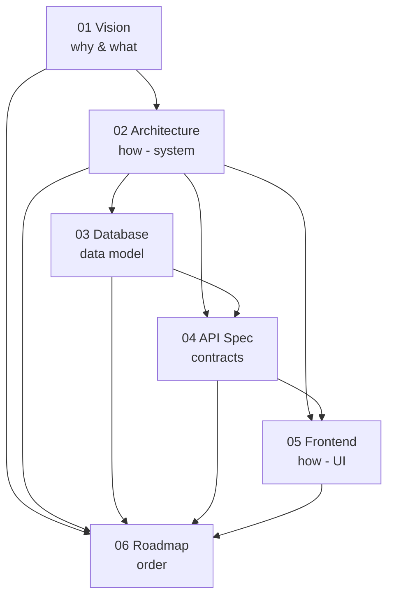

# 00 — Documentation Index

**Kindergarten Management System (KG-CRM)** — canonical project documentation.

This folder is the **single source of truth** for the project. Read the documents **in order**. Every design and implementation decision must be consistent with them. When a decision changes, the owning document is updated in the **same** change — never leave two documents disagreeing.

> **Purpose of this structure:** on large projects, context gets lost and decisions start contradicting each other across time and people. A numbered, single-source-of-truth doc set prevents that. Claude (and every developer) reads these before proposing or writing anything — see the root [`CLAUDE.md`](../CLAUDE.md) for the operating protocol.

---

## Reading Order

| # | Document | Answers the question | Read when |
|---|----------|----------------------|-----------|
| 00 | **[00_INDEX](./00_INDEX.md)** | Where is everything? | First. |
| 01 | **[01_Project_Vision](./01_Project_Vision.md)** | *Why* does this exist, and *what* must it do? | Before any design discussion. |
| 02 | **[02_Software_Architecture](./02_Software_Architecture.md)** | *How* is the system structured? (modules, layers, security, scalability) | Before touching structure, apps, or infra. |
| 03 | **[03_Database_Design](./03_Database_Design.md)** | *What* is the data model? (entities, relationships, constraints, indexes) | Before creating models/migrations or writing queries. |
| 04 | **[04_Backend_API_Specification](./04_Backend_API_Specification.md)** | *What* are the endpoints and contracts? | Before building/consuming any API. |
| 05 | **[05_Frontend_Architecture](./05_Frontend_Architecture.md)** | *How* is the React app structured and routed? | Before building any frontend feature. |
| 06 | **[06_Development_Roadmap](./06_Development_Roadmap.md)** | *In what order* do we build it? | Before planning a sprint or picking up work. |
| 07 | **[07_Radix_Intelligence](./07_Radix_Intelligence.md)** | *What* does Radix AI compute, from which rows, with what evidence — and what it deliberately is not? | Before touching insights, the nightly engine, or any "AI" claim in marketing. |

---

## Document Dependency Map

**Rule of precedence:** if two documents conflict, the **upstream** document wins (01 over 02 over 03 …), and the downstream document must be corrected. Cross-cutting technical decisions are recorded as **ADRs** in [02_Software_Architecture](./02_Software_Architecture.md) §2 and are considered *locked* unless a new ADR supersedes them.

---

## Locked Invariants (do not contradict without a new ADR)

These are the load-bearing decisions the whole system depends on. They are restated in [`CLAUDE.md`](../CLAUDE.md) so they are enforced every session.

1. **Modular monolith + service layer** — modules never touch each other's tables; they call services/selectors. ([02](./02_Software_Architecture.md) §2)
2. **`organization_id` + `branch_id` on every operational entity** — `organization` is the tenant/security boundary that **nothing** bypasses; `branch` is the operational scope. ([02](./02_Software_Architecture.md) ADR-9, [03](./03_Database_Design.md) §6)
3. **Money & stock are append-only ledgers** — balances/stock are *derived*, never overwritten. ([03](./03_Database_Design.md) §8, §13, §15)
4. **Debtors is a derived view, not a table.** ([03](./03_Database_Design.md) §13.7)
5. **Data-driven RBAC, deny-by-default, enforced on the backend.** Vendor (platform) access is a **separate plane**, not a stronger customer role. ([02](./02_Software_Architecture.md) §11, ADR-10)
6. **Versioned API-as-product with one response envelope & error format.** ([02](./02_Software_Architecture.md) §13, [04](./04_Backend_API_Specification.md))
7. **Feature-based frontend; TanStack Query owns server state.** ([05](./05_Frontend_Architecture.md))
8. **Subscription billing is its own domain with an append-only usage ledger** — every charge traces to an immutable `usage_snapshot`; it never shares tables with tuition `finance`. ([02](./02_Software_Architecture.md) ADR-11, [03](./03_Database_Design.md) §20)
9. **Integrity is enforced in the database** — FKs, `CHECK`s, unique/partial indexes, insert-only audit, and `ON DELETE RESTRICT` on every path from `organization`. ([03](./03_Database_Design.md) §21–§22)

---

## Change Log

| Version | Date | Change |
|---------|------|--------|
| 1.0 | 2026-07-24 | Initial documentation set established (01–06 + index). |
| 1.1 | 2026-09-17 | Added 07_Radix_Intelligence (V1 design, ADR-14). |
| 1.2 | 2026-09-18 | **Radix Intelligence V1 vertical slice shipped** (`payment_delay` end-to-end). [03 §20a](./03_Database_Design.md) `insight` table; [04 §14.3](./04_Backend_API_Specification.md) `/insights*`; [06 Sprint 12](./06_Development_Roadmap.md); [07 §4](./07_Radix_Intelligence.md) rule corrected to ledger-based debt with FIFO settlement (found by the integration test), §13.1 acceptance recorded. |
| 1.1 | 2026-07-29 | **Multi-tenant SaaS business model adopted.** New [01 §4](./01_Project_Vision.md) (pricing, payment terms, trial); **ADR-9** (`organization` is the tenancy root, superseding branch-as-tenancy-root), **ADR-10** (platform staff on a separate access plane; `Super Admin` removed in favour of `Org Owner`), **ADR-11** (subscriptions as a bounded module with an append-only usage ledger). [03 §6](./03_Database_Design.md) rewritten; [03 §20](./03_Database_Design.md) added; [04 §18–19](./04_Backend_API_Specification.md) added; [06](./06_Development_Roadmap.md) Sprint 0 gains tenancy, Sprints 10–11 added. |

### What changed and why (v1.1)

The product is sold as a hosted SaaS: one subscription per **kindergarten business**, covering unlimited branches, priced per enrolled child. The original design made **branch** the tenancy boundary, which cannot express that — a customer legitimately reads across their own branches, while no customer may ever read across organizations.

The correction was made **before any application code existed**, which is the only cheap moment for it. Adding `organization_id` to a model file is one line; adding it to twenty tables holding live data across paying customers, while auditing every endpoint for leaks, is the most expensive migration in SaaS.

*Keep this index current whenever a document is added or a locked invariant changes.*
