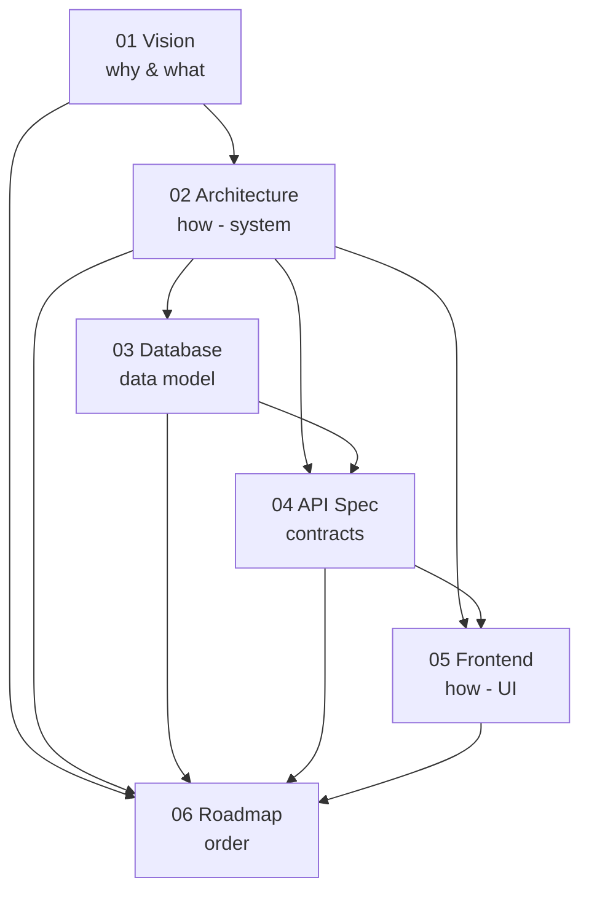

# 00 — Documentation Index

**Kindergarten Management System (KG-CRM)** — canonical project documentation.

This folder is the **single source of truth** for the project. Read the documents **in order**. Every design and implementation decision must be consistent with them. When a decision changes, the owning document is updated in the **same** change — never leave two documents disagreeing.

> **Purpose of this structure:** on large projects, context gets lost and decisions start contradicting each other across time and people. A numbered, single-source-of-truth doc set prevents that. Claude (and every developer) reads these before proposing or writing anything — see the root [`CLAUDE.md`](../CLAUDE.md) for the operating protocol.

---

## Reading Order

| # | Document | Answers the question | Read when |
|---|----------|----------------------|-----------|
| 00 | **[00_INDEX](./00_INDEX.md)** | Where is everything? | First. |
| 01 | **[01_Project_Vision](./01_Project_Vision.md)** | *Why* does this exist, and *what* must it do? | Before any design discussion. |
| 02 | **[02_Software_Architecture](./02_Software_Architecture.md)** | *How* is the system structured? (modules, layers, security, scalability) | Before touching structure, apps, or infra. |
| 03 | **[03_Database_Design](./03_Database_Design.md)** | *What* is the data model? (entities, relationships, constraints, indexes) | Before creating models/migrations or writing queries. |
| 04 | **[04_Backend_API_Specification](./04_Backend_API_Specification.md)** | *What* are the endpoints and contracts? | Before building/consuming any API. |
| 05 | **[05_Frontend_Architecture](./05_Frontend_Architecture.md)** | *How* is the React app structured and routed? | Before building any frontend feature. |
| 06 | **[06_Development_Roadmap](./06_Development_Roadmap.md)** | *In what order* do we build it? | Before planning a sprint or picking up work. |

---

## Document Dependency Map

**Rule of precedence:** if two documents conflict, the **upstream** document wins (01 over 02 over 03 …), and the downstream document must be corrected. Cross-cutting technical decisions are recorded as **ADRs** in [02_Software_Architecture](./02_Software_Architecture.md) §2 and are considered *locked* unless a new ADR supersedes them.

---

## Locked Invariants (do not contradict without a new ADR)

These are the load-bearing decisions the whole system depends on. They are restated in [`CLAUDE.md`](../CLAUDE.md) so they are enforced every session.

1. **Modular monolith + service layer** — modules never touch each other's tables; they call services/selectors. ([02](./02_Software_Architecture.md) §2)
2. **`branch_id` on every operational entity** — multi-branch is a config switch, not a rewrite. ([03](./03_Database_Design.md) §6)
3. **Money & stock are append-only ledgers** — balances/stock are *derived*, never overwritten. ([03](./03_Database_Design.md) §8, §13, §15)
4. **Debtors is a derived view, not a table.** ([03](./03_Database_Design.md) §13.7)
5. **Data-driven RBAC, deny-by-default, enforced on the backend.** ([02](./02_Software_Architecture.md) §11)
6. **Versioned API-as-product with one response envelope & error format.** ([02](./02_Software_Architecture.md) §13, [04](./04_Backend_API_Specification.md))
7. **Feature-based frontend; TanStack Query owns server state.** ([05](./05_Frontend_Architecture.md))

---

## Change Log

| Version | Date | Change |
|---------|------|--------|
| 1.0 | 2026-07-24 | Initial documentation set established (01–06 + index). |

*Keep this index current whenever a document is added or a locked invariant changes.*
