# Kindergarten Management System — Software Architecture Document (SAD)

| | |
|---|---|
| **Project** | Kindergarten Management System (KG-CRM) |
| **Architecture Style** | CRM + ERP + LMS (modular monolith, service-ready) |
| **Document Owner** | Chief Software Architect |
| **Status** | Draft v1.0 — pre-development, MVP scope |
| **Audience** | Backend, Frontend, DevOps, QA, Product |
| **Golden Rule** | Build for the MVP, but never make a decision that blocks a future module. |

> This document is the single source of truth for the system's structure. No models, serializers, views, or endpoints exist yet. Everything below describes **how the system is shaped**, **why each decision was made**, and **where every developer plugs in**. A developer joining tomorrow should be able to read this and start building without asking "where does this go?"

---

## Table of Contents

1. [Executive Summary](#1-executive-summary)
2. [Architectural Principles & Key Decisions](#2-architectural-principles--key-decisions)
3. [Overall System Architecture](#3-overall-system-architecture)
4. [Technology Stack Rationale](#4-technology-stack-rationale)
5. [Backend Folder Structure](#5-backend-folder-structure)
6. [Recommended Django Apps](#6-recommended-django-apps-and-why-each-exists)
7. [Frontend Folder Structure](#7-frontend-folder-structure)
8. [Recommended React Folders](#8-recommended-react-folders-and-why)
9. [Module Relationships](#9-module-relationships)
10. [Authentication Flow](#10-authentication-flow)
11. [Authorization — RBAC](#11-authorization--rbac)
12. [Database Architecture (Entities & Relationships)](#12-database-architecture-entities--relationships)
13. [API Architecture](#13-api-architecture)
14. [Frontend Architecture](#14-frontend-architecture)
15. [State Management Strategy](#15-state-management-strategy)
16. [File Storage](#16-file-storage)
17. [Notifications Architecture](#17-notifications-architecture)
18. [Background Jobs (Celery)](#18-background-jobs-celery)
19. [Caching Strategy (Redis)](#19-caching-strategy-redis)
20. [Security](#20-security)
21. [Performance](#21-performance)
22. [Scalability & Future Modules](#22-scalability--future-modules)
23. [Deployment & DevOps](#23-deployment--devops)
24. [Appendix: Naming Conventions & Standards](#24-appendix-naming-conventions--standards)

---

## 1. Executive Summary

The Kindergarten Management System is an internal business platform for kindergarten operators. It merges three classic enterprise domains:

- **CRM** — managing children, guardians, enrollment, and communication.
- **ERP** — managing money (payments, debts, payroll, expenses), inventory (kitchen & warehouse), and operations.
- **LMS** — the future learning layer (homework, meal planning, teacher/parent portals).

For the MVP we deliver an **administrative back-office**: staff log in and run the kindergarten. The public/parent-facing surfaces come later.

### Chosen architecture style: **Modular Monolith**

We deliberately **do not** start with microservices. At this stage microservices would add network latency, distributed-transaction complexity, and DevOps overhead with zero business benefit. Instead we build a **modular monolith**: one deployable Django application, internally split into strongly-bounded modules (Django apps) with clear contracts between them.

This gives us:

- **Speed now** — one repo, one deployment, one database, simple local dev.
- **Options later** — because modules are cleanly bounded and communicate through service layers (not by reaching into each other's tables), any module (e.g. Online Payments, Analytics) can be extracted into its own service when scale demands it.

The frontend is a **standalone React SPA** consuming a versioned REST API — fully decoupled from the backend, which keeps the door open for a future mobile app reusing the same API.

---

## 2. Architectural Principles & Key Decisions

Every decision in this document traces back to these principles.

| # | Principle | What it means in practice |
|---|-----------|---------------------------|
| P1 | **Modularity over cleverness** | Each business capability is a bounded module. No module reads another module's tables directly — it calls a service function or an API. |
| P2 | **Future-proof, not future-built** | We build only the MVP, but every boundary anticipates the roadmap (branches, portals, online payments). We add seams, not features. |
| P3 | **Separation of concerns (layered)** | API layer → Service layer → Data layer. Business logic lives in services, never in views or serializers. |
| P4 | **Explicit contracts** | Modules talk through documented service interfaces and typed API responses. Contracts are stable; internals are free to change. |
| P5 | **Security by default** | Every endpoint is authenticated and authorized unless explicitly public. Deny-by-default RBAC. |
| P6 | **Multi-branch aware from day one** | Every core entity carries a `branch` boundary. One subscription covers unlimited branches ([01 §4.1](./01_Project_Vision.md)). |
| P7 | **Auditability** | Money and children are sensitive. Every financial and administrative mutation is audit-logged. |
| P8 | **Idempotent & async where it matters** | Notifications, reports, and heavy aggregation run in background workers, never in the request/response cycle. |
| P9 | **The API is a product** | Versioned, consistent envelope, predictable errors. The mobile app and parent portal will be first-class consumers. |
| P10 | **Tenant isolation is absolute** | Every operational row carries `organization_id`. **No role — including the customer's own owner — can read across organizations.** Branch scoping is a business rule that some roles bypass; organization scoping is a security boundary that **nothing** bypasses. |
| P11 | **Metering is evidence, not a counter** | Every subscription charge traces to an immutable `usage_snapshot` that records what was counted, when, and how. A bill we cannot reconstruct is a bill we cannot defend. |

### Key Architectural Decision Records (condensed)

| ID | Decision | Alternatives considered | Why we chose it |
|----|----------|------------------------|-----------------|
| ADR-1 | Modular monolith | Microservices | Team size, single DB transactions for finance, faster MVP. Extraction path preserved via service layer. |
| ADR-2 | Service layer pattern | Fat models / fat views | Business logic testable in isolation; modules decoupled; avoids "God model." |
| ADR-3 | JWT (access + refresh) | Django session auth | SPA + future mobile need stateless, cross-client auth. |
| ADR-4 | Custom User + separate Role model | Django Groups only | Business roles ≠ Django groups; we need a role matrix, branch scoping, and UI-driven role management. |
| ADR-5 | PostgreSQL as single OLTP store | MySQL / Mongo | Strong relational integrity for finance, JSONB flexibility for settings, mature ecosystem. |
| ADR-6 | Redis for cache + Celery broker | RabbitMQ, DB-backed cache | One infra component serves caching, sessions, rate-limit counters, and task queue. |
| ADR-7 | Debtors as a *derived* domain | Debtors as a stored table | A debtor is a computed state of the finance ledger, not a separate entity — avoids data duplication and drift. |
| ADR-8 | Frontend SPA (Vite + React) | Django templates / SSR | Rich internal dashboard UX, decoupled from API, reusable by mobile. |
| **ADR-9** | **`organization` is the tenancy root; `branch` sits inside it** | Branch as tenancy root (original design); schema-per-tenant; DB-per-tenant | The product is sold per **organization**, and one subscription covers unlimited branches ([01 §4](./01_Project_Vision.md)). Branch cannot be the tenancy root because a customer legitimately reads across their own branches. Shared-schema row scoping keeps cross-branch reporting trivial and can graduate to RLS/partitioning without a data migration. **Supersedes the branch-as-tenancy-root model in [03 §6](./03_Database_Design.md).** |
| **ADR-10** | **Platform staff live outside the customer RBAC matrix** | Add a "Platform Admin" row to the existing role matrix | The original **Super Admin** was defined as bypassing all scoping. In a multi-tenant system that role, granted to a customer, would expose every other customer's children. Vendor access is a *different kind of subject* with a different auth path, mandatory audit, and no implicit data access — not a stronger customer role. |
| **ADR-11** | **Subscription billing is its own bounded module with an append-only usage ledger** | Reuse the `finance` app; compute charges on demand at invoice time | Vendor→customer billing and kindergarten→parent billing share vocabulary but nothing else ([01 §4.6](./01_Project_Vision.md)); merging them would corrupt both. Charges derive from immutable `usage_snapshot` rows (P11) so any invoice can be reconstructed and defended months later — the same discipline as ADR-7's ledger. |
| **ADR-12** | **Pricing revised at launch: 400 000 UZS base / +50 000 per 10 (Radix CRM rebrand)** | Keep the original 500 000 / +80 000 figures | Confirmed by the founder on 2026-09-16, alongside the public rebrand to Radix CRM. Applied as a **new dated `SubscriptionPlan` version** (`0003_radix_pricing`, effective 2026-09-14), not an edit to the existing row — the original plan is closed with `valid_to`, so subscriptions already billed under it keep their historical figures untouched ([03 §20.1](./03_Database_Design.md)). This is the mechanism ADR-11's immutable-ledger discipline exists to support: a price change is a new fact, not a rewrite of history. |
| **ADR-13** | **Two delivery models, one codebase: `DEPLOYMENT_MODE` = `saas` \| `standalone`** | Fork the repo into a separate single-tenant product; maintain two branches; strip the `subscriptions` app for on-premise builds | The product is now sold two ways ([01 §4.7](./01_Project_Vision.md)): hosted subscription, or a **one-off licence deployed on the customer's own server**. A fork was rejected on maintenance grounds — 40 000 lines duplicated means every fix applied twice, and the two copies diverge within weeks, which a solo-founder team cannot carry. `standalone` instead **disables what does not apply**: `SubscriptionWriteGate` opens unconditionally, no trial subscription is created at registration, `billing`/`platform`/`public` routes are never registered, the marketing site and vendor console are dropped from the router, and the tenant address collapses from `/t/<slug>` to the install root. **The flag is a commercial boundary, never a security one** — `organization_id` scoping and RLS behave identically in both modes (CLAUDE.md invariants 2 and 8), so a standalone database that later holds a second kindergarten is still correctly isolated. |
| **ADR-15** | **Platform-console 2FA is a deployment switch (`PLATFORM_2FA_REQUIRED`), default off** | Keep TOTP mandatory (ADR-10 as written); delete the TOTP code entirely | The owner decided on 2026-09-22 that an Authenticator code on every vendor sign-in is friction he does not want while he is the only vendor user. ADR-10's *separation* is untouched — vendor accounts still live in `platform_user`, sign in on their own endpoint, get a token bound to the platform plane, and are audited on every call; only the second factor becomes optional. Deleting the TOTP machinery was rejected because it is small, tested, and the day a second vendor employee or a security review arrives, turning it back on must be a one-line `.env` change, not a rewrite. When the switch is on, a login without a `code` answers `401 TOTP_REQUIRED` **before** the password is checked, so the reply never becomes a password oracle; the login page shows the code field only after that reply — the frontend never has to know the server's setting. Secrets are still generated and stored for every account, so enabling 2FA later never locks anyone out. |
| **ADR-16** | **Three product languages (uz / ru / en) with Uzbek as the source language; translation is a pure lookup keyed by the source string, chosen per browser and sent to the API as `Accept-Language`** | i18n keys (`children.title`) with JSON files per language; a React i18n context with live switching; storing the language on the user record; translating the platform console too | Decided 2026-09-22 when the founder asked for the website and every customer dashboard (`/t/<slug>` and `/private`) to work in all three languages. **Source-string keys**: the code stays readable Uzbek (`t('Bola qo‘shish')`), a missing translation degrades to the source instead of a key or `undefined`, and a catalog-completeness test (`lib/i18n/__tests__/catalog.test.ts`, `apps/core/tests/test_i18n.py`) fails the build when any wrapped string lacks a `ru`/`en` entry or its `{placeholders}` differ — the same guarantee as extracted keys, without inventing 800 identifiers. **Reload on switch**: the locale is read once at boot (`localStorage` `kg-crm.locale`, default `uz`) and `setLocale()` reloads the page, so `t()` is a plain function usable in module-level constants (status labels, nav) with no provider, no re-render bookkeeping and no boot-order bugs; only the active catalog is loaded (`uz` loads none). **Per browser, not per user**: the choice follows the device the person is working on and needs no migration or profile endpoint; the backend learns it per request from `Accept-Language` (Django `LocaleMiddleware`, `gettext` on every user-facing message, `.po` under `backend/locale/`, compiled in the Docker build). The public site keeps its own content layer (`features/landing/content.ts`, `/uz` `/ru` `/en` with `hreflang`) because it is prerendered and SEO-addressed; the vendor console stays Uzbek-only by decision — one operator, no customer-facing text. Tenant *data* (role names, categories, SMS templates) is never translated: it belongs to the customer. |
| **ADR-14** | **Radix Intelligence is a deterministic rules engine over tenant data, not an ML model** | Call an external LLM API; self-host an open-weight LLM; train a model on customer data | The product promise is *"Radix finds what the director would miss"* — that needs correct signals with evidence, not generated text. With zero paying customers there is no ground truth to train on, and standalone installs (ADR-13) run on CPU-only servers the vendor does not control. V1 ([07](./07_Radix_Intelligence.md)) therefore computes insights nightly from the tenant's own rows with pure rule functions, stores each as an `insight` row (RLS, invariants 2/8) carrying a **frozen evidence snapshot** of numbers and ids — never names or phones — (the ADR-11 discipline) and a deep link into the existing UI. One **open row per condition** (partial unique index), refreshed nightly while the condition holds and closed as `auto_resolved` when it disappears, so a persisting problem is one ageing row, never thirty; a dismissal suppresses that condition for seven days, and a condition that vanishes and returns is a new row — history is rows, never state flips. Language is factual — never predictive. An LLM enters only in V3, and only to *narrate* structured insights it is handed, never to query the database. |

---

## 3. Overall System Architecture

### 3.1 High-Level (C4 — System Context)

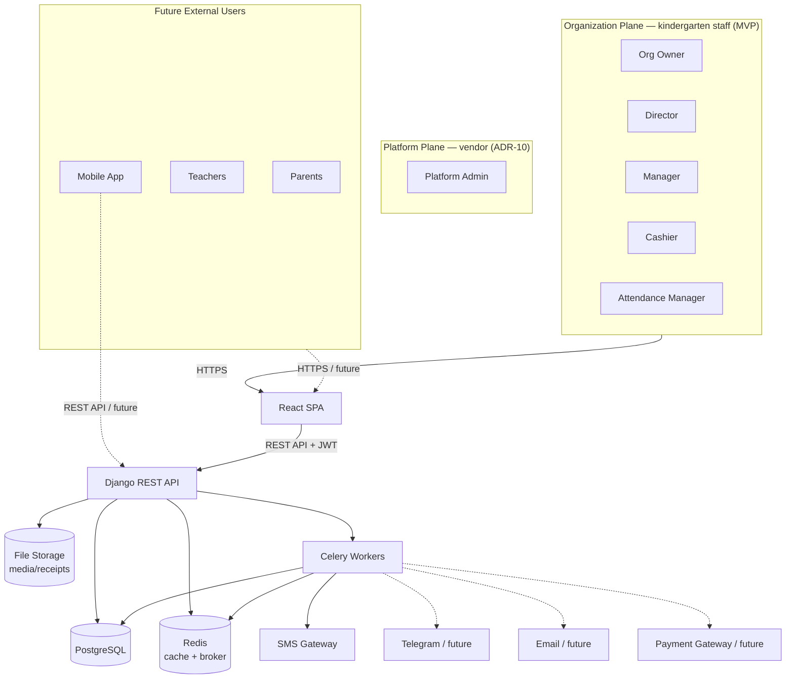

### 3.2 Deployment / Runtime Topology

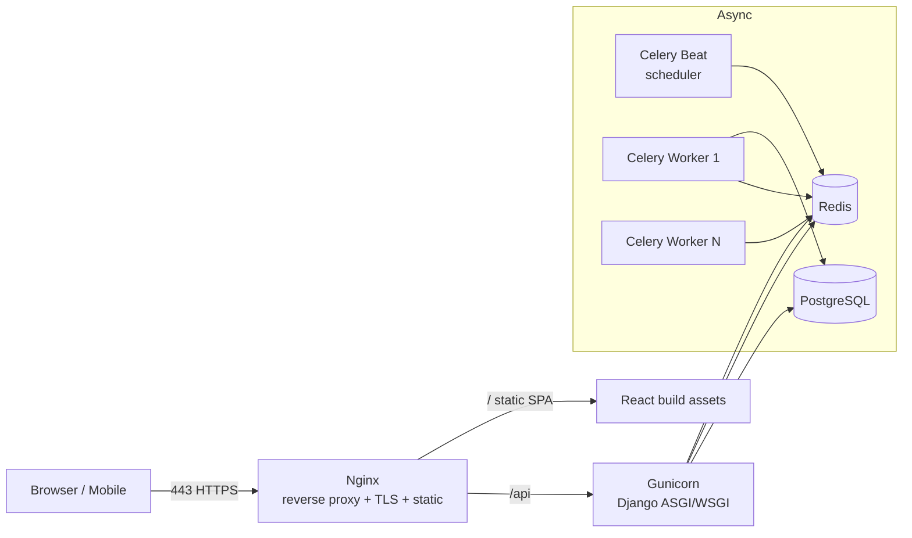

**Runtime components:**

| Component | Responsibility | Scaling model |
|-----------|----------------|---------------|
| **Nginx** | TLS termination, reverse proxy, gzip, serving SPA static build, rate limiting (edge), request buffering | Vertical; add instances behind LB later |
| **Gunicorn + Django** | Stateless API workers | Horizontal — add worker processes/containers |
| **PostgreSQL** | System of record | Vertical first, then read replicas |
| **Redis** | Cache, Celery broker/result backend, rate-limit & lock store | Vertical, then Redis cluster |
| **Celery Workers** | Async jobs (SMS, reports, aggregation) | Horizontal — add workers per queue |
| **Celery Beat** | Cron-like scheduler (daily debt recalculation, reminders) | Single instance (leader) |

### 3.3 Logical Layered Architecture (inside the backend)

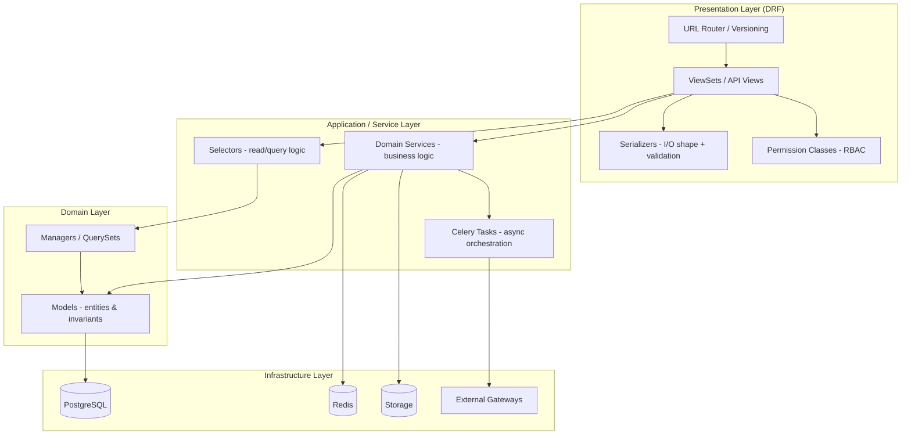

**The rule:** Views orchestrate, Serializers shape & validate I/O, **Services own business logic**, Selectors own reads, Models own data + invariants. This is the backbone of P3 and the reason the system stays maintainable as modules multiply.

---

## 4. Technology Stack Rationale

### Backend

| Technology | Role | Why it's here |
|-----------|------|---------------|
| **Python 3.12+** | Language | Ecosystem, hiring, data/AI-readiness (future AI Assistant). |
| **Django** | Web framework | Batteries-included: ORM, migrations, admin, auth scaffolding. Accelerates ERP-style CRUD. |
| **Django REST Framework** | API framework | Serialization, viewsets, permissions, browsable API, pagination. |
| **PostgreSQL** | Primary DB | ACID for finance, foreign keys, partial indexes, JSONB for flexible settings, window functions for reports. |
| **Redis** | Cache + broker | Multi-purpose: caching, Celery broker, rate limiting, distributed locks. |
| **Celery** | Task queue | Async SMS, report generation, scheduled debt recalculation, reminders. |
| **JWT (SimpleJWT)** | Auth tokens | Stateless auth for SPA + future mobile. |
| **Gunicorn** | App server | Production WSGI server, multi-worker. |
| **Nginx** | Reverse proxy | TLS, static serving, buffering, edge rate limiting. |
| **Docker** | Packaging | Reproducible environments, parity dev↔prod. |

### Frontend

| Technology | Role | Why it's here |
|-----------|------|---------------|
| **React + TypeScript** | UI + type safety | Component model + compile-time contracts against the API. |
| **Vite** | Build/dev server | Instant HMR, fast builds. |
| **Tailwind CSS** | Styling | Utility-first, consistent design system, no CSS sprawl. |
| **Shadcn/UI** | Component library | Accessible, unstyled-but-themable primitives we own (copied into repo, not a black-box dependency). |
| **TanStack Query** | Server state | Caching, background refetch, mutations, invalidation — the heart of data flow. |
| **React Hook Form + Zod** | Forms + validation | Performant forms; Zod schemas mirror backend validation and infer TS types. |
| **React Router** | Routing | Nested layouts, protected/role-based routes. |
| **Axios** | HTTP client | Interceptors for JWT attach/refresh, centralized error handling. |
| **Recharts** | Charts | Dashboard & reports visualizations. |
| **Framer Motion** | Animation | Polished transitions, professional feel. |

---

## 5. Backend Folder Structure

A **`src`-less, project-in-root** layout with a dedicated `apps/` package. Everything under `apps/` is a bounded module; everything under `config/` is deployment glue.

```
backend/
├── config/                      # Project configuration (NOT a business app)
│   ├── __init__.py
│   ├── settings/
│   │   ├── base.py              # Shared settings
│   │   ├── development.py       # Local overrides
│   │   ├── production.py        # Prod overrides
│   │   └── test.py              # Test overrides
│   ├── urls.py                  # Root URL conf → includes /api/v1/...
│   ├── asgi.py
│   ├── wsgi.py
│   └── celery.py                # Celery app instance & autodiscovery
│
├── apps/                        # ALL business modules live here
│   ├── core/                    # Shared kernel (base classes, mixins, utils)
│   ├── organizations/           # TENANCY ROOT — the customer entity (ADR-9)
│   ├── subscriptions/           # Plans, subscriptions, usage metering, vendor invoices (ADR-11)
│   ├── platform/                # Vendor-side console & platform staff (ADR-10)
│   ├── accounts/                # Users, auth, roles, RBAC
│   ├── branches/                # Branch — operational scope inside an organization
│   ├── children/                # Children, guardians, groups, enrollment
│   ├── attendance/              # Daily attendance
│   ├── finance/                 # Payments, invoices, tariffs, debtors (derived)
│   ├── hr/                      # Employees / staff records
│   ├── payroll/                 # Salaries, payroll runs, payslips
│   ├── inventory/               # Kitchen & warehouse: products, stock, suppliers
│   ├── expenses/                # Operational expenses
│   ├── reports/                 # Report generation & aggregation
│   ├── notifications/           # SMS/Telegram/Email dispatch
│   ├── settings_app/            # System-wide configurable settings
│   └── audit/                   # Audit log (cross-cutting)
│
├── api/                         # API composition root
│   └── v1/
│       └── router.py            # Aggregates all app routers under /api/v1/
│
├── requirements/
│   ├── base.txt
│   ├── development.txt
│   └── production.txt
│
├── manage.py
├── Dockerfile
├── docker-compose.yml           # dev: web, db, redis, worker, beat
├── .env.example
├── pytest.ini
└── README.md
```

### Internal structure of **every** app (the standard we enforce)

Consistency is a feature. Every app under `apps/` follows the **same** internal shape, so any developer can navigate any module instantly:

```
apps/finance/
├── __init__.py
├── apps.py                  # AppConfig
├── models.py                # Entities & invariants (or models/ package if large)
├── managers.py              # Custom QuerySets/Managers (read helpers)
├── services.py              # Business logic — the ONLY place mutations happen
├── selectors.py             # Read/query functions for the API to consume
├── serializers.py           # DRF I/O shaping + validation
├── permissions.py           # Module-specific RBAC permission classes
├── views.py                 # ViewSets/APIViews — thin orchestration only
├── urls.py                  # Module router
├── tasks.py                 # Celery tasks for this module
├── filters.py               # django-filter FilterSets
├── constants.py             # Enums, choices, status codes
├── signals.py               # Domain events (used sparingly, explicitly)
├── admin.py                 # Django admin registration
├── migrations/
└── tests/
    ├── test_services.py
    ├── test_api.py
    └── factories.py
```

> **Why this rigid uniformity?** Onboarding speed and reviewability. When `services.py` is *always* where logic lives and `selectors.py` is *always* where reads live, code review, testing, and debugging become mechanical. It also prevents the two classic Django decay patterns: fat views and fat models.

---

## 6. Recommended Django Apps (and why each exists)

Modules map to apps, but **not 1:1** — some UI modules are *views* over a shared domain (e.g. Debtors is a lens on Finance; Dashboard is an aggregation over everything). Below is the definitive mapping.

| Django App | Backs UI Module(s) | Responsibility | Why it exists as its own app |
|-----------|-------------------|----------------|------------------------------|
| **core** | (none — shared) | Base model (`created_at`, `updated_at`, `is_active`, `organization`, `branch`), mixins, pagination, exceptions, common utils, base permissions, **the tenant-scoping queryset mixin** | A shared kernel prevents copy-paste and enforces cross-cutting concerns (soft delete, timestamps, org + branch scoping) in one place. Tenant scoping lives here so it is inherited, not re-implemented per app (P10). |
| **organizations** | (implicit in every module) | The `organization` entity — the tenancy root; onboarding/signup; org-level profile and legal-entity details | The customer is the billing and isolation boundary (ADR-9). Every other app's rows point here. Kept minimal and separate from `subscriptions` so *who the customer is* stays independent of *what they pay*. |
| **subscriptions** | Billing & Subscription | Subscription plans, an organization's subscription, trial lifecycle, per-child usage metering, subscription invoices & payments | Vendor→customer money is a distinct domain from tuition (ADR-11). Isolating it prevents the two "invoice" concepts from bleeding into each other and keeps the usage ledger auditable (P11). |
| **platform** | Platform Console (vendor-only) | Platform staff identity, cross-organization console, trial/suspension operations, platform-level audit | Vendor access is not a customer role (ADR-10). A separate app means the cross-tenant capability lives in exactly one auditable place instead of being a flag scattered through business apps. |
| **accounts** | Users & Roles, Auth | Custom User, authentication, Role, Permission, role assignment, JWT issuance | Identity is foundational and security-sensitive; it must be isolated and hardened. |
| **branches** | Branches, Settings (branch) | Branch entity; the operational scope inside an organization | Branch drives staff scope, reporting, and invoice numbering. It is **not** the tenancy boundary (ADR-9) — an organization's own roles legitimately read across their branches. |
| **children** | Children | Child profiles, guardians, child↔guardian links, groups/classes, enrollment lifecycle | The CRM core. Central entity referenced by attendance, finance, and future portals. |
| **attendance** | Attendance | Daily attendance records, check-in/out, absence reasons | High-write, date-partitioned domain with its own reporting needs; kept separate for performance isolation. |
| **finance** | Payments, Debtors | Tariffs/plans, invoices, invoice lines, payments, discounts, the financial **ledger** | Money is the ERP heart. All balances/debts are derived from one consistent ledger — no duplicated "debt" tables (ADR-7). |
| **hr** | Payroll (staff data), future Teacher Portal | Employee records, positions, employment status | Employees are distinct from Users (not every employee logs in; not every user is paid). Separation avoids polluting the auth model. |
| **payroll** | Payroll | Salary structures, payroll runs, payslips, bonuses/deductions | Payroll cycles and calculations are complex and periodic; isolating them keeps HR clean and payroll auditable. |
| **inventory** | Kitchen & Warehouse | Products/items, categories, stock levels, stock movements (in/out), suppliers | Classic ERP inventory; foundation for future Meal Planning (recipes consume stock). |
| **expenses** | Expenses | Expense categories, expense records, approval state | Operational spend tracked separately from payroll and inventory for clean P&L reporting. |
| **reports** | Reports, Dashboard | Aggregation, report definitions, export generation (PDF/Excel), snapshotting | Reporting reads across modules; centralizing it prevents each module from growing ad-hoc aggregation code. |
| **notifications** | Notifications | Templates, channels (SMS now; Telegram/Email later), delivery log, dispatch orchestration | A channel-agnostic notification hub so new channels are plug-ins, not rewrites (P2). |
| **settings_app** | Settings | System settings (JSONB key-value), tariff config, feature flags | Runtime configuration without redeploys; feature flags gate future modules. |
| **audit** | (cross-cutting; surfaced in Reports/Settings) | Immutable audit log of who did what, when, to which record | Compliance and traceability for money/children (P7). Cross-cutting, so it's its own app. |

> **Note on Dashboard:** It is **not** a Django app. It is a read-only aggregation surface served by `reports` selectors (and cached). Building it as its own app would create a module that owns no data but reaches into every other module — an anti-pattern. Instead the Dashboard composes cached selector outputs.

---

## 7. Frontend Folder Structure

**Feature-based (not type-based)** architecture. Code is grouped by business feature, mirroring backend modules, with a shared foundation. This is the single most important frontend decision for scalability: adding a module means adding a folder, touching nothing else.

```
frontend/
├── public/
├── src/
│   ├── app/                      # App shell & providers
│   │   ├── App.tsx
│   │   ├── router.tsx            # Route tree (public / protected / role-based)
│   │   └── providers/            # QueryClient, Auth, Theme, Toast providers
│   │
│   ├── components/               # Shared, feature-agnostic UI
│   │   ├── ui/                   # Shadcn/UI primitives (button, dialog, table…)
│   │   ├── layout/               # Sidebar, Topbar, PageHeader, shells
│   │   ├── data-display/         # DataTable, StatCard, Chart wrappers
│   │   └── feedback/             # Spinners, EmptyState, ErrorBoundary
│   │
│   ├── features/                 # ONE folder per business module
│   │   ├── dashboard/
│   │   ├── children/
│   │   ├── payments/
│   │   ├── debtors/
│   │   ├── attendance/
│   │   ├── payroll/
│   │   ├── inventory/
│   │   ├── expenses/
│   │   ├── reports/
│   │   ├── notifications/
│   │   ├── settings/
│   │   └── users/
│   │
│   ├── lib/                      # Framework-level utilities
│   │   ├── api/
│   │   │   ├── client.ts         # Axios instance + interceptors (JWT/refresh)
│   │   │   ├── queryClient.ts    # TanStack Query config
│   │   │   └── endpoints.ts      # Central endpoint constants
│   │   ├── auth/                 # Token storage, auth helpers
│   │   ├── utils/                # formatters, date, currency, cn()
│   │   └── validation/           # Shared Zod schemas & helpers
│   │
│   ├── hooks/                    # Global reusable hooks (useDebounce, useMediaQuery)
│   ├── config/                   # Env config, route constants, RBAC map
│   ├── types/                    # Global TS types (ApiResponse, Paginated<T>)
│   ├── styles/                   # Tailwind base, globals
│   └── main.tsx                  # Entry point
│
├── index.html
├── vite.config.ts
├── tailwind.config.ts
├── tsconfig.json
├── .env.example
└── package.json
```

### Internal structure of **every** feature (the standard)

```
features/payments/
├── api/                  # Query & mutation hooks (TanStack Query) for this feature
│   ├── usePayments.ts
│   ├── usePaymentDetail.ts
│   └── useCreatePayment.ts
├── components/           # Feature-specific components
│   ├── PaymentTable.tsx
│   ├── PaymentForm.tsx
│   └── PaymentFilters.tsx
├── pages/                # Route-level screens
│   ├── PaymentsListPage.tsx
│   └── PaymentDetailPage.tsx
├── schemas/              # Zod schemas (form + response validation)
│   └── payment.schema.ts
├── types/                # TypeScript types for this feature
│   └── payment.types.ts
├── hooks/                # Feature-local hooks
└── index.ts             # Public exports (barrel) — the feature's contract
```

> **Why feature-based?** Type-based folders (`/components`, `/pages`, `/hooks` globally) collapse under growth — every change touches five distant folders. Feature-based keeps a module's code **co-located and cohesive**, mirrors the backend, and makes deleting or extracting a feature trivial. The `index.ts` barrel makes each feature's public surface explicit (P4).

---

## 8. Recommended React Folders (and why)

| Folder | What lives here | Why it exists |
|--------|-----------------|---------------|
| **app/** | App shell, router, global providers | Single composition root; keeps `main.tsx` trivial and providers ordered in one visible place. |
| **app/providers/** | `QueryClientProvider`, `AuthProvider`, `ThemeProvider`, toast | Provider nesting is error-prone; centralizing it prevents "why is my context undefined" bugs. |
| **components/ui/** | Shadcn primitives | We **own** these primitives (copied in), so they're versioned with our app and themeable. |
| **components/layout/** | Sidebar, Topbar, page shells | Layout is shared across all features; duplicating it per feature would fracture the UX. |
| **components/data-display/** | `DataTable`, `StatCard`, chart wrappers | Reusable presentation used by many features; standardizes tables/cards/charts once. |
| **components/feedback/** | Spinner, EmptyState, ErrorBoundary | Consistent loading/error/empty states across the app — a hallmark of enterprise polish. |
| **features/** | One folder per business module | The core of scalability: features are self-contained and mirror backend apps (P1, P2). |
| **features/\*/api/** | TanStack Query hooks | Data-fetching lives beside the feature that uses it; the only place server state is defined. |
| **features/\*/schemas/** | Zod schemas | Validation + inferred types in one place; mirrors backend serializer validation. |
| **lib/api/** | Axios client, interceptors, query client | One HTTP entry point → one place for auth headers, token refresh, and error normalization. |
| **lib/auth/** | Token storage & helpers | Isolates the sensitive auth mechanics; swapping storage strategy touches one folder. |
| **lib/utils/** | Formatters (currency, date), `cn()` | Pure helpers shared everywhere; no business logic. |
| **hooks/** | Global hooks (`useDebounce`, `useMediaQuery`) | Cross-feature behavior that isn't tied to any module. |
| **config/** | Env, route constants, RBAC route map | Configuration and the role→route map live in one auditable place. |
| **types/** | Global types (`ApiResponse<T>`, `Paginated<T>`) | The shared shape of the API envelope, used by every feature. |

---

## 9. Module Relationships

Modules are bounded, but they **collaborate**. The map below shows who reads from / writes to / notifies whom. Arrows are **directional dependencies** (A → B means "A depends on / calls B").

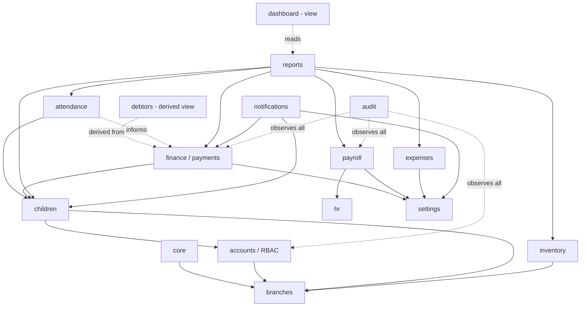

### Relationship table (the contracts)

| From | To | Interaction | Mechanism |
|------|----|-------------|-----------|
| attendance | children | Reads child/group to record attendance | Service call / FK |
| finance | children | Invoices belong to a child | FK + service |
| finance | settings | Reads active tariff/discount config | Selector |
| debtors | finance | Debtor list = children with positive outstanding balance | **Selector over finance ledger** (no own tables) |
| attendance | finance | Absence may affect billing (future rule engine) | Domain event (signal) → service |
| payroll | hr | Payroll runs over employees | Service call / FK |
| notifications | finance | "Payment received" / "debt reminder" triggers | Domain event → Celery task |
| notifications | children | Resolve guardian contact for messaging | Selector |
| reports | (all) | Aggregates across modules | **Read-only selectors** — never writes |
| dashboard | reports | Cached KPI aggregation | Selector + Redis cache |
| audit | finance/accounts/payroll | Records every mutation | Signals / service-layer hooks |

> **Enforced rule (P1):** cross-module communication happens through **service functions, selectors, or domain events** — never by importing and querying another app's models directly from a view. `reports` is the only broad reader, and it is **read-only**. This is what lets us later extract, e.g., `finance` into a separate service.

---

## 10. Authentication Flow

**Stateless JWT** using access + refresh tokens (SimpleJWT). Access tokens are short-lived; refresh tokens are long-lived and rotated.

### 10.1 Login & token lifecycle

```mermaid
sequenceDiagram
    participant U as User
    participant SPA as React SPA
    participant API as Django API
    participant DB as PostgreSQL
    participant R as Redis

    U->>SPA: Enter credentials
    SPA->>API: POST /api/v1/auth/login {email, password}
    API->>DB: Verify credentials
    API->>API: Load user + role + permissions
    API-->>SPA: 200 { access (15m), refresh (7d), user profile }
    SPA->>SPA: Store access in memory; refresh in httpOnly cookie / secure store
    SPA->>API: GET /api/v1/children (Authorization: Bearer access)
    API->>API: Validate JWT + check permission
    API-->>SPA: 200 data

    Note over SPA,API: Access token expires
    SPA->>API: request → 401 (token expired)
    SPA->>API: POST /api/v1/auth/refresh {refresh}
    API->>R: Check refresh not blacklisted
    API-->>SPA: 200 { new access, rotated refresh }
    SPA->>API: retry original request
```

### 10.2 Token strategy & rationale

| Token | Lifetime | Stored where | Purpose |
|-------|----------|--------------|---------|
| **Access** | ~15 min | In-memory (JS) | Sent as `Authorization: Bearer` on every request. Short life limits theft window. |
| **Refresh** | ~7 days | httpOnly, Secure, SameSite cookie (preferred) | Obtains new access tokens; rotated on each use; blacklisted on logout. |

**Frontend handling (Axios interceptors):**
- **Request interceptor** attaches the access token.
- **Response interceptor** catches `401`, calls `/auth/refresh` **once**, queues concurrent failed requests, retries them after refresh, and on refresh failure → force logout + redirect to `/login`.

**Logout:** refresh token is **blacklisted** in Redis; frontend clears in-memory access token and cookie.

**Endpoints (contract):**
```
POST /api/v1/auth/login       → issue tokens
POST /api/v1/auth/refresh     → rotate access (+refresh)
POST /api/v1/auth/logout      → blacklist refresh
GET  /api/v1/auth/me          → current user profile + role + permissions
POST /api/v1/auth/password/change
```

> The frontend loads `/auth/me` on boot to hydrate the auth context (role, permissions, branch) which drives **role-based routing and UI gating**.

---

## 11. Authorization — RBAC

Authorization is **role-based, deny-by-default, and enforced on the backend** (the frontend only *hides* what the backend *forbids*). We use a **custom Role + Permission model**, not raw Django groups (ADR-4), because roles are business concepts, are branch-scoped, and are managed through the UI.

### 11.0 Two access planes (ADR-10)

Authorization operates on **two planes that never merge**:

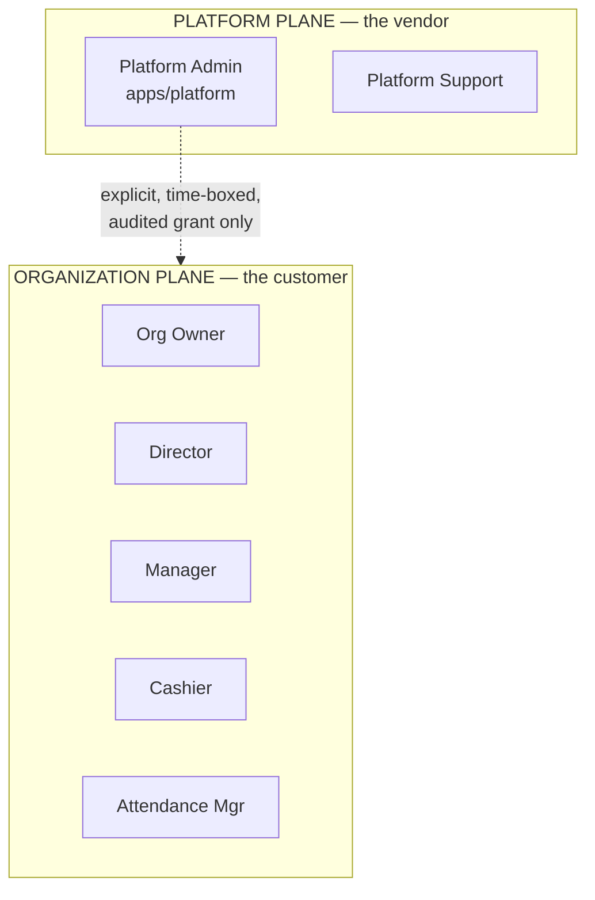

| | Platform plane | Organization plane |
|---|---|---|
| Who | Vendor staff | Kindergarten staff |
| Lives in | `apps/platform`, separate table | `accounts.User` + `accounts.Role` |
| Login path | Separate endpoint; TOTP when `PLATFORM_2FA_REQUIRED` is on (ADR-15, default off) | Standard `/auth/login` |
| Data access | **None by default.** Sees organization *metadata* (name, plan, status, child count) — never children, payments, or payroll. | Full access to their own organization, per role |
| Cross-organization | Yes, metadata only | **Never, under any role** |

> **The rule that makes this safe:** `organization_id` scoping is applied by the **base queryset**, and platform staff are not exempt from it — they simply have no organization. Reading a customer's operational data requires an explicit, time-boxed, customer-visible support grant that is written to the audit log. There is no "god flag" that silently unlocks tenant data.

### 11.1 Organization roles

> **`Super Admin` no longer exists.** It was defined as bypassing all scoping, which in a multi-tenant system would expose every customer's data to whoever held it. It is replaced by **Org Owner** (customer, org-scoped) and **Platform Admin** (vendor, different plane) — ADR-10.

| Role | Scope | Description |
|------|-------|-------------|
| **Org Owner** | All branches **of their own organization** | Full control of their organization: Users & Roles, Settings, Billing & Subscription, all financial and operational data across their branches. Cannot see any other organization — this is enforced, not conventional. |
| **Director** | Branch (all modules) | Full operational visibility & control within a branch: children, finance, payroll, inventory, expenses, reports. Cannot manage system-level settings/roles beyond their branch. |
| **Manager** | Branch (operations) | Day-to-day operations: children, attendance oversight, inventory/kitchen, expenses. Limited financial write; read reports. No payroll, no role management. |
| **Cashier** | Branch (finance) | Payments intake, invoices, debtor follow-up. Read children. No payroll, no settings, no user management. |
| **Attendance Manager** | Branch (attendance) | Records and manages daily attendance. Read-only children. No finance, payroll, or settings. |

### 11.2 Permission matrix (MVP)

Legend: **F** = Full (CRUD), **W** = Create/Update, **R** = Read-only, **—** = No access.

| Module | Org Owner | Director | Manager | Cashier | Attendance Mgr |
|--------|:---------:|:--------:|:-------:|:-------:|:--------------:|
| Dashboard | F | F | R | R | R |
| Children | F | F | W | R | R |
| Payments | F | F | R | F | — |
| Debtors | F | F | R | W | — |
| Attendance | F | F | W | — | F |
| Payroll | F | F | — | — | — |
| Kitchen & Warehouse | F | F | F | — | — |
| Expenses | F | F | W | R | — |
| Reports | F | F | R | R (finance only) | R (attendance only) |
| Notifications | F | F | W | W (payment/debt) | — |
| Settings | F | R | — | — | — |
| **Branches** | **F** | **R** | **—** | **—** | **—** |
| **Billing & Subscription** | **F** | **—** | **—** | **—** | **—** |
| Users & Roles | F | R (branch) | — | — | — |
| Audit Log | F | R | — | — | — |

> **Billing is Org Owner only.** A Director who can see the subscription invoice can infer the vendor's pricing for every branch; more importantly, changing the payment term is a commercial commitment for the legal entity, not a branch operation.

**This matrix is the seeded starting point, not a permanent constraint.** It is written to each organization's `role`/`role_permission` rows at signup (`seed_system_roles`, which runs once per organization and is never re-applied). From there the **Org Owner may re-assign any permission to any role — system roles included — and may create additional roles**, because kindergartens divide work differently: in one, the cashier also marks attendance; in another, they must not.

Two rails keep that freedom safe:

| Rail | Rule | Why |
|------|------|-----|
| **Owner lockout** | The `org_owner` role must always keep `users.read` and `users.update` (`OWNER_LOCKED_PERMISSIONS`); removing them returns `422`. | Roles are edited only by someone holding `users.update`. Dropping it would leave the tenant permanently unable to fix any role — recoverable only through a vendor `SupportGrant` (ADR-10). |
| **System role codes are immutable** | A system role can be renamed and re-permissioned, but its `code` cannot change, and it cannot be deleted. | Code paths key off the code (e.g. `role.code != "org_owner"` decides whether a branch is required). Renaming it would break permission logic silently. |

Custom roles carry `is_system = false`, get a normalized `code` (`"Kassir yordamchisi"` → `kassir_yordamchisi`, unique per organization), and may be deleted.

### 11.3 How it's enforced

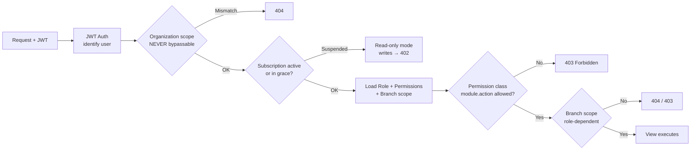

- **Permission model:** `permission = "<module>.<action>"` e.g. `payments.create`, `children.read`. Roles hold a set of permissions.
- **DRF Permission classes** in each app's `permissions.py` check `module.action` against the user's role.
- **Organization scoping (P10):** the base queryset mixin filters **every** query by the authenticated user's `organization_id`. This is applied first, before any permission logic, and **no role bypasses it**. A cross-organization reference returns `404`, never `403` — a `403` would confirm the row exists in another tenant.
- **Branch scoping (P6):** applied *after* organization scoping. Org Owner reads across all branches **within their organization**; every other role is bound to their branch.
- **Subscription gate:** a suspended organization degrades to **read-only** — writes return `402 Payment Required`. Data is never deleted or hidden for non-payment ([01 §4.4](./01_Project_Vision.md)).
- **Frontend mirroring:** the `config/rbac.ts` map and an `useCan(permission)` hook hide/disable UI the user can't use — **UX only**, never a security boundary.

> **The failure mode this ordering prevents:** a developer writing a new endpoint forgets the tenant filter. Because scoping lives in the shared base queryset and is applied before the view's own logic, forgetting it is not possible without deliberately opting out — and opting out is greppable. Defense in depth is added by Postgres **Row-Level Security** on `organization_id` before the first paying customer ([03 §6](./03_Database_Design.md)).

> **Design note:** permissions are **data**, not code. New roles or permission tweaks are configuration changes, and future roles (Teacher, Parent) slot into the same matrix without code changes — critical for the Parent/Teacher Portal roadmap.

---

## 12. Database Architecture (Entities & Relationships)

> No models here — this describes **entities and how they relate**, per the brief. PostgreSQL is the single system of record.

### 12.1 Cross-cutting conventions

- Every business table inherits from a **base entity**: `id (UUID)`, `created_at`, `updated_at`, `is_active` (soft delete), **`organization_id` (P10 — mandatory on every operational table)**, and — where applicable — `branch_id` (P6).
- **`organization_id` is denormalized onto every operational table**, not derived by joining through `branch`. The extra UUID column buys two things: every scoping filter is a single hop (no forgotten join can leak across tenants), and Postgres RLS policies stay simple. This is the one denormalization we accept without a consistency trigger, because the value is immutable for the row's lifetime.
- **UUID primary keys** for externally-referenced entities (children, payments) to avoid enumeration and ease future distribution; sequential IDs internally are acceptable for high-volume append-only tables (attendance) if needed.
- **Soft delete** by default (`is_active=false`) for anything audited; hard delete only for truly transient data.
- **Money** stored as `Decimal` (never float), with an explicit currency at the branch/settings level.

### 12.2 Entity–Relationship Overview

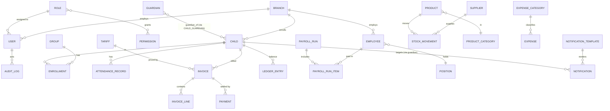

### 12.3 Domain-by-domain entities

**Identity & Access (`accounts`, `branches`)**
| Entity | Key attributes | Relationships |
|--------|----------------|---------------|
| Branch | name, address, currency, timezone, is_active | 1—N Users, Children, Employees |
| User | email (login), password hash, is_active, branch | N—1 Role, N—1 Branch |
| Role | name, description, is_system | M—N Permission, 1—N User |
| Permission | code (`module.action`), label | M—N Role |

**Children CRM (`children`)**
| Entity | Key attributes | Relationships |
|--------|----------------|---------------|
| Child | full name, DOB, gender, enrollment status, branch | N—M Guardian, 1—N Enrollment, 1—N Attendance, 1—N Invoice |
| Guardian | full name, phone, relation type | N—M Child (via ChildGuardian) |
| ChildGuardian | relation, is_primary, can_pickup | join(Child, Guardian) |
| Group | name, age range, capacity, branch | 1—N Enrollment |
| Enrollment | start_date, end_date, status | N—1 Child, N—1 Group |

**Attendance (`attendance`)**
| Entity | Key attributes | Relationships |
|--------|----------------|---------------|
| AttendanceRecord | date, status (present/absent/excused), check_in, check_out, reason | N—1 Child, N—1 Group |

**Finance (`finance`) — the ledger is the source of truth**
| Entity | Key attributes | Relationships |
|--------|----------------|---------------|
| Tariff / Plan | name, amount, period (monthly), branch | 1—N Invoice |
| Invoice | number, period, amount_due, status, due_date | N—1 Child, N—1 Tariff, 1—N InvoiceLine, 1—N Payment |
| InvoiceLine | description, amount, quantity | N—1 Invoice |
| Payment | amount, method, paid_at, received_by | N—1 Invoice |
| Discount | type (%/fixed), reason, validity | applied to Invoice/Child |
| LedgerEntry | direction (debit/credit), amount, ref | N—1 Child — **balance = Σ entries** |

> **Debtors are derived:** a *debtor* is any Child whose ledger balance is > 0 (owes money) past due. There is **no `Debtor` table** — the Debtors module is a **selector/query** over `LedgerEntry`/`Invoice`. This is ADR-7 and prevents the classic bug where a stored debt table drifts out of sync with actual payments.

**HR & Payroll (`hr`, `payroll`)**
| Entity | Key attributes | Relationships |
|--------|----------------|---------------|
| Employee | full name, phone, hire_date, status, base_salary, branch | N—1 Position, 1—N PayrollRunItem, optional 1—1 User |
| Position | title, department | 1—N Employee |
| PayrollRun | period, status, totals, created_by | 1—N PayrollRunItem |
| PayrollRunItem | gross, deductions, bonuses, net | N—1 PayrollRun, N—1 Employee |

**Inventory / Kitchen & Warehouse (`inventory`)**
| Entity | Key attributes | Relationships |
|--------|----------------|---------------|
| ProductCategory | name | 1—N Product |
| Product | name, unit, min_stock, current_stock, branch | N—1 Category, 1—N StockMovement |
| Supplier | name, contact | 1—N StockMovement |
| StockMovement | direction (in/out), quantity, unit_price, date, reason | N—1 Product, N—1 Supplier |

**Expenses (`expenses`)**
| Entity | Key attributes | Relationships |
|--------|----------------|---------------|
| ExpenseCategory | name | 1—N Expense |
| Expense | amount, date, description, status, branch | N—1 Category, N—1 User (created_by) |

**Notifications (`notifications`)**
| Entity | Key attributes | Relationships |
|--------|----------------|---------------|
| NotificationTemplate | code, channel, subject, body (with variables) | 1—N Notification |
| Notification | recipient, channel, rendered body, status, sent_at, retry_count | N—1 Template |

**Settings & Audit (`settings_app`, `audit`)**
| Entity | Key attributes | Relationships |
|--------|----------------|---------------|
| SystemSetting | key, value (JSONB), branch (nullable = global) | scoped by branch |
| AuditLog | actor(User), action, entity_type, entity_id, before/after (JSONB), timestamp, ip | N—1 User |

### 12.4 Indexing & integrity highlights
- Composite indexes on hot query paths: `attendance(child_id, date)`, `invoice(child_id, status)`, `ledger(child_id)`, `stock_movement(product_id, date)`, `payment(paid_at)`.
- `branch_id` indexed on every scoped table (drives RBAC scoping and future sharding).
- Foreign keys `ON DELETE` set to `PROTECT` for financial references (never silently cascade money), `RESTRICT`/soft-delete elsewhere.
- Unique constraints: `invoice.number`, `permission.code`, `attendance(child_id, date)`.

---

## 13. API Architecture

### 13.1 REST strategy
- **Resource-oriented**, plural nouns, HTTP verbs for actions:
  `GET /children`, `POST /children`, `GET /children/{id}`, `PATCH /children/{id}`, `DELETE /children/{id}`.
- **Non-CRUD operations** as sub-resources or actions: `POST /invoices/{id}/payments`, `POST /payroll/runs/{id}/finalize`.
- **Stateless**: every request carries the JWT; no server session.

### 13.2 URL versioning
- **URI versioning**: everything under `/api/v1/`. A future breaking change ships as `/api/v2/` while `v1` keeps serving the mobile app / older clients. This is the safest, most explicit versioning for a product with multiple future consumers (mobile, portals).

```
/api/v1/auth/...
/api/v1/children/...
/api/v1/payments/...
/api/v1/attendance/...
...
```

### 13.3 Pagination
- **Cursor or page-number pagination**; default **page-number** for admin tables (users expect "page 3 of 20").
- Standard query params: `?page=2&page_size=25` (max page_size capped, e.g. 100).
- Response includes `count`, `next`, `previous`, and `results`.

### 13.4 Filtering, Searching, Sorting
| Concern | Convention | Example |
|--------|-----------|---------|
| Filtering | `django-filter` FilterSets, field-based query params | `/children?group=5&status=active` |
| Searching | `?search=` across configured text fields | `/children?search=aziz` |
| Sorting | `?ordering=` with `-` for desc, multi-field allowed | `/payments?ordering=-paid_at` |
| Date ranges | `?date_after=&date_before=` | `/attendance?date_after=2026-07-01` |

### 13.5 Standard success response envelope
Consistency lets the frontend write **one** response handler.

```json
{
  "success": true,
  "data": { },
  "meta": {
    "pagination": { "count": 120, "page": 2, "page_size": 25, "total_pages": 5 }
  },
  "message": null
}
```
For lists, `data` is the array and `meta.pagination` is populated. For single resources, `data` is the object and `meta` may be omitted.

### 13.6 Standard error format
One error shape everywhere → predictable frontend handling and toasts.

```json
{
  "success": false,
  "error": {
    "code": "VALIDATION_ERROR",
    "message": "The submitted data is invalid.",
    "details": {
      "amount": ["This field must be greater than 0."],
      "child": ["This child does not exist."]
    }
  }
}
```

**Error code taxonomy (stable, machine-readable):**
| HTTP | `error.code` | When |
|------|-------------|------|
| 400 | `VALIDATION_ERROR` | Field validation failed (`details` per field) |
| 401 | `AUTHENTICATION_REQUIRED` | Missing/expired token |
| 403 | `PERMISSION_DENIED` | RBAC / branch scope denies |
| 404 | `NOT_FOUND` | Resource missing or outside branch scope |
| 409 | `CONFLICT` | Duplicate / state conflict (e.g. double payment) |
| 422 | `BUSINESS_RULE_VIOLATION` | Valid input, violates domain rule |
| 429 | `RATE_LIMITED` | Throttled |
| 500 | `INTERNAL_ERROR` | Unhandled (no internals leaked) |

Implemented via a **custom DRF exception handler** in `core/` so every app returns the same envelope automatically.

### 13.7 API documentation
- **OpenAPI 3 schema** auto-generated (drf-spectacular) → served as Swagger UI at `/api/docs`. The schema is the living contract the frontend types can be generated from.

---

## 14. Frontend Architecture

### 14.1 Pages, Layouts & Routing model

```mermaid
graph TD
    ROOT[RootProviders<br/>Query + Auth + Theme]

    ROOT --> PUB[PublicLayout]
    ROOT --> PROT[ProtectedRoute<br/>requires valid JWT]

    PUB --> LOGIN[/login/]
    PUB --> FORGOT[/forgot-password/]
    PUB --> NF[404 / not-authorized]

    PROT --> APPL[AppLayout<br/>Sidebar + Topbar]
    APPL --> RB[RoleRoute wrapper<br/>checks permission]

    RB --> DASH[/dashboard/]
    RB --> CHILD[/children/*]
    RB --> PAYM[/payments/*]
    RB --> DEBT[/debtors/*]
    RB --> ATTN[/attendance/*]
    RB --> PAYR[/payroll/*]
    RB --> INV[/inventory/*]
    RB --> EXP[/expenses/*]
    RB --> REP[/reports/*]
    RB --> NOTIF[/notifications/*]
    RB --> SET[/settings/*]
    RB --> USR[/users/*]
```

### 14.2 Route categories

| Category | Wrapper | Behavior |
|----------|---------|----------|
| **Public routes** | `PublicLayout` | `/login`, `/forgot-password`. Accessible without auth. If already authenticated → redirect to `/dashboard`. |
| **Protected routes** | `ProtectedRoute` | Require a valid session; unauthenticated → redirect to `/login` (preserving intended URL). |
| **Role-based routes** | `RoleRoute permission="module.read"` | Wrap protected routes; if the user's role lacks the permission → redirect to `/not-authorized`. Drives the sidebar too (hide links the user can't access). |

### 14.3 Layouts
- **PublicLayout** — centered card, branding, no nav (auth screens).
- **AppLayout** — persistent Sidebar (module nav, filtered by permissions), Topbar (user menu, branch selector for multi-branch future, notifications bell), and a content `<Outlet/>`.
- **Page** — each route renders a Page component from its feature's `pages/`, composed of feature components. Pages orchestrate; they don't hold business logic.

### 14.4 Component layering
```
Page  →  Feature Components  →  Shared UI (Shadcn)  →  Primitives
```
Pages fetch via feature `api/` hooks (TanStack Query), pass data down, and handle mutations. Presentational components stay dumb and reusable.

---

## 15. State Management Strategy

The single most common frontend mistake is dumping everything into one global store. We split state by **its true nature**:

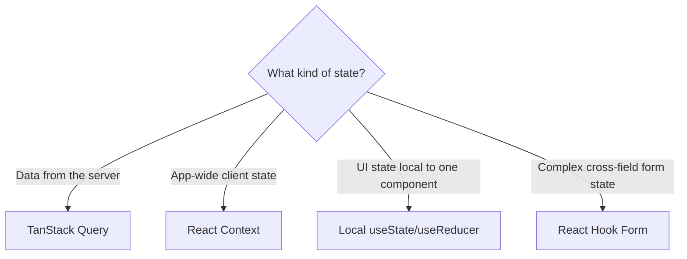

| State type | Tool | Examples | Rule |
|-----------|------|----------|------|
| **Server state** | **TanStack Query** | children list, payments, dashboard KPIs, any API data | **Default choice.** Never copy server data into Context/global state. Query owns caching, refetch, invalidation, loading/error. |
| **Global client state** | **React Context** (thin) | authenticated user + permissions, current branch, theme, toast | Only for truly app-wide, low-frequency data. Keep providers small to avoid re-render storms. |
| **Local UI state** | `useState` / `useReducer` | modal open, selected rows, active tab, filter drafts | Keep it as local as possible; lift only when genuinely shared. |
| **Form state** | **React Hook Form + Zod** | create/edit forms everywhere | RHF owns field state & validation; Zod schema is the contract (and infers TS types). |

**Concrete conventions:**
- Query keys are structured and centralized per feature: `['payments', { filters }]`, `['payments', id]`. Mutations **invalidate** the relevant keys — no manual refetch juggling.
- Auth/permissions live in a **single AuthContext**, hydrated from `/auth/me`, consumed by `useAuth()` and `useCan()`.
- **No Redux.** With TanStack Query owning server state and Context handling the small global slice, Redux would be ceremony without benefit. If a genuinely complex *client* state machine appears later (e.g. a multi-step wizard), reach for Zustand locally — not a global store.

---

## 16. File Storage

### 16.1 Storage abstraction (key decision)
All file access goes through Django's **storage backend abstraction**. In MVP files live on the **server filesystem** (served by Nginx); the config can switch to **S3-compatible object storage** (MinIO/AWS S3) with **zero application code change** — critical for scaling and multi-server deployments (P2).

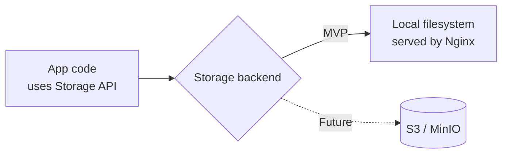

### 16.2 What we store & how it's organized

| Category | Examples | Access | Path convention |
|----------|----------|--------|-----------------|
| **Media / Images** | Child photos, staff photos, product images | Authenticated; branch-scoped | `media/{branch}/children/{child_id}/avatar.jpg` |
| **Documents** | Contracts, enrollment PDFs, staff docs | Authenticated; role-gated | `media/{branch}/documents/{entity}/{id}/...` |
| **Receipts** | Payment receipts, invoices (generated PDFs) | Authenticated; finance roles | `media/{branch}/receipts/{year}/{month}/{invoice_no}.pdf` |
| **Reports/Exports** | Generated Excel/PDF reports | Temporary, signed URL | `media/exports/{user}/{uuid}.xlsx` |

### 16.3 Rules
- **Private by default.** No file is publicly reachable by guessing a URL. Downloads go through an authenticated endpoint (or short-lived signed URLs when on S3).
- **Validation on upload:** file type allowlist (images: jpg/png/webp; docs: pdf), size limits, and — for images — server-side re-encode/thumbnail generation via a **Celery task** (never block the request).
- **UUID filenames** to prevent collisions and enumeration; original name kept as metadata.
- **Receipts/invoices** are generated asynchronously (Celery) and stored, then linked from the payment record.

---

## 17. Notifications Architecture

Designed as a **channel-agnostic hub** so SMS ships now and Telegram/Email/Push are **plug-ins**, not rewrites (P2).

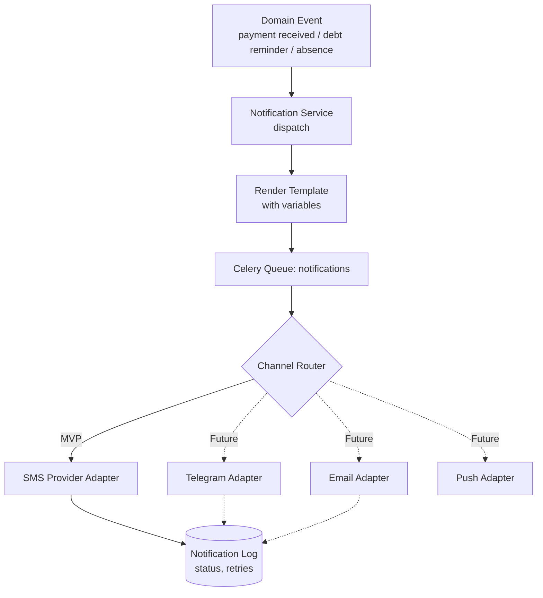

### 17.1 Design pillars

| Pillar | Detail |
|--------|--------|
| **Channel adapter interface** | Every channel implements the same interface: `send(recipient, rendered_message) -> DeliveryResult`. Adding Telegram/Email = adding one adapter class + config. The rest of the system is untouched. |
| **Template-driven** | Messages come from `NotificationTemplate` (code + channel + body with `{variables}`). Non-developers can edit wording in Settings. |
| **Always async** | Dispatch happens in a Celery task on the `notifications` queue. A slow/downed SMS gateway never blocks a user request. |
| **Delivery log & retries** | Every send is recorded (`queued → sent → delivered/failed`) with retry/backoff. Failures are visible in the Notifications module. |
| **Provider abstraction** | The SMS provider is behind an adapter + settings, so switching gateways is a config change. |
| **Preference-ready** | Schema anticipates per-guardian channel preferences (needed once Parent Portal exists). |

### 17.2 MVP triggers
- Payment received → SMS receipt to guardian.
- Debt reminder → scheduled SMS to debtors (Celery Beat, e.g. weekly).
- (Config-gated) attendance absence notice.

> **Future path:** Telegram bot and Email are new adapters registered with the Channel Router; the AI Assistant can later compose message bodies feeding the same templates.

---

## 18. Background Jobs (Celery)

### 18.0 Reliability

By default Celery acknowledges a task **before** running it, so a worker that dies mid-task — OOM, a deploy, a rebooted server — loses the task silently. For the invoice run on the 1st of the month that reads: *that month's invoices were never issued, and nobody found out.*

The settings therefore enable `task_acks_late` with `task_reject_on_worker_lost`: a task is acknowledged only once it finishes, and is redelivered otherwise. That trade is only sound if tasks are idempotent, which is why idempotency came first:

| Task | What stops a second run from doing damage |
|------|-------------------------------------------|
| `finance.generate_monthly_invoices` | `uq_invoice_child_period` — a partial unique index; the **database** refuses the duplicate |
| `reports.send_debt_reminders` | `queue_debt_reminders()` skips guardians already reminded today |
| `notifications.dispatch_queued` | only `queued` rows are picked up; a sent message leaves the set |
| `reports.recompute_balances`, `finance.mark_overdue_invoices` | naturally idempotent (recompute / conditional update) |

Three settings support that choice and are easy to get wrong in isolation: `worker_prefetch_multiplier = 1` keeps redelivery scoped to one task rather than a whole prefetched batch; `task_time_limit` stops a hung task from occupying a worker forever; and the broker's `visibility_timeout` (900 s) is deliberately **larger** than the time limit — set equal or smaller, it would hand a still-running task to a second worker and manufacture the duplication the rest of this section prevents.

Transient failures retry with exponential backoff and jitter (`apps/core/tasks.py`). Business-rule violations do **not** retry: "this child has no tariff" is not fixed by trying again five times, it is only buried in the log.

> **Queued is not sent.** `queue_notification()` writes a row; something has to deliver it. Payment receipts were queued inside `record_payment` and never dispatched by anything — parents never received them, with no error anywhere. `notifications.dispatch_queued` runs every five minutes and drains the queue. Delivery stays outside the request on purpose: taking a payment must not depend on an SMS gateway being alive (P8).


Anything slow, external, scheduled, or heavy runs **off the request path**. Celery + Redis broker; **Celery Beat** for schedules.

### 18.1 Queues (isolation so one slow job type can't starve another)

| Queue | Jobs | Why isolated |
|-------|------|--------------|
| `default` | misc short tasks | General. |
| `notifications` | SMS/Telegram/Email dispatch, retries | External I/O; must not block reports. |
| `reports` | Report/export generation (PDF/Excel), heavy aggregation | CPU/time heavy; separate worker pool. |
| `media` | Image processing, thumbnails, receipt PDF generation | Bursty uploads. |
| `maintenance` | Nightly recalculations, cleanup | Scheduled, low priority. |

### 18.2 Representative tasks

| Task | Trigger | Queue |
|------|---------|-------|
| Send SMS notification | Event / scheduled | notifications |
| Generate monthly invoices for all active children | Beat (monthly) | maintenance |
| Recalculate debtor balances / flag overdue | Beat (daily) | maintenance |
| Send debt reminders to overdue guardians | Beat (weekly) | notifications |
| Generate report export (Excel/PDF) | User request | reports |
| Process/resize uploaded image, make thumbnail | On upload | media |
| Generate payment receipt PDF | On payment | media |
| Snapshot dashboard KPIs into cache | Beat (hourly) | maintenance |
| Purge expired refresh tokens / temp exports | Beat (daily) | maintenance |

### 18.3 Reliability rules
- **Idempotent tasks** (safe to retry): invoice generation checks for existing period invoice before creating (P8).
- **Retries with exponential backoff** for external calls (SMS).
- **`acks_late=True`** so a crashed worker re-queues the task.
- **Results & monitoring** via Flower (dev) and task-status records for user-facing long jobs (e.g. "your export is ready").

---

## 19. Caching Strategy (Redis)

Cache to protect the database from repeated expensive reads — **but never cache money you must trust to the cent.** Financial *authoritative* reads hit the DB; *derived summaries* may be cached with explicit invalidation.

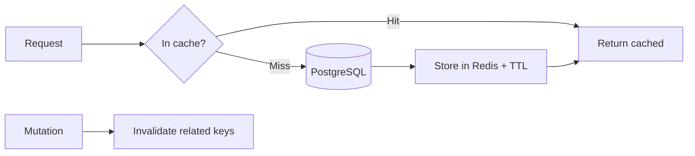

| What we cache | Strategy | TTL / Invalidation |
|---------------|----------|--------------------|
| **Dashboard KPIs / aggregates** | Precomputed snapshot (Celery) + cache-aside | Refresh hourly + invalidate on relevant mutation |
| **Reports (expensive aggregations)** | Cache-aside by (params hash) | Short TTL (e.g. 5–15 min) |
| **Reference/config data** (roles, permissions, settings, tariffs, categories) | Cache-aside | Long TTL; invalidate on write |
| **Auth/permission resolution per user** | Per-request or short cache | Invalidate on role change |
| **Rate-limit counters** | Redis counters | Sliding window |
| **Refresh-token blacklist / locks** | Redis sets/keys | Token lifetime |

**Rules:**
- **Cache keys are namespaced & branch-scoped:** `kpi:{branch}:dashboard`, `report:{branch}:{hash}`.
- **Invalidate on write** in the service layer — the same place that owns the mutation owns the cache bust.
- **Never cache** live financial balances used for a payment decision; compute those from the ledger.
- Start simple (cache-aside). Introduce precomputed snapshots only where profiling shows a hot path.

---

## 20. Security

Security is layered — no single control is trusted alone.

### 20.1 Controls overview

| Layer | Control | Detail |
|-------|---------|--------|
| **Transport** | TLS everywhere | Nginx terminates HTTPS; HSTS; HTTP→HTTPS redirect. |
| **AuthN** | JWT (access+refresh) | Short access life, refresh rotation + blacklist on logout. Passwords hashed (Argon2/PBKDF2). |
| **AuthZ** | RBAC + branch scope | Deny-by-default; permission classes per endpoint; object-level branch filtering. Backend is the authority. |
| **Audit** | Immutable audit log | Every financial/admin mutation records actor, action, before/after, IP, timestamp. Append-only. |
| **Rate limiting** | DRF throttling + Nginx | Per-user & per-IP throttles; stricter on `/auth/login` (brute-force defense). Redis-backed counters. |
| **CORS** | Explicit allowlist | Only the known frontend origin(s) allowed; credentials mode configured deliberately. |
| **CSRF** | Token-based auth = low CSRF surface | JWT in `Authorization` header (not cookie) sidesteps CSRF for the API. **If** refresh token is in a cookie, apply CSRF protection + `SameSite=Strict` on that flow. |
| **Validation** | Two-layer | Zod on the frontend (UX) + serializer/service validation on the backend (authority). Never trust the client. |
| **Secrets** | Env-based | `.env` / secrets manager; never committed. Separate secrets per environment. |
| **Injection** | ORM + parameterization | Django ORM prevents SQL injection; avoid raw SQL, and parameterize if unavoidable. |
| **Headers** | Security headers | CSP, X-Content-Type-Options, X-Frame-Options (clickjacking), Referrer-Policy via Nginx/Django. |
| **File uploads** | Type/size allowlist + async re-encode | Prevents malicious uploads; private storage. |
| **Least privilege** | DB & infra | App DB user limited to needed privileges; workers scoped per queue. |

### 20.2 Login brute-force & account safety
- Throttled login endpoint + progressive delays / temporary lockout on repeated failures (counters in Redis).
- Generic auth error messages (never reveal whether email exists).
- Password policy enforced server-side; password change invalidates other sessions (rotate/blacklist refresh tokens).

### 20.3 Audit log (P7)
- Written from the **service layer** (and select signals) so it can't be bypassed by a view.
- Covers: payments, invoices, payroll runs, role/permission changes, user create/deactivate, settings changes, stock adjustments.
- Read-only in the UI (Org Owner / Director), filterable by actor/entity/date.
- **Platform-plane actions are audited separately and immutably** (ADR-10): every support grant, suspension, plan change, and cross-organization metadata read is logged with the platform actor's identity. This log is visible to the affected customer — vendor access to a tenant is never invisible to that tenant.

---

## 21. Performance

Performance is designed in via query discipline, indexing, caching, and pagination — not bolted on later.

### 21.1 Database
| Technique | Application |
|-----------|-------------|
| **Indexing** | Composite indexes on hot paths (§12.4): `attendance(child_id,date)`, `invoice(child_id,status)`, `ledger(child_id)`, `payment(paid_at)`, plus `branch_id` everywhere. Partial indexes for "active/overdue" filters. |
| **Query optimization** | `select_related` for FKs, `prefetch_related` for reverse/M2M in selectors — **kill N+1 in the selector layer**, verified in tests. |
| **Aggregation at the DB** | Use `annotate`/`aggregate`/window functions for balances & reports rather than Python loops. |
| **Pagination everywhere** | No unbounded list endpoints; capped `page_size`. |
| **Read replicas (future)** | Reports/dashboard reads can be routed to a replica when load grows (P22). |
| **Connection pooling** | PgBouncer in front of Postgres for many workers. |

### 21.2 Backend
- **Selectors return exactly what the serializer needs** — `.only()/.values()` for wide tables.
- **Heavy work is async** (reports, exports, receipts) — request stays fast.
- **Caching** of reference data & dashboard KPIs (§19).

### 21.3 Frontend
| Technique | Application |
|-----------|-------------|
| **Route-based code splitting** | `React.lazy` + Suspense per feature → small initial bundle. |
| **TanStack Query caching** | Avoids redundant network calls; background refetch keeps data fresh without spinners. |
| **List virtualization** | For large tables (attendance, children) render only visible rows. |
| **Lazy loading** | Images lazy-loaded; charts/reports loaded on demand. |
| **Debounced search** | Search inputs debounced before hitting the API. |
| **Memoization** | `useMemo`/`React.memo` on expensive renders and stable props. |
| **Optimistic updates** | For quick mutations (e.g. attendance toggles) with rollback on error. |
| **Asset optimization** | Vite production build: tree-shaking, minification, gzip/brotli via Nginx. |

---

## 22. Scalability & Future Modules

The whole architecture exists to make **this section trivial**. Adding a module should be *additive*, never a refactor.

### 22.1 The "add a module" playbook
To add, e.g., **Meal Planning**:
1. **Backend:** create `apps/meals/` following the standard app shape (§5). Register its router in `api/v1`. It reads `inventory` stock via a **selector** (contract), not by importing tables.
2. **RBAC:** add `meals.*` permissions (data, not code) and assign to roles in the matrix.
3. **Frontend:** create `features/meals/` following the standard feature shape (§7). Add its routes under `RoleRoute` and a sidebar entry gated by permission.
4. **Done.** No existing module changes. This is the payoff of P1 + P2.

### 22.2 How each roadmap module slots in

| Future module | Where it plugs in | What already supports it |
|---------------|-------------------|--------------------------|
| **Parent Portal** | New `parents` app + new **Parent role** in RBAC matrix; reuses children/finance/attendance **selectors** & the same versioned API | RBAC is data-driven; API is a product; guardian/child model exists. Portal users are scoped to one organization by the same base queryset (P10). |
| **Teacher Portal** | New **Teacher role**; `hr.Employee`↔`User` link already anticipated; reuses attendance/children | Employee/User separation + RBAC. |
| **Online Payments** | New payment **gateway adapter** in finance + webhook endpoint; writes to the **same ledger** | Ledger-based finance + adapter pattern (like notifications). |
| **Medical Records** | New `medical` app linked to `children` (1—N) | Bounded module + child entity. |
| **Meal Planning** | New `meals` app consuming `inventory` via selectors | Inventory + stock movements exist. |
| **Homework / LMS** | New `learning` app linked to groups/children; Teacher/Parent roles | Groups/enrollment + RBAC. |
| **Gallery** | New `gallery` app on top of the **storage abstraction** | Private storage + async media processing. |
| **AI Assistant** | New service consuming read **selectors** + a task queue; composes notifications | Clean read layer + Celery + Python/AI-ready stack. |
| **Mobile App** | New client against the **same `/api/v1`**; JWT auth already stateless | API-as-a-product, stateless auth. |
| **Analytics** | Read replica + `reports` extensions / warehouse export | Read-only reporting layer + replica-ready. Cross-tenant aggregates are **vendor-plane only** and must be anonymized. |
| **Automated card debit** (subscriptions) | New payment-gateway adapter in `subscriptions` + webhook endpoint; writes the same subscription payment records | Adapter pattern (as in `notifications`); invoice-and-transfer flow already models the money, so cards become an additional settlement path, not a new domain. |
| **Tenant data isolation hardening** | Postgres **RLS** policies on `organization_id`; optional partition-by-organization for the largest tables | `organization_id` on every row from day one (ADR-9) means RLS is a policy addition, never a migration. |

### 22.3 Scaling axes
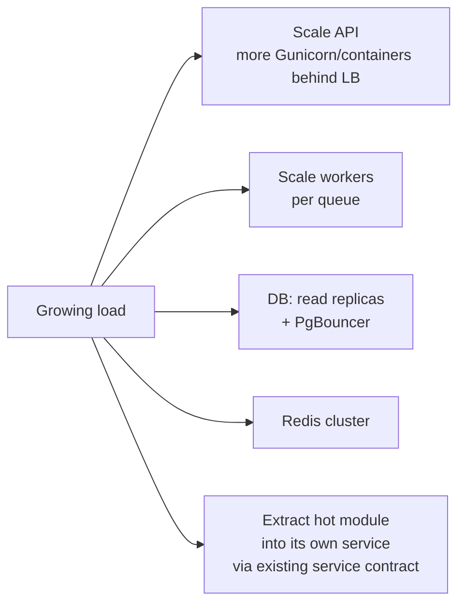
- **Stateless API** → horizontal scaling is trivial (no sticky sessions; JWT).
- **Per-queue workers** → scale notification vs report load independently.
- **Module extraction** → because modules already talk through service contracts, a hot module (e.g. Online Payments) can become its own deployable service without touching callers' logic — the monolith was always "microservice-ready."

---

## 23. Deployment & DevOps

### 23.1 Environments
| Env | Purpose | Notes |
|-----|---------|-------|
| **Local** | Dev | `docker-compose` up: web, db, redis, worker, beat. `development.py` settings. |
| **Staging** | Pre-prod validation | Mirrors prod; real integrations in sandbox mode. |
| **Production** | Live | `production.py`; secrets from env; TLS; backups. |

### 23.2 Containerization
- **Backend image:** Python + Gunicorn. Same image runs as web / worker / beat with different commands.
- **Frontend:** built by Vite → static assets served by **Nginx** (multi-stage build).
- **docker-compose (dev)** services: `nginx`, `web`, `db (postgres)`, `redis`, `worker`, `beat`.
- Prod uses the same images; orchestration can graduate to a managed setup / Kubernetes later without image changes.

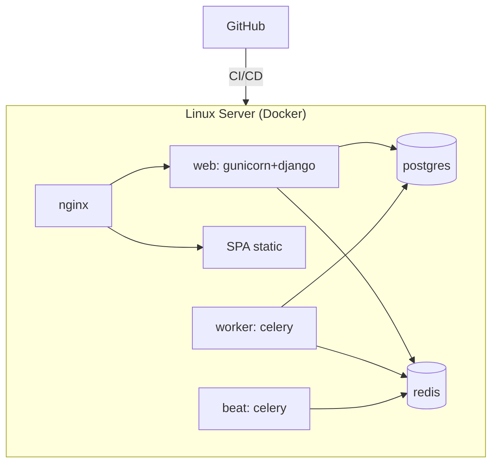

### 23.3 CI/CD (GitHub)
- **CI:** on PR → lint (ruff/eslint), type-check (mypy/tsc), run tests (pytest + vitest), build images.
- **CD:** on merge to main → build & push images → deploy to Linux server (compose pull + up, or registry-based). Run migrations as a controlled step.
- **Migrations** run as an explicit deploy step (never auto on boot in prod).
- **Backups:** automated Postgres backups + tested restore; media backed up (or on S3 with lifecycle).
- **Observability:** structured logging, health-check endpoints (`/health`), error tracking (Sentry), Celery monitoring (Flower).

### 23.4 Configuration
- **12-factor:** all config via environment variables; `.env.example` documents every key.
- **Split settings** (`base/development/production/test`) — never one giant settings file.

---

## 24. Appendix: Naming Conventions & Standards

| Area | Convention |
|------|-----------|
| **Python** | `snake_case` functions/vars, `PascalCase` classes, `UPPER_SNAKE` constants. Ruff + Black formatting. Type hints required in services/selectors. |
| **Django apps** | Lowercase, singular domain nouns (`finance`, `children`). Standard internal layout (§5). |
| **API URLs** | Plural, kebab-free lowercase nouns; `/api/v1/<resource>`; actions as sub-resources. |
| **TypeScript** | `camelCase` vars/functions, `PascalCase` components/types, `use*` for hooks. ESLint + Prettier. |
| **React files** | Components `PascalCase.tsx`; hooks `useThing.ts`; feature folders lowercase. |
| **Query keys** | Array form, feature-prefixed: `['children', filters]`, `['children', id]`. |
| **Zod schemas** | `<entity>.schema.ts`, exported schema + inferred type. |
| **Commits** | Conventional Commits (`feat:`, `fix:`, `refactor:`). |
| **Branches** | `feature/…`, `fix/…`, `chore/…`; PR-based, protected `main`. |
| **Tests** | Backend: `pytest`, factories per app. Frontend: Vitest + Testing Library. Services & selectors must be unit-tested. |
| **Migrations** | Reviewed like code; never edited after merge; data migrations separated from schema. |

---

## Summary — The Five Decisions That Make This Future-Proof

1. **Modular monolith with a service layer** — fast to build now, extractable into services later; modules never touch each other's tables.
2. **`branch_id` on every entity from day one** — multi-branch becomes config, not a rewrite.
3. **Data-driven RBAC** — new roles (Parent, Teacher) and permissions are data, so future portals need no auth rewrite.
4. **Ledger-based finance with derived debtors** — one source of financial truth; online payments plug into the same ledger.
5. **Adapter patterns for notifications & storage + a versioned API-as-product** — new channels, new storage backends, and new clients (mobile, portals) are additive.

> Build the MVP against these seams and the roadmap — Parent Portal, Online Payments, Meal Planning, AI Assistant, Mobile, automated card debit — arrives as *new folders*, not *big refactors*.

*End of Software Architecture Document v1.0.*
