# Kindergarten Management System — Software Architecture Document (SAD)

| | |
|---|---|
| **Project** | Kindergarten Management System (KG-CRM) |
| **Architecture Style** | CRM + ERP + LMS (modular monolith, service-ready) |
| **Document Owner** | Chief Software Architect |
| **Status** | Draft v1.0 — pre-development, MVP scope |
| **Audience** | Backend, Frontend, DevOps, QA, Product |
| **Golden Rule** | Build for the MVP, but never make a decision that blocks a future module. |

> This document is the single source of truth for the system's structure. No models, serializers, views, or endpoints exist yet. Everything below describes **how the system is shaped**, **why each decision was made**, and **where every developer plugs in**. A developer joining tomorrow should be able to read this and start building without asking "where does this go?"

---

## Table of Contents

1. [Executive Summary](#1-executive-summary)
2. [Architectural Principles & Key Decisions](#2-architectural-principles--key-decisions)
3. [Overall System Architecture](#3-overall-system-architecture)
4. [Technology Stack Rationale](#4-technology-stack-rationale)
5. [Backend Folder Structure](#5-backend-folder-structure)
6. [Recommended Django Apps](#6-recommended-django-apps-and-why-each-exists)
7. [Frontend Folder Structure](#7-frontend-folder-structure)
8. [Recommended React Folders](#8-recommended-react-folders-and-why)
9. [Module Relationships](#9-module-relationships)
10. [Authentication Flow](#10-authentication-flow)
11. [Authorization — RBAC](#11-authorization--rbac)
12. [Database Architecture (Entities & Relationships)](#12-database-architecture-entities--relationships)
13. [API Architecture](#13-api-architecture)
14. [Frontend Architecture](#14-frontend-architecture)
15. [State Management Strategy](#15-state-management-strategy)
16. [File Storage](#16-file-storage)
17. [Notifications Architecture](#17-notifications-architecture)
18. [Background Jobs (Celery)](#18-background-jobs-celery)
19. [Caching Strategy (Redis)](#19-caching-strategy-redis)
20. [Security](#20-security)
21. [Performance](#21-performance)
22. [Scalability & Future Modules](#22-scalability--future-modules)
23. [Deployment & DevOps](#23-deployment--devops)
24. [Appendix: Naming Conventions & Standards](#24-appendix-naming-conventions--standards)

---

## 1. Executive Summary

The Kindergarten Management System is an internal business platform for kindergarten operators. It merges three classic enterprise domains:

- **CRM** — managing children, guardians, enrollment, and communication.
- **ERP** — managing money (payments, debts, payroll, expenses), inventory (kitchen & warehouse), and operations.
- **LMS** — the future learning layer (homework, meal planning, teacher/parent portals).

For the MVP we deliver an **administrative back-office**: staff log in and run the kindergarten. The public/parent-facing surfaces come later.

### Chosen architecture style: **Modular Monolith**

We deliberately **do not** start with microservices. At this stage microservices would add network latency, distributed-transaction complexity, and DevOps overhead with zero business benefit. Instead we build a **modular monolith**: one deployable Django application, internally split into strongly-bounded modules (Django apps) with clear contracts between them.

This gives us:

- **Speed now** — one repo, one deployment, one database, simple local dev.
- **Options later** — because modules are cleanly bounded and communicate through service layers (not by reaching into each other's tables), any module (e.g. Online Payments, Analytics) can be extracted into its own service when scale demands it.

The frontend is a **standalone React SPA** consuming a versioned REST API — fully decoupled from the backend, which keeps the door open for a future mobile app reusing the same API.

---

## 2. Architectural Principles & Key Decisions

Every decision in this document traces back to these principles.

| # | Principle | What it means in practice |
|---|-----------|---------------------------|
| P1 | **Modularity over cleverness** | Each business capability is a bounded module. No module reads another module's tables directly — it calls a service function or an API. |
| P2 | **Future-proof, not future-built** | We build only the MVP, but every boundary anticipates the roadmap (branches, portals, online payments). We add seams, not features. |
| P3 | **Separation of concerns (layered)** | API layer → Service layer → Data layer. Business logic lives in services, never in views or serializers. |
| P4 | **Explicit contracts** | Modules talk through documented service interfaces and typed API responses. Contracts are stable; internals are free to change. |
| P5 | **Security by default** | Every endpoint is authenticated and authorized unless explicitly public. Deny-by-default RBAC. |
| P6 | **Multi-branch aware from day one** | Every core entity carries a `branch` boundary. One subscription covers unlimited branches ([01 §4.1](./01_Project_Vision.md)). |
| P7 | **Auditability** | Money and children are sensitive. Every financial and administrative mutation is audit-logged. |
| P8 | **Idempotent & async where it matters** | Notifications, reports, and heavy aggregation run in background workers, never in the request/response cycle. |
| P9 | **The API is a product** | Versioned, consistent envelope, predictable errors. The mobile app and parent portal will be first-class consumers. |
| P10 | **Tenant isolation is absolute** | Every operational row carries `organization_id`. **No role — including the customer's own owner — can read across organizations.** Branch scoping is a business rule that some roles bypass; organization scoping is a security boundary that **nothing** bypasses. |
| P11 | **Metering is evidence, not a counter** | Every subscription charge traces to an immutable `usage_snapshot` that records what was counted, when, and how. A bill we cannot reconstruct is a bill we cannot defend. |

### Key Architectural Decision Records (condensed)

| ID | Decision | Alternatives considered | Why we chose it |
|----|----------|------------------------|-----------------|
| ADR-1 | Modular monolith | Microservices | Team size, single DB transactions for finance, faster MVP. Extraction path preserved via service layer. |
| ADR-2 | Service layer pattern | Fat models / fat views | Business logic testable in isolation; modules decoupled; avoids "God model." |
| ADR-3 | JWT (access + refresh) | Django session auth | SPA + future mobile need stateless, cross-client auth. |
| ADR-4 | Custom User + separate Role model | Django Groups only | Business roles ≠ Django groups; we need a role matrix, branch scoping, and UI-driven role management. |
| ADR-5 | PostgreSQL as single OLTP store | MySQL / Mongo | Strong relational integrity for finance, JSONB flexibility for settings, mature ecosystem. |
| ADR-6 | Redis for cache + Celery broker | RabbitMQ, DB-backed cache | One infra component serves caching, sessions, rate-limit counters, and task queue. |
| ADR-7 | Debtors as a *derived* domain | Debtors as a stored table | A debtor is a computed state of the finance ledger, not a separate entity — avoids data duplication and drift. |
| ADR-8 | Frontend SPA (Vite + React) | Django templates / SSR | Rich internal dashboard UX, decoupled from API, reusable by mobile. |
| **ADR-9** | **`organization` is the tenancy root; `branch` sits inside it** | Branch as tenancy root (original design); schema-per-tenant; DB-per-tenant | The product is sold per **organization**, and one subscription covers unlimited branches ([01 §4](./01_Project_Vision.md)). Branch cannot be the tenancy root because a customer legitimately reads across their own branches. Shared-schema row scoping keeps cross-branch reporting trivial and can graduate to RLS/partitioning without a data migration. **Supersedes the branch-as-tenancy-root model in [03 §6](./03_Database_Design.md).** |
| **ADR-10** | **Platform staff live outside the customer RBAC matrix** | Add a "Platform Admin" row to the existing role matrix | The original **Super Admin** was defined as bypassing all scoping. In a multi-tenant system that role, granted to a customer, would expose every other customer's children. Vendor access is a *different kind of subject* with a different auth path, mandatory audit, and no implicit data access — not a stronger customer role. |
| **ADR-11** | **Subscription billing is its own bounded module with an append-only usage ledger** | Reuse the `finance` app; compute charges on demand at invoice time | Vendor→customer billing and kindergarten→parent billing share vocabulary but nothing else ([01 §4.6](./01_Project_Vision.md)); merging them would corrupt both. Charges derive from immutable `usage_snapshot` rows (P11) so any invoice can be reconstructed and defended months later — the same discipline as ADR-7's ledger. |
| **ADR-12** | **Pricing revised at launch: 400 000 UZS base / +50 000 per 10 (Radix CRM rebrand)** | Keep the original 500 000 / +80 000 figures | Confirmed by the founder on 2026-09-16, alongside the public rebrand to Radix CRM. Applied as a **new dated `SubscriptionPlan` version** (`0003_radix_pricing`, effective 2026-09-14), not an edit to the existing row — the original plan is closed with `valid_to`, so subscriptions already billed under it keep their historical figures untouched ([03 §20.1](./03_Database_Design.md)). This is the mechanism ADR-11's immutable-ledger discipline exists to support: a price change is a new fact, not a rewrite of history. |
| **ADR-13** | **Two delivery models, one codebase: `DEPLOYMENT_MODE` = `saas` \| `standalone`** | Fork the repo into a separate single-tenant product; maintain two branches; strip the `subscriptions` app for on-premise builds | The product is now sold two ways ([01 §4.7](./01_Project_Vision.md)): hosted subscription, or a **one-off licence deployed on the customer's own server**. A fork was rejected on maintenance grounds — 40 000 lines duplicated means every fix applied twice, and the two copies diverge within weeks, which a solo-founder team cannot carry. `standalone` instead **disables what does not apply**: `SubscriptionWriteGate` opens unconditionally, no trial subscription is created at registration, `billing`/`platform`/`public` routes are never registered, the marketing site and vendor console are dropped from the router, and the tenant address collapses from `/t/<slug>` to the install root. **The flag is a commercial boundary, never a security one** — `organization_id` scoping and RLS behave identically in both modes (CLAUDE.md invariants 2 and 8), so a standalone database that later holds a second kindergarten is still correctly isolated. |
| **ADR-15** *(default superseded by ADR-24)* | **Platform-console 2FA is a deployment switch (`PLATFORM_2FA_REQUIRED`), default off** | Keep TOTP mandatory (ADR-10 as written); delete the TOTP code entirely | The owner decided on 2026-09-22 that an Authenticator code on every vendor sign-in is friction he does not want while he is the only vendor user. ADR-10's *separation* is untouched — vendor accounts still live in `platform_user`, sign in on their own endpoint, get a token bound to the platform plane, and are audited on every call; only the second factor becomes optional. Deleting the TOTP machinery was rejected because it is small, tested, and the day a second vendor employee or a security review arrives, turning it back on must be a one-line `.env` change, not a rewrite. When the switch is on, a login without a `code` answers `401 TOTP_REQUIRED` **before** the password is checked, so the reply never becomes a password oracle; the login page shows the code field only after that reply — the frontend never has to know the server's setting. Secrets are still generated and stored for every account, so enabling 2FA later never locks anyone out. **The default flipped to on in ADR-24** (2026-10-02) once backup codes removed the lock-out risk; everything else in this row still holds. **On 2026-10-05 the owner switched it off again in production** (`PLATFORM_2FA_REQUIRED=False`): the console still has a single vendor account, and a code on every sign-in is friction he does not want. The code default stays on — this is a deployment choice, which is exactly what the switch is for. That account currently holds **no backup codes**, so if it is ever turned back on and the phone is lost, the way in is `create_platform_user --update --new-2fa` on the server. |
| **ADR-16** | **Three product languages (uz / ru / en) with Uzbek as the source language; translation is a pure lookup keyed by the source string, chosen per browser and sent to the API as `Accept-Language`** | i18n keys (`children.title`) with JSON files per language; a React i18n context with live switching; storing the language on the user record; translating the platform console too | Decided 2026-09-22 when the founder asked for the website and every customer dashboard (`/t/<slug>` and `/private`) to work in all three languages. **Source-string keys**: the code stays readable Uzbek (`t('Bola qo‘shish')`), a missing translation degrades to the source instead of a key or `undefined`, and a catalog-completeness test (`lib/i18n/__tests__/catalog.test.ts`, `apps/core/tests/test_i18n.py`) fails the build when any wrapped string lacks a `ru`/`en` entry or its `{placeholders}` differ — the same guarantee as extracted keys, without inventing 800 identifiers. **Reload on switch**: the locale is read once at boot (`localStorage` `kg-crm.locale`, default `uz`) and `setLocale()` reloads the page, so `t()` is a plain function usable in module-level constants (status labels, nav) with no provider, no re-render bookkeeping and no boot-order bugs; only the active catalog is loaded (`uz` loads none). **Per browser, not per user**: the choice follows the device the person is working on and needs no migration or profile endpoint; the backend learns it per request from `Accept-Language` (Django `LocaleMiddleware`, `gettext` on every user-facing message, `.po` under `backend/locale/`, compiled in the Docker build). The public site keeps its own content layer (`features/landing/content.ts`, `/uz` `/ru` `/en` with `hreflang`) because it is prerendered and SEO-addressed; the vendor console stays Uzbek-only by decision — one operator, no customer-facing text. Tenant *data* (role names, categories, SMS templates) is never translated: it belongs to the customer. |
| **ADR-14** | **Radix Intelligence is a deterministic rules engine over tenant data, not an ML model** | Call an external LLM API; self-host an open-weight LLM; train a model on customer data | The product promise is *"Radix finds what the director would miss"* — that needs correct signals with evidence, not generated text. With zero paying customers there is no ground truth to train on, and standalone installs (ADR-13) run on CPU-only servers the vendor does not control. V1 ([07](./07_Radix_Intelligence.md)) therefore computes insights nightly from the tenant's own rows with pure rule functions, stores each as an `insight` row (RLS, invariants 2/8) carrying a **frozen evidence snapshot** of numbers and ids — never names or phones — (the ADR-11 discipline) and a deep link into the existing UI. One **open row per condition** (partial unique index), refreshed nightly while the condition holds and closed as `auto_resolved` when it disappears, so a persisting problem is one ageing row, never thirty; a dismissal suppresses that condition for seven days, and a condition that vanishes and returns is a new row — history is rows, never state flips. Language is factual — never predictive. An LLM enters only in V3, and only to *narrate* structured insights it is handed, never to query the database. |
| **ADR-17** | **Money has a location: `cash_account` + an append-only `cash_movement` ledger** | Add a `paid_from` text column to `payment`, `expense` and payroll and aggregate by it; keep one implicit pot and report by payment *method*; adopt a full double-entry chart of accounts | The system recorded **how much** money moved and never **where it moved from**. That was invisible while the only question asked was "what did we earn this month", and it broke the moment the first customer asked the real one: *"how much do I have, in cash, on the terminal, and in the bank?"* — a kindergarten runs three or four separate pots and settles each one differently. A `paid_from` string on each table would answer it for one report and drift on the next: the same enum would be re-declared in four apps, a correction in one place would not move the others, and nothing would stop a payment leaving an account that was never credited. A full chart of accounts is the textbook answer and the wrong size for this product — it asks a kindergarten director to think in debits and credits. So money gets the **same treatment this codebase already gives the two other things that must never drift**: children's balances (`child_ledger_entry`, D3) and stock (`stock_movement`). `cash_account` names the pots (naqd, terminal, bank hisobi, Payme/Click — seeded per branch), and every money event — payment, reversal, expense, payroll payout, advance, transfer between pots — writes an immutable `cash_movement`. A balance is `Σ in − Σ out`, never a stored number, so it cannot be wrong; a correction is a counter-movement, never an `UPDATE`. Everything the customer asked for then falls out of one table instead of four features: cash on hand per pot, the profit split by pot, "which money did this expense come from", and payroll that reconciles with outflows. |
| **ADR-18** | **A payroll line is split into an *official* and an *unofficial* part; withholding rates live in Settings, not in code** | One `employment_type` flag on the employee (official *or* unofficial); hard-code Uzbek rates (12% JShDS, 0.1% INPS) in the service; let the accountant type the withheld sum by hand every month | Kindergartens here pay some staff on the books — to a bank card, with income tax and pension withheld — and top the same person up in cash, and pay other staff entirely in cash. A single flag on the employee cannot express that, because **one person is both**: an official salary *and* a cash bonus. So the split belongs to the payroll **line**, not to the employee. `employee.official_salary` is the on-the-books part; whatever else `base_salary` covers is the cash part. Withholdings are computed on the official part only, the cash part carries bonuses, penalties and advances, and the payslip shows two blocks that add up — which is the document the accountant actually has to defend. Rates are **configuration, not code** (`payroll.income_tax_rate`, `payroll.pension_rate` in `system_setting`, seeded 12% and 0.1%): they change by decree, sometimes mid-year, and a rate frozen in a service means a release and a redeploy to obey the law. The employer-side social tax stays a manually entered expense by the owner's decision (2026-09-30) — the system should not assert a liability the kindergarten may not be paying. Existing data is untouched: `official_salary` defaults to 0, so every historical run stays exactly the number it was, and reclassification is a deliberate act. |
| **ADR-19** | **A fee credit for absence comes from an approved *document*, never from the attendance grid** | Credit every day whose `attendance_record.status` is `absent`/`excused`; recompute the month's invoice in place; let the cashier type an ad-hoc discount | The obvious implementation is the dangerous one. If billing read the attendance grid, a child who overslept would earn a refund, and the kindergarten's revenue would fall by itself, silently, every month — the teacher marking a register would be moving money without knowing it. Money may only move on evidence, so an **`absence_claim`** is its own record: a medical certificate or a parent's written application, a date range, an approval, and the number it produced. Attendance keeps doing its own job and the two never read each other. The day rate is `invoice.amount_due ÷ working days in that month`, not `tariff ÷ 30`: a 22-working-day month divided by 30 hands the parent money they never paid, and taking `amount_due` rather than the raw tariff means a child with a discount is credited from what was actually charged, never more. Working days come from the branch's weekday setting minus the `holiday` calendar — the customer's own rule: a day the kindergarten was closed anyway is not a day the parent missed. **No minimum number of days** (owner's decision, 2026-09-30): three days and fifteen days are both legitimate if documented. The credit lands as a **negative line on the next invoice generated**, so the paper a parent holds and the balance in the system are the same number and no issued document is ever edited (D3). The database — not the service — guarantees two claims can never pay for the same day: `EXCLUDE USING gist` over `(child_id, daterange)` on every non-rejected claim. |
| **ADR-20** | **Money is tied to a document by an explicit *allocation*, never by a column on the payment** | Keep the single `payment.invoice` FK and forbid overpayment; recompute "who owes what" from the ledger alone on every screen; let the cashier split a payment into several rows by hand | The system had **two independent answers** to "what does this child owe": the ledger (`Σ debit − Σ credit`) and the invoice cache (`amount_due − amount_paid`). A payment recorded without an invoice — an advance, which is how a kindergarten actually receives money — credited the ledger and touched no invoice. So Debtors said 130 000 and the payments board said 1 500 000 for the same child, on the same day, and both numbers were correctly computed. A single FK cannot express reality: one payment of 3 000 000 covers two months, and money handed over before an invoice exists belongs to a document that has not been written yet. **`payment_allocation`** is that missing link — which money settled which invoice, as its own row. `invoice.amount_paid` becomes a cache over the allocations, so the two views can no longer disagree; the formula itself lives in exactly one file (`finance/balance.py`) and every screen reads it. Allocation is FIFO by due date, with the cashier able to name a starting invoice, and the remainder simply stays unallocated — which *is* the advance, with no separate concept to keep in sync. Overpayment therefore stops being an error: refusing it forced the cashier to split the sum by hand, which is the likeliest place to fumble a number, while the `amount_paid ≤ amount_due` invariant is now held by the allocation itself under a row lock. Rows are released, never deleted, when a payment is reversed or an invoice cancelled: "this money once settled that document" is a fact a dispute needs. Three numbers are named separately and deliberately — `balance` (what the family owes), `advance` (what we hold of theirs) and `outstanding` (what open documents still carry) — because they answer different questions and are not required to be equal. |
| **ADR-21** | **Row-level scope is an extra layer on top of module×action RBAC, and it switches itself on only when someone is made a group's teacher** | Add a `teacher` system role whose permissions are narrower; filter by `user.branch`; give every role an explicit list of group ids | The existing RBAC answers *"may this person read attendance?"* and cannot answer *"whose attendance?"* — which is the only question that matters for a teacher. In a six-group kindergarten she has no business seeing the other five groups' children, let alone marking their registers. A narrower *role* does not solve it, because the restriction is not about permissions at all: two teachers hold the same role and must see different children. Branch does not solve it either — the groups are in one branch. So the scope is a **second layer** (`children/scope.py`) that leaves module permissions exactly as they were, and the restriction is derived from a fact rather than a setting: `group.teacher → employee ← user`. The order of the checks is deliberate — owner, then the `children.read_all` permission, then **"is this person actually some group's teacher"**. Without that last condition any narrow custom role — an outside bookkeeper, say — would suddenly see nothing, a decision nobody made; with it, the layer is inert until someone deliberately assigns a teacher. `read_all` exists only for `children` and `attendance` (`EXTRA_ACTIONS`), because `billing.read_all` would mean nothing, and every seeded system role has it, so no existing role changes behaviour. The link goes through `Employee`, not `User`, because a teacher is first an employee — she has a salary and a contract — while a login is optional and many staff never get one. |
| **ADR-22** | **A message that was not delivered may never be logged as sent — "test mode" is its own status, and the sending rules live in settings, not in code** | Keep `sent` for every provider and read the provider name on each screen; drop out-of-window messages; hard-code 08:00–21:00 and one reminder a day | The audit found the quietest possible failure: the notification log said **"Yuborildi"** for every message, including one addressed to `12345`, while no real gateway was connected at all. Everything downstream of that lie is worse than having no feature — the kindergarten believed its reminders went out, parents were never told about their debt, and the only visible symptom was that nobody paid. So the console adapter now returns `test_mode=True` and the row is stored as **`test_mode`**, a status the screen shows as a banner that cannot be dismissed; an unusable number is `failed` **with a reason** and is never handed to a provider, because a gateway will accept it and report success. Three more rules became data rather than code, because they are business decisions a kindergarten owns: the sending window (`notifications.send_from_hour`/`send_to_hour`, default 08:00–21:00 — a 02:00 SMS is the worst possible first impression, and a debt reminder loses nothing by waiting until morning), the daily reminder cap (`debt_reminders_per_day`, default 1 — the second SMS carries no new information and a double-clicked button is invisible to the sender), and the retry count. Out-of-window messages stay **`queued`**: nothing is dropped, the morning dispatcher sends them. Cost is finally visible too — price is charged per **part** (160 Latin / 70 Cyrillic characters), the maths lives in one module mirrored on both stacks, and `test_mode` rows are excluded because they cost nothing. The provider itself stays behind the existing adapter (`EskizProvider`), which refuses to start without an approved sender name: Eskiz accepts messages from an unapproved `from` and silently never delivers them — the same lie, one layer down. |
| **ADR-24** | **Platform-console 2FA is on by default (`PLATFORM_2FA_REQUIRED=True`), customer-side 2FA is optional and self-service, and both planes get single-use backup codes** | Keep the switch off (ADR-15 as written); make 2FA mandatory for tenant Org Owners too; give staff accounts no second factor at all; store backup codes in their own table | ADR-15 turned the vendor's second factor **off** on 2026-09-22 because an Authenticator code on every sign-in was friction the only vendor user did not want, and because losing the phone would have locked the console with no way back in. The second half of that reasoning is what changed: **backup codes** remove the lock-out risk (ten single-use codes, printed once by `create_platform_user`, with `--update --new-2fa` as the server-side last resort), and the first half does not survive scrutiny — the console holds the customer list, the subscriptions and the support grants, which makes it the single most valuable account in the system, and it was standing behind one password. So the default flips to **on**, and the switch stays, because a demo or a standalone install may still need it off. On the **customer** side the same reasoning does not apply: kindergarten staff share phones and swap them often, and a mandatory code would push a team onto one handset — which is exactly how an audit trail stops answering "who did this". 2FA there is therefore **per user and self-service**, enabled in two steps (a generated secret is not an enabled factor — otherwise someone who never finished adding it would be locked out of their own account), removable only with the password (a stolen session must not be able to strip it), and visible in `/auth/me` so the screen can say what is on. The TOTP algorithm moved from `apps/platform/` to `apps/core/`: two copies of an authentication primitive is two behaviours and, one day, a fix applied to only one of them — the module holds no models, so the plane separation of ADR-10 is untouched and each plane keeps its secret in its own table. |
| **ADR-23** | **Telegram bot is the primary parent channel; SMS stays behind the same adapter and is switched on by one `.env` line** | Ship SMS first because it needs no action from the parent; run both channels at once with automatic SMS fallback; build a parent mobile app | SMS costs money per message, needs a gateway contract and an approved sender name, and its 70-character Cyrillic limit shapes the wording of every template. Telegram costs nothing, has no length limit, and in Uzbekistan practically every parent already has it — so the owner's decision was to start with the bot and keep SMS as a paid option. The adapter from ADR-22 made this a one-class change, which is the whole point of having had it. Three consequences are load-bearing. **The address is a `chat_id`, and we cannot issue one**: it appears only when the parent starts the bot, so the link itself is the consent record and "not connected" is an ordinary state, not an error — the screen says so on the child's card and in a banner, with the reach counted (a working bot that nobody has joined delivers exactly as much as a broken one). **The invite code carries the organization** (`base64url(org uuid + 8 random bytes)`), because the bot receives `/start` with no tenant context and the alternative was an exit from RLS for an operational table — which ADR-10 deliberately does not have, and widening it for a convenience would trade the strongest isolation guarantee for a link. The code is single-use: the link may be forwarded into a family group while the messages carry a child's name and the amount owed. **Fallback is not automatic**: SMS is used only when its gateway is genuinely connected, never when it is in test mode, because falling through to a console provider would show the kindergarten a log full of messages while leaving it unaware that parents need to join the bot. Cost accounting follows the same line — only real `sent` SMS rows are priced, Telegram rows are free and the screen says so. |
| **ADR-25** | **Delegation rule: nobody grants, assigns or manages beyond the permissions they hold** | Make roles and accounts owner-only; trust the `users.*` permission as written | Found in production on 2026-10-02: an owner gave a Manager role `users.*` so she could open staff accounts, and `users.update` alone also let her widen **her own** role, assign herself (or a new account) the Owner role, and rename the Owner role's `code` — which is what `is_org_owner` reads, so the real owner would have lost ownership. RLS kept the tenant boundary intact; the hole was *inside* one kindergarten. Owner-only was rejected because delegating account management is a real need. The rule now lives in one service module (`apps/accounts/delegation.py`): a non-owner may assign a role, edit a role, or manage an account only if that role's permissions are a **subset of their own**; never the Owner role, never their own role or account (self-service is the Profile page), and only inside their own branch. A role's `code` is immutable after creation for everyone. Authorization runs **before** validation so a refused caller gets `403`, not field errors. `GET /roles` returns `can_assign`/`can_edit` per row so the UI hides what the backend would refuse instead of duplicating the rule. The Owner is outside the rule — they are the organization's top authority. |
| **ADR-26** | **Parent online payments go into the kindergarten's own Payme / Click merchant account; Radix never holds the money** | One Radix merchant account that collects for every kindergarten and pays out; card acquiring through a bank; leave online payment to each kindergarten's separate tools | Collecting on behalf of customers would turn Radix into a payment intermediary — licensing, settlement and chargeback liability — for a product whose job is bookkeeping. So each kindergarten connects **its own** merchant (`merchant_credential`, one active row per provider, secret encrypted at rest with Fernet under `MERCHANT_SECRET_KEY` — a database dump must not hand out the keys that move a kindergarten's money; production refuses to save keys without it). The provider's commission is the kindergarten's (P6-2): the ledger records the full amount the parent paid. The staff creates a 30-day **payment link** for an invoice (`/pay/<token>`); the token embeds the organization (`base64url(org uuid + random bytes)`, the ADR-23 pattern), and the provider callbacks carry the organization in their URL (`/public/pay/{provider}/{organization_id}`), so both run inside `organization_context` and **RLS is not widened** — another kindergarten's invoice is simply "not found". A performed transaction becomes an ordinary `finance.record_payment(method=online)` — `Payment`, ledger credit, allocation from that invoice (ADR-20) and a `cash_movement` into the branch's "Payme / Click" pot (ADR-17), all in one transaction — keyed by `provider:transaction_id` so a retried callback records money once (`UNIQUE (provider, provider_txn_id)`). A cancellation after payment is `reverse_payment`, a counter-entry, never a delete. The parent's page and the provider pages are reached by redirect: no third-party script or iframe, so the CSP does not change. **Subscription invoices (PLAN 6.4) reuse the same protocol code** with a second *ledger* (`online_payments/merchant.py`): the merchant is Radix's own (keys in `.env`), the account is the invoice number, the record is a `subscription_payment` in its own transaction table (invariant 9) — one copy of each protocol, so the two cannot drift. |
| **ADR-27** | **The parent bot finds a kindergarten through an HMAC contact index; RLS is not widened** | Search every organization's guardians on each update (as `/stop` did); give the webhook a platform-mode exit on `guardian`; store the plain phone / chat id in a cross-tenant table | A Telegram update carries no tenant — just a chat id, or a phone number shared with Telegram's own contact button. Answering "whose child is this?" is a search across organizations, and ADR-10 / ADR-23 deliberately give operational tables no exit for it. Looping over every organization works for a rare `/stop`, not for every button press. So one narrow **metadata** table, `contact_index (kind, digest, organization_id)`, answers only "which organizations know this contact?"; it stores `HMAC-SHA256(CONTACT_INDEX_KEY, value)`, never the phone or the chat id, so read on its own (it is visible in platform mode) it cannot say whose number is whose. Everything after that happens inside each organization's own context, and the guardian → child chain is re-checked there on every message — a stale index row leads to "nobody here", never to another family. Rows are written by a signal on every guardian save, removed on `/stop`, and the whole index is derived: `rebuild_contact_index` (dry run by default) recreates it from the guardian rows, which is also the step after a key change. A shared phone links only when Telegram says it is the sender's **own** contact (`contact.user_id == from.id`), because anyone can forward a stranger's contact card. |
| **ADR-28** | **Self-signup returns, but a tenant exists only after the e-mail link is opened; never-paid self-signup trials are purged after the export window** | Keep sign-up vendor-only (01 §4.4 as written); reopen `/auth/signup` as it was; create the tenant at once and clean up later | The owner's brief asked for a self-service 14-day trial. The reason the old open signup was removed still stands — a random visit left a permanent tenant (RLS policies, subscription, seeded roles) — so it comes back with that reason closed: the public form writes only a platform-plane `signup_request` (token stored as SHA-256, 24-hour link) and a `Lead` (`source=self_signup`) for sales; opening the link with a password runs the **same** `register_organization()` as the console — the same 15-day trial (the brief's 14 days were unified to 15 by the owner on 2026-10-03). One self-signup trial per e-mail. The response never says whether an address is known. Clean-up is `purge_unconverted_trials`: unconfirmed requests after 7 days; a self-signup tenant whose subscription was cancelled at trial end, that never paid, and whose trial ended more than 30 days ago (01 §4.4's export window) goes through `purge_organization`. A tenant counts as self-signup only if a `signup_request` points at it, so vendor-opened organizations — every tenant that existed before this ADR — can never be candidates. The command is a dry run unless the owner adds `--apply`. SaaS only. **Confirmed by the owner on 2026-10-04** against the two alternatives put to him — never deleting (the database fills with abandoned tenants holding children's names) and deleting only the personal fields while keeping counters (two half-states to reason about, and the counters are already in `Lead`): the row goes entirely, and the audit log keeps "this organization was deleted on this date". |
| **ADR-29** | **A pot never pays out money it does not hold — and a pot can be given its opening balance** | Keep allowing any payout and let the balance go negative; block it outright with no override; store a balance column that can be topped up | A live kindergarten marked a 12 000 000 payroll run as paid and the dashboard showed **−6 752 500**. Two faults sat behind one button. First, the payout screen never asked **which pot** the money left: the frontend sent `mark-paid` with no rows, so the server silently applied its own proposal (official → bank, cash → till). Second, nothing checked whether the pot held that money. A negative pot states no fact about a kindergarten; it states that a record is **missing** — almost always the money that was in the safe before the system was adopted, because until now there was **no way to enter an opening balance at all**, so every pot began at zero and the first expense pushed it under. Blocking alone would therefore have stopped ordinary work on day one. So the three parts ship together: `cash.post_movement()` refuses an `out` movement larger than the pot's balance and the message names the pot, its balance and the shortfall; `allow_negative=True` records it anyway, and the screens turn that into a checkbox the user ticks after reading the warning (corrections — the counter-movement of a reversal, an inventory write-off's mirror — always pass it, since the original money has already moved and blocking the counter-entry would leave the journal stating something false); `cash.adjust_balance()` writes an `opening` or `manual` movement with a **mandatory reason**, so the journal stays append-only and answers "where did this balance come from?"; and every money-out document now carries its pot — `employee_advance.cash_account` was added (it used to hard-code the till with no choice and no trace), the payroll payout dialog shows each row's pot with that pot's balance beside it, and expenses already had the field. Nothing is stored: a balance is still `Σ in − Σ out`. |
| **ADR-30** *(narrowed by ADR-47, 2026-10-28)* | **A cashier sees only the money they took — and that limit is a flag on the role, never the absence of a permission** | A new `payments.read_all` permission that restricts everyone who lacks it; removing `payments.read` from the cashier; a hard-coded `role.code == "cashier"` check | Customer request, 2026-10-14: *"a cashier seeing everything is wrong — only what they themselves took, when and how much; no expenses, no total takings, no payroll, no net result."* The cashier still needs `payments.read`, because the payment board — their actual job — opens with it, so the module × action RBAC alone cannot express "these payments, not those". A `read_all` permission was the obvious mirror of ADR-21, and it was rejected for the reason invariant 14 exists: every existing role — director, manager, every role a kindergarten built itself — would lack the new code on the day it shipped, and all of them would have gone blind at deploy. So the limit is **`role.payments_own_only`, default `false`**: nothing changes until someone turns it on. `finance/scope.py` applies it in one place (`PaymentViewSet.get_base_queryset`), so the journal, a single payment, the receipt and the reversal all go through it and another cashier's payment answers `404`; `journal-summary` and `daily-summary` pin `received_by` to the caller, and `board-summary` keeps its keys but returns `null` for the month's money, so the screen can tell "not shown to you" from "failed to load". The **system cashier role** is born with the flag and without `dashboard`, `expenses` and `reports` (`OWN_PAYMENTS_ROLES`, `ROLE_MATRIX`); existing organizations are moved by `manage.py restrict_cashier_role` (dry-run by default) because roles are tenant data. The flag joins ADR-25: an own-only actor can neither assign nor edit a role without it, nor clear it — an unrestricted role with the same permission codes still sees more. The role editor shows it as a checkbox, so a kindergarten can give the same limit to a role it built itself. **2026-10-28: the journal part of this was reversed by the same kindergarten after a fortnight of use — see ADR-47. The flag still withholds the month's total, the daily cash report and in-transit money, and it still refuses every action on someone else's payment; what it no longer does is hide the rows.** |
| **ADR-31** | **One calculator decides what a child owes for a month, and every screen reads it** | Keep the computation inside `issue_invoice` with a copy in the preview; take the absence day rate from `invoice.amount_due`; round to whole sums | The owner's brief of 2026-10-14 listed what the kindergarten's Excel got wrong: one sheet divided by 20 days, another by 21; children who came or left mid-month landed in different columns under different rules. The system had a quieter version of the same disease. The month's charge lived in two near-identical copies (`issue_invoice` and `preview_monthly_invoices`), and the absence day rate was read from `invoice.amount_due` — which for a child who arrived mid-month is already prorated, so their every day was worth less than a classmate's. `apps/finance/charges.py::plan_month()` is now the only place a month is computed: price → benefit (the **monthly amount**, base of the day rate) → working-day window (arrival, trial, departure, pause) → rounding of the **result**, never of the rate (`finance.rounding_step`, default 1 000: 8 × 145 238,10 = 1 161 905 → 1 162 000). It returns lines that each carry their own formula. This supersedes two earlier decisions: **Q5** (a child leaving mid-month paid the full month) — now billed to the last day in `prorated` mode; and **Q2's whole-sum rounding** — now a setting. The trial (`finance.trial_days`, default 3) needs no "did they stay?" click: a child withdrawn inside it owes nothing, anyone else starts paying the day after. A "bir oylik ariza" is a `child_pause` row, not a status change, so the child keeps their group and place. |
| **ADR-32** | **A benefit has a type, a reason and an author; siblings are found through guardians, not surnames** | Keep benefits as tariffs ("XODIMLAR FARZANDLARI — 1 525 000"); a free-text reason on a discount; detect siblings by surname; store each sibling discount as a row someone must remember to add | The kindergarten's Excel marked categories with cell colours, wrote no reasons, guessed brothers by surname and summed the totals by hand — and the totals were wrong. In the system the same disease showed as tariffs that were really benefits: the amount was right, the reason and the person behind it were nowhere. `discount.kind` is now the only place a category lives; the typed kinds read their terms from settings (`benefits.*`), so a policy change reaches every such child; a reason is mandatory and the author is recorded; rows are ended, never edited, so the history is the table. The sibling discount is **derived, not entered**: the family is the set of children linked through shared guardians (transitively, so a father and a mother tie three children together), and the calculator applies `benefits.sibling_amount` to every billable member — the first child too by default (`benefits.sibling_rule`). It appears the moment a second child is linked, with nobody remembering to add it. An explicit benefit is a deliberate human decision and wins over the sibling discount instead of stacking. The benefits report reads the invoice lines, so it states what was actually given. |
| **ADR-33** | **What an absence returns is a rule on its kind; a debt is forgiven only by a document** | Keep two fixed kinds that both return the full rate; add a "days" column to the attendance grid; let staff set a balance or an invoice to zero | The owner's 2026-09-30 decision ("no minimum, full rate for any length") met the brief of 2026-10-14: a 1–2-day medical certificate returns only the meal money, 3 days or more return the full day rate for all of them, an application returns the full rate, and other kinds must be addable. `absence_kind` is that rule as data — `refund_mode`, an optional `daily_amount` (falling back to the contract's meal fee, so the number exists once), `min_days` and `full_rate_from_days` — and the claim records its `basis`, so the invoice line can say `2 × 37 500 = 75 000` instead of a bare number. ADR-19 is unchanged: money still moves only on a claim. Changing the rules is `settings.update`; reading the kinds for the claim form is `attendance.read`. The Excel's other leak — a debt typed as 0 — is closed by having no way to do it: forgiving is `invoice_write_off`, with an amount, a reason and an author, written as a minus line and a ledger credit through the same path an absence credit takes, so the one balance formula needs no second branch. |
| **ADR-34** | **A payment has one date, a named payer and a method that says where the money went** | Validate dates only in the form; keep "Payme / Click" as one method; record salary withholding as cash in and cash out | The Excel carried two dates in one cell, years like 2027 and 2029, and undated rows. `record_payment` — the one path for the counter, the batch, online payments and imports — refuses a future date and asks for a reason past `finance.backdate_days`. The payer is a guardian of that child, snapshotted by name. Click and Payme are separate because their commission and their reports differ (12.5); the merged `online` stays only on old rows. Withholding a staff parent's fee from salary moves no money at all, so it writes **no** `cash_movement`: it lands on `payroll_item.tuition` and the cash simply stays when salaries are paid — booking it as "in" would show money the till never held. Skipping the oldest debt is the cashier's call, with a reason, because an unexplained open August is the question nobody can answer later. |
| **ADR-35** | **Cash custody is derived; a counting difference is a document; commission is its own expense** | Net the commission off the payment; book handovers as movements between "personal" pots; correct a miscount with an anonymous adjustment | The brief asked for a cashier → responsible-person chain with confirmation, a visible "who holds what", day close without a balancing line, and automatic commission. A handover moves no money between pots — the till is one physical box — so it is its own record (`cash_handover`), and custody is a derived sum over movements by author plus confirmed handovers; inventing per-person pots would have turned every payment into two movements. The receiver alone confirms, because "I gave" and "I got" are two people's words. A count difference becomes a `count` movement tied to a `cash_count` row with a mandatory reason (a DB `CHECK`), so the shortage has a name and a date. Commission is booked gross-in, expense-out: "how much came by terminal" and "how much the bank kept" stay two true answers, and a reversed payment keeps its commission because the bank does. |
| **ADR-36** | **A month is summed from allocations and closed once; later changes are correction lines** | Count "collected" by payment date only; let a closed month's invoices be edited; allow reopening | The Excel counted an advance twice — once when it arrived, again when it was retyped into the next month — and its totals were added by hand. The summary keeps **two** views: cash received (by `paid_at`) and collected for the month (by `payment_allocation`), so one payment sits once in each and never twice in either. The check compares independent sources (lines, invoice caches, allocations) so a drift turns red instead of being averaged away. Closing is `reports.approve` (owner, director), only for an ended, green month; afterwards nothing re-prices it — a late claim lands on the next invoice as a dated correction — while payments and write-offs, which are themselves correction documents, still settle its debt. No reopening: a lock that can be undone by the person it constrains is a convention, not a lock. |
| **ADR-37** | **Money that is neither tuition nor expense has its own document; an owner draw is never an expense** | Book dividends and loan repayments as expenses; let a refund be a negative payment; record owner money with a manual cash adjustment | The Excel mixed dividends into expenses or hid them, and counted an owner's top-up as income. `money_operation` gives each kind its own row and its own `cash_movement`, so the P&L reads only income and expense documents while cash flow still sees every tiyin. A dividend accrues its tax as a liability at the moment it is paid, because that is when the obligation arises. A refund is tied to the payment whose unused part it returns: allocation already subtracts it, so returned money cannot settle the next invoice, and the payment can no longer be reversed whole. |
| **ADR-38** | **Three views of one month, each from its own date: P&L by accrual, cash flow by money date, position at a date** | One "profit" report on payment dates (the old `profit_loss`); book salaries in the month they were paid; expense an air conditioner in full | The Excel booked July salaries in August because that is when they were paid, counted an advance in two months, and let one investment wipe a month's profit. `apps/reports/money.py` reads the existing ledgers only: the P&L takes invoices by period, expenses by their accrual `period` (default the paid month), payroll by its run month (gross + social tax, finalised runs only) and spreads investments by `amortize_months`; cash flow takes `cash_movement` by date and keeps transfers outside totals with a bridge check; the position takes child-ledger balances (debts vs advances), unpaid payroll, unpaid credit purchases, accrued-minus-paid taxes and loans at the end of a day. A payroll run now becomes `paid` only when fully paid, because salaries are paid in parts. |
| **ADR-39** | **A bank statement confirms documents; it creates one only when the child is certain** | Import lines as payments and expenses wholesale; match on amount alone; require a person for every line | The statement is the bank's truth, but the system's documents are the kindergarten's. A line first looks for what is already recorded (transit settlements by day and method, then any movement in that pot with the same amount within ±3 days, each document linked once). Only a parent credit with no document becomes a new payment, and only when a contract number or a name fitting exactly one child makes the child certain — a wrongly assigned payment is a hidden debt for another family. Everything else waits in a queue with ignore (with a reason), make-expense and make-payment. Fingerprints make re-uploading harmless. |
| **ADR-40** | **One control registry — checks and "Diqqat" are deterministic rules computed on demand; alerts fire after commit** | Store attention rows nightly like insights; let every screen compute its own warnings; send alerts inside the transaction | `apps/intelligence/control.py` holds the checks (green/red/not applicable, with detail and a link) and the attention rules (severity, message, amount, subject, the evidence in plain numbers) — ADR-14's rules + evidence, no prediction. They are computed for a period when asked, so a correction shows at once and the home page, the monthly pack and the Telegram digest read the same list. Thresholds are settings (`control.*`, `alerts.*`). Instant alerts (large expense, large benefit, write-off, reversal, till difference, statement difference, closed-month correction) go to the owner's linked Telegram — directors by setting — through `transaction.on_commit`, so a refused action never sends a message; the daily digest runs hourly and fires at each kindergarten's own hour. |
| **ADR-41** | **The monthly pack is one deterministic JSON; every format renders it, snapshots freeze it** | A report per screen; PDF and Excel each computing their own numbers; editing a submitted report | `apps/reports/pack.py` builds the 16 sections from the module selectors only, so a number in the pack is the number on its screen (test 19) and drills down to its rows through a `source` key. Web, PDF (WeasyPrint, server-side, A4) and Excel (a sheet per section plus raw data) all render that JSON. A snapshot stores the JSON with a SHA-256 checksum; a later change shows as a differing checksum and becomes a new version, diffed number by number — the old one is kept. The profit ≠ cash waterfall is built from cash-flow categories, so it reconciles to the money change exactly with no plug line. |
| **ADR-42** | **Governance is a process over frozen numbers; finance totals are a permission of their own** | Numbers that depend on who approves; editing a submitted report; `payroll.read` as the only key to the finance centre | A branch (or the organization) chooses model A, B or C in settings (`governance.model`); the pack is built the same way in every model (test 1), only `ReportReview` changes. A: the owner approves. B: whoever can read the pack submits; a leader (`reports.approve`) asks at a number path, returns with a reason or accepts — each acceptor separately (`governance.acceptors`). C: each branch runs B; the organization consolidation is approved once every branch is accepted, and inter-branch transfers are eliminated from it. Submission requires every red check and every attention item to carry a note. A submitted or approved report is a `ReportSnapshot`, frozen by a database trigger (only the purge/reset transaction may delete it); history is the append-only `report_event`. A share link opens the frozen version as a watermarked PDF, expires, and stores only a token hash; the token carries the organization (ADR-23). `reports.finance` opens the finance centre with totals only; salaries by name stay behind `payroll.read`, which still opens the centre so no existing role loses it. In a single-branch organization the report unit is the organization, whoever asks. |
| **ADR-43** | **A plan is an editable number beside the facts; a forecast shows its basis line by line; "safe to withdraw" is a formula, never a recommendation** | Storing budgets inside the ledgers; a forecast from an opaque coefficient; netting expected income into what the owner may take | `budget_line` (one row per period, kind and category) is plain editable data — the actual always comes from `money.profit_and_loss`, so a plan can never "fix" a number. `apps/reports/forecast.py` returns every expected movement with its date and basis ("09.2026 invoices × last 3 months' collection rate 75%", "on credit: supplier, due 12.10", "August payroll, unpaid"), and the 30/60/90 buckets are just sums of those lines. Inflows: the current month's invoices and the next three months at the current amount, both × the collection rate of the last three finished months, measured with allocations made by that date (so a past month's pack stays reproducible); old debts are left out on purpose. Outflows: unpaid payroll and taxes now, future payroll on `forecast.pay_day` and taxes on `forecast.tax_day` from the last finalized run, credit purchases on their due date, recurring spending as the last three months' average. Safe withdrawal = cash + bank + in transit − every outflow in the next 30 days − reserve (`forecast.reserve_amount`, else `forecast.reserve_months` × payroll fund, default 0.5); expected income is not counted, and a negative result is shown as a shortfall, never as a negative amount. The monthly pack's plan section, the KPI list (each with its brief §6 definition) and the 12-month trend read the same functions. |
| **ADR-44** | **Legal settings are editable presets; obligations come from documents; the accountant's journal is generated from the ledgers, never typed** | Hard-coded tax rates; a tax table filled by hand; a fiscal flag on the payment row; a second bookkeeping module | A tax preset (`settings_app/legal.py`: PQ-403, general, turnover) writes the payroll and dividend rates in one action and every value stays an ordinary setting marked "the accountant confirms" — nothing is presented as legal advice. `tax_obligation` rows are derived from finalized payroll runs (income tax, INPS, social tax), owner draws (dividend tax) and, under the turnover regime, the month's revenue; the amount follows the documents until a `tax_payment` operation — real money from a pot, ADR-29 applies — freezes it. Status (upcoming, due, overdue, paid) is computed from the date, and one reminder goes three days before and one after the due date. A fiscal receipt is its own row (`payment_fiscal`) because a payment is an immutable document and the receipt is added later by someone else; cash and terminal need one from the kindergarten, Click and Payme are covered by the provider, transfers and payroll withholding need none. The control starts at `fiscal.control_from` so switching it on does not turn every past month red, and the attention list carries one summary item, not one per payment. An employer payer is recorded on the payment (`payer_kind`, organisation name, 9-digit TIN) and recognised on a bank statement by the counterparty's TIN or legal form. The Dr/Cr journal (`apps/reports/journal.py`) posts accruals (invoices, payroll, credit purchases, dividend tax) and every cash movement of the month exactly once, so the cash and bank account turnover equals the pots' movement to the tiyin; account codes are settings and an expense category's own code wins. |
| **ADR-45** | **One word per concept, and the screen never shows a key or a code** | A metaphor nobody uses outside the codebase; `payroll.income_tax_rate` as a field label; `pcs` on one screen and `dona` on another; the browser's own English validation message | An independent audit (2026-10-21) read the product as a customer would and found the shell, not the core, lagging: every calculation checked out, while the words gave the product away. The decisions: **`cash_account` is a "hisob"** in every user-facing string, never a "qop" — the metaphor was ours, not the language's, and "Qoplar koʻprigi" meant nothing to an accountant (it is now "Hisoblar mosligi"); **a unit is shown by name** (`unitLabel()` in `lib/format.ts`: `pcs` → `dona`, `pack` → `quti`), with free text left as the kindergarten typed it; **a setting is shown by its label and its unit**, never by its key; **a message a person reads is ours** — `lib/forms/validity.ts` replaces the browser's own, in one document-level listener rather than a hundred `onInvalid` attributes; **a required field is marked** (`FieldLabel`); **a chart axis takes its unit from the figure** (`axisMoney()`), because dividing by a million turned every small kindergarten's revenue into `0 mln`. Where two Uzbek words competed, the everyday one wins: **chiqim** (not xarajat) for money out, **oylik** (not ish haqi) for pay. **Toʻlov** and **tushum** both stay, because they are different facts — one received payment document, and the money that came in over a period. The glossary lives in [05 §17.3](./05_Frontend_Architecture.md) and the guards are tests: `a11y.test.ts` refuses a native `type="month"`, and `features/audit/__tests__/labels.test.ts` compares the audit log's labels against the backend's own sources, because an unlabelled value prints itself. |
| **ADR-46** | **A child's path is a status; a departure carries a reason from a fixed list; a trial is unbilled** | Free text for why a family left; a "trial" that is only a note; a returned child re-entered as a new one | The kindergarten (2026-10-28) described the path it actually runs: **yangi → sinovda (3 kun) → faol**, then **ketgan** and sometimes **qaytib kelgan**. `EnrollmentStatus` carries all five; `trial_until` is stored, not computed, and `is_billable_for()` returns `False` while a child is on trial — three days of looking around are not a month of tuition, and a forgotten trial flag is money lost, so the list shows "Sinov tugadi" once the date passes. "Qaytib kelgan" is its own status and bills exactly like "faol" (`ENROLLED_STATUSES`), because the fact the kindergarten wants on the screen is that a family came back. Departure takes a code from `WithdrawReason` (eleven entries, from the customer's own list) with the free-text note beside it: "why did six children leave this month?" cannot be answered by six different sentences, and the answer changes what the owner does — three families lost to a disagreement with a teacher is a management decision, three who moved away is not. |
| **ADR-47** | **The payment journal is open to every role; the method is correctable on the day, by the person who took it** | Each cashier seeing only their own payments; fixing a wrong method by reversing and re-entering the payment; editing the amount | ADR-30 closed the journal to a cashier at the kindergarten's request (2026-10-14); a fortnight of real use reversed that: at every shift change "who took how much yesterday?" had to go through the owner. **Seeing** is now open to everyone with `payments.read` — the row names who took the money — while `Role.payments_own_only` keeps what it was for: the month's total is still withheld from a cashier's board, the daily cash report and in-transit money stay personal, and **acting** on someone else's payment (reversal, refund, fiscal receipt, correction) is refused (`PaymentViewSet._assert_mine`, `403`). The most common real error — "cash" pressed while the money went through the terminal — is fixed in place by `correct_payment_method`: the old cash movement is countered, the old method's commission expense is countered and marked rejected, the money is posted into the new pot and the new commission is written, all in one transaction (invariants 3 and 12). Only the same calendar day, never after a reversal or refund, never for payroll withholding, and **never the amount** — a wrong amount is a different event and is corrected by a reversal. |
| **ADR-48** | **Money lent out is a document, not an expense; the return settles it by name** | A "draft expense" that reduces profit; a loan tracked in a note field; a new table beside `money_operation` | The kindergarten lends money — to a teacher before pay day, to a parent, to a supplier as a deposit — and asked for it (2026-10-28) in the expenses screen: *"it comes off the total, but it also enters the books; it may be a loan, and it must be returnable — when it comes back it goes into the total again."* That is **not a cost**: the kindergarten is no poorer, the money is simply with someone else, so it must leave the pot (ADR-29 applies — an empty till lends nothing) and stay out of profit and loss. The document is `money_operation` (ADR of 13.2b) with two new kinds, `loan_out` and `loan_return`, rather than a table of its own: the pot, the movement and the negative-balance check already live there, and a second copy of them would drift. A return carries `settles` — a self-link to the loan, enforced by a check constraint — because "how much is still out with whom?" has no answer if the returned money merely lands in the till. More than the outstanding amount is refused: a surplus is a different event (a gift, other income), and recording it as a return would make the loan list go negative. |
| **ADR-49** | **The bot offers each role only what that role can be told** | One help list for everyone; a menu keyed on the role's code; a second permission table for the bot | The staff bot already refused what a role may not see — a cashier asking for profit got "not allowed" — but it **offered** that question anyway: the help text was identical for everyone, so the bot's own suggestion led to its own refusal (customer request, 2026-10-28: *"the bot should work for every role in its own way — the director one thing, the cashier another, the admin another"*). `INTENT_PERMISSIONS` now names, in one place, what each question needs, `can_ask()` answers it, and `help_text(user=…)` is built from that — including the greeting sent the moment a staff member links their chat, which used to tell a cashier to send expenses they have no right to create. Nothing checks a role **code** (invariant 14), so a role a kindergarten built itself gets exactly the list its permissions earn, and `payments_own_only` still turns "the takings" into "what you took". |
| **ADR-50** | **A document's ledger entry carries the document's date; a claim without its paper waits; a reversal names its reason and takes its commission with it** | Stamping the ledger with `now()` because the invoice is usually issued today; approving a medical claim on trust; a reversal with an empty reason | An independent audit (2026-10-30) read eleven defects off the production demo, and four of them were one mistake in different clothes: **a date that was not the document's**. The invoice charge was posted with `timezone.now()` while the payment carried `paid_at`, so at 30.09 the ledger held 446 credits and not one debit — every family looked like it was in advance (526 785 200) and nobody owed anything. Payroll stamped `paid_at` at the moment the button was pressed, so five months of salaries landed on one October afternoon and "unpaid payroll at 30.09" read 309 mln. The frontend built every period filter with `toISOString()`, which in UTC+5 moves local midnight back a day, so "this month" asked for 30.09–30.10. All three now take the date from the thing that happened: `invoice.issued_date`, the chosen `paid_on` (never in the future, never before the period), and `isoDate()` from `lib/format.ts` — guarded by a test that refuses `toISOString()` anywhere in `src/`. The rest: **a kind that `requires_document` is not approved without one** (a certificate number is enough; an undocumented claim waits instead of erroring, because the paper follows the child); **an approved claim can be cancelled with a reason** while one already on an invoice cannot — that is money, and money comes back as a correction line; **a reversal needs a reason of at least five characters and closes the payment's bank commission with it** (this replaces the Bosqich 12.5 note that the bank keeps its fee — a reversed payment left an ownerless expense behind); **an expense that the pot cannot cover leaves no row** (`perform_create` is atomic — three presses used to leave three drafts); **nothing is billed or marked present before `enrolled_on`**; and **P&L estimates payroll from active salaries when no run is finalized**, saying so with `payroll_estimated` rather than reporting a 91.8 % margin. The cash card on the dashboard now names the owner's draws and contributions and sums everything else explicitly, so its equation closes instead of being short by 167 mln; custody counts authorless movements under "Belgilanmagan", so the people-column adds up to the pots. |
---

## 3. Overall System Architecture

### 3.1 High-Level (C4 — System Context)

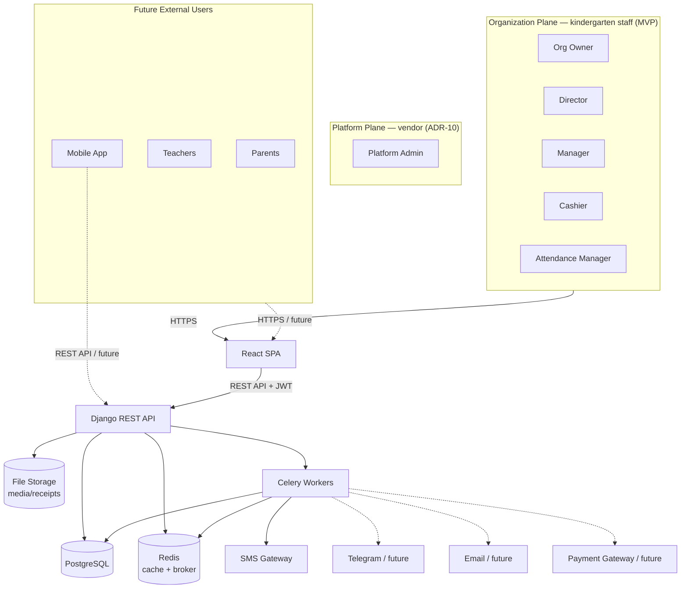

### 3.2 Deployment / Runtime Topology

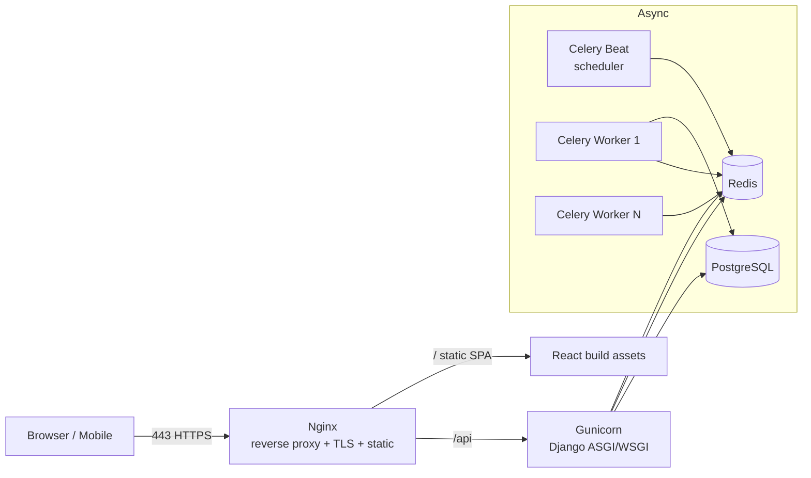

**Runtime components:**

| Component | Responsibility | Scaling model |
|-----------|----------------|---------------|
| **Nginx** | TLS termination, reverse proxy, gzip, serving SPA static build, rate limiting (edge), request buffering | Vertical; add instances behind LB later |
| **Gunicorn + Django** | Stateless API workers | Horizontal — add worker processes/containers |
| **PostgreSQL** | System of record | Vertical first, then read replicas |
| **Redis** | Cache, Celery broker/result backend, rate-limit & lock store | Vertical, then Redis cluster |
| **Celery Workers** | Async jobs (SMS, reports, aggregation) | Horizontal — add workers per queue |
| **Celery Beat** | Cron-like scheduler (daily debt recalculation, reminders) | Single instance (leader) |

### 3.3 Logical Layered Architecture (inside the backend)

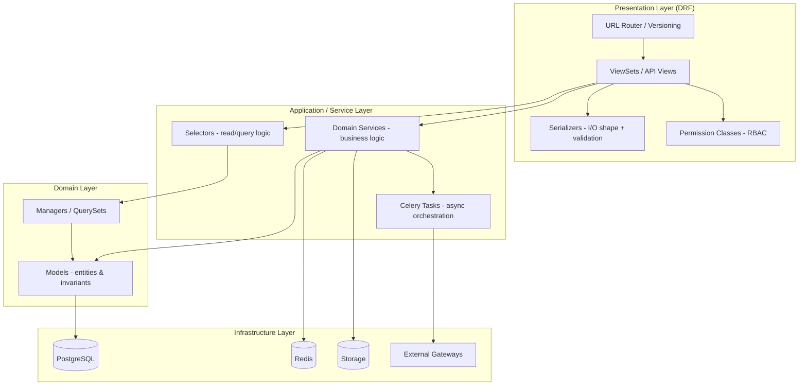

**The rule:** Views orchestrate, Serializers shape & validate I/O, **Services own business logic**, Selectors own reads, Models own data + invariants. This is the backbone of P3 and the reason the system stays maintainable as modules multiply.

---

## 4. Technology Stack Rationale

### Backend

| Technology | Role | Why it's here |
|-----------|------|---------------|
| **Python 3.12+** | Language | Ecosystem, hiring, data/AI-readiness (future AI Assistant). |
| **Django** | Web framework | Batteries-included: ORM, migrations, admin, auth scaffolding. Accelerates ERP-style CRUD. |
| **Django REST Framework** | API framework | Serialization, viewsets, permissions, browsable API, pagination. |
| **PostgreSQL** | Primary DB | ACID for finance, foreign keys, partial indexes, JSONB for flexible settings, window functions for reports. |
| **Redis** | Cache + broker | Multi-purpose: caching, Celery broker, rate limiting, distributed locks. |
| **Celery** | Task queue | Async SMS, report generation, scheduled debt recalculation, reminders. |
| **JWT (SimpleJWT)** | Auth tokens | Stateless auth for SPA + future mobile. |
| **Gunicorn** | App server | Production WSGI server, multi-worker. |
| **Nginx** | Reverse proxy | TLS, static serving, buffering, edge rate limiting. |
| **Docker** | Packaging | Reproducible environments, parity dev↔prod. |

### Frontend

| Technology | Role | Why it's here |
|-----------|------|---------------|
| **React + TypeScript** | UI + type safety | Component model + compile-time contracts against the API. |
| **Vite** | Build/dev server | Instant HMR, fast builds. |
| **Tailwind CSS** | Styling | Utility-first, consistent design system, no CSS sprawl. |
| **Shadcn/UI** | Component library | Accessible, unstyled-but-themable primitives we own (copied into repo, not a black-box dependency). |
| **TanStack Query** | Server state | Caching, background refetch, mutations, invalidation — the heart of data flow. |
| *(no form library)* | Forms + validation | Forms are plain `useState`; validation is the server's answer, so one rule is stated once ([05 §12](./05_Frontend_Architecture.md)). |
| **React Router** | Routing | Nested layouts, protected/role-based routes. |
| **Axios** | HTTP client | Interceptors for JWT attach/refresh, centralized error handling. |
| **Recharts** | Charts | Dashboard & reports visualizations. |
| **Framer Motion** | Animation | Polished transitions, professional feel. |

---

## 5. Backend Folder Structure

A **`src`-less, project-in-root** layout with a dedicated `apps/` package. Everything under `apps/` is a bounded module; everything under `config/` is deployment glue.

```
backend/
├── config/                      # Project configuration (NOT a business app)
│   ├── __init__.py
│   ├── settings/
│   │   ├── base.py              # Shared settings
│   │   ├── development.py       # Local overrides
│   │   ├── production.py        # Prod overrides
│   │   └── test.py              # Test overrides
│   ├── urls.py                  # Root URL conf → includes /api/v1/...
│   ├── asgi.py
│   ├── wsgi.py
│   └── celery.py                # Celery app instance & autodiscovery
│
├── apps/                        # ALL business modules live here
│   ├── core/                    # Shared kernel (base classes, mixins, utils)
│   ├── organizations/           # TENANCY ROOT — the customer entity (ADR-9)
│   ├── subscriptions/           # Plans, subscriptions, usage metering, vendor invoices (ADR-11)
│   ├── platform/                # Vendor-side console & platform staff (ADR-10)
│   ├── accounts/                # Users, auth, roles, RBAC
│   ├── branches/                # Branch — operational scope inside an organization
│   ├── children/                # Children, guardians, groups, enrollment
│   ├── attendance/              # Daily attendance
│   ├── finance/                 # Payments, invoices, tariffs, debtors (derived)
│   ├── hr/                      # Employees / staff records
│   ├── payroll/                 # Salaries, payroll runs, payslips
│   ├── inventory/               # Kitchen & warehouse: products, stock, suppliers
│   ├── expenses/                # Operational expenses
│   ├── reports/                 # Report generation & aggregation
│   ├── notifications/           # SMS/Telegram/Email dispatch
│   ├── settings_app/            # System-wide configurable settings
│   └── audit/                   # Audit log (cross-cutting)
│
├── api/                         # API composition root
│   └── v1/
│       └── router.py            # Aggregates all app routers under /api/v1/
│
├── requirements/
│   ├── base.txt
│   ├── development.txt
│   └── production.txt
│
├── manage.py
├── Dockerfile
├── docker-compose.yml           # dev: web, db, redis, worker, beat
├── .env.example
├── pytest.ini
└── README.md
```

### Internal structure of **every** app (the standard we enforce)

Consistency is a feature. Every app under `apps/` follows the **same** internal shape, so any developer can navigate any module instantly:

```
apps/finance/
├── __init__.py
├── apps.py                  # AppConfig
├── models.py                # Entities & invariants (or models/ package if large)
├── managers.py              # Custom QuerySets/Managers (read helpers)
├── services.py              # Business logic — the ONLY place mutations happen
├── selectors.py             # Read/query functions for the API to consume
├── serializers.py           # DRF I/O shaping + validation
├── permissions.py           # Module-specific RBAC permission classes
├── views.py                 # ViewSets/APIViews — thin orchestration only
├── urls.py                  # Module router
├── tasks.py                 # Celery tasks for this module
├── filters.py               # django-filter FilterSets
├── constants.py             # Enums, choices, status codes
├── signals.py               # Domain events (used sparingly, explicitly)
├── admin.py                 # Django admin registration
├── migrations/
└── tests/
    ├── test_services.py
    ├── test_api.py
    └── factories.py
```

> **Why this rigid uniformity?** Onboarding speed and reviewability. When `services.py` is *always* where logic lives and `selectors.py` is *always* where reads live, code review, testing, and debugging become mechanical. It also prevents the two classic Django decay patterns: fat views and fat models.

---

## 6. Recommended Django Apps (and why each exists)

Modules map to apps, but **not 1:1** — some UI modules are *views* over a shared domain (e.g. Debtors is a lens on Finance; Dashboard is an aggregation over everything). Below is the definitive mapping.

| Django App | Backs UI Module(s) | Responsibility | Why it exists as its own app |
|-----------|-------------------|----------------|------------------------------|
| **core** | (none — shared) | Base model (`created_at`, `updated_at`, `is_active`, `organization`, `branch`), mixins, pagination, exceptions, common utils, base permissions, **the tenant-scoping queryset mixin** | A shared kernel prevents copy-paste and enforces cross-cutting concerns (soft delete, timestamps, org + branch scoping) in one place. Tenant scoping lives here so it is inherited, not re-implemented per app (P10). |
| **organizations** | (implicit in every module) | The `organization` entity — the tenancy root; onboarding/signup; org-level profile and legal-entity details | The customer is the billing and isolation boundary (ADR-9). Every other app's rows point here. Kept minimal and separate from `subscriptions` so *who the customer is* stays independent of *what they pay*. |
| **subscriptions** | Billing & Subscription | Subscription plans, an organization's subscription, trial lifecycle, per-child usage metering, subscription invoices & payments | Vendor→customer money is a distinct domain from tuition (ADR-11). Isolating it prevents the two "invoice" concepts from bleeding into each other and keeps the usage ledger auditable (P11). |
| **platform** | Platform Console (vendor-only) | Platform staff identity, cross-organization console, trial/suspension operations, platform-level audit | Vendor access is not a customer role (ADR-10). A separate app means the cross-tenant capability lives in exactly one auditable place instead of being a flag scattered through business apps. |
| **accounts** | Users & Roles, Auth | Custom User, authentication, Role, Permission, role assignment, JWT issuance | Identity is foundational and security-sensitive; it must be isolated and hardened. |
| **branches** | Branches, Settings (branch) | Branch entity; the operational scope inside an organization | Branch drives staff scope, reporting, and invoice numbering. It is **not** the tenancy boundary (ADR-9) — an organization's own roles legitimately read across their branches. |
| **children** | Children | Child profiles, guardians, child↔guardian links, groups/classes, enrollment lifecycle | The CRM core. Central entity referenced by attendance, finance, and future portals. |
| **attendance** | Attendance | Daily attendance records, check-in/out, absence reasons | High-write, date-partitioned domain with its own reporting needs; kept separate for performance isolation. |
| **finance** | Payments, Debtors | Tariffs/plans, invoices, invoice lines, payments, discounts, the financial **ledger** | Money is the ERP heart. All balances/debts are derived from one consistent ledger — no duplicated "debt" tables (ADR-7). |
| **hr** | Payroll (staff data), future Teacher Portal | Employee records, positions, employment status | Employees are distinct from Users (not every employee logs in; not every user is paid). Separation avoids polluting the auth model. |
| **payroll** | Payroll | Salary structures, payroll runs, payslips, bonuses/deductions | Payroll cycles and calculations are complex and periodic; isolating them keeps HR clean and payroll auditable. |
| **inventory** | Kitchen & Warehouse | Products/items, categories, stock levels, stock movements (in/out), suppliers | Classic ERP inventory; foundation for future Meal Planning (recipes consume stock). |
| **expenses** | Expenses | Expense categories, expense records, approval state | Operational spend tracked separately from payroll and inventory for clean P&L reporting. |
| **reports** | Reports, Dashboard | Aggregation, report definitions, export generation (PDF/Excel), snapshotting | Reporting reads across modules; centralizing it prevents each module from growing ad-hoc aggregation code. |
| **notifications** | Notifications | Templates, channels (SMS now; Telegram/Email later), delivery log, dispatch orchestration | A channel-agnostic notification hub so new channels are plug-ins, not rewrites (P2). |
| **settings_app** | Settings | System settings (JSONB key-value), tariff config, feature flags | Runtime configuration without redeploys; feature flags gate future modules. |
| **audit** | (cross-cutting; surfaced in Reports/Settings) | Immutable audit log of who did what, when, to which record | Compliance and traceability for money/children (P7). Cross-cutting, so it's its own app. |

> **Note on Dashboard:** It is **not** a Django app. It is a read-only aggregation surface served by `reports` selectors (and cached). Building it as its own app would create a module that owns no data but reaches into every other module — an anti-pattern. Instead the Dashboard composes cached selector outputs.

---

## 7. Frontend Folder Structure

**Feature-based (not type-based)** architecture. Code is grouped by business feature, mirroring backend modules, with a shared foundation. This is the single most important frontend decision for scalability: adding a module means adding a folder, touching nothing else.

```
frontend/
├── public/
├── src/
│   ├── app/                      # App shell & providers
│   │   ├── App.tsx
│   │   ├── router.tsx            # Route tree (public / protected / role-based)
│   │   └── providers/            # QueryClient, Auth, Theme, Toast providers
│   │
│   ├── components/               # Shared, feature-agnostic UI
│   │   ├── ui/                   # Shadcn/UI primitives (button, dialog, table…)
│   │   ├── layout/               # Sidebar, Topbar, PageHeader, shells
│   │   ├── data-display/         # DataTable, StatCard, Chart wrappers
│   │   └── feedback/             # Spinners, EmptyState, ErrorBoundary
│   │
│   ├── features/                 # ONE folder per business module
│   │   ├── dashboard/
│   │   ├── children/
│   │   ├── payments/
│   │   ├── debtors/
│   │   ├── attendance/
│   │   ├── payroll/
│   │   ├── inventory/
│   │   ├── expenses/
│   │   ├── reports/
│   │   ├── notifications/
│   │   ├── settings/
│   │   └── users/
│   │
│   ├── lib/                      # Framework-level utilities
│   │   ├── api/
│   │   │   ├── client.ts         # Axios instance + interceptors (JWT/refresh)
│   │   │   ├── queryClient.ts    # TanStack Query config
│   │   │   └── endpoints.ts      # Central endpoint constants
│   │   ├── auth/                 # Token storage, auth helpers
│   │   ├── utils/                # formatters, date, currency, cn()
│   │   └── password.ts           # Minimal parol uzunligi (05 §12)
│   │
│   ├── hooks/                    # Global reusable hooks (useDebounce, useMediaQuery)
│   ├── config/                   # Env config, route constants, RBAC map
│   ├── types/                    # Global TS types (ApiResponse, Paginated<T>)
│   ├── styles/                   # Tailwind base, globals
│   └── main.tsx                  # Entry point
│
├── index.html
├── vite.config.ts
├── tailwind.config.ts
├── tsconfig.json
├── .env.example
└── package.json
```

### Internal structure of **every** feature (the standard)

```
features/payments/
├── api/                  # Query & mutation hooks (TanStack Query) for this feature
│   ├── usePayments.ts
│   ├── usePaymentDetail.ts
│   └── useCreatePayment.ts
├── components/           # Feature-specific components
│   ├── PaymentTable.tsx
│   ├── PaymentForm.tsx
│   └── PaymentFilters.tsx
├── pages/                # Route-level screens
│   ├── PaymentsListPage.tsx
│   └── PaymentDetailPage.tsx
├── api.ts                # So'rov/javob tiplari (TS)
│   └── payment.schema.ts
├── types/                # TypeScript types for this feature
│   └── payment.types.ts
├── hooks/                # Feature-local hooks
└── index.ts             # Public exports (barrel) — the feature's contract
```

> **Why feature-based?** Type-based folders (`/components`, `/pages`, `/hooks` globally) collapse under growth — every change touches five distant folders. Feature-based keeps a module's code **co-located and cohesive**, mirrors the backend, and makes deleting or extracting a feature trivial. The `index.ts` barrel makes each feature's public surface explicit (P4).

---

## 8. Recommended React Folders (and why)

| Folder | What lives here | Why it exists |
|--------|-----------------|---------------|
| **app/** | App shell, router, global providers | Single composition root; keeps `main.tsx` trivial and providers ordered in one visible place. |
| **app/providers/** | `QueryClientProvider`, `AuthProvider`, `ThemeProvider`, toast | Provider nesting is error-prone; centralizing it prevents "why is my context undefined" bugs. |
| **components/ui/** | Shadcn primitives | We **own** these primitives (copied in), so they're versioned with our app and themeable. |
| **components/layout/** | Sidebar, Topbar, page shells | Layout is shared across all features; duplicating it per feature would fracture the UX. |
| **components/data-display/** | `DataTable`, `StatCard`, chart wrappers | Reusable presentation used by many features; standardizes tables/cards/charts once. |
| **components/feedback/** | Spinner, EmptyState, ErrorBoundary | Consistent loading/error/empty states across the app — a hallmark of enterprise polish. |
| **features/** | One folder per business module | The core of scalability: features are self-contained and mirror backend apps (P1, P2). |
| **features/\*/api/** | TanStack Query hooks | Data-fetching lives beside the feature that uses it; the only place server state is defined. |
| **features/\*/api.ts** | Request/response types | Hand-written TS mirroring [04](./04_Backend_API_Specification.md); validation stays on the server ([05 §12](./05_Frontend_Architecture.md)). |
| **lib/api/** | Axios client, interceptors, query client | One HTTP entry point → one place for auth headers, token refresh, and error normalization. |
| **lib/auth/** | Token storage & helpers | Isolates the sensitive auth mechanics; swapping storage strategy touches one folder. |
| **lib/utils/** | Formatters (currency, date), `cn()` | Pure helpers shared everywhere; no business logic. |
| **hooks/** | Global hooks (`useDebounce`, `useMediaQuery`) | Cross-feature behavior that isn't tied to any module. |
| **config/** | Env, route constants, RBAC route map | Configuration and the role→route map live in one auditable place. |
| **types/** | Global types (`ApiResponse<T>`, `Paginated<T>`) | The shared shape of the API envelope, used by every feature. |

---

## 9. Module Relationships

Modules are bounded, but they **collaborate**. The map below shows who reads from / writes to / notifies whom. Arrows are **directional dependencies** (A → B means "A depends on / calls B").

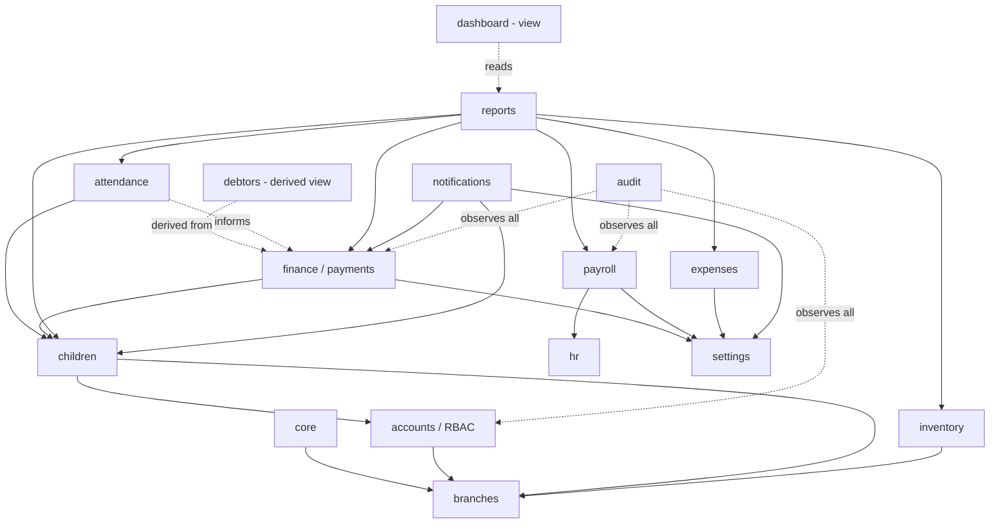

### Relationship table (the contracts)

| From | To | Interaction | Mechanism |
|------|----|-------------|-----------|
| attendance | children | Reads child/group to record attendance | Service call / FK |
| finance | children | Invoices belong to a child | FK + service |
| finance | settings | Reads active tariff/discount config | Selector |
| debtors | finance | Debtor list = children with positive outstanding balance | **Selector over finance ledger** (no own tables) |
| attendance | finance | Absence may affect billing (future rule engine) | Domain event (signal) → service |
| payroll | hr | Payroll runs over employees | Service call / FK |
| notifications | finance | "Payment received" / "debt reminder" triggers | Domain event → Celery task |
| notifications | children | Resolve guardian contact for messaging | Selector |
| reports | (all) | Aggregates across modules | **Read-only selectors** — never writes |
| dashboard | reports | Cached KPI aggregation | Selector + Redis cache |
| audit | finance/accounts/payroll | Records every mutation | Signals / service-layer hooks |

> **Enforced rule (P1):** cross-module communication happens through **service functions, selectors, or domain events** — never by importing and querying another app's models directly from a view. `reports` is the only broad reader, and it is **read-only**. This is what lets us later extract, e.g., `finance` into a separate service.

---

## 10. Authentication Flow

**Stateless JWT** using access + refresh tokens (SimpleJWT). Access tokens are short-lived; refresh tokens are long-lived and rotated.

### 10.1 Login & token lifecycle

```mermaid
sequenceDiagram
    participant U as User
    participant SPA as React SPA
    participant API as Django API
    participant DB as PostgreSQL
    participant R as Redis

    U->>SPA: Enter credentials
    SPA->>API: POST /api/v1/auth/login {email, password}
    API->>DB: Verify credentials
    API->>API: Load user + role + permissions
    API-->>SPA: 200 { access (15m), refresh (7d), user profile }
    SPA->>SPA: Store access in memory; refresh in httpOnly cookie / secure store
    SPA->>API: GET /api/v1/children (Authorization: Bearer access)
    API->>API: Validate JWT + check permission
    API-->>SPA: 200 data

    Note over SPA,API: Access token expires
    SPA->>API: request → 401 (token expired)
    SPA->>API: POST /api/v1/auth/refresh {refresh}
    API->>R: Check refresh not blacklisted
    API-->>SPA: 200 { new access, rotated refresh }
    SPA->>API: retry original request
```

### 10.2 Token strategy & rationale

| Token | Lifetime | Stored where | Purpose |
|-------|----------|--------------|---------|
| **Access** | ~15 min | In-memory (JS) | Sent as `Authorization: Bearer` on every request. Short life limits theft window. |
| **Refresh** | ~7 days | httpOnly, Secure, SameSite cookie (preferred) | Obtains new access tokens; rotated on each use; blacklisted on logout. |

**Frontend handling (Axios interceptors):**
- **Request interceptor** attaches the access token.
- **Response interceptor** catches `401`, calls `/auth/refresh` **once**, queues concurrent failed requests, retries them after refresh, and on refresh failure → force logout + redirect to `/login`.

**Logout:** refresh token is **blacklisted** in Redis; frontend clears in-memory access token and cookie.

**Endpoints (contract):**
```
POST /api/v1/auth/login       → issue tokens
POST /api/v1/auth/refresh     → rotate access (+refresh)
POST /api/v1/auth/logout      → blacklist refresh
GET  /api/v1/auth/me          → current user profile + role + permissions
POST /api/v1/auth/password/change
```

> The frontend loads `/auth/me` on boot to hydrate the auth context (role, permissions, branch) which drives **role-based routing and UI gating**.

---

## 11. Authorization — RBAC

Authorization is **role-based, deny-by-default, and enforced on the backend** (the frontend only *hides* what the backend *forbids*). We use a **custom Role + Permission model**, not raw Django groups (ADR-4), because roles are business concepts, are branch-scoped, and are managed through the UI.

### 11.0 Two access planes (ADR-10)

Authorization operates on **two planes that never merge**:

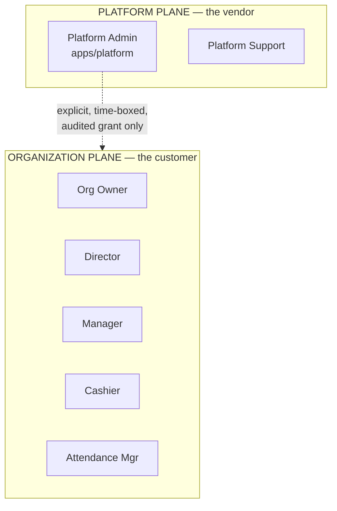

| | Platform plane | Organization plane |
|---|---|---|
| Who | Vendor staff | Kindergarten staff |
| Lives in | `apps/platform`, separate table | `accounts.User` + `accounts.Role` |
| Login path | Separate endpoint; TOTP when `PLATFORM_2FA_REQUIRED` is on (ADR-24, **default on**) | Standard `/auth/login`; optional per-user 2FA (ADR-24) |
| Data access | **None by default.** Sees organization *metadata* (name, plan, status, child count) — never children, payments, or payroll. | Full access to their own organization, per role |
| Cross-organization | Yes, metadata only | **Never, under any role** |

> **The rule that makes this safe:** `organization_id` scoping is applied by the **base queryset**, and platform staff are not exempt from it — they simply have no organization. Reading a customer's operational data requires an explicit, time-boxed, customer-visible support grant that is written to the audit log. There is no "god flag" that silently unlocks tenant data.

### 11.1 Organization roles

> **`Super Admin` no longer exists.** It was defined as bypassing all scoping, which in a multi-tenant system would expose every customer's data to whoever held it. It is replaced by **Org Owner** (customer, org-scoped) and **Platform Admin** (vendor, different plane) — ADR-10.

| Role | Scope | Description |
|------|-------|-------------|
| **Org Owner** | All branches **of their own organization** | Full control of their organization: Users & Roles, Settings, Billing & Subscription, all financial and operational data across their branches. Cannot see any other organization — this is enforced, not conventional. |
| **Director** | Branch (all modules) | Full operational visibility & control within a branch: children, finance, payroll, inventory, expenses, reports. Cannot manage system-level settings/roles beyond their branch. |
| **Manager** | Branch (operations) | Day-to-day operations: children, attendance oversight, inventory/kitchen, expenses. Limited financial write; read reports. No payroll, no role management. |
| **Cashier** | Branch (finance) | Payments intake, invoices, debtor follow-up. Read children. **Sees every payment and who took it** (ADR-47), but acts only on their own; the month's total, the daily cash report and in-transit money stay personal (ADR-30). No dashboard, expenses, reports, payroll, settings or user management. |
| **Attendance Manager** | Branch (attendance) | Records and manages daily attendance. Read-only children. No finance, payroll, or settings. |

### 11.2 Permission matrix (MVP)

Legend: **F** = Full (CRUD), **W** = Create/Update, **R** = Read-only, **—** = No access.

| Module | Org Owner | Director | Manager | Cashier | Attendance Mgr |
|--------|:---------:|:--------:|:-------:|:-------:|:--------------:|
| Dashboard | F | F | R | — | R |
| Children | F | F | W | R | R |
| Payments | F | F | R | F (reads all, acts on own — ADR-30, ADR-47) | — |
| Debtors | F | F | R | W | — |
| Attendance | F | F | W | — | F |
| Payroll | F | F | — | — | — |
| Kitchen & Warehouse | F | F | F | — | — |
| Expenses | F | F | W | — | — |
| Reports | F + finance | F + finance | R | — | R (attendance only) |
| Notifications | F | F | W | W (payment/debt) | — |
| Settings | F | R | — | — | — |
| **Branches** | **F** | **R** | **—** | **—** | **—** |
| **Billing & Subscription** | **F** | **—** | **—** | **—** | **—** |
| Users & Roles | F | R (branch) | — | — | — |
| Audit Log | F | R | — | — | — |

> **The Reports row is enforced per report, not per module.** `reports.read` alone opens nothing: each endpoint additionally requires the permission of the subject it reports on — `revenue` → `payments.read`, `expenses` → `expenses.read`, `payroll` and `profit-loss` → `payroll.read` (P&L contains payroll), `debtors` → `debtors.read`, `attendance` → `attendance.read` (`apps/reports/views.py` `REPORT_SCOPE`). A finished CSV export is guarded the same way, so exporting cannot walk around the matrix. Without this, one flat `reports.read` handed an Attendance Manager the kindergarten's revenue and profit — contradicting their own row ("No finance, payroll, or settings").
>
> **The finance centre has a key of its own** (ADR-42). Profit and loss, cash flow, position, the home cards and the monthly pack open with **`reports.finance` or `payroll.read`**. `reports.finance` (an `EXTRA_ACTIONS` permission, seeded for Org Owner and Director) shows totals only — the pack carries payroll as sums, never by name — so the owner can let a manager prepare and submit the monthly report without showing who earns what. `payroll.read` still opens the centre, so no role that had it lost it on the day the new key shipped.
>
> **`GET /dashboard` follows the same rule, block by block.** The dashboard is a shortcut to data the caller can already reach elsewhere, never a second way in, so **each block carries its own permission** and a block the role may not read is left out of the response rather than hidden by the client (`DASHBOARD_SECTIONS`, [04 §14.1](./04_Backend_API_Specification.md)): children → `children.read`, attendance → `attendance.read`, low stock → `inventory.read`, money → `payments.read`/`debtors.read`, and **cash balance → all of `payments.read`, `expenses.read`, `payroll.read`** (one number combines all three; given any two the third follows). The cache key carries the set of blocks, so a full payload cached for the owner is never served to a teacher. The frontend hides the tiles to match, and the finance **Reports page** (revenue, expenses, payroll, P&L) is navigated and routed by a finance permission **and** `reports.read` (`NavItem.requires`) — the finance permission alone showed a cashier a page whose every tab answered `403` once ADR-30 took `reports.read` away.
>
> **No role may land on a page it cannot open.** Every "safe destination" in the SPA used to be a hard-coded `/dashboard`. That held only because every *system* role has `dashboard.read` — the first customer built a custom "Tarbiyachi" role (children, groups, attendance) and the account opened on an error box instead of the app. The destination is now computed from the person's permissions (`landingPathFor()`, first open item in the sidebar, `/profile` as the floor) and `/home` is the post-login entry point; `/` cannot be used because on the SaaS deployment the marketing site owns the root ([05 §9](./05_Frontend_Architecture.md)).

> **Billing is Org Owner only.** A Director who can see the subscription invoice can infer the vendor's pricing for every branch; more importantly, changing the payment term is a commercial commitment for the legal entity, not a branch operation.

**This matrix is the seeded starting point, not a permanent constraint.** It is written to each organization's `role`/`role_permission` rows at signup (`seed_system_roles`, which runs once per organization and is never re-applied). From there the **Org Owner may re-assign any permission to any role — system roles included — and may create additional roles**, because kindergartens divide work differently: in one, the cashier also marks attendance; in another, they must not.

Two rails keep that freedom safe:

| Rail | Rule | Why |
|------|------|-----|
| **Owner lockout** | The `org_owner` role must always keep `users.read` and `users.update` (`OWNER_LOCKED_PERMISSIONS`); removing them returns `422`. | Roles are edited only by someone holding `users.update`. Dropping it would leave the tenant permanently unable to fix any role — recoverable only through a vendor `SupportGrant` (ADR-10). |
| **System role codes are immutable** | A system role can be renamed and re-permissioned, but its `code` cannot change, and it cannot be deleted. | Code paths key off the code (e.g. `role.code != "org_owner"` decides whether a branch is required). Renaming it would break permission logic silently. |

Custom roles carry `is_system = false`, get a normalized `code` (`"Kassir yordamchisi"` → `kassir_yordamchisi`, unique per organization), and may be deleted.

### 11.3 How it's enforced

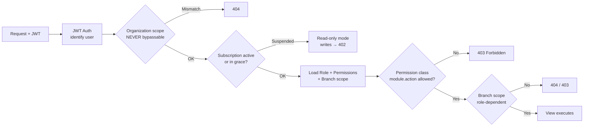

- **Permission model:** `permission = "<module>.<action>"` e.g. `payments.create`, `children.read`. Roles hold a set of permissions.
- **DRF Permission classes** in each app's `permissions.py` check `module.action` against the user's role.
- **Organization scoping (P10):** the base queryset mixin filters **every** query by the authenticated user's `organization_id`. This is applied first, before any permission logic, and **no role bypasses it**. A cross-organization reference returns `404`, never `403` — a `403` would confirm the row exists in another tenant.
- **Branch scoping (P6):** applied *after* organization scoping. Org Owner reads across all branches **within their organization**; every other role is bound to their branch.
- **Subscription gate:** a suspended organization degrades to **read-only** — writes return `402 Payment Required`. Data is never deleted or hidden for non-payment ([01 §4.4](./01_Project_Vision.md)).
- **Frontend mirroring:** the `config/rbac.ts` map and an `useCan(permission)` hook hide/disable UI the user can't use — **UX only**, never a security boundary.

> **The failure mode this ordering prevents:** a developer writing a new endpoint forgets the tenant filter. Because scoping lives in the shared base queryset and is applied before the view's own logic, forgetting it is not possible without deliberately opting out — and opting out is greppable. Defense in depth is added by Postgres **Row-Level Security** on `organization_id` before the first paying customer ([03 §6](./03_Database_Design.md)).

> **Design note:** permissions are **data**, not code. New roles or permission tweaks are configuration changes, and future roles (Teacher, Parent) slot into the same matrix without code changes — critical for the Parent/Teacher Portal roadmap.

---

## 12. Database Architecture (Entities & Relationships)

> No models here — this describes **entities and how they relate**, per the brief. PostgreSQL is the single system of record.

### 12.1 Cross-cutting conventions

- Every business table inherits from a **base entity**: `id (UUID)`, `created_at`, `updated_at`, `is_active` (soft delete), **`organization_id` (P10 — mandatory on every operational table)**, and — where applicable — `branch_id` (P6).
- **`organization_id` is denormalized onto every operational table**, not derived by joining through `branch`. The extra UUID column buys two things: every scoping filter is a single hop (no forgotten join can leak across tenants), and Postgres RLS policies stay simple. This is the one denormalization we accept without a consistency trigger, because the value is immutable for the row's lifetime.
- **UUID primary keys** for externally-referenced entities (children, payments) to avoid enumeration and ease future distribution; sequential IDs internally are acceptable for high-volume append-only tables (attendance) if needed.
- **Soft delete** by default (`is_active=false`) for anything audited; hard delete only for truly transient data.
- **Money** stored as `Decimal` (never float), with an explicit currency at the branch/settings level.

### 12.2 Entity–Relationship Overview

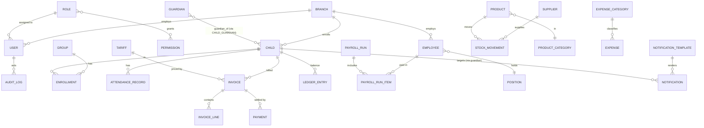

### 12.3 Domain-by-domain entities

**Identity & Access (`accounts`, `branches`)**
| Entity | Key attributes | Relationships |
|--------|----------------|---------------|
| Branch | name, address, currency, timezone, is_active | 1—N Users, Children, Employees |
| User | email (login), password hash, is_active, branch | N—1 Role, N—1 Branch |
| Role | name, description, is_system | M—N Permission, 1—N User |
| Permission | code (`module.action`), label | M—N Role |

**Children CRM (`children`)**
| Entity | Key attributes | Relationships |
|--------|----------------|---------------|
| Child | full name, DOB, gender, enrollment status, branch | N—M Guardian, 1—N Enrollment, 1—N Attendance, 1—N Invoice |
| Guardian | full name, phone, relation type | N—M Child (via ChildGuardian) |
| ChildGuardian | relation, is_primary, can_pickup | join(Child, Guardian) |
| Group | name, age range, capacity, branch | 1—N Enrollment |
| Enrollment | start_date, end_date, status | N—1 Child, N—1 Group |

**Attendance (`attendance`)**
| Entity | Key attributes | Relationships |
|--------|----------------|---------------|
| AttendanceRecord | date, status (present/absent/excused), check_in, check_out, reason | N—1 Child, N—1 Group |

**Finance (`finance`) — the ledger is the source of truth**
| Entity | Key attributes | Relationships |
|--------|----------------|---------------|
| Tariff / Plan | name, amount, period (monthly), branch | 1—N Invoice |
| Invoice | number, period, amount_due, status, due_date | N—1 Child, N—1 Tariff, 1—N InvoiceLine, 1—N Payment |
| InvoiceLine | description, amount, quantity | N—1 Invoice |
| Payment | amount, method, paid_at, received_by | N—1 Invoice |
| Discount | type (%/fixed), reason, validity | applied to Invoice/Child |
| LedgerEntry | direction (debit/credit), amount, ref | N—1 Child — **balance = Σ entries** |

> **Debtors are derived:** a *debtor* is any Child whose ledger balance is > 0 (owes money) past due. There is **no `Debtor` table** — the Debtors module is a **selector/query** over `LedgerEntry`/`Invoice`. This is ADR-7 and prevents the classic bug where a stored debt table drifts out of sync with actual payments.

**HR & Payroll (`hr`, `payroll`)**
| Entity | Key attributes | Relationships |
|--------|----------------|---------------|
| Employee | full name, phone, hire_date, status, base_salary, branch | N—1 Position, 1—N PayrollRunItem, optional 1—1 User |
| Position | title, department | 1—N Employee |
| PayrollRun | period, status, totals, created_by | 1—N PayrollRunItem |
| PayrollRunItem | gross, deductions, bonuses, net | N—1 PayrollRun, N—1 Employee |

**Inventory / Kitchen & Warehouse (`inventory`)**
| Entity | Key attributes | Relationships |
|--------|----------------|---------------|
| ProductCategory | name | 1—N Product |
| Product | name, unit, min_stock, current_stock, branch | N—1 Category, 1—N StockMovement |
| Supplier | name, contact | 1—N StockMovement |
| StockMovement | direction (in/out), quantity, unit_price, date, reason | N—1 Product, N—1 Supplier |

**Expenses (`expenses`)**
| Entity | Key attributes | Relationships |
|--------|----------------|---------------|
| ExpenseCategory | name | 1—N Expense |
| Expense | amount, date, description, status, branch | N—1 Category, N—1 User (created_by) |

**Notifications (`notifications`)**
| Entity | Key attributes | Relationships |
|--------|----------------|---------------|
| NotificationTemplate | code, channel, subject, body (with variables) | 1—N Notification |
| Notification | recipient, channel, rendered body, status, sent_at, retry_count | N—1 Template |

**Settings & Audit (`settings_app`, `audit`)**
| Entity | Key attributes | Relationships |
|--------|----------------|---------------|
| SystemSetting | key, value (JSONB), branch (nullable = global) | scoped by branch |
| AuditLog | actor(User), action, entity_type, entity_id, before/after (JSONB), timestamp, ip | N—1 User |

### 12.4 Indexing & integrity highlights
- Composite indexes on hot query paths: `attendance(child_id, date)`, `invoice(child_id, status)`, `ledger(child_id)`, `stock_movement(product_id, date)`, `payment(paid_at)`.
- `branch_id` indexed on every scoped table (drives RBAC scoping and future sharding).
- Foreign keys `ON DELETE` set to `PROTECT` for financial references (never silently cascade money), `RESTRICT`/soft-delete elsewhere.
- Unique constraints: `invoice.number`, `permission.code`, `attendance(child_id, date)`.

---

## 13. API Architecture

### 13.1 REST strategy
- **Resource-oriented**, plural nouns, HTTP verbs for actions:
  `GET /children`, `POST /children`, `GET /children/{id}`, `PATCH /children/{id}`, `DELETE /children/{id}`.
- **Non-CRUD operations** as sub-resources or actions: `POST /invoices/{id}/payments`, `POST /payroll/runs/{id}/finalize`.
- **Stateless**: every request carries the JWT; no server session.

### 13.2 URL versioning
- **URI versioning**: everything under `/api/v1/`. A future breaking change ships as `/api/v2/` while `v1` keeps serving the mobile app / older clients. This is the safest, most explicit versioning for a product with multiple future consumers (mobile, portals).

```
/api/v1/auth/...
/api/v1/children/...
/api/v1/payments/...
/api/v1/attendance/...
...
```

### 13.3 Pagination
- **Cursor or page-number pagination**; default **page-number** for admin tables (users expect "page 3 of 20").
- Standard query params: `?page=2&page_size=25` (max page_size capped, e.g. 100).
- Response includes `count`, `next`, `previous`, and `results`.

### 13.4 Filtering, Searching, Sorting
| Concern | Convention | Example |
|--------|-----------|---------|
| Filtering | `django-filter` FilterSets, field-based query params | `/children?group=5&status=active` |
| Searching | `?search=` across configured text fields | `/children?search=aziz` |
| Sorting | `?ordering=` with `-` for desc, multi-field allowed | `/payments?ordering=-paid_at` |
| Date ranges | `?date_after=&date_before=` | `/attendance?date_after=2026-07-01` |

### 13.5 Standard success response envelope
Consistency lets the frontend write **one** response handler.

```json
{
  "success": true,
  "data": { },
  "meta": {
    "pagination": { "count": 120, "page": 2, "page_size": 25, "total_pages": 5 }
  },
  "message": null
}
```
For lists, `data` is the array and `meta.pagination` is populated. For single resources, `data` is the object and `meta` may be omitted.

### 13.6 Standard error format
One error shape everywhere → predictable frontend handling and toasts.

```json
{
  "success": false,
  "error": {
    "code": "VALIDATION_ERROR",
    "message": "The submitted data is invalid.",
    "details": {
      "amount": ["This field must be greater than 0."],
      "child": ["This child does not exist."]
    }
  }
}
```

**Error code taxonomy (stable, machine-readable):**
| HTTP | `error.code` | When |
|------|-------------|------|
| 400 | `VALIDATION_ERROR` | Field validation failed (`details` per field) |
| 401 | `AUTHENTICATION_REQUIRED` | Missing/expired token |
| 403 | `PERMISSION_DENIED` | RBAC / branch scope denies |
| 404 | `NOT_FOUND` | Resource missing or outside branch scope |
| 409 | `CONFLICT` | Duplicate / state conflict (e.g. double payment) |
| 422 | `BUSINESS_RULE_VIOLATION` | Valid input, violates domain rule |
| 429 | `RATE_LIMITED` | Throttled |
| 500 | `INTERNAL_ERROR` | Unhandled (no internals leaked) |

Implemented via a **custom DRF exception handler** in `core/` so every app returns the same envelope automatically.

### 13.7 API documentation
- **OpenAPI 3 schema** auto-generated (drf-spectacular) → served as Swagger UI at `/api/docs`. The schema is the living contract the frontend types can be generated from.

---

## 14. Frontend Architecture

### 14.1 Pages, Layouts & Routing model

```mermaid
graph TD
    ROOT[RootProviders<br/>Query + Auth + Theme]

    ROOT --> PUB[PublicLayout]
    ROOT --> PROT[ProtectedRoute<br/>requires valid JWT]

    PUB --> LOGIN[/login/]
    PUB --> FORGOT[/forgot-password/]
    PUB --> NF[404 / not-authorized]

    PROT --> APPL[AppLayout<br/>Sidebar + Topbar]
    APPL --> RB[RoleRoute wrapper<br/>checks permission]

    RB --> DASH[/dashboard/]
    RB --> CHILD[/children/*]
    RB --> PAYM[/payments/*]
    RB --> DEBT[/debtors/*]
    RB --> ATTN[/attendance/*]
    RB --> PAYR[/payroll/*]
    RB --> INV[/inventory/*]
    RB --> EXP[/expenses/*]
    RB --> REP[/reports/*]
    RB --> NOTIF[/notifications/*]
    RB --> SET[/settings/*]
    RB --> USR[/users/*]
```

### 14.2 Route categories

| Category | Wrapper | Behavior |
|----------|---------|----------|
| **Public routes** | `PublicLayout` | `/login`, `/forgot-password`. Accessible without auth. If already authenticated → redirect to the first section the role may open (`landingPathFor()`), not a fixed `/dashboard`. |
| **Protected routes** | `ProtectedRoute` | Require a valid session; unauthenticated → redirect to `/login` (preserving intended URL). |
| **Role-based routes** | `PermissionRoute permission="module.read"` | Wrap protected routes; if the user's role lacks the permission → redirect to the first section it *may* open. Drives the sidebar too (hide links the user can't access). `/dashboard` is wrapped like every other page — it is not a universal fallback. |

### 14.3 Layouts
- **PublicLayout** — centered card, branding, no nav (auth screens).
- **AppLayout** — persistent Sidebar (module nav, filtered by permissions), Topbar (user menu, branch selector for multi-branch future, notifications bell), and a content `<Outlet/>`.
- **Page** — each route renders a Page component from its feature's `pages/`, composed of feature components. Pages orchestrate; they don't hold business logic.

### 14.4 Component layering
```
Page  →  Feature Components  →  Shared UI (Shadcn)  →  Primitives
```
Pages fetch via feature `api/` hooks (TanStack Query), pass data down, and handle mutations. Presentational components stay dumb and reusable.

---

## 15. State Management Strategy

The single most common frontend mistake is dumping everything into one global store. We split state by **its true nature**:

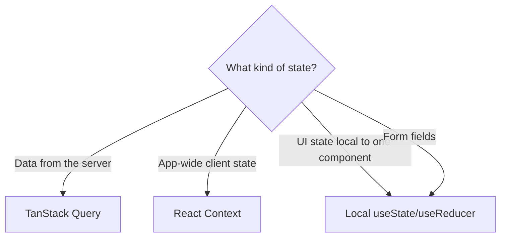

| State type | Tool | Examples | Rule |
|-----------|------|----------|------|
| **Server state** | **TanStack Query** | children list, payments, dashboard KPIs, any API data | **Default choice.** Never copy server data into Context/global state. Query owns caching, refetch, invalidation, loading/error. |
| **Global client state** | **React Context** (thin) | authenticated user + permissions, current branch, theme, toast | Only for truly app-wide, low-frequency data. Keep providers small to avoid re-render storms. |
| **Local UI state** | `useState` / `useReducer` | modal open, selected rows, active tab, filter drafts | Keep it as local as possible; lift only when genuinely shared. |
| **Form state** | `useState` | create/edit forms everywhere | No form library: fields are ordinary local state and validation is the server's answer, so a rule is stated once ([05 §12](./05_Frontend_Architecture.md)). A form with genuine cross-field state would be the case to add one — none exists yet. |

**Concrete conventions:**
- Query keys are structured and centralized per feature: `['payments', { filters }]`, `['payments', id]`. Mutations **invalidate** the relevant keys — no manual refetch juggling.
- Auth/permissions live in a **single AuthContext**, hydrated from `/auth/me`, consumed by `useAuth()` and `useCan()`.
- **No Redux.** With TanStack Query owning server state and Context handling the small global slice, Redux would be ceremony without benefit. If a genuinely complex *client* state machine appears later (e.g. a multi-step wizard), reach for Zustand locally — not a global store.

---

## 16. File Storage

### 16.1 Storage abstraction (key decision)
All file access goes through Django's **storage backend abstraction**. In MVP files live on the **server filesystem** (served by Nginx); the config can switch to **S3-compatible object storage** (MinIO/AWS S3) with **zero application code change** — critical for scaling and multi-server deployments (P2).

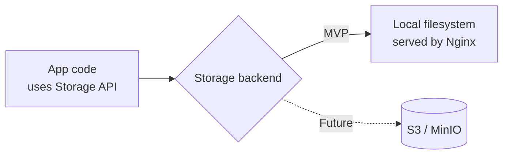

### 16.2 What we store & how it's organized

| Category | Examples | Access | Path convention |
|----------|----------|--------|-----------------|
| **Media / Images** | Child photos, staff photos, product images | Authenticated; branch-scoped | `media/{branch}/children/{child_id}/avatar.jpg` |
| **Documents** | Contracts, enrollment PDFs, staff docs | Authenticated; role-gated | `media/{branch}/documents/{entity}/{id}/...` |
| **Receipts** | Payment receipts, invoices (generated PDFs) | Authenticated; finance roles | `media/{branch}/receipts/{year}/{month}/{invoice_no}.pdf` |
| **Reports/Exports** | Generated Excel/PDF reports | Temporary, signed URL | `media/exports/{user}/{uuid}.xlsx` |

### 16.3 Rules
- **Private by default.** No file is publicly reachable by guessing a URL. Downloads go through an authenticated endpoint (or short-lived signed URLs when on S3).
- **Validation on upload:** file type allowlist (images: jpg/png/webp; docs: pdf), size limits, and — for images — server-side re-encode/thumbnail generation via a **Celery task** (never block the request).
- **UUID filenames** to prevent collisions and enumeration; original name kept as metadata.
- **Receipts/invoices** are generated asynchronously (Celery) and stored, then linked from the payment record.

---

## 17. Notifications Architecture

Designed as a **channel-agnostic hub** so SMS ships now and Telegram/Email/Push are **plug-ins**, not rewrites (P2).

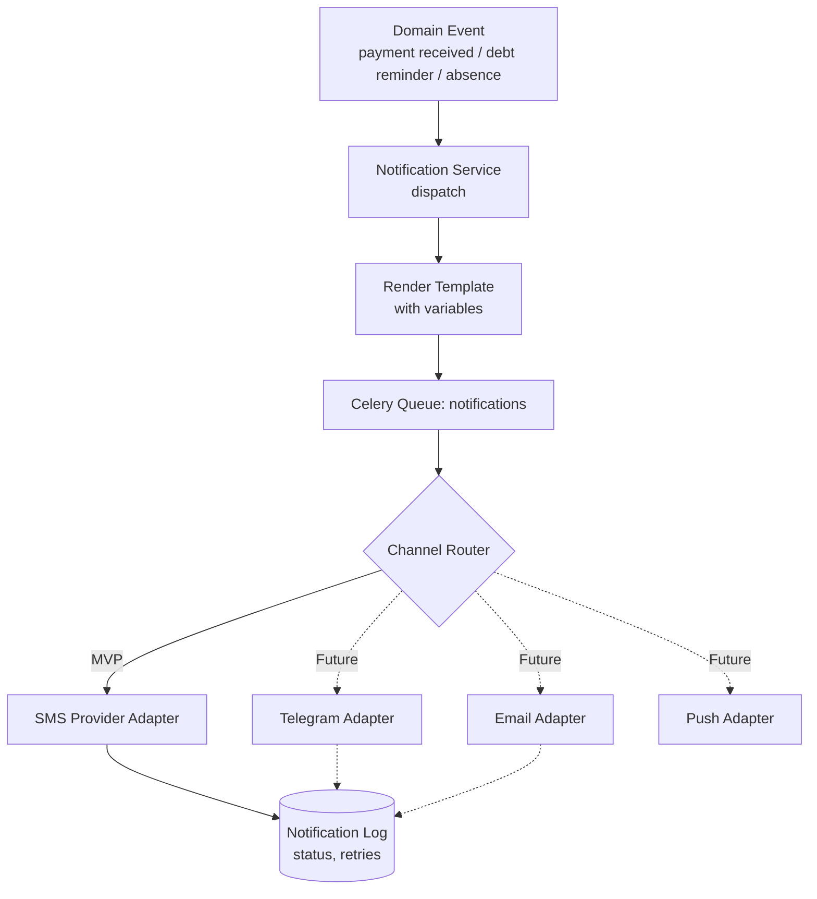

### 17.1 Design pillars

| Pillar | Detail |
|--------|--------|
| **Channel adapter interface** | Every channel implements the same interface: `send(recipient, rendered_message) -> DeliveryResult`. Adding Telegram/Email = adding one adapter class + config. The rest of the system is untouched. |
| **Template-driven** | Messages come from `NotificationTemplate` (code + channel + body with `{variables}`). Non-developers can edit wording in Settings. |
| **Always async** | Dispatch happens in a Celery task on the `notifications` queue. A slow/downed SMS gateway never blocks a user request. |
| **Delivery log & retries** | Every send is recorded (`queued → sent → delivered/failed`) with retry/backoff. Failures are visible in the Notifications module. |
| **Provider abstraction** | Providers sit behind an adapter and are chosen **per channel** (`provider_name(channel)`): Telegram is decided by the presence of `TELEGRAM_BOT_TOKEN` — one bot, nothing to choose — while SMS is a swappable set of gateways picked by `NOTIFICATION_PROVIDER` (`console`, `eskiz`). A provider that cannot deliver reports `test_mode`, never `sent` (ADR-22). |
| **Telegram is the primary channel** | ADR-23. `resolve_channel(guardian)` sends on Telegram when the parent has joined the bot, and on SMS **only when that gateway is really connected** — never a fall-through to a console provider. An unreachable parent produces a `failed` row with the reason, which is visible, rather than a silent skip. |
| **Consent lives in the link** | A `chat_id` exists only after the parent starts the bot, so the invite link is the consent record. The code embeds the organization so the webhook never crosses a tenant boundary, and it is single-use because the link can be forwarded while the message carries a child's name and balance (`apps/children/telegram.py`). |
| **The log never flatters itself** | `test_mode` is a distinct status, an unusable number is `failed` with a reason before any provider call, and a message outside the sending window stays `queued`. "Sent" means a gateway accepted it for delivery — nothing else. |
| **Sending rules are settings** | Window (`notifications.send_from_hour`/`send_to_hour`), daily reminder cap, retry count and SMS price are per-organization data, not constants. |
| **Cost is per part** | 160 Latin / 70 Cyrillic characters per part; the maths lives in `apps/notifications/segments.py` and is mirrored (and tested) in `frontend/src/features/notifications/sms.ts`. Uzbek apostrophes are normalised before sending, because a single `ʻ` doubles the price of the whole message. |
| **Preference-ready** | Schema anticipates per-guardian channel preferences (needed once Parent Portal exists). |

### 17.2 MVP triggers
- Payment received → SMS receipt to guardian.
- Debt reminder → scheduled SMS to debtors (Celery Beat, e.g. weekly), capped per guardian per day.
- (Config-gated) attendance absence notice.
- New website lead → Telegram message to the sales chat (`apps/platform/alerts.py`). It runs inside `transaction.on_commit`, is skipped silently when unconfigured, and can never fail the lead itself: the notification is a convenience, the lead is the business.

### 17.3 The bot's inbound side

One bot serves both jobs — parent messages and the sales alert — so there is a single token and a single webhook: `POST /api/v1/public/telegram/webhook/{secret}`.

| Rule | Why |
|------|-----|
| The secret is **in the path**, and is also checked against `X-Telegram-Bot-Api-Secret-Token` when present | This is the only unauthenticated write endpoint in the product. A mismatch answers `404`, not `403`: confirming that the endpoint exists is itself information. |
| It always answers `200` | Telegram redelivers an update for hours after a non-`2xx`. One of our exceptions would have become an infinite loop, so failures are logged and acknowledged. |
| Only `/start <code>` and `/stop` are handled | The bot is not a place to hold a conversation, and a parent's free text is not stored. |
| `/start` resolves the tenant **from the code**, then works inside `organization_context` | See ADR-23: operational tables have no platform-mode exit, and the right answer was to make the code carry the context rather than widen RLS. |
| `/stop` clears the chat in **every** organization, each inside its own context | The parent pressed stop in one chat and sees one bot; messages continuing from a second kindergarten would break that promise. The loop is cheap because `/stop` is rare. |

`python manage.py set_telegram_webhook --base-url https://radix-crm.uz` registers it, assembling the URL from the same settings the app reads — so the address Telegram calls and the address the app expects cannot drift apart.

> **Future path:** Telegram bot and Email are new adapters registered with the Channel Router; the AI Assistant can later compose message bodies feeding the same templates.

---

## 18. Background Jobs (Celery)

### 18.0 Reliability

By default Celery acknowledges a task **before** running it, so a worker that dies mid-task — OOM, a deploy, a rebooted server — loses the task silently. For the invoice run on the 1st of the month that reads: *that month's invoices were never issued, and nobody found out.*

The settings therefore enable `task_acks_late` with `task_reject_on_worker_lost`: a task is acknowledged only once it finishes, and is redelivered otherwise. That trade is only sound if tasks are idempotent, which is why idempotency came first:

| Task | What stops a second run from doing damage |
|------|-------------------------------------------|
| `finance.generate_monthly_invoices` | `uq_invoice_child_period` — a partial unique index; the **database** refuses the duplicate |
| `reports.send_debt_reminders` | `queue_debt_reminders()` skips guardians already reminded today |
| `notifications.dispatch_queued` | only `queued` rows are picked up; a sent message leaves the set |
| `reports.recompute_balances`, `finance.mark_overdue_invoices` | naturally idempotent (recompute / conditional update) |

Three settings support that choice and are easy to get wrong in isolation: `worker_prefetch_multiplier = 1` keeps redelivery scoped to one task rather than a whole prefetched batch; `task_time_limit` stops a hung task from occupying a worker forever; and the broker's `visibility_timeout` (900 s) is deliberately **larger** than the time limit — set equal or smaller, it would hand a still-running task to a second worker and manufacture the duplication the rest of this section prevents.

Transient failures retry with exponential backoff and jitter (`apps/core/tasks.py`). Business-rule violations do **not** retry: "this child has no tariff" is not fixed by trying again five times, it is only buried in the log.

> **Queued is not sent.** `queue_notification()` writes a row; something has to deliver it. Payment receipts were queued inside `record_payment` and never dispatched by anything — parents never received them, with no error anywhere. `notifications.dispatch_queued` runs every five minutes and drains the queue. Delivery stays outside the request on purpose: taking a payment must not depend on an SMS gateway being alive (P8).


Anything slow, external, scheduled, or heavy runs **off the request path**. Celery + Redis broker; **Celery Beat** for schedules.

### 18.1 Queues (isolation so one slow job type can't starve another)

| Queue | Jobs | Why isolated |
|-------|------|--------------|
| `default` | misc short tasks | General. |
| `notifications` | SMS/Telegram/Email dispatch, retries | External I/O; must not block reports. |
| `reports` | Report/export generation (PDF/Excel), heavy aggregation | CPU/time heavy; separate worker pool. |
| `media` | Image processing, thumbnails, receipt PDF generation | Bursty uploads. |
| `maintenance` | Nightly recalculations, cleanup | Scheduled, low priority. |

### 18.2 Representative tasks

| Task | Trigger | Queue |
|------|---------|-------|
| Send SMS notification | Event / scheduled | notifications |
| Generate monthly invoices for all active children | Beat (monthly) | maintenance |
| Recalculate debtor balances / flag overdue | Beat (daily) | maintenance |
| Send debt reminders to overdue guardians | Beat (weekly) | notifications |
| Generate report export (Excel/PDF) | User request | reports |
| Process/resize uploaded image, make thumbnail | On upload | media |
| Generate payment receipt PDF | On payment | media |
| Snapshot dashboard KPIs into cache | Beat (hourly) | maintenance |
| Purge expired refresh tokens / temp exports | Beat (daily) | maintenance |

### 18.3 Reliability rules
- **Idempotent tasks** (safe to retry): invoice generation checks for existing period invoice before creating (P8).
- **Retries with exponential backoff** for external calls (SMS).
- **`acks_late=True`** so a crashed worker re-queues the task.
- **Results & monitoring** via Flower (dev) and task-status records for user-facing long jobs (e.g. "your export is ready").

---

## 19. Caching Strategy (Redis)

Cache to protect the database from repeated expensive reads — **but never cache money you must trust to the cent.** Financial *authoritative* reads hit the DB; *derived summaries* may be cached with explicit invalidation.

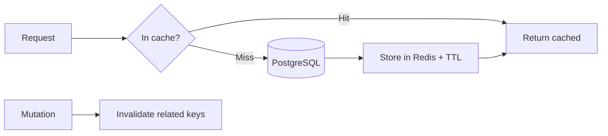

| What we cache | Strategy | TTL / Invalidation |
|---------------|----------|--------------------|
| **Dashboard KPIs / aggregates** | Precomputed snapshot (Celery) + cache-aside | Refresh hourly + invalidate on relevant mutation |
| **Reports (expensive aggregations)** | Cache-aside by (params hash) | Short TTL (e.g. 5–15 min) |
| **Reference/config data** (roles, permissions, settings, tariffs, categories) | Cache-aside | Long TTL; invalidate on write |
| **Auth/permission resolution per user** | Per-request or short cache | Invalidate on role change |
| **Rate-limit counters** | Redis counters | Sliding window |
| **Refresh-token blacklist / locks** | Redis sets/keys | Token lifetime |

**Rules:**
- **Cache keys are namespaced & branch-scoped:** `kpi:{branch}:dashboard`, `report:{branch}:{hash}`.
- **Invalidate on write** in the service layer — the same place that owns the mutation owns the cache bust.
- **Never cache** live financial balances used for a payment decision; compute those from the ledger.
- Start simple (cache-aside). Introduce precomputed snapshots only where profiling shows a hot path.

---

## 20. Security

Security is layered — no single control is trusted alone.

### 20.1 Controls overview

| Layer | Control | Detail |
|-------|---------|--------|
| **Transport** | TLS everywhere | Nginx terminates HTTPS; HSTS; HTTP→HTTPS redirect. |
| **AuthN** | JWT (access+refresh) | Short access life, refresh rotation + blacklist on logout. Passwords hashed (Argon2/PBKDF2). |
| **AuthZ** | RBAC + branch scope | Deny-by-default; permission classes per endpoint; object-level branch filtering. Backend is the authority. |
| **Audit** | Immutable audit log | Every financial/admin mutation records actor, action, before/after, IP, timestamp. Append-only. |
| **Rate limiting** | DRF throttling + Nginx | Per-user & per-IP throttles; stricter on `/auth/login` (brute-force defense). Redis-backed counters. |
| **CORS** | Explicit allowlist | Only the known frontend origin(s) allowed; credentials mode configured deliberately. |
| **CSRF** | Token-based auth = low CSRF surface | JWT in `Authorization` header (not cookie) sidesteps CSRF for the API. **If** refresh token is in a cookie, apply CSRF protection + `SameSite=Strict` on that flow. |
| **Validation** | **Server-side, surfaced in the UI** | The serializer and the service are the authority; `400 VALIDATION_ERROR.details` is mapped back onto the fields. Rules the user must know *before* submitting (password length, allowed file types) are stated next to the field and tied to the backend by a test ([05 §12](./05_Frontend_Architecture.md)). |
| **Secrets** | Env-based | `.env` / secrets manager; never committed. Separate secrets per environment. |
| **Injection** | ORM + parameterization | Django ORM prevents SQL injection; avoid raw SQL, and parameterize if unavoidable. |
| **Headers** | Security headers | One list in `deploy/nginx/_headers.conf`, included by both server blocks **and** by `/media/` (an `add_header` in a location silently drops every inherited one): HSTS (1 year, no `preload` — that is an owner's decision), CSP, Permissions-Policy, X-Content-Type-Options, X-Frame-Options, Referrer-Policy. CSP: `script-src 'self'` with no inline script and no `eval`; `style-src 'unsafe-inline'` only because prerendered HTML carries React's `style="…"` attributes; no outside origin at all — fonts are self-hosted (`src/fonts.ts`, 2026-10-03; Google Fonts used to receive every visitor's IP); `connect-src 'self'`; `frame-ancestors 'none'`. Uploaded media get a second, stricter `CSP: sandbox`. Verified in headless Chrome on the landing page, both login pages, the invite page and the vendor console: zero violations. |
| **File uploads** | Type/size allowlist + async re-encode | Prevents malicious uploads; private storage. |
| **Least privilege** | DB & infra | App DB user limited to needed privileges; workers scoped per queue. |

### 20.2 Login brute-force & account safety
- Throttled login endpoint + progressive delays / temporary lockout on repeated failures (counters in Redis).
- Generic auth error messages (never reveal whether email exists).
- Password policy enforced server-side; password change invalidates other sessions (rotate/blacklist refresh tokens).

**Throttle rates are set for a shared office IP, not for a single user.** Everyone in a kindergarten sits behind one NAT address, so every per-IP limit is in practice a limit for the whole staff:

| Scope | Rate | Why this number |
|-------|------|-----------------|
| `login` | `20/min` | Ten people signing in at the start of a shift — several of them mistyping on day one — must not lock the rest out. At 20/min an online password search is still hopeless, and every failure lands in the audit log. |
| `refresh` | `60/min` | The access token lives **in memory only**, so every page load and every 15-minute expiry issues one `POST /auth/refresh`. That request is anonymous (the token travels in the body), so without its own scope it fell under `anon` = 120/hour **for the entire kindergarten** — staff were logged out mid-shift. The limit here is not the security control: a refresh token is a 100+ character random secret. |
| `anon` | `120/hour` | Public endpoints (pricing, leads) only. |
| `user` | `2000/hour` | Per authenticated user; contains one tenant's runaway script without touching the others. |
| `export` | `20/hour` | The most expensive endpoint — it reads a whole period and writes a file. |

Each is overridable per deployment (`LOGIN_THROTTLE_RATE`, `REFRESH_THROTTLE_RATE`, …).

### 20.3 Audit log (P7)
- Written from the **service layer** (and select signals) so it can't be bypassed by a view.
- Covers: payments, invoices, payroll runs, role/permission changes, user create/deactivate, settings changes, stock adjustments.
- Read-only in the UI (Org Owner / Director), filterable by actor/entity/date.
- **Platform-plane actions are audited separately and immutably** (ADR-10): every support grant, suspension, plan change, and cross-organization metadata read is logged with the platform actor's identity. This log is visible to the affected customer — vendor access to a tenant is never invisible to that tenant.

---

## 21. Performance

Performance is designed in via query discipline, indexing, caching, and pagination — not bolted on later.

### 21.1 Database
| Technique | Application |
|-----------|-------------|
| **Indexing** | Composite indexes on hot paths (§12.4): `attendance(child_id,date)`, `invoice(child_id,status)`, `ledger(child_id)`, `payment(paid_at)`, plus `branch_id` everywhere. Partial indexes for "active/overdue" filters. |
| **Query optimization** | `select_related` for FKs, `prefetch_related` for reverse/M2M in selectors — **kill N+1 in the selector layer**, verified in tests. |
| **Aggregation at the DB** | Use `annotate`/`aggregate`/window functions for balances & reports rather than Python loops. |
| **Pagination everywhere** | No unbounded list endpoints; capped `page_size`. |
| **Read replicas (future)** | Reports/dashboard reads can be routed to a replica when load grows (P22). |
| **Connection pooling** | PgBouncer in front of Postgres for many workers. |

### 21.2 Backend
- **Selectors return exactly what the serializer needs** — `.only()/.values()` for wide tables.
- **Heavy work is async** (reports, exports, receipts) — request stays fast.
- **Caching** of reference data & dashboard KPIs (§19).

### 21.3 Frontend
| Technique | Application |
|-----------|-------------|
| **Route-based code splitting** | `React.lazy` + Suspense per feature → small initial bundle. |
| **TanStack Query caching** | Avoids redundant network calls; background refetch keeps data fresh without spinners. |
| **List virtualization** | For large tables (attendance, children) render only visible rows. |
| **Lazy loading** | Images lazy-loaded; charts/reports loaded on demand. |
| **Debounced search** | Search inputs debounced before hitting the API. |
| **Memoization** | `useMemo`/`React.memo` on expensive renders and stable props. |
| **Optimistic updates** | For quick mutations (e.g. attendance toggles) with rollback on error. |
| **Asset optimization** | Vite production build: tree-shaking, minification, gzip/brotli via Nginx. |

---

## 22. Scalability & Future Modules

The whole architecture exists to make **this section trivial**. Adding a module should be *additive*, never a refactor.

### 22.1 The "add a module" playbook
To add, e.g., **Meal Planning**:
1. **Backend:** create `apps/meals/` following the standard app shape (§5). Register its router in `api/v1`. It reads `inventory` stock via a **selector** (contract), not by importing tables.
2. **RBAC:** add `meals.*` permissions (data, not code) and assign to roles in the matrix.
3. **Frontend:** create `features/meals/` following the standard feature shape (§7). Add its routes under `RoleRoute` and a sidebar entry gated by permission.
4. **Done.** No existing module changes. This is the payoff of P1 + P2.

### 22.2 How each roadmap module slots in

| Future module | Where it plugs in | What already supports it |
|---------------|-------------------|--------------------------|
| **Parent Portal** | New `parents` app + new **Parent role** in RBAC matrix; reuses children/finance/attendance **selectors** & the same versioned API | RBAC is data-driven; API is a product; guardian/child model exists. Portal users are scoped to one organization by the same base queryset (P10). |
| **Teacher Portal** | New **Teacher role**; `hr.Employee`↔`User` link already anticipated; reuses attendance/children | Employee/User separation + RBAC. |
| **Online Payments** | New payment **gateway adapter** in finance + webhook endpoint; writes to the **same ledger** | Ledger-based finance + adapter pattern (like notifications). |
| **Medical Records** | New `medical` app linked to `children` (1—N) | Bounded module + child entity. |
| **Meal Planning** | New `meals` app consuming `inventory` via selectors | Inventory + stock movements exist. |
| **Homework / LMS** | New `learning` app linked to groups/children; Teacher/Parent roles | Groups/enrollment + RBAC. |
| **Gallery** | New `gallery` app on top of the **storage abstraction** | Private storage + async media processing. |
| **AI Assistant** | New service consuming read **selectors** + a task queue; composes notifications | Clean read layer + Celery + Python/AI-ready stack. |
| **Mobile App** | New client against the **same `/api/v1`**; JWT auth already stateless | API-as-a-product, stateless auth. |
| **Analytics** | Read replica + `reports` extensions / warehouse export | Read-only reporting layer + replica-ready. Cross-tenant aggregates are **vendor-plane only** and must be anonymized. |
| **Automated card debit** (subscriptions) | New payment-gateway adapter in `subscriptions` + webhook endpoint; writes the same subscription payment records | Adapter pattern (as in `notifications`); invoice-and-transfer flow already models the money, so cards become an additional settlement path, not a new domain. |
| **Tenant data isolation hardening** | Postgres **RLS** policies on `organization_id`; optional partition-by-organization for the largest tables | `organization_id` on every row from day one (ADR-9) means RLS is a policy addition, never a migration. |

### 22.3 Scaling axes
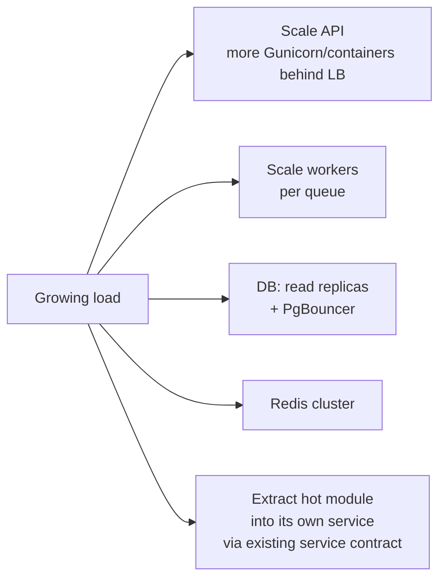
- **Stateless API** → horizontal scaling is trivial (no sticky sessions; JWT).
- **Per-queue workers** → scale notification vs report load independently.
- **Module extraction** → because modules already talk through service contracts, a hot module (e.g. Online Payments) can become its own deployable service without touching callers' logic — the monolith was always "microservice-ready."

---

## 23. Deployment & DevOps

### 23.1 Environments
| Env | Purpose | Notes |
|-----|---------|-------|
| **Local** | Dev | `docker-compose` up: web, db, redis, worker, beat. `development.py` settings. |
| **Staging** | Pre-prod validation | Mirrors prod; real integrations in sandbox mode. |
| **Production** | Live | `production.py`; secrets from env; TLS; backups. |

### 23.2 Containerization
- **Backend image:** Python + Gunicorn. Same image runs as web / worker / beat with different commands.
- **Frontend:** built by Vite → static assets served by **Nginx** (multi-stage build).
- **docker-compose (dev)** services: `nginx`, `web`, `db (postgres)`, `redis`, `worker`, `beat`.
- Prod uses the same images; orchestration can graduate to a managed setup / Kubernetes later without image changes.

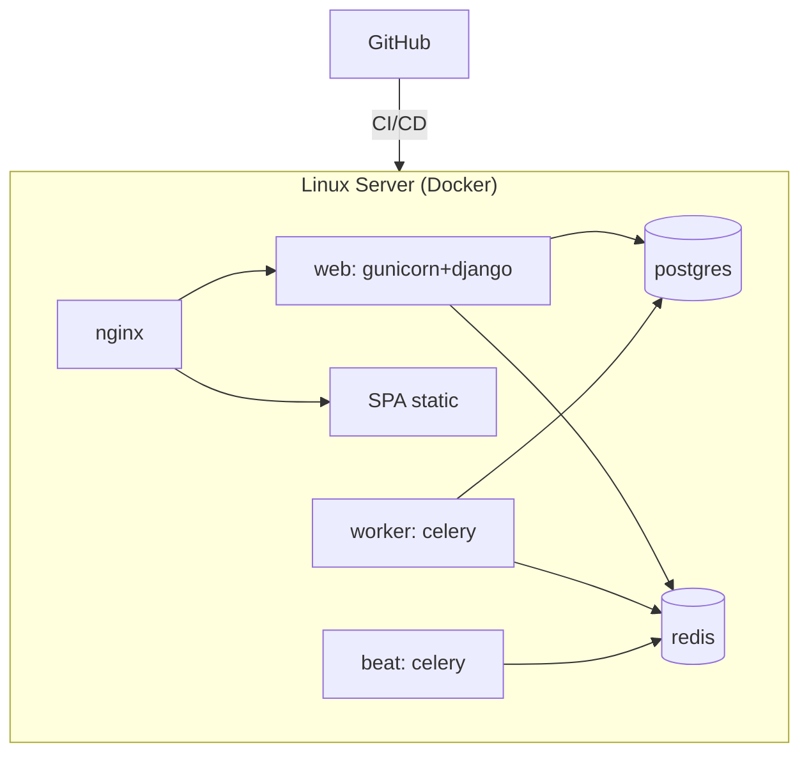

### 23.3 CI/CD (GitHub)
- **CI:** on PR → lint (ruff/eslint), type-check (mypy/tsc), run tests (pytest + vitest), build images.
- **CD:** on merge to main → build & push images → deploy to Linux server (compose pull + up, or registry-based). Run migrations as a controlled step.
- **Migrations** run as an explicit deploy step (never auto on boot in prod).
- **Backups:** automated Postgres backups + tested restore; media backed up (or on S3 with lifecycle).
- **Observability:** structured logging, health-check endpoints (`/health`), error tracking (Sentry), Celery monitoring (Flower).

### 23.4 Configuration
- **12-factor:** all config via environment variables; `.env.example` documents every key.
- **Split settings** (`base/development/production/test`) — never one giant settings file.

---

## 24. Appendix: Naming Conventions & Standards

| Area | Convention |
|------|-----------|
| **Python** | `snake_case` functions/vars, `PascalCase` classes, `UPPER_SNAKE` constants. Ruff + Black formatting. Type hints required in services/selectors. |
| **Django apps** | Lowercase, singular domain nouns (`finance`, `children`). Standard internal layout (§5). |
| **API URLs** | Plural, kebab-free lowercase nouns; `/api/v1/<resource>`; actions as sub-resources. |
| **TypeScript** | `camelCase` vars/functions, `PascalCase` components/types, `use*` for hooks. ESLint + Prettier. |
| **React files** | Components `PascalCase.tsx`; hooks `useThing.ts`; feature folders lowercase. |
| **Query keys** | Array form, feature-prefixed: `['children', filters]`, `['children', id]`. |
| **API types** | Each feature's `api.ts`; shared shapes in `lib/api/types.ts`. |
| **Commits** | Conventional Commits (`feat:`, `fix:`, `refactor:`). |
| **Branches** | `feature/…`, `fix/…`, `chore/…`; PR-based, protected `main`. |
| **Tests** | Backend: `pytest`, factories per app. Frontend: Vitest + Testing Library. Services & selectors must be unit-tested. |
| **Migrations** | Reviewed like code; never edited after merge; data migrations separated from schema. |

---

## Summary — The Five Decisions That Make This Future-Proof

1. **Modular monolith with a service layer** — fast to build now, extractable into services later; modules never touch each other's tables.
2. **`branch_id` on every entity from day one** — multi-branch becomes config, not a rewrite.
3. **Data-driven RBAC** — new roles (Parent, Teacher) and permissions are data, so future portals need no auth rewrite.
4. **Ledger-based finance with derived debtors** — one source of financial truth; online payments plug into the same ledger.
5. **Adapter patterns for notifications & storage + a versioned API-as-product** — new channels, new storage backends, and new clients (mobile, portals) are additive.

> Build the MVP against these seams and the roadmap — Parent Portal, Online Payments, Meal Planning, AI Assistant, Mobile, automated card debit — arrives as *new folders*, not *big refactors*.

*End of Software Architecture Document v1.0.*
