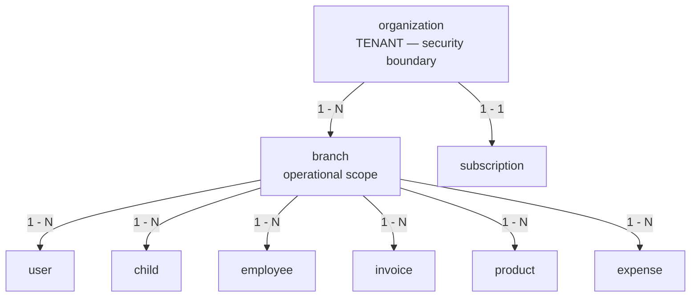
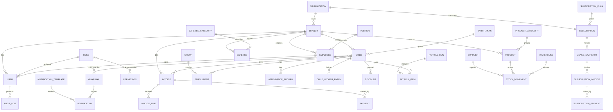
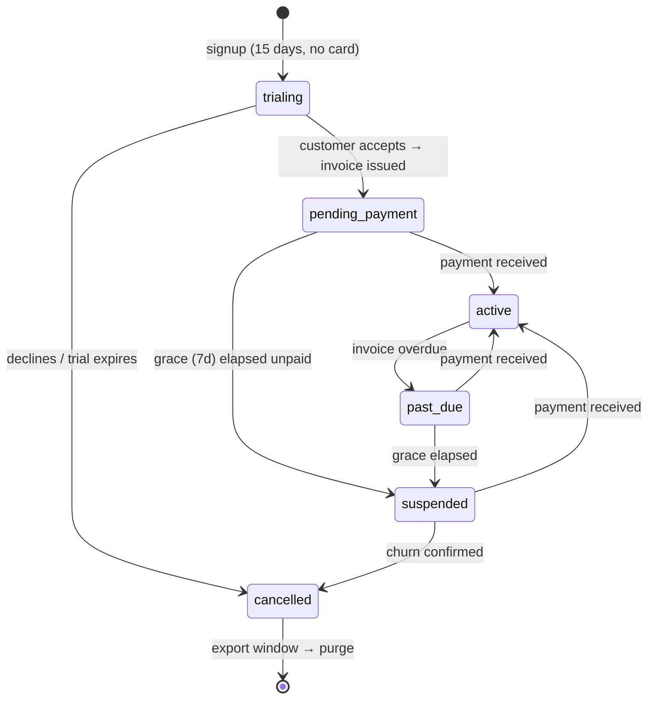

# Kindergarten Management System — Database Architecture (PostgreSQL)

| | |
|---|---|
| **Project** | Kindergarten Management System (KG-CRM) |
| **Database** | PostgreSQL 15+ |
| **Document** | Database Design & Data Architecture v1.0 |
| **Scope** | Entities, relationships, business rules, constraints, indexes, normalization |
| **Companion doc** | [02_Software_Architecture.md](./02_Software_Architecture.md) |
| **Explicitly out of scope** | Django models, migrations, ORM code |

> This is the **logical + physical data design**. It describes every table, column, type, key, constraint, index, and the business rules the schema enforces — at the database level, where they belong. No ORM code. When developers later write models, this document is the contract they implement.

---

## Table of Contents

1. [Database Design Principles](#1-database-design-principles)
2. [Naming Conventions](#2-naming-conventions)
3. [Standard Data Types](#3-standard-data-types)
4. [Standard (Base) Columns](#4-standard-base-columns)
5. [Enum & Reference-Data Strategy](#5-enum--reference-data-strategy)
6. [Multi-Tenancy Model](#6-multi-tenancy-model-adr-9)
7. [Soft Delete Strategy](#7-soft-delete-strategy)
8. [Normalization Analysis](#8-normalization-analysis)
9. [High-Level ERD](#9-high-level-erd)
10. [Schema Domain: Tenancy, Identity & Access](#10-schema-domain-tenancy-identity--access)
11. [Schema Domain: Children (CRM)](#11-schema-domain-children-crm)
12. [Schema Domain: Attendance](#12-schema-domain-attendance)
13. [Schema Domain: Finance](#13-schema-domain-finance)
14. [Schema Domain: HR & Payroll](#14-schema-domain-hr--payroll)
15. [Schema Domain: Inventory (Kitchen & Warehouse)](#15-schema-domain-inventory-kitchen--warehouse)
16. [Schema Domain: Expenses](#16-schema-domain-expenses)
17. [Schema Domain: Notifications](#17-schema-domain-notifications)
18. [Schema Domain: Settings](#18-schema-domain-settings)
19. [Schema Domain: Audit](#19-schema-domain-audit)
20. [Schema Domain: Subscriptions & Metering](#20-schema-domain-subscriptions--metering-adr-11)
20a. [Schema Domain: Radix Intelligence](#20a-schema-domain-radix-intelligence-adr-14)
21. [Referential Integrity — ON DELETE Matrix](#21-referential-integrity--on-delete-matrix)
22. [Business-Rule Constraints Catalog](#22-business-rule-constraints-catalog)
23. [Indexing Strategy](#23-indexing-strategy)
24. [Triggers & Computed Data](#24-triggers--computed-data)
25. [Views & Materialized Views](#25-views--materialized-views)
26. [Concurrency, Transactions & Integrity](#26-concurrency-transactions--integrity)
27. [Partitioning & Scaling](#27-partitioning--scaling)

---

## 1. Database Design Principles

| # | Principle | Consequence in this schema |
|---|-----------|----------------------------|
| D1 | **Integrity is enforced in the database, not just the app** | Foreign keys, `CHECK`, `UNIQUE`, and `NOT NULL` guard every invariant. The app is one client; the DB is the last line of defense. |
| D2 | **Normalize to 3NF, denormalize only with proof** | The base model is fully normalized. A handful of cached/derived columns exist for performance and are always kept consistent by a transaction or trigger (documented in §24). |
| D3 | **Money and stock are append-only ledgers** | Balances and stock levels are **derived from immutable movement records**, never overwritten in place. This kills the #1 finance bug: silent drift. |
| D4 | **Every business row is organization-scoped, then branch-scoped** | `organization_id` **and** `branch_id` on every operational table. `organization_id` is the tenant/security boundary (never bypassable); `branch_id` is the operational scope (ADR-9, [02 §11](./02_Software_Architecture.md)). |
| D5 | **Soft delete for master data, hard delete for transients** | Financial and referenced records are never physically deleted; they are deactivated for auditability. |
| D6 | **UUID surface keys** | Externally-referenced entities use UUID PKs to prevent enumeration and ease future distribution/sharding. |
| D7 | **Time is always `timestamptz` (UTC)** | No naive timestamps ever. Presentation converts to branch timezone. |
| D8 | **Explicit over implicit** | No hidden magic. Every constraint is named; every rule is documented here. |

---

## 2. Naming Conventions

| Object | Convention | Example |
|--------|-----------|---------|
| Table | `snake_case`, **singular** noun | `child`, `payment`, `stock_movement` |
| Join / bridge table | `<a>_<b>` singular | `child_guardian`, `role_permission` |
| Column | `snake_case` | `first_name`, `amount_due` |
| Primary key | `id` | `id` |
| Foreign key | `<referenced_table>_id` | `child_id`, `branch_id` |
| Boolean | `is_` / `has_` / `can_` prefix | `is_active`, `can_pickup` |
| Timestamp | `_at` suffix | `created_at`, `paid_at` |
| Date | `_date` suffix (or `_on`) | `due_date`, `hire_date` |
| Money amount | `amount` / `amount_*` | `amount_due`, `base_salary` |
| Index | `ix_<table>_<cols>` | `ix_attendance_child_date` |
| Unique constraint | `uq_<table>_<cols>` | `uq_invoice_number` |
| Check constraint | `ck_<table>_<rule>` | `ck_payment_amount_positive` |
| Foreign key constraint | `fk_<table>_<ref>` | `fk_invoice_child` |

**Rules:** no reserved words as identifiers, no abbreviations that aren't domain-standard, no plural table names (Django-friendly and unambiguous).

---

## 3. Standard Data Types

Deliberate, consistent type choices across the whole database.

| Concept | PostgreSQL type | Rationale |
|---------|-----------------|-----------|
| Surface primary key | `UUID` (default `gen_random_uuid()`) | Non-guessable, distribution-friendly (D6). |
| High-volume internal PK (optional) | `BIGINT GENERATED ALWAYS AS IDENTITY` | For append-only giants (attendance, audit) where UUID index bloat matters — used selectively. |
| Money | `NUMERIC(12,2)` | Exact decimal. **Never `float`/`real`** for money. Supports up to 9,999,999,999.99. |
| Quantity (stock) | `NUMERIC(12,3)` | Fractional units (e.g. 2.5 kg). |
| Percentage | `NUMERIC(5,2)` | e.g. discount 12.50 %. |
| Short text (names, codes) | `VARCHAR(n)` with sensible `n` | Bounded to catch bad data early. |
| Long text (notes, body) | `TEXT` | Unbounded content. |
| Email | `CITEXT` | Case-insensitive uniqueness without `LOWER()` gymnastics. |
| Phone | `VARCHAR(20)` | Stored normalized (E.164-ish); validated in app. |
| Timestamp | `TIMESTAMPTZ` | UTC, timezone-aware (D7). |
| Date only | `DATE` | Birthdays, due dates, attendance day. |
| Boolean | `BOOLEAN` | With explicit default. |
| Enum-like status | `VARCHAR` + `CHECK` | See §5 — portable and easy to evolve. |
| Flexible config / snapshots | `JSONB` | Settings values, audit diffs. Indexable via GIN. |
| Full-text search | `TSVECTOR` (generated) + GIN | Child/guardian search (§23). |

---

## 4. Standard (Base) Columns

Every table inherits a base set. To avoid repetition, the per-table definitions below **omit these** and list only domain columns.

| Column | Type | Constraint | Applies to |
|--------|------|-----------|-----------|
| `id` | `UUID` | PK, default `gen_random_uuid()` | all tables |
| `created_at` | `TIMESTAMPTZ` | `NOT NULL DEFAULT now()` | all tables |
| `updated_at` | `TIMESTAMPTZ` | `NOT NULL DEFAULT now()` (trigger-maintained) | all mutable tables |
| `is_active` | `BOOLEAN` | `NOT NULL DEFAULT true` | **master data only** (soft delete) |
| `created_by` | `UUID` | `NULL`, FK → `user(id)` `ON DELETE SET NULL` | user-authored records |
| `organization_id` | `UUID` | `NOT NULL`, FK → `organization(id)` `ON DELETE RESTRICT` | **every operational table** (D4, P10) |
| `branch_id` | `UUID` | `NOT NULL`, FK → `branch(id)` `ON DELETE RESTRICT` | all branch-scoped tables |

> **Append-only tables** (`child_ledger_entry`, `stock_movement`, `audit_log`, `attendance_record`, `usage_snapshot`) intentionally have **no `updated_at`/`is_active`** — they are immutable facts. Corrections are new rows, not edits (D3).

> **`organization_id` has no exceptions among operational tables.** The only tables that omit it are the two vendor-owned reference tables, `permission` and `subscription_plan` (§6.2). A new table without `organization_id` should fail code review by default.

---

## 5. Enum & Reference-Data Strategy

Three tiers, chosen by how the value set behaves:

| Tier | Mechanism | When | Examples |
|------|-----------|------|----------|
| **Fixed, code-owned enums** | `VARCHAR` column + named `CHECK (col IN (...))` | Small, stable, meaningful only to code | `gender`, `invoice.status`, `attendance.status`, `payment.method` |
| **Extensible master data** | Dedicated reference table (FK) | Users add/rename values; need attributes | `expense_category`, `product_category`, `position`, `notification_template` |
| **Global configuration** | `system_setting` (JSONB) | Tunable at runtime, no schema change | tariff defaults, reminder cadence, feature flags |

**Why `CHECK`-constrained `VARCHAR` over native `CREATE TYPE ... AS ENUM`?**
Native PG enums are painful to alter (adding/reordering values, removing values requires rewrites) and map awkwardly to the ORM. `VARCHAR + CHECK` is portable, trivially extensible (edit the constraint), self-documenting, and Django-friendly. We reserve reference **tables** for anything users manage.

---

## 6. Multi-Tenancy Model (ADR-9)

**Model: shared database, shared schema, row-level scoping by `organization_id` (security) + `branch_id` (operations)** (D4).

> **This section supersedes the earlier branch-as-tenancy-root design.** The product is sold per **organization**, and one subscription covers unlimited branches ([01 §4](./01_Project_Vision.md)). Branch cannot be the tenancy root, because a customer's own Org Owner legitimately reads across their branches — while no one may ever read across organizations.

### 6.1 The two scoping levels

| Level | Column | Nature | Who may cross it |
|-------|--------|--------|------------------|
| **Organization** | `organization_id NOT NULL` | **Security boundary** | **Nobody.** Not Org Owner, not platform staff via the normal API. |
| **Branch** | `branch_id` | Business scope | Org Owner (all branches in their org); other roles are branch-bound. |

### 6.2 Rules

- Every operational table carries **both** `organization_id NOT NULL` and `branch_id`.
- `organization_id` is **denormalized onto every table**, not reached through `branch`. One extra UUID per row buys single-hop filtering and simple RLS policies; the value is immutable for the row's lifetime, so no consistency trigger is needed ([02 §12.1](./02_Software_Architecture.md)).
- The base queryset applies the organization filter **before** any permission or branch logic. A cross-organization id returns **404**, never 403 — a 403 would confirm the row exists in another tenant.
- **Uniqueness is scoped to the organization, not globally.** Two different kindergartens may both have a branch coded `MAIN` or a group named "Sunflowers". Every unique index that was `UNIQUE (branch_id, …)` must include or be rooted in `organization_id`; anything that was globally unique (e.g. `branch.code`) becomes `UNIQUE (organization_id, code)`.
- **Platform-global data** (no organization): `permission`, `subscription_plan`. These are vendor-owned reference tables with `organization_id` absent by design — the only tables allowed to omit it.
- **Organization-global data**: `role`, `system_setting`, `notification_template` rows with `branch_id IS NULL` mean "applies to all branches **of this organization**" — they still carry `organization_id`.

### 6.3 Defense in depth — Row-Level Security

App-layer scoping is the primary control, but a single forgotten filter in a new endpoint would leak children's data across customers. Before the first paying customer, add Postgres **RLS** policies on `organization_id` for every operational table, with the tenant id set per connection/transaction.

RLS is a *policy addition*, not a migration, precisely because `organization_id` is present from the first migration. This is the payoff of deciding tenancy before any code exists.

**Implemented in Sprint 11** (`apps/core/migrations/0002_row_level_security.py`). How it works:

| Piece | Detail |
|-------|--------|
| Tenant id per connection | `organization_context()` sets both the `ContextVar` *and* the Postgres GUC `app.organization_id`, and clears the GUC on exit so a pooled connection never inherits the previous tenant. |
| Request boundary | On the HTTP path the GUC is set by `TenantJWTAuthentication`, **not** by `organization_context()` — so the contextmanager's own cleanup never applies there. `TenantMiddleware` therefore calls `clear_request_settings()` in a `finally`, resetting all three GUCs (`organization_id`, `platform`, `auth_lookup`) in one round trip. Without it the connection returns to the pool still naming the last tenant, which turned "an unset context sees nothing" into "an unset context sees the *previous* tenant" — fail-stale rather than fail-closed. Locked by `TestRequestBoundary` in `apps/core/tests/test_rls.py`. |
| Policy | `USING (organization_id = app_current_org())`, where `app_current_org()` returns `NULL` when the GUC is unset — so **an unset context sees nothing**, matching `TenantScopeMissing`. |
| `FORCE ROW LEVEL SECURITY` | Enabled on every protected table. Without it the table **owner bypasses RLS entirely**, which would make the policies decorative in exactly the deployment most projects run. It also means the whole test suite executes under RLS. |
| Platform plane | `organization`, `subscription`, `usage_snapshot`, `subscription_invoice`, `subscription_payment` add `OR app_is_platform()`. **Operational tables do not** — children, payments and attendance stay invisible to the vendor even in platform mode ([04 §19](./04_Backend_API_Specification.md)). |
| Auth door | `user` and `refresh_token` add `OR app_is_auth_lookup()`. Finding a user by email *is* the query that determines the tenant, so it cannot itself be tenant-scoped. The door is two tables wide and nothing else. |
| `audit_log` | Read is strict; **write also permits `organization_id IS NULL`**. A failed login has no known organization, and refusing to write that row would discard exactly the evidence that matters most. |
| Catalogue | `permission` and `subscription_plan` have no RLS — vendor reference data, identical for all tenants (§6.2). |

> **Cross-tenant work is now explicit.** Anything that legitimately spans tenants — signup (there is no tenant yet), the nightly jobs, the platform console — must ask for `platform_context()` by name. That is the point: a cross-tenant loop should be visible in the code and greppable, not an accident of a missing filter.

> **Deployment requirement.** The runtime database role should **not** own the tables. Migrations run as the owner; the application connects as a restricted role. `FORCE` makes RLS apply either way, but keeping ownership separate means a mistake in the policy set still cannot be escalated by the app's own connection.

> **`python manage.py check_rls` must run after every `migrate`, and its exit code must gate the deploy.**
>
> Django marks a migration applied and never runs it again. If the migration file is later edited — a table added to the policy set, `FORCE` switched on — an **already-migrated database silently keeps the old state**, and nothing reports it. That is not hypothetical: it happened here. The development database carried the policies but not `FORCE`, so the owner connection bypassed them entirely while every screen and every test looked correct. It surfaced only because a console query returned another organization's rows.
>
> Tests cannot catch this class of problem: they build a fresh database every run, where the migration always executes in full. The gap exists only in a **live** database, so only a live database can be asked. `check_rls` asks it — per table: RLS enabled, `FORCE` set, policy present — and `--fix` reapplies the policy SQL, which both it and the migration import from `apps/core/rls.py` so the two can never drift apart.

> **Why not schema-per-tenant or DB-per-tenant?** Both isolate better but make cross-organization vendor operations (usage metering, platform reporting, migrations across hundreds of tenants) painful and slow, and neither is needed at this scale. Shared-schema + RLS is the standard trade-off; the escape hatch is partition-by-organization or extracting a large tenant, and `organization_id` on every row keeps both open.

---

## 7. Soft Delete Strategy

| Data class | Deletion | Reason |
|-----------|----------|--------|
| **Organization (tenant root)** | **Soft**, then an explicit audited **purge job** after the export window | Churn is `is_active=false`; the customer keeps read-only access + export for 30 days ([01 §4.4](./01_Project_Vision.md)). Physical deletion is a deliberate, logged operation with a known table order — never a cascade (§21). |
| Master/reference (child, employee, product, user, group, tariff, category) | **Soft** — set `is_active = false` | Referenced by history; must never break FKs or reports (D5). |
| Financial/append-only (ledger, payment, invoice, stock movement, payroll, **usage snapshot, subscription invoice/payment**) | **Never deleted** — status/reversal rows | Legal/audit integrity. A cancelled invoice gets `status='cancelled'`, not a `DELETE`. |
| Transient (unsent notification draft, expired export, session token) | **Hard delete** allowed | No historical value. |

**Uniqueness with soft delete:** partial unique indexes ignore inactive rows where re-use should be allowed, e.g. `UNIQUE (branch_id, name) WHERE is_active` for groups.

---

## 8. Normalization Analysis

The schema is designed to **Third Normal Form (3NF)**, with select tables reaching **BCNF**, and a small, explicit set of **controlled denormalizations** for performance.

### 8.1 Normal-form walkthrough

| NF | Requirement | How the design satisfies it |
|----|-------------|-----------------------------|
| **1NF** | Atomic columns, no repeating groups | No comma-lists or arrays-of-entities. A child's multiple guardians → rows in `child_guardian`, not `guardian1/guardian2` columns. A child's group history → `enrollment` rows. |
| **2NF** | No partial dependency on part of a composite key | Bridge tables (`child_guardian`, `role_permission`) carry only attributes fully dependent on the *whole* key (e.g. `is_primary` depends on the child+guardian pair, not on either alone). |
| **3NF** | No transitive dependency (non-key → non-key) | `invoice` stores `child_id`, not the child's name/phone (those live in `child`). `payment` stores `invoice_id`, not the invoice's amount. Category names live once in category tables and are referenced by FK. |
| **BCNF** | Every determinant is a candidate key | Reference tables (`permission.code`, `product` per branch) have their natural keys as enforced unique candidate keys. |

### 8.2 Deliberate denormalizations (and how they stay correct)

Denormalization is allowed **only** when (a) it removes a proven hot aggregation and (b) it's kept consistent inside the same transaction or by a trigger. Each is a *cache of derived truth*, never an independent source.

| Denormalized column | Source of truth | Kept consistent by | Why |
|---------------------|-----------------|--------------------|-----|
| `invoice.amount_paid`, `invoice.status` | sum of `payment` rows for the invoice | payment service (same transaction) + reconciliation job | Avoids summing payments on every invoice list render. |
| `child.balance` *(optional cache)* | `child_ledger_entry` sum | trigger on ledger insert | Debtor list & child header show balance without scanning the ledger. Authoritative balance still computed from ledger for any money-moving decision (D3). |
| `product.current_stock` | `stock_movement` sum | trigger on movement insert (or service in txn) | Stock badges/alerts without re-aggregating movements. |
| `payroll_run.total_net` etc. | `payroll_item` rows | payroll finalize service (txn) | Run summary display. |
| `group.enrolled_count` *(optional)* | active `enrollment` rows | trigger | Capacity checks and dashboards. |

> **The discipline (D3):** the ledger / movement tables are **the truth**; caches can always be rebuilt by re-aggregating. Any money-affecting operation recomputes from the ledger under a lock (§26) rather than trusting the cached column.

---

## 9. High-Level ERD

Domain-level view (details per domain follow). Bridge tables shown where they carry meaning.

---

## 10. Schema Domain: Tenancy, Identity & Access

### 10.1 `organization` (the tenancy root — ADR-9)
One paying customer: a kindergarten business, with one or more branches. **Every operational row in the database points here.**

| Column | Type | Constraints | Notes |
|--------|------|-------------|-------|
| `name` | `VARCHAR(200)` | `NOT NULL` | Trading name |
| `slug` | `VARCHAR(50)` | `NOT NULL`, `UNIQUE` | URL/support identifier — globally unique |
| `legal_name` | `VARCHAR(255)` | `NULL` | Registered entity name (for invoices/acts) |
| `tax_id` | `VARCHAR(20)` | `NULL` | INN/STIR — required before the first subscription invoice |
| `contact_email` | `CITEXT` | `NOT NULL` | Billing contact |
| `contact_phone` | `VARCHAR(20)` | `NULL` | |
| `country` | `CHAR(2)` | `NOT NULL DEFAULT 'UZ'` | ISO 3166-1; drives data-residency handling |
| `locale` | `VARCHAR(10)` | `NOT NULL DEFAULT 'uz'` | Default UI language |
| `onboarded_at` | `TIMESTAMPTZ` | `NULL` | First successful data import — the trial clock reference ([01 §4.4](./01_Project_Vision.md)) |

**Business rules:**
- An organization is **never hard-deleted.** Churn sets `is_active=false`; data is retained for the export window, then purged by an explicit, audited job.
- `slug` is globally unique (it appears in support tooling and URLs); everything else is scoped beneath it.
- Deleting an organization row is blocked by `ON DELETE RESTRICT` from every child table — by design.

### 10.2 `branch`
An operational location **inside an organization**. Not the tenancy root (ADR-9).

| Column | Type | Constraints | Notes |
|--------|------|-------------|-------|
| `organization_id` | `UUID` | `NOT NULL` FK → organization `ON DELETE RESTRICT` | Tenant owner |
| `name` | `VARCHAR(150)` | `NOT NULL` | Display name |
| `code` | `VARCHAR(20)` | `NOT NULL` | Short code (used in invoice numbering) |
| `address` | `TEXT` | `NULL` | |
| `phone` | `VARCHAR(20)` | `NULL` | |
| `currency` | `CHAR(3)` | `NOT NULL DEFAULT 'UZS'` | ISO 4217 |
| `timezone` | `VARCHAR(40)` | `NOT NULL DEFAULT 'Asia/Tashkent'` | For presentation |

**Constraint:** `uq_branch_org_code` — `UNIQUE (organization_id, code)`. Code is unique **within an organization**, not globally — two unrelated kindergartens may both use `MAIN`.

**Business rules:** a branch cannot be hard-deleted while it has children/employees (soft delete only). There is **no limit on branches per organization** — branch count is never billed ([01 §4.5](./01_Project_Vision.md)).

### 10.3 `role`
Business roles (not Django groups). Branch-scoped or global.

| Column | Type | Constraints | Notes |
|--------|------|-------------|-------|
| `name` | `VARCHAR(80)` | `NOT NULL` | e.g. "Cashier" |
| `code` | `VARCHAR(40)` | `NOT NULL` | `org_owner`, `director`, `manager`, `cashier`, `attendance_manager` |
| `description` | `TEXT` | `NULL` | |
| `is_system` | `BOOLEAN` | `NOT NULL DEFAULT false` | System roles can't be deleted/renamed |
| `organization_id` | `UUID` | `NOT NULL` FK → organization | Roles are per-organization |
| `branch_id` | `UUID` | `NULL` FK → branch | `NULL` = applies to all branches of this organization |

**Constraints:** `uq_role_org_code_branch` — `UNIQUE (organization_id, code, branch_id)`. **Rule:** `is_system = true` rows are immutable except permission assignment.

> **`super_admin` is gone** (ADR-10). `org_owner` is its replacement and is scoped to one organization; vendor staff are not rows in this table at all — they live in the platform plane ([02 §11.0](./02_Software_Architecture.md)). System roles are seeded per organization at signup.

### 10.4 `permission`
Atomic capabilities, global.

| Column | Type | Constraints | Notes |
|--------|------|-------------|-------|
| `code` | `VARCHAR(60)` | `NOT NULL`, `UNIQUE` | `"<module>.<action>"`, e.g. `payments.create` |
| `module` | `VARCHAR(40)` | `NOT NULL` | `payments`, `children`, … |
| `action` | `VARCHAR(20)` | `NOT NULL` | `read`, `create`, `update`, `delete`, `export`, `approve` |
| `label` | `VARCHAR(120)` | `NOT NULL` | Human label |

**Constraint:** `uq_permission_module_action` — `UNIQUE (module, action)`.

### 10.5 `role_permission` (bridge)

| Column | Type | Constraints |
|--------|------|-------------|
| `role_id` | `UUID` | `NOT NULL` FK → role `ON DELETE CASCADE` |
| `permission_id` | `UUID` | `NOT NULL` FK → permission `ON DELETE CASCADE` |

**Constraint:** `uq_role_permission` — `UNIQUE (role_id, permission_id)`. (No surrogate id needed; composite PK acceptable, but we keep base `id` for ORM uniformity.)

### 10.6 `user`
Authentication identity.

| Column | Type | Constraints | Notes |
|--------|------|-------------|-------|
| `organization_id` | `UUID` | `NOT NULL` FK → organization `ON DELETE RESTRICT` | Tenant owner — set at creation, **never mutable** |
| `email` | `CITEXT` | `NOT NULL` | Login identifier |
| `password_hash` | `VARCHAR(255)` | `NOT NULL` | Argon2/PBKDF2 |
| `full_name` | `VARCHAR(150)` | `NOT NULL` | |
| `phone` | `VARCHAR(20)` | `NULL` | |
| `photo` | `VARCHAR(255)` | `NULL` | Profil rasmi — storage kaliti; fayl nomi UUID (docs/02 §16.2) |
| `role_id` | `UUID` | `NOT NULL` FK → role `ON DELETE RESTRICT` | One primary role (MVP) |
| `branch_id` | `UUID` | `NULL` FK → branch | `NULL` only for Org Owner (cross-branch within their org) |
| `is_staff` | `BOOLEAN` | `NOT NULL DEFAULT true` | Back-office user |
| `last_login_at` | `TIMESTAMPTZ` | `NULL` | |
| `totp_secret` | `VARCHAR(64)` | `NOT NULL DEFAULT ''` | Base32 TOTP key — **optional 2FA**, set by the user (ADR-24) |
| `totp_confirmed_at` | `TIMESTAMPTZ` | `NULL` | 2FA is active only when this is set |
| `totp_backup_codes` | `JSONB` | `NOT NULL DEFAULT '[]'` | SHA-256 hashes of single-use backup codes |

**Constraint:** `uq_user_org_email` — `UNIQUE (organization_id, email)`.

> **Email is unique per organization, not globally.** The same person may legitimately work for two kindergartens. Login therefore resolves an email to *one or more* organization memberships; if there is more than one, the user picks the organization after authenticating. Making email globally unique would silently prevent a real scenario and, worse, leak the existence of another tenant's account at signup time.

**Business rules:**
- Org Owner may have `branch_id IS NULL`; **all other roles must have a branch** → `ck_user_branch_required` `CHECK (role is org_owner OR branch_id IS NOT NULL)` (enforced via app + trigger since it references role code).
- `ck_user_branch_same_org` — a user's `branch_id` must belong to their `organization_id` (trigger; a plain FK cannot express it). The same rule applies to every table carrying both columns.
- `organization_id` is **immutable after insert** (trigger). Moving a user between tenants is not an update; it is a new account.
- Deactivating a user (`is_active=false`) must invalidate their refresh tokens (app-level).
- **Future-proofing:** to move from single-role to multi-role, add a `user_role` bridge; `role_id` stays as "primary role" during transition.

> **Why 2FA lives in three columns on `user` and not in two tables of its own** (ADR-24). `totp_confirmed_at` is separate from the secret because generating a key is not the same as enabling 2FA: a person who sees the key, never adds it to their app and closes the tab would otherwise be locked out of their own account at the next sign-in. The backup codes are a `JSONB` array of hashes rather than a `user_backup_code` table because they are verified **during login**, before any tenant context exists — a new table would have had to be added to the narrow `auth_lookup_context()` door, and loosening an RLS policy for convenience is the one trade this schema does not make (ADR-10, [§6.3](#63-row-level-security)). A used code is removed from the array, so "used but still valid" cannot happen; the hash is plain SHA-256, not PBKDF2, because the codes are high-entropy values that no dictionary attack reaches — and verifying ten PBKDF2 hashes on every sign-in would cost seconds for nothing.

### 10.7 `refresh_token` (auth session tracking — optional but recommended)

| Column | Type | Constraints | Notes |
|--------|------|-------------|-------|
| `user_id` | `UUID` | `NOT NULL` FK → user `ON DELETE CASCADE` | |
| `token_hash` | `VARCHAR(255)` | `NOT NULL`, `UNIQUE` | Store hash, never raw |
| `expires_at` | `TIMESTAMPTZ` | `NOT NULL` | |
| `revoked_at` | `TIMESTAMPTZ` | `NULL` | Blacklist on logout/rotation |
| `user_agent` | `VARCHAR(255)` | `NULL` | |
| `ip` | `INET` | `NULL` | |

> Fast blacklist checks also live in Redis; this table is the durable record for audit and "active sessions" UI.

---

## 11. Schema Domain: Children (CRM)

### 11.1 `child`

| Column | Type | Constraints | Notes |
|--------|------|-------------|-------|
| `first_name` | `VARCHAR(80)` | `NOT NULL` | |
| `last_name` | `VARCHAR(80)` | `NOT NULL` | |
| `middle_name` | `VARCHAR(80)` | `NULL` | |
| `date_of_birth` | `DATE` | `NOT NULL` | |
| `gender` | `VARCHAR(10)` | `NOT NULL`, `CHECK (gender IN ('male','female'))` | |
| `enrollment_status` | `VARCHAR(20)` | `NOT NULL DEFAULT 'active'`, `CHECK (... IN ('prospect','active','paused','graduated','withdrawn'))` | Lifecycle |
| `enrolled_on` | `DATE` | `NULL` | |
| `contract_number` | `VARCHAR(40)` | `NULL` | The number on the kindergarten's **paper** contract (PLAN 9.3) — deliberately separate from `contract.number` (`SH-2026-0001`), which the system generates. Forcing both into one column would have made one of them a lie |
| `tariff_id` | `UUID` | `NULL` FK → tariff_plan `ON DELETE RESTRICT` | Current billing plan |
| `monthly_fee` | `NUMERIC(12,2)` | `NULL`, `CHECK (monthly_fee IS NULL OR monthly_fee > 0)` | **Individual** monthly price — instead of a tariff (2026-10) |
| `photo_path` | `VARCHAR(255)` | `NULL` | Private storage key |
| `balance` | `NUMERIC(12,2)` | `NOT NULL DEFAULT 0` | **Cached** from ledger (§8.2) |
| `notes` | `TEXT` | `NULL` | |
| `search_vector` | `TSVECTOR` | generated | Full-text search (§23) |

**Business rules:**
- `date_of_birth` must be in the past → `ck_child_dob_past CHECK (date_of_birth < CURRENT_DATE)`.
- A child in `active` status should have a price: a `tariff_id` **or** an individual `monthly_fee` (enforced at billing time; warned in app).
- **One price source** → `ck_child_one_price_source CHECK (tariff_id IS NULL OR monthly_fee IS NULL)`. Private kindergartens often agree a price per family instead of a standard plan, so a child may carry an individual `monthly_fee` with no tariff; both at once would leave it ambiguous which one is billed. The API clears the other source when one is set. `apps/finance/selectors.child_monthly_price()` is the single place that answers "what does this child pay" — the invoice, the absence day rate and the screens all read it.
- The invoice **copies** the amount (`invoice.amount_due`, the first `invoice_line`); with an individual price `invoice.tariff_id` is `NULL` and the line reads "Individual narx — MM/YYYY". Changing the price later never rewrites issued invoices — the same rule as a tariff.
- Soft delete only; a child with financial history is never hard-deleted.

### 11.2 `guardian`

| Column | Type | Constraints | Notes |
|--------|------|-------------|-------|
| `first_name` | `VARCHAR(80)` | `NOT NULL` | |
| `last_name` | `VARCHAR(80)` | `NOT NULL` | |
| `phone` | `VARCHAR(20)` | `NOT NULL` | Contact number; also the SMS address |
| `email` | `CITEXT` | `NULL` | Future email channel |
| `language` | `VARCHAR(2)` | `NOT NULL DEFAULT ''` | Message language; blank = the kindergarten's default ([§17.1](#171-notification_template)) |
| `telegram_chat_id` | `VARCHAR(32)` | `NOT NULL DEFAULT ''` | The primary message address (ADR-23). Blank = not connected |
| `telegram_linked_at` | `TIMESTAMPTZ` | `NULL` | When the parent started the bot |
| `telegram_code` | `VARCHAR(48)` | `NOT NULL DEFAULT ''` | Single-use invite payload; cleared on linking |
| `search_key` | `VARCHAR(255)` | indexed | Name **and phone**, normalised (apostrophes, Cyrillic↔Latin) |

**Constraints:** `uq_guardian_branch_phone` — `UNIQUE (branch_id, phone) WHERE is_active` (dedupe guardians per branch); `uq_guardian_telegram_code` — `UNIQUE (telegram_code) WHERE telegram_code <> ''`; `uq_guardian_telegram_chat` — `UNIQUE (organization_id, telegram_chat_id) WHERE telegram_chat_id <> ''`.

> **Why the chat is unique per organization and the code is unique globally.** The code is looked up by a webhook that has no tenant context, so it must be unambiguous everywhere — it is a random token, not customer data, and it carries the organization inside it (ADR-23). The chat, by contrast, is deliberately *not* globally unique: one parent may have children in two Radix kindergartens and must receive messages from both. A global constraint would have stopped the second one with an unexplained "the code did not work".

> **`telegram_chat_id` cannot be issued by us.** It exists only after the parent starts the bot, which makes the link the consent record and "not connected" an ordinary state rather than a fault. Clearing the column is how both `/stop` and a staff-side disconnect work; the row itself is never deleted.

**Future-proofing:** a `guardian` can later be linked 1–1 to a `user` for the Parent Portal (add nullable `user_id`).

### 11.2a Billing window of a child (Bosqich 12.1)

`child.skip_trial BOOLEAN NOT NULL DEFAULT false` and table **`child_pause`** (tenant-scoped, RLS, `organization_id`/`branch_id` like every operational table):

| Column | Type | Constraints | Notes |
|--------|------|-------------|-------|
| `child_id` | `UUID` | `NOT NULL` FK → child `ON DELETE CASCADE` | |
| `month_from`, `month_to` | `DATE` | `NOT NULL`, first of a month, `CHECK (month_to >= month_from)` | A "bir oylik ariza" covers whole months |
| `reason` | `VARCHAR(255)` | `NOT NULL` | Mandatory |
| `created_by_id` | `UUID` | `NULL` FK → user `ON DELETE SET NULL` | |

How a month is billed — `charges.plan_month()`, in this order; every value is a branch setting with Oriental Kinderland's figure as the default:

1. Price: tariff or individual fee; then the benefit. The result is the **monthly amount** — the base of the day rate (ADR-31).
2. Window inside the month, when `finance.first_month_mode = prorated`: from the arrival date (new children only, not `is_existing_client`), moved past a **trial** of `finance.trial_days` working days (default 3, not for `skip_trial`), up to the day before `status_changed_on` for a child who left. A child withdrawn inside the trial owes nothing.
3. Days = working days in that window (`attendance.working_weekdays` per branch, `holiday` per organization). The whole month → the monthly amount unchanged; otherwise `monthly × days / working days`, rounded to `finance.rounding_step` (default 1 000). The day rate itself is never rounded — the result is.
4. A month covered by `child_pause` is 0, the child stays `active` and keeps their place. If that month's invoice was already issued and nothing paid, it is cancelled and re-issued at 0; if money was received, the pause is refused with the reason, because what happens to that money is a person's decision.

### 11.3 `child_guardian` (bridge — carries the relationship semantics)

| Column | Type | Constraints | Notes |
|--------|------|-------------|-------|
| `child_id` | `UUID` | `NOT NULL` FK → child `ON DELETE CASCADE` | |
| `guardian_id` | `UUID` | `NOT NULL` FK → guardian `ON DELETE RESTRICT` | |
| `relation` | `VARCHAR(20)` | `NOT NULL`, `CHECK (... IN ('mother','father','grandparent','sibling','other'))` | |
| `is_primary` | `BOOLEAN` | `NOT NULL DEFAULT false` | Primary contact |
| `can_pickup` | `BOOLEAN` | `NOT NULL DEFAULT true` | Pickup authorization |

**Constraints:**
- `uq_child_guardian` — `UNIQUE (child_id, guardian_id)`.
- **At most one primary guardian per child** → partial unique index `uq_child_primary_guardian UNIQUE (child_id) WHERE is_primary`.
- Business rule: every `active` child must have ≥1 guardian and exactly one `is_primary` (enforced in app; the partial index guarantees "at most one").

### 11.4 `group` (kindergarten class/group)

| Column | Type | Constraints | Notes |
|--------|------|-------------|-------|
| `name` | `VARCHAR(80)` | `NOT NULL` | e.g. "Sunflowers" |
| `age_min` | `SMALLINT` | `NULL` | Min age (months/years) |
| `age_max` | `SMALLINT` | `NULL` | |
| `capacity` | `SMALLINT` | `NOT NULL DEFAULT 0`, `CHECK (capacity >= 0)` | |
| `teacher_employee_id` | `UUID` | `NULL` FK → employee `ON DELETE SET NULL` | Homeroom teacher |
| `enrolled_count` | `SMALLINT` | `NOT NULL DEFAULT 0` | **Cached** active enrollments |

**Constraints:** `uq_group_branch_name UNIQUE (branch_id, name) WHERE is_active`; `ck_group_age CHECK (age_max IS NULL OR age_min IS NULL OR age_max >= age_min)`.

### 11.5 `enrollment` (child ↔ group over time — the history)

| Column | Type | Constraints | Notes |
|--------|------|-------------|-------|
| `child_id` | `UUID` | `NOT NULL` FK → child `ON DELETE CASCADE` | |
| `group_id` | `UUID` | `NOT NULL` FK → group `ON DELETE RESTRICT` | |
| `start_date` | `DATE` | `NOT NULL` | |
| `end_date` | `DATE` | `NULL` | Open = current |
| `status` | `VARCHAR(20)` | `NOT NULL DEFAULT 'active'`, `CHECK (... IN ('active','ended','transferred'))` | |

**Business rules:**
- `ck_enrollment_dates CHECK (end_date IS NULL OR end_date >= start_date)`.
- **A child has at most one open (current) enrollment** → partial unique index `uq_enrollment_current UNIQUE (child_id) WHERE end_date IS NULL AND status='active'`.
- Group capacity check (enrolled_count < capacity) enforced in the enrollment service under a lock.

---

### 11a. Status, archive and search (PLAN 2.1, 2.2, 2.7)

| Column | Table | Why |
|--------|-------|-----|
| `status_changed_on`, `status_reason` | `child` | A status alone says nothing. The question that follows is always about money — *"since when?"* — because no invoice is written for periods after that date (Q5). Both are mandatory at the service layer. |
| `archived_at`, `archived_by` | `child` | `is_active` carried two meanings at once, "deleted" and "archived", and they could not be told apart — so "who archived this child, when and why" had no answer. `DELETE` on the API archives; the invoices, payments and attendance stay, because they are the kindergarten's financial history. A hard delete exists on a separate, deliberately narrow path: no financial records **and** created within 24 hours (Q6). |
| `allergies`, `medical_notes` | `child` | Separate from the free-text `notes`: an allergy is information the kitchen and the teacher need, and hunting for it inside a paragraph is the easiest possible place to make a mistake. |
| `teacher_id` | `group` | The group's teacher — an `Employee`, not a `User` (ADR-21). |
| `search_key` | `child`, `guardian`, `employee` | One child is written three ways — "Ulug'bek", "Ulugʻbek", "Улугбек" — and the director must find them whichever she types; otherwise she concludes the child is missing and enters them again, leaving one child with two balances. The key is latin-only, apostrophe-free, lower-case, with `x` folded to `h`; the query goes through the same function. A denormalised column rather than `ILIKE`, because comparing the two spellings at query time would need `translate()` on every row and no index would be used. Phones go into the guardian's and employee's key too: the director usually searches by number. |

---

## 12. Schema Domain: Attendance

### 12.1 `attendance_record` (append-only, high volume)

| Column | Type | Constraints | Notes |
|--------|------|-------------|-------|
| `child_id` | `UUID` | `NOT NULL` FK → child `ON DELETE CASCADE` | |
| `group_id` | `UUID` | `NULL` FK → group `ON DELETE SET NULL` | Group at time of record |
| `attendance_date` | `DATE` | `NOT NULL` | The day |
| `status` | `VARCHAR(15)` | `NOT NULL`, `CHECK (... IN ('present','absent','excused'))` | |
| `check_in_at` | `TIMESTAMPTZ` | `NULL` | |
| `check_out_at` | `TIMESTAMPTZ` | `NULL` | |
| `reason` | `VARCHAR(255)` | `NULL` | Absence reason |
| `recorded_by` | `UUID` | `NULL` FK → user `ON DELETE SET NULL` | |

**Business rules:**
- **One record per child per day** → `uq_attendance_child_date UNIQUE (child_id, attendance_date)`. Corrections update the same row (this is the one operational table where an in-place status update is allowed, because a day's state is a single fact, not a money movement).
- **There is no `late` status.** Attendance answers one question at the end of the day — was the child here or not — and lateness changed no downstream number (fees, meals, group capacity) while costing a decision on every child, every day. A child who arrived is `present`; the arrival time, when it matters, is already in `check_in_at`. Removed in migration `attendance.0004_drop_late_status`, which rewrote existing `late` rows to `present` — reports had always counted them as attending, so no figure moved.
- `ck_attendance_checkout CHECK (check_out_at IS NULL OR check_in_at IS NULL OR check_out_at >= check_in_at)`.
- `attendance_date` cannot be in the future → `ck_attendance_not_future CHECK (attendance_date <= CURRENT_DATE)`.

**Scaling note:** prime candidate for **range partitioning by month** as volume grows (§27).

---

### 12.2 `absence_claim` (ADR-19)
A documented absence that earns a fee credit. **Not derived from `attendance_record`** — see ADR-19 for why that separation is the whole point.

| Column | Type | Constraints | Notes |
|--------|------|-------------|-------|
| `child_id` | `UUID` | `NOT NULL` FK → child `ON DELETE RESTRICT` | |
| `kind` | `VARCHAR(10)` | `NOT NULL`, `CHECK (kind IN ('medical','parental'))` | Doctor's certificate / parent's written application |
| `date_from` | `DATE` | `NOT NULL` | |
| `date_to` | `DATE` | `NOT NULL`, `CHECK (date_to >= date_from)` | Inclusive |
| `document_no` | `VARCHAR(60)` | `NULL` | Certificate number, if any |
| `document_file` | `VARCHAR` (`FileField`) | `NULL` | The certificate or application itself — `media/{organization_id}/absence/{uuid}.{ext}` (PLAN 7.7) |
| `note` | `VARCHAR(255)` | `NULL` | |
| `status` | `VARCHAR(10)` | `NOT NULL DEFAULT 'pending'`, `CHECK (... IN ('pending','approved','rejected','applied'))` | |
| `billable_days` | `SMALLINT` | `NOT NULL DEFAULT 0`, `CHECK (billable_days >= 0)` | Working days in the range, holidays removed — **computed at approval** |
| `daily_rate` | `NUMERIC(12,2)` | `NOT NULL DEFAULT 0`, `CHECK (daily_rate >= 0)` | Snapshot at approval |
| `credit_amount` | `NUMERIC(12,2)` | `NOT NULL DEFAULT 0`, `CHECK (credit_amount >= 0)` | `= billable_days × daily_rate` |
| `approved_by_id` | `UUID` | `NULL` FK → user `ON DELETE SET NULL` | |
| `decided_at` | `TIMESTAMPTZ` | `NULL` | |
| `decision_note` | `VARCHAR(255)` | `NULL` | |
| `applied_invoice_id` | `UUID` | `NULL` FK → invoice `ON DELETE RESTRICT` | The invoice that consumed it |
| `created_by_id` | `UUID` | `NULL` FK → user `ON DELETE SET NULL` | |

**Business rules:**
- **No two claims may cover the same day for the same child.** Enforced by the database, not the service:
  `EXCLUDE USING gist (child_id WITH =, daterange(date_from, date_to, '[]') WITH &&) WHERE (status <> 'rejected')` — requires `btree_gist` (verified available on the production cluster, PostgreSQL 17). An application-level check loses this race; the constraint cannot.
- **There is no minimum length** (owner's decision, 2026-09-30): three days and fifteen days are equally valid if the document supports them. No setting exists for a threshold, deliberately — an unused knob is a future misconfiguration.
- The numbers are frozen at **approval**, not at creation and not at application: a tariff that changes next month must not move a credit already granted.
- `billable_days` counts only days the kindergarten was open: the branch's working weekdays (`attendance.working_weekdays`) minus `holiday` (§12.3). A day the kindergarten was closed anyway is not a day the parent missed.
- `daily_rate` = the charged amount of the invoice covering the absence month ÷ the working days of **that** month. Falls back to `tariff ÷ working days` when no invoice exists yet. Using the charged amount rather than the raw tariff keeps a discounted child from being credited more than they were billed.
- `credit_amount` is capped at the covering invoice's `amount_due`.
- **The rule comes from the claim's kind** (Bosqich 12.3, ADR-33) — table **`absence_kind`** (organization-scoped, RLS): `code` (unique among active, never changes), `name`, `refund_mode` (`full_rate` · `fixed_per_day` · `none`), `daily_amount` (empty → the `contracts.daily_meal_fee` setting, 37 500, the same meal fee the contract template prints), `min_days`, `full_rate_from_days`, `requires_document`. Two kinds are created lazily for every organization: *Shifokor maʼlumotnomasi* — `fixed_per_day` with `full_rate_from_days = 3`, so 1–2 working days return the meal money only and 3 or more return the full day rate for **all** of them; *Ota-ona arizasi* — `full_rate`, `min_days = 1`. `absence_claim.kind` holds the code and `absence_claim.basis` records which rule priced the claim. Every result is rounded to `finance.rounding_step`, the meal money included (1 × 37 500 → 38 000). This supersedes the 2026-09-30 "no minimum, full rate for any length" decision.
- **Approved at creation when the author may approve** (owner request, 2026-10-14). `POST /absence-claims` approves in the same transaction if the caller is the owner or holds `attendance.approve`; otherwise the claim waits as before. ADR-19 is untouched — money still moves only on a claim, never on the grid — but a second click by the same person checked nothing. The permission test is what keeps `attendance.create` from quietly becoming the right to move money: a manager can write a claim, not grant it. A claim that cannot be approved (no working day in the range) is not created at all, rather than left pending forever.
- Status flow: `pending → approved → applied`, or `pending → rejected`. `applied` is set either by invoice generation (the credit becomes a line on the next invoice) or, since PLAN 7.7, by approval itself when the covering month's invoice is still unpaid — `applied_invoice_id` makes double-application impossible in both cases.
- **The file can be replaced only while `pending`; a decided claim takes its *first* file and no other.** After a decision the document behind the money is fixed: otherwise the approver signs off on one certificate and the folder ends up holding another. Attaching the first file to an approved claim is not a swap — and since claims now approve on creation, the paper that arrives two days later needs somewhere to go. The stored name is a UUID — the uploaded name would both collide ("spravka.pdf" is what everyone calls it) and let one family guess another's document path. It is never served from `/media/`; `GET /absence-claims/{id}/document/download` is the only way in, because a static URL knows neither the session nor the tenant and the file is a child's medical record.

**Indexes:** `(organization_id, child_id, date_from)`; partial `(organization_id, status) WHERE status = 'approved'` — the hot path is "which credits are waiting to be applied".

### 12.3 `holiday`
Days the kindergarten is closed. **Organization-scoped, not branch-scoped**: a public holiday is national, and asking a three-branch organization to type Navro'z three times invites three different answers.

| Column | Type | Constraints | Notes |
|--------|------|-------------|-------|
| `holiday_date` | `DATE` | `NOT NULL` | |
| `name` | `VARCHAR(80)` | `NOT NULL` | "Navro'z", "Mustaqillik kuni" |

**Constraint:** `uq_holiday_org_date UNIQUE (organization_id, holiday_date)`.

**Not pre-seeded with a fixed list.** Religious holidays move every year and government decrees shift working days around them; a list shipped in code would be wrong by the following spring and nobody would notice until a parent was credited for a day they were never owed. The kindergarten enters its own calendar, which is also the only source that knows about a local closure.

**Working weekdays** live in `system_setting` as `attendance.working_weekdays` (default `1,2,3,4,5` — Monday to Friday, ISO numbering), because a kindergarten that opens on Saturday is a setting, not a schema change.

---

### 12.4 `staff_attendance` (2026-10)

Staff timesheet — one row per employee per day. Asked for by a customer so the month-end salary report stops living on paper.

| Column | Type | Constraints | Notes |
|--------|------|-------------|-------|
| `id` | `UUID` | PK | |
| `organization_id` | `UUID` | `NOT NULL` FK, immutable trigger, **RLS** | Tenant boundary |
| `branch_id` | `UUID` | `NOT NULL` FK | The employee's branch at marking time |
| `employee_id` | `UUID` | `NOT NULL` FK → employee `ON DELETE RESTRICT` | |
| `attendance_date` | `DATE` | `NOT NULL`, `ck_staff_attendance_not_future` (+1 day slack, as §12.1) | |
| `status` | `VARCHAR(10)` | `NOT NULL`, `ck_staff_attendance_status IN ('present','absent','sick','leave')` | |
| `note` | `VARCHAR(255)` | | |
| `recorded_by` | `UUID` | FK → user `ON DELETE SET NULL` | |

**Business rules:** `uq_staff_attendance_employee_date (employee_id, attendance_date)` — re-marking a day **updates** the row (like §12.1: the day's state is a fact, not money). Sick and leave are separate statuses because payroll treats them differently; children only need one "excused". Only an employee employed that day (`hire_date ≤ d ≤ termination_date`) can be marked. The timesheet counts each employee's **own** working days — the organization's working weekdays and `holiday` rows, clipped to their hire/termination dates. **Salaries are never changed from this table**: it is the fact the accountant reads, not a payroll rule.

## 13. Schema Domain: Finance

> The **`child_ledger_entry`** table is the single source of financial truth. Invoices and payments are *documents* that generate ledger entries. Balances and the entire **Debtors** module are derived from this ledger (D3, ADR-7).

### 13.1 `tariff_plan`

| Column | Type | Constraints | Notes |
|--------|------|-------------|-------|
| `name` | `VARCHAR(80)` | `NOT NULL` | e.g. "Full-day" |
| `amount` | `NUMERIC(12,2)` | `NOT NULL`, `CHECK (amount >= 0)` | Base charge |
| `billing_period` | `VARCHAR(15)` | `NOT NULL DEFAULT 'monthly'`, `CHECK (... IN ('monthly','daily','termly'))` | |

**Constraint:** `uq_tariff_branch_name UNIQUE (branch_id, name) WHERE is_active`.
**Future-proofing:** child↔tariff over time can graduate to a `child_tariff` history table with `effective_from/to`; MVP uses `child.tariff_id`.

### 13.2 `discount`

| Column | Type | Constraints | Notes |
|--------|------|-------------|-------|
| `child_id` | `UUID` | `NOT NULL` FK → child `ON DELETE CASCADE` | Recurring child-level benefit |
| `kind` | `VARCHAR(20)` | `NOT NULL DEFAULT 'custom'` | `staff_child` · `low_income` · `full` · `custom` (Bosqich 12.2). The category lives **only** here — never in a colour or free text |
| `discount_type` | `VARCHAR(12)` | `NOT NULL`, `CHECK (... IN ('percent','fixed'))` | Used for `custom` only |
| `value` | `NUMERIC(12,2)` | `NOT NULL`, `CHECK (value >= 0)` | Used for `custom` only |
| `reason` | `VARCHAR(255)` | `NOT NULL` via the API | Mandatory since 12.2; legacy rows may be blank |
| `valid_from` | `DATE` | `NOT NULL` | |
| `valid_to` | `DATE` | `NULL` | |
| `created_by_id` | `UUID` | `NULL` FK → user `ON DELETE SET NULL` | Who entered it |

**Constraints:** `ck_discount_percent CHECK (discount_type <> 'percent' OR value <= 100)`; `ck_discount_dates CHECK (valid_to IS NULL OR valid_to >= valid_from)`.

**Benefits (Bosqich 12.2, ADR-32).** A typed benefit takes its terms from settings, not from the row: `benefits.staff_child_percent` (50), `benefits.low_income_percent` (100), `benefits.full_percent` (100) — changing the policy reaches every such child from the next month. Rows are never edited or deleted: a change is `POST /discounts/{id}/end` plus a new row, so the history is the table itself; two benefits may not overlap. The **sibling discount has no row**: `finance.services.sibling_reduction()` finds the family through shared guardians (`children.services.family_of`, transitive), counts the members billable that month, and gives each `benefits.sibling_amount` (100 000) — or all but the earliest-enrolled under `benefits.sibling_rule = after_first`. An explicit benefit wins over the sibling discount; they do not stack. Every applied benefit becomes an `invoice_line` with `kind = 'benefit'`, `benefit_kind` and `discount_id`, and the benefits report (`GET /reports/benefits`) sums those lines — what invoices actually gave, not what rows promised. `manage.py convert_benefit_tariffs` (dry-run) moves children off "benefit tariffs" such as "XODIMLAR FARZANDLARI — 1 525 000" onto the base tariff plus a typed benefit.

### 13.3 `invoice`

| Column | Type | Constraints | Notes |
|--------|------|-------------|-------|
| `number` | `VARCHAR(30)` | `NOT NULL` | Human-readable (branch code + seq) |
| `child_id` | `UUID` | `NOT NULL` FK → child `ON DELETE RESTRICT` | |
| `tariff_id` | `UUID` | `NULL` FK → tariff_plan `ON DELETE SET NULL` | Snapshot of plan used |
| `period_year` | `SMALLINT` | `NOT NULL` | Billing period |
| `period_month` | `SMALLINT` | `NOT NULL`, `CHECK (period_month BETWEEN 1 AND 12)` | |
| `amount_due` | `NUMERIC(12,2)` | `NOT NULL`, `CHECK (amount_due >= 0)` | After discounts |
| `amount_paid` | `NUMERIC(12,2)` | `NOT NULL DEFAULT 0`, `CHECK (amount_paid >= 0)` | **Cached** from payments |
| `status` | `VARCHAR(20)` | `NOT NULL DEFAULT 'issued'`, `CHECK (... IN ('draft','issued','partially_paid','paid','overdue','cancelled'))` | |
| `issued_date` | `DATE` | `NOT NULL` | |
| `due_date` | `DATE` | `NOT NULL` | |

**Business rules:**
- `uq_invoice_number UNIQUE (branch_id, number)`.
- **One invoice per child per period** → `uq_invoice_child_period UNIQUE (child_id, period_year, period_month) WHERE status <> 'cancelled'`. This makes monthly invoice generation **idempotent** (D3 / [02_Software_Architecture.md §18.3](./02_Software_Architecture.md)).
- `ck_invoice_paid_not_over CHECK (amount_paid <= amount_due)`.
- `ck_invoice_due_after_issue CHECK (due_date >= issued_date)`.
- Status transitions are one-directional except cancel: `draft → issued → partially_paid → paid`; `overdue` set by a scheduled job when `due_date < today AND amount_paid < amount_due`.

### 13.3a `invoice_write_off` (append-only — Bosqich 12.3)

The only way to forgive debt. The Excel sheets sometimes typed a debt as 0 and the debt simply vanished; the system has no way to edit a balance, an invoice amount or a ledger row by hand (`PATCH /invoices` is `405`, the ledger is read-only, `child.balance` is a cache nobody can write). `POST /debtors/write-off` (`debtors.approve` — owner and director; the cashier holds `debtors` but not `approve`) writes, in one transaction: a `write_off` line on the invoice with the reason and the formula (`3 050 000 − 50 000 = 3 000 000`), `amount_due` reduced, a ledger **credit**, and this row — `invoice_id` (`RESTRICT`), `amount > 0`, `reason NOT NULL`, `created_by_id`. It goes through the same path as an absence credit (PLAN 7.7) on purpose: every formula that computes "debt" as `amount_due − amount_paid` stays correct without being touched (invariant 13). The amount may not exceed what is still owed; an invoice written off in full becomes `paid`.

### 13.3b `month_close` — a closed month (Bosqich 12.6)

Organization-scoped (RLS). `branch_id`, `period_year`, `period_month`, `closed_by_id`, `snapshot` (the monthly summary at closing time); `UNIQUE (branch_id, period_year, period_month)`. Only an ended month whose check is green closes, once; there is no reopening. After it: `issue_invoice` and `cancel_invoice` for that period and a pause covering it are refused (`422`); an absence claim for its dates is **not** applied to its invoice but waits for the next one, where `_apply_absence_credits` writes it as `Tuzatish (MM.YYYY): …`. Payments and write-offs still settle its debt — they are correction documents in their own right.

**The monthly check** compares three sources: `Σ invoice_line = Σ invoice.amount_due`; `Σ live payment_allocation = Σ invoice.amount_paid`; and `charged + benefits + recalculations = collected + outstanding`. A drifted cache turns it red, and a red month does not close.

`invoice_line.absence_claim_id` (FK → absence_claim, `SET_NULL`) records which claim a `credit` line came from, so the summary splits recalculations by kind and basis (certificate — meal money / full rate, application, …) without parsing text.

### 13.3c `report_snapshot` — the monthly pack, frozen (Bosqich 13.5)

Organization-scoped (RLS). `branch_id` (nullable — organisation-wide pack), `period_year`, `period_month`, `version`, `data` (the pack JSON), `checksum` (SHA-256 of its canonical form), `created_by_id`; `UNIQUE (organization, branch, period, version) NULLS NOT DISTINCT`. A snapshot is never edited: when the live pack's checksum differs from the latest version, the page says "changed" and the next snapshot becomes a new version; the diff compares numeric leaves by path. Since 13.6 a trigger (`kg_guard_snapshot_frozen`) refuses any `UPDATE` of `data`, `checksum`, `version`, period or branch and any `DELETE`, except inside the purge/reset transaction that sets `kg.purge`.

### 13.3d `report_review`, `report_event`, `report_share_link` — governance (Bosqich 13.6, ADR-42)

All organization-scoped (RLS). **`report_review`** — one row per (organization, branch, period), `UNIQUE … NULLS NOT DISTINCT`: `status` (`draft` · `submitted` · `question` · `returned` · `resubmitted` · `accepted`), `snapshot_id` (the version under review, `RESTRICT`), `submitted_by_id`, `submitted_at`, `late_notified_at`. It holds the process, never a number. **`report_event`** — append-only history: `kind` (`note` · `submit` · `question` · `answer` · `accept` · `return` · `approve`), `path` (a number path, `checks:<id>` or `attention:<rule>:<type>:<id>`), `text`, `parent_id` (an answer under its question), `snapshot_id`, `author_id`. **`report_share_link`** — `snapshot_id`, `token_hash` (SHA-256, unique; the token itself is never stored), `label`, `expires_at`, `revoked_at`, `opened_count`, `last_opened_at`, `created_by_id`.

### 13.3e `budget_line` — the monthly plan (Bosqich 13.7, ADR-43)

Organization-scoped (RLS). `branch_id` (nullable — organization-wide plan), `period_year`, `period_month`, `kind` (`revenue` · `other_income` · `payroll` · `category`), `category_id` (FK → expense_category, `RESTRICT`; required exactly when `kind = 'category'` — `CHECK`), `amount` (`NUMERIC(14,2)`, `CHECK ≥ 0`), `updated_by_id`; `UNIQUE (organization, branch, period, kind, category) NULLS NOT DISTINCT`. Editable data, not a ledger: saving a month replaces its lines. The actual beside each line is computed, never stored.

### 13.3f Legal settings — `payment_fiscal`, `tax_obligation` (Bosqich 13.8, ADR-44)

**`payment.payer_kind`** (`guardian` · `employer` · `other`, default `guardian`) and **`payment.payer_tin`** (`CHECK` empty or nine digits); for an employer `payer_name` holds the organisation. **`bank_statement_line.counterparty_tin`** — the counterparty's TIN when the statement has that column.

**`payment_fiscal`** — organization-scoped (RLS), one per payment (`OneToOne`, `RESTRICT`): `number`, `qr` (`CHECK` at least one), `issuer` (`kindergarten` · `provider`), `kind` (`advance` · `sale` · `credit`, from the month the money settled), `recorded_by_id`.

**`tax_obligation`** — organization-scoped (RLS): `kind` (`income_tax` · `pension` · `social_tax` · `dividend_tax` · `turnover_tax`), `period_year`, `period_month`, `due_date`, `amount` (`CHECK ≥ 0`), `operation_id` (OneToOne → `money_operation`, `RESTRICT` — the `tax_payment` that paid it), `reminded_at`, `overdue_notified_at`; `UNIQUE (organization, branch, kind, period) NULLS NOT DISTINCT`. The amount is recomputed from the documents until `operation_id` is set.

### 13.4 `invoice_line`
For itemization beyond the base tariff (extra meals, activities, one-off fees).

| Column | Type | Constraints | Notes |
|--------|------|-------------|-------|
| `invoice_id` | `UUID` | `NOT NULL` FK → invoice `ON DELETE CASCADE` | |
| `description` | `VARCHAR(255)` | `NOT NULL` | |
| `kind` | `VARCHAR(20)` | `NOT NULL DEFAULT ''` | `base` · `benefit` · `proration` · `pause` · `credit` · `correction` (Bosqich 12.1) — reports and "Nega?" read the kind, never parse the text |
| `formula` | `VARCHAR(255)` | `NOT NULL DEFAULT ''` | How the line's amount came about: `3 050 000 × 8 / 21 = 1 162 000` |
| `quantity` | `NUMERIC(10,2)` | `NOT NULL DEFAULT 1`, `CHECK (quantity > 0)` | |
| `unit_amount` | `NUMERIC(12,2)` | `NOT NULL` | Negative for `benefit`, `proration`, `pause` and `credit` lines |
| `line_total` | `NUMERIC(12,2)` | `NOT NULL` | `= quantity * unit_amount` (enforced in service) |

**Rule:** `SUM(line_total)` equals `invoice.amount_due` exactly. Since Bosqich 12.1 the lines are written by one calculator, `apps/finance/charges.py::plan_month()`: the full price (`base`), the benefit, and — when the child is not billed for the whole month — one `proration` line whose formula states the days (`21 ish kunidan 8 kun`), or a `pause` line. Absence credits follow as `credit` lines. Preview, issue, the absence day rate and the "Nega?" explanation all read that same calculator, so they cannot drift apart.

### 13.5 `payment`
A money-received event.

| Column | Type | Constraints | Notes |
|--------|------|-------------|-------|
| `invoice_id` | `UUID` | `NULL` FK → invoice `ON DELETE RESTRICT` | Direct link (MVP); NULL = unapplied credit |
| `child_id` | `UUID` | `NOT NULL` FK → child `ON DELETE RESTRICT` | Denormalized for fast child statements |
| `amount` | `NUMERIC(12,2)` | `NOT NULL`, `CHECK (amount > 0)` | |
| `method` | `VARCHAR(20)` | `NOT NULL`, `CHECK (... IN ('cash','terminal','bank_transfer','click','payme','payroll','online'))` | How a kindergarten here is actually paid. Click and Payme are separate since Bosqich 12.4 (commission and reports tell them apart); `online` ("Payme / Click") stays only for rows written before 2026-10-15 and is refused for new payments. `payroll` — a staff parent's fee withheld from salary (below) |
| `reference` | `VARCHAR(100)` | `NULL` | External txn ref |
| `paid_at` | `TIMESTAMPTZ` | `NOT NULL DEFAULT now()` | |
| `received_by` | `UUID` | `NULL` FK → user `ON DELETE SET NULL` | Cashier |
| `receipt_path` | `VARCHAR(255)` | `NULL` | Generated receipt PDF |
| `batch_id` | `UUID` | `NULL` | Rows entered in **one cashier action** share it (§13.5a) |
| `payer_id` | `UUID` | `NULL` FK → guardian `ON DELETE SET NULL` | Who paid — must be one of the child's guardians (Bosqich 12.4) |
| `payer_name` | `VARCHAR(255)` | | Snapshot of the payer's name, so the receipt still answers after the guardian is removed |
| `employee_id` | `UUID` | `NULL` FK → employee `ON DELETE RESTRICT` | `CHECK`: set **iff** `method = 'payroll'` |
| `backdate_reason` | `VARCHAR(255)` | | Required when `paid_at` is older than `finance.backdate_days` (60) |
| `allocation_reason` | `VARCHAR(255)` | | Required when the cashier starts allocation at a month other than the oldest open one |

**Business rules:**
- **One payment, one date** (Bosqich 12.4, ADR-34). `paid_at` in the future is refused; older than `finance.backdate_days` (setting, default 60) only with `backdate_reason`. The check lives in `record_payment`, so the counter, the batch, online payments and any import obey it alike.
- **Salary deduction** (`payroll`): no `cash_movement` is written — the money never reaches a pot; it stays in the till when the salary is paid. `payroll_item.tuition` carries it into that month's draft run (period by `paid_at`, synced like advances, reversed with the payment); a finalized run refuses both the deduction and its reversal.
- **Manual allocation needs a reason.** Allocation is FIFO; naming a starting invoice other than the oldest open one requires `allocation_reason` (an online payment carries one automatically — the parent paid that very invoice). `GET /payments/{id}` lists the live allocations.
- A payment is **immutable**; corrections are made via a **reversal payment** (`amount` reversal recorded as a credit-reversing ledger entry) or a `refund` ledger entry — never an UPDATE/DELETE (D3).
- Recording a payment, in one transaction: inserts the payment, inserts a **credit** `child_ledger_entry`, updates `invoice.amount_paid`/`status`, updates `child.balance`.
- **Future-proofing (multi-invoice settlement):** introduce `payment_allocation (payment_id, invoice_id, amount)` to split one payment across invoices; MVP uses the direct `invoice_id`.

### 13.5a One counter action, several methods
A parent pays 1 000 000 in cash and 2 500 000 on the terminal for the same invoice. That is **one thing that happened** and four things that must stay true: the till is up by 1 000 000, the terminal by 2 500 000, the invoice by 3 500 000, and the family's ledger by 3 500 000.

**It is stored as several `payment` rows sharing a `batch_id`, not as one row with a split table.** A `payment` is defined as *"a money-received event"*, and a method is part of that event — two methods are two events. Keeping them as rows means `daily_cash_summary`, the method chart, the per-method cash accounts and the existing breakdown modal all keep working without learning a new shape; a split child table would have forced every one of them to join. The batch is what the **UI** needs ("show me that one action"), not what the ledger needs.

Rules for a batch:
- All rows are written in **one transaction**, with one `Idempotency-Key`: a double-click cannot produce half a batch.
- Allocation is ordered and capped: the batch fills the invoice up to its outstanding amount, and **any remainder is written as an invoice-less advance** (`invoice_id IS NULL`) instead of being refused. Refusing was the old behaviour and it was wrong at the counter — the money is already in the cashier's hand.
- `uq_payment_idempotency` still applies to the batch as a whole; individual rows keep their own ids so a single mistaken line can be reversed without touching the rest.

**Method rename (2026-09-30).** `card` → `terminal`, in one migration that rewrites existing rows and the `CHECK`. The customer's vocabulary is *naqd / terminal / o'tkazma / Payme-Click*, and a value named `card` displayed as "Terminal" is the kind of small lie that eventually reaches a report. `bank_transfer` and `online` keep their values; only their labels changed.

### 13.5b `payment_allocation` — which money settled which invoice (ADR-20)

The system had **two independent answers** to "what does this child owe": the ledger (`Σ debit − Σ credit`) and the invoice cache (`amount_due − amount_paid`). A payment taken without an invoice — an advance, which is how a kindergarten actually receives money — credited the ledger and touched no invoice. Debtors said 130 000 and the payments board said 1 500 000 for the same child, and both were correctly computed. `payment_allocation` is the missing link between them.

| Column | Type | Constraints | Notes |
|--------|------|-------------|-------|
| `payment_id` | `UUID` | `NOT NULL` FK → payment `ON DELETE RESTRICT` | |
| `invoice_id` | `UUID` | `NOT NULL` FK → invoice `ON DELETE RESTRICT` | |
| `amount` | `NUMERIC(12,2)` | `NOT NULL`, `CHECK (amount > 0)` | Part of the payment that settles this invoice |
| `allocated_at` | `TIMESTAMPTZ` | `NOT NULL` | |
| `released_at` | `TIMESTAMPTZ` | `NULL` | Set when the payment is reversed or the invoice cancelled |
| `release_reason` | `VARCHAR(255)` | `NULL` | |

- `uq_allocation_payment_invoice` — partial `UNIQUE (payment_id, invoice_id) WHERE released_at IS NULL`; a released row never blocks a new one.
- Partial indexes on `invoice_id` and `payment_id` where `released_at IS NULL` — every read is of live rows only.

**Rules:**
- `invoice.amount_paid` is a **cache over the live allocations**, recomputed (never incremented) by `_refresh_invoice_payment_state`.
- **Allocation is FIFO by `due_date`**; the cashier may name a starting invoice and the remainder still flows on. Whatever is left unallocated **is** the advance — there is no separate advance balance to keep in sync.
- `advance = Σ payments − Σ live allocations`. Three numbers are named separately because they answer different questions and need not be equal: `balance` (what the family owes), `advance` (what we hold of theirs), `outstanding` (what open documents still carry).
- Rows are **released, not deleted**: "this money once settled that document" is a fact a dispute needs.
- Overpayment is **not an error**. The `amount_paid ≤ amount_due` invariant is held by the allocation itself under `SELECT … FOR UPDATE`; refusing the money forced the cashier to split the sum by hand, which is the likeliest place to fumble a number.

**Backfill.** `finance.0009` copies the existing `payment.invoice` links into allocations — a *schema* move that changes no displayed number. Applying historical **advances** to open invoices changes numbers and is therefore a separate, owner-run command: `apply_open_credits --tenant <slug> [--dry-run]`.

### 13.6 `child_ledger_entry` (append-only — THE source of truth)

| Column | Type | Constraints | Notes |
|--------|------|-------------|-------|
| `child_id` | `UUID` | `NOT NULL` FK → child `ON DELETE RESTRICT` | |
| `entry_type` | `VARCHAR(15)` | `NOT NULL`, `CHECK (... IN ('charge','payment','discount','adjustment','refund'))` | |
| `direction` | `VARCHAR(6)` | `NOT NULL`, `CHECK (direction IN ('debit','credit'))` | debit ↑owed, credit ↓owed |
| `amount` | `NUMERIC(12,2)` | `NOT NULL`, `CHECK (amount > 0)` | Always positive; sign comes from `direction` |
| `source_type` | `VARCHAR(20)` | `NOT NULL`, `CHECK (... IN ('invoice','payment','discount','manual'))` | What generated it |
| `source_id` | `UUID` | `NULL` | Points to invoice/payment id (soft polymorphic) |
| `occurred_at` | `TIMESTAMPTZ` | `NOT NULL DEFAULT now()` | |
| `description` | `VARCHAR(255)` | `NULL` | |
| `created_by` | `UUID` | `NULL` FK → user `ON DELETE SET NULL` | |

**Business rules (the ledger contract):**
- **Balance of a child** = `Σ debit.amount − Σ credit.amount`. `> 0` ⇒ child owes ⇒ **debtor**.
- Rows are **never updated or deleted**. A mistake is corrected by an `adjustment`/`refund` counter-entry.
- `charge` → debit (from invoice issue); `payment` → credit; `discount` → credit; `refund` → debit.
- Consistency check job: `child.balance` (cache) must equal recomputed ledger balance.

### 13.7 Debtors — **derived, not stored**
There is **no `debtor` table.** A debtor is any child whose ledger balance is positive (optionally: with an overdue invoice). Served by a SQL view (§25) and the Debtors module reads it. This is the whole point of the ledger design: the debtor list can never drift out of sync with reality.

---

## 13a. Schema Domain: Money Accounts (ADR-17)

> **The third append-only ledger.** `child_ledger_entry` answers *"what does this family owe?"*, `stock_movement` answers *"what is left in the store?"*, and `cash_movement` answers *"how much money is in which pot, right now?"* — the question the first customer asked that the system could not answer. A balance is always `Σ in − Σ out`; it is never stored, so it cannot drift.

### 13a.1 `cash_account`
A pot of money the kindergarten actually holds. Seeded per branch, editable by the organization.

| Column | Type | Constraints | Notes |
|--------|------|-------------|-------|
| `name` | `VARCHAR(80)` | `NOT NULL` | "Naqd kassa", "Bank hisobi" (older branches also had "Terminal", "Payme/Click") |
| `kind` | `VARCHAR(12)` | `NOT NULL`, `CHECK (... IN ('cash','terminal','bank','ewallet'))` | Drives the default icon and the method mapping |
| `handles_method` | `VARCHAR(20)` | `NULL`, `CHECK (... IN ('cash','terminal','bank_transfer','online'))` | The payment method that lands here by default. `NULL` = never auto-selected |

**Constraints:**
- `uq_cash_account_branch_name UNIQUE (branch_id, name) WHERE is_active`.
- `uq_cash_account_method UNIQUE (branch_id, handles_method) WHERE is_active AND handles_method IS NOT NULL` — **one destination per method per branch.** Two accounts claiming `cash` would make "where did this payment land" a coin toss.

**Seeding — two pots, not one per method (owner request, 2026-10-14).** Creating a branch creates **"Naqd kassa"** (`cash`, handles `cash`) and **"Bank hisobi"** (`bank`, handles `bank_transfer`). Routing lives in `cash.account_for_method()`: cash lands in the till, and **terminal, bank transfer and Payme/Click all land in the bank pot**, because that is where the money physically is — a card terminal and an online wallet settle into the kindergarten's one bank account. The payment *method* is a separate question and stays on `payment.method`, so the revenue report still answers "how much came in by terminal?".

The first design seeded four pots, one per method, and it confused the two questions: money taken by terminal sat in a "Terminal" pot, the bank pot read zero, and an expense paid from the bank was refused under ADR-29 while the money was in fact in the bank. The `terminal` and `ewallet` kinds stay in the enum for history. Existing branches are moved with `manage.py consolidate_cash_accounts` (dry-run by default, `--apply` to write): one **transfer** per old pot into the bank — append-only, never a rewrite of old movements — after which the emptied pot is deactivated.

A branch with no matching pot still accepts the payment — it lands in the branch's `cash` account, because refusing money at the counter over a configuration gap is the wrong failure.

**Two pots, by the owner's rule (2026-10-15).** Money sits in exactly two places: the **cash till** and the **bank account**. Terminal, transfer, Click and Payme are payment *methods* — all of them land in the one bank account, are spent from it, and stay visible only as `payment.method` in reports. A new pot therefore has `kind ∈ {cash, bank}` and `handles_method ∈ {'', cash}` / `{'', bank_transfer}` respectively (the serializer refuses anything else); `terminal` and `ewallet` survive only on deactivated legacy rows that `consolidate_cash_accounts` merged into the bank.

### 13a.2 `cash_movement` (append-only — THE source of truth for cash)

| Column | Type | Constraints | Notes |
|--------|------|-------------|-------|
| `cash_account_id` | `UUID` | `NOT NULL` FK → cash_account `ON DELETE RESTRICT` | |
| `direction` | `VARCHAR(3)` | `NOT NULL`, `CHECK (direction IN ('in','out'))` | |
| `amount` | `NUMERIC(14,2)` | `NOT NULL`, `CHECK (amount > 0)` | Always positive; the sign is `direction` |
| `source_type` | `VARCHAR(20)` | `NOT NULL`, `CHECK (... IN ('payment','payment_reversal','expense','payroll','advance','transfer','opening','manual'))` | What moved the money |
| `source_id` | `UUID` | `NULL` | The payment / expense / payout row (soft polymorphic, as `child_ledger_entry.source_id`) |
| `transfer_group` | `UUID` | `NULL` | The two legs of one transfer share it |
| `occurred_at` | `TIMESTAMPTZ` | `NOT NULL DEFAULT now()` | When the money actually moved, not when it was typed |
| `description` | `VARCHAR(255)` | `NULL` | |
| `created_by_id` | `UUID` | `NULL` FK → user `ON DELETE SET NULL` | |

**Business rules (the cash contract):**
- **Balance of an account** = `Σ in.amount − Σ out.amount`. Cash on hand for the organization is the sum over its accounts.
- Rows are **never updated or deleted**. A mistake is corrected by a counter-movement, exactly as in `child_ledger_entry` (D3).
- Every write is posted **inside the same transaction** as the document that caused it. A payment with no movement, or a movement with no payment, is a silently wrong balance — the transaction makes both impossible.
- A **transfer** (cash banked at the end of the day, a terminal settling) is two rows sharing `transfer_group`: `out` of one account, `in` to the other, equal amounts. It moves money between pots and must never change the total.
- `source_type = 'opening'` exists for one purpose: the migration that backfills history (below). Nothing else may write it.

**Backfill.** Introducing this table on a live database is a data migration, not just a schema change: every non-reversed `payment`, every `approved`/`paid` `expense`, every `paid` payroll payout and every `employee_advance` that already exists gets its movement, mapped by the same rules the services use. Without it the first screen a customer sees after the upgrade reads zero, and they would be right to distrust every number after that.

**Indexes:** `(organization_id, cash_account_id, occurred_at)` for balances and statements; `(source_type, source_id)` for "show me the movement behind this document".

---

### 13a.3 Bank commission (Bosqich 12.5)

A payment lands in its pot **gross**; the method's commission is booked as its own document — an `expense` in the branch's "Bank komissiyasi" category, `status = paid`, `cash_account` = the pot the payment reached, `payment_id` (FK → payment, `ON DELETE SET NULL`) — and a matching `out` movement, in the same transaction as the payment. Rates are branch settings `commission.<method>_percent` (terminal 0.2, Click 1, Payme 1, transfer 0); the result is rounded to the whole so'm (10 000 000 × 0.2 % = 20 000). A malformed setting reads as 0 rather than refusing the payment. The commission movement has **no author**: the bank keeps it, the cashier did not, so it never lowers a cashier's custody. A reversed payment keeps its commission — the bank does not return it.

### 13a.4 Transfers

`POST /cash-accounts/transfer` writes two `transfer` movements sharing a `transfer_group` — cash collection, a bank withdrawal. Income and expense are untouched (40 000 000 collected: cash −40 m, bank +40 m, nothing else). The source pot obeys ADR-29.

### 13a.5 `cash_handover` — cash from hand to hand

Organization-scoped (RLS). `cash_account_id` (the cash till **or the bank account** — a cashier hands over both at the end of the day; default the till; `RESTRICT`), `from_user_id`, `to_user_id` (`RESTRICT`, `CHECK` different people), `amount > 0`, `note`, `status` (`pending` · `confirmed` · `rejected`), `decided_at`, `decision_note`. **No `cash_movement` is written**: the money stays in the same till; only the person holding it changes. Until the receiver confirms, it counts as the sender's. Only the receiver confirms or rejects (with a reason) — the owner cannot confirm in their stead. Nobody hands over more than they hold, pending handovers included.

**Custody** ("who is answerable for how much") is derived, never stored, **separately for cash and for the bank**: for each kind of pot, `Σ signed movements` grouped by `created_by` (the cashier who took the payment, the manager who approved an expense, whoever closed the day), minus confirmed handovers given, plus confirmed handovers received. The rows sum to the till balance (movements without an author excepted). Receivers are people who see the whole till — `payments.read` and not `payments_own_only`.

### 13a.6 `cash_count` — closing the day

Organization-scoped (RLS). `cash_account_id`, `counted_on`, `system_balance`, `counted ≥ 0`, `difference = counted − system_balance`, `reason`, `created_by_id`; `UNIQUE (cash_account_id, counted_on)`; `CHECK (difference = 0 OR reason <> '')`. A non-zero difference writes a `count` movement (`source_id` = the count) with the reason, so the pot equals what was counted — a shortage or surplus with an author and a reason, never the Excel's anonymous balancing line. Closing is `payments.update` and closed to `payments_own_only` users: the cashier hands over, the responsible person counts.

### 13a.7 `money_operation` — money that is neither tuition nor expense (Bosqich 13.2b)

Organization-scoped (RLS), immutable. `kind`: `other_income` (subtype `subsidy` · `club` · `rent` · `other`), `owner_draw` (`dividend` · `draw`), `owner_contribution`, `loan_in`, `loan_repay`, `tax_payment` (`dividend_tax` · `social_tax` · `income_tax` · `other`); `cash_account_id`, `amount > 0`, `occurred_on` (not in the future), `period_year/month` (the income month for `other_income`), `counterparty`, `reason NOT NULL`, `tax_amount`, `created_by_id`. Each writes one `operation` `cash_movement` in the same transaction; outflows obey ADR-29. An owner draw is **not an expense** — it never enters the P&L; a `dividend` accrues `tax_amount = amount × tax.dividend_percent` (default 5 %, the accountant confirms) which stays a liability until a `tax_payment / dividend_tax`. A contribution and a loan are not income; the loan balance is `Σ loan_in − Σ loan_repay`.

### 13a.8 `refund` — returning an advance to a parent (Bosqich 13.2b)

Organization-scoped (RLS), immutable: `payment_id`, `child_id`, `cash_account_id` (all `RESTRICT`), `amount > 0`, `refunded_on`, `reason NOT NULL`. Only the unused part of that payment can go back (`payment_unallocated`, which now subtracts refunds — so returned money is never allocated to the next invoice); money that settled invoices must be released first. One transaction: the document, a ledger **debit** (`refund`) and an `out` movement. A payment with a refund can no longer be reversed as a whole — that would return the same money twice.

### 13a.9 Money in transit — `payment_settlement` (Bosqich 13.2c)

Terminal, Click and Payme money (and legacy `online`) is credited to the bank pot at once — it is the kindergarten's money — but it is **in transit** until a `payment_settlement` row says the bank received it (`payment_id` one-to-one `RESTRICT`, `settled_on`, `reference`). Expected amount = payment − its commission expense; expected date = paid day + `transit.settle_days` (default 1); past that date and unsettled it is **overdue**. `GET /cash-accounts/balances` splits each pot into `arrived` and `in_transit`; the 2026-10-15 rule stands — there is one bank account, transit is a state of money inside it, not a pot. Settlements come from the statement import (13.3) or by hand (`POST /payments/settle`, several payments in one bank credit). `in_transit(as_of=…)` gives the month-end picture for the balance.

### 13a.10 `bank_statement`, `bank_statement_line` (Bosqich 13.3d)

Organization-scoped (RLS). A statement is uploaded to a **bank** pot with a column **mapping** (date; amount, or debit and credit; purpose; counterparty; reference) because every bank client exports differently; the header row is found automatically below any bank title rows. Each line is an immutable fact — date, direction, amount, purpose, counterparty, reference — with a `fingerprint` unique per pot, so the same statement uploaded twice adds nothing (and can never create a parent's payment twice). Only `status` (`unmatched` · `matched` · `ignored`), `match_kind`, `matched_ids`, `note` change.

Matching, most certain first: (1) a credit equal to the expected sum of one day's transit payments of one method (or one payment) settles them — Click/Payme/terminal words in the purpose narrow the method; (2) a movement already in the system in that pot with the same amount within ±3 days — a bank-transfer payment, other income, an owner contribution, a transfer; for debits an expense, payroll, owner draw, tax, refund or transfer; each document is linked once; (3) a credit with no document: a contract number in the purpose, or a first + last name that fits **exactly one** active child, creates the bank-transfer payment (idempotency key from the fingerprint). Two children with that name → the line waits for a person. The queue: ignore (reason required), make an expense (the money already left, so ADR-29 does not block), make a payment for a chosen child. `closing_balance` from the statement is compared with the pot's balance at the end of the last statement day; the difference feeds the checks of 13.4.

**Also in 13.3:** `expense.receipt` (image/PDF, 10 MB, downloaded through the API only); categories expose `last_used_at` and `?ordering=recent`; `cash_count.denominations` — when given, the count is their sum and a different typed total is refused. `GET /reports/completeness` reports receipts %, cash days with movement vs closed, whether the bank statement reaches month end, and unmatched lines.

## 14. Schema Domain: HR & Payroll

### 14.1 `position`

| Column | Type | Constraints | Notes |
|--------|------|-------------|-------|
| `title` | `VARCHAR(80)` | `NOT NULL` | e.g. "Teacher", "Cook" |
| `department` | `VARCHAR(60)` | `NULL` | |

**Constraint:** `uq_position_branch_title UNIQUE (branch_id, title) WHERE is_active`.

### 14.2 `employee`
Distinct from `user` — not every employee logs in; not every user is paid.

| Column | Type | Constraints | Notes |
|--------|------|-------------|-------|
| `first_name` | `VARCHAR(80)` | `NOT NULL` | |
| `last_name` | `VARCHAR(80)` | `NOT NULL` | |
| `phone` | `VARCHAR(20)` | `NULL` | |
| `position_id` | `UUID` | `NULL` FK → position `ON DELETE SET NULL` | |
| `user_id` | `UUID` | `NULL` FK → user `ON DELETE SET NULL`, `UNIQUE` | Optional login link (future Teacher Portal) |
| `employment_status` | `VARCHAR(15)` | `NOT NULL DEFAULT 'active'`, `CHECK (... IN ('active','on_leave','terminated'))` | |
| `hire_date` | `DATE` | `NOT NULL` | |
| `termination_date` | `DATE` | `NULL` | |
| `base_salary` | `NUMERIC(12,2)` | `NOT NULL DEFAULT 0`, `CHECK (base_salary >= 0)` | Monthly base — **the total the employee receives** |
| `official_salary` | `NUMERIC(12,2)` | `NOT NULL DEFAULT 0`, `CHECK (official_salary >= 0)`, `CHECK (official_salary <= base_salary)` | The on-the-books part (ADR-18). The remainder, `base_salary − official_salary`, is the cash part |
| `work_mode` | `VARCHAR(10)` | `NOT NULL DEFAULT 'monthly'`, `CHECK (... IN ('monthly','hourly'))` | How the pay is computed (PLAN 9.1) |
| `work_days` | `VARCHAR(20)` | `NULL` | ISO weekdays, comma-separated (`"1,3,5"`). Empty = the branch calendar |
| `hours_per_day` | `NUMERIC(4,2)` | `NOT NULL DEFAULT 0`, `CHECK (0 ≤ hours_per_day ≤ 24)` | Hourly staff only |
| `hourly_rate` | `NUMERIC(12,2)` | `NOT NULL DEFAULT 0` | Hourly staff only |

**Constraints:** `uq_employee_user UNIQUE (user_id)` (a user maps to at most one employee); `ck_employee_termination CHECK (termination_date IS NULL OR termination_date >= hire_date)`; `ck_employee_official_within_base CHECK (official_salary <= base_salary)`.

**The schedule is the denominator of the pay, not a label** (PLAN 9.1). A part-time teacher who starts mid-month is prorated over **her own** working days (`work_days`), not the branch's: 8/13 rather than 13/22, which paid her less than the days she actually worked. For `hourly`, the amount is days present in the timesheet × `hours_per_day` × `hourly_rate`; with no timesheet rows at all for that month it falls back to the schedule, because a silent zero is worse than an approximation nobody asked for. `ck_employee_hourly_rate` refuses an hourly employee without a rate and hours — otherwise their payroll line would quietly come out as zero.

**Who fills `user_id`** (PLAN 9.1b). The account form, not the employee form: a person is hired first and given access later, if at all. Clearing the picker releases the link, so an account handed to someone else stops carrying the old employee's group scope (ADR-21).

**Why one total and one split, not two independent numbers** (ADR-18). `base_salary` stays the single answer to "what does this person earn", so nothing that already reads it changes meaning, and `official_salary` carves a part out of it. Two free-standing columns would have made the total a sum nobody owns — and the first time they disagreed, the payslip and the employment contract would disagree with them. Existing rows default to `official_salary = 0`, so **every historical payroll figure stays exactly what it was**; moving someone onto the books is a deliberate edit.

### 14.3 `payroll_run`
A payroll cycle for a period.

| Column | Type | Constraints | Notes |
|--------|------|-------------|-------|
| `period_year` | `SMALLINT` | `NOT NULL` | |
| `period_month` | `SMALLINT` | `NOT NULL`, `CHECK (period_month BETWEEN 1 AND 12)` | |
| `status` | `VARCHAR(15)` | `NOT NULL DEFAULT 'draft'`, `CHECK (... IN ('draft','finalized','paid'))` | |
| `total_gross` | `NUMERIC(14,2)` | `NOT NULL DEFAULT 0` | **Cached** from items |
| `total_deductions` | `NUMERIC(14,2)` | `NOT NULL DEFAULT 0` | Cached |
| `total_net` | `NUMERIC(14,2)` | `NOT NULL DEFAULT 0` | Cached |
| `finalized_at` | `TIMESTAMPTZ` | `NULL` | |
| `finalized_by` | `UUID` | `NULL` FK → user | |

**Business rules:**
- **One run per branch per period** → `uq_payroll_run_branch_period UNIQUE (branch_id, period_year, period_month)`.
- A `finalized` run is immutable (items locked); forward it goes only to `paid`.
- **Backwards it goes only through `reopen_run()`**, which returns a `finalized` *or* `paid` run to `draft`, clears `finalized_at`/`finalized_by`/`paid_at`, re-syncs advances and recomputes the totals. It demands a reason and writes it to the audit log, and the API guards it with `payroll.approve` ([04 §11.2](./04_Backend_API_Specification.md)). The one-way rule was the original design — "fix it next month with a bonus or deduction" — and it is right for a run whose money has gone out; it left the first customer unable to correct a run they had not paid yet. A run is a computed *document*, so this does not touch the append-only money records (`child_ledger_entry`, `stock_movement`, `employee_advance`), which is where D3 actually binds.

### 14.4 `payroll_item`
Per-employee line within a run.

| Column | Type | Constraints | Notes |
|--------|------|-------------|-------|
| `payroll_run_id` | `UUID` | `NOT NULL` FK → payroll_run `ON DELETE CASCADE` | |
| `employee_id` | `UUID` | `NOT NULL` FK → employee `ON DELETE RESTRICT` | |
| `base_amount` | `NUMERIC(12,2)` | `NOT NULL`, `CHECK (base_amount >= 0)` | Snapshot of salary |
| `bonus` | `NUMERIC(12,2)` | `NOT NULL DEFAULT 0`, `CHECK (bonus >= 0)` | |
| `deduction` | `NUMERIC(12,2)` | `NOT NULL DEFAULT 0`, `CHECK (deduction >= 0)` | |
| `advance` | `NUMERIC(12,2)` | `NOT NULL DEFAULT 0` | Snapshot of `employee_advance` for the period (§14.5) |
| `official_base` | `NUMERIC(12,2)` | `NOT NULL DEFAULT 0`, `CHECK (official_base >= 0)` | Snapshot of `employee.official_salary` (ADR-18) |
| `tax_income` | `NUMERIC(12,2)` | `NOT NULL DEFAULT 0`, `CHECK (tax_income >= 0)` | Withheld income tax (JShDS) |
| `tax_pension` | `NUMERIC(12,2)` | `NOT NULL DEFAULT 0`, `CHECK (tax_pension >= 0)` | Withheld pension contribution (INPS) |
| `official_net` | `NUMERIC(12,2)` | `NOT NULL DEFAULT 0`, `CHECK (official_net >= 0)` | `= official_base − tax_income − tax_pension` → paid **by transfer** |
| `cash_net` | `NUMERIC(12,2)` | `NOT NULL DEFAULT 0`, `CHECK (cash_net >= 0)` | `= (base_amount − official_base) + bonus − deduction − advance` → paid **in cash** |
| `gross` | `NUMERIC(12,2)` | `NOT NULL` | `= base_amount + bonus` |
| `net` | `NUMERIC(12,2)` | `NOT NULL`, `CHECK (net >= 0)` | `= official_net + cash_net` |
| `note` | `VARCHAR(255)` | `NULL` | |

**Constraint:** `uq_payroll_item UNIQUE (payroll_run_id, employee_id)` — one line per employee per run.

**The two blocks of a payslip** (ADR-18). Withholdings are computed on `official_base` alone, at the rates in `system_setting` (`payroll.income_tax_rate`, `payroll.pension_rate`) **snapshotted into the row** — a rate that changes in March must not silently rewrite February's payslip. Bonuses, penalties and advances all land on the cash side, because that is where they physically happen. The two nets are kept apart rather than summed early for one reason: they leave **different pots** (§13a), and a single `net` cannot tell the bank account from the till.

`net = official_net + cash_net` stays the number everything outside payroll already reads, so reports and the P&L keep working unchanged.

**Taxes are withheld, not spent.** `tax_income + tax_pension` never becomes a `cash_movement` at payout time — that money stays in the bank account until the kindergarten pays the state, which it records as an ordinary expense (owner's decision, ADR-18). The payroll report shows the withheld total so the accountant knows what is owed.

**Future-proofing:** several distinct bonuses or penalties on one line → `payroll_item_component` child table. One `bonus` and one `deduction` cover what the first customer needs; itemisation is a display feature, not a correctness one.

### 14.4a `payroll_payout`
What actually left, from which pot, on which day. A run can be paid in several instalments and from several accounts.

| Column | Type | Constraints | Notes |
|--------|------|-------------|-------|
| `payroll_run_id` | `UUID` | `NOT NULL` FK → payroll_run `ON DELETE RESTRICT` | |
| `payroll_item_id` | `UUID` | `NULL` FK → payroll_item `ON DELETE RESTRICT` | `NULL` = a lump payment for the whole run |
| `cash_account_id` | `UUID` | `NOT NULL` FK → cash_account `ON DELETE RESTRICT` | |
| `part` | `VARCHAR(10)` | `NOT NULL`, `CHECK (part IN ('official','cash'))` | Which block of the payslip this settles |
| `amount` | `NUMERIC(12,2)` | `NOT NULL`, `CHECK (amount > 0)` | |
| `paid_on` | `DATE` | `NOT NULL` | |
| `note` | `VARCHAR(255)` | `NULL` | |
| `created_by_id` | `UUID` | `NULL` FK → user `ON DELETE SET NULL` | |

**Business rules:**
- A payout is **immutable** and posts an `out` `cash_movement` in the same transaction (`source_type = 'payroll'`).
- `Σ payouts(item, part)` may not exceed that part's net → checked in the service against a locked row, as payments are against an invoice.
- Marking a run `paid` **proposes** one payout per item per non-zero part — official → the branch's `bank` account, cash → its `cash` account — and the user may change the account before confirming. The proposal is a convenience; the rows are the record.
- `ON DELETE RESTRICT` on the run: a paid run can be reopened (§14.3) but its payouts are money that already left and are never cascaded away. Reopening a run that has payouts requires reversing them first — the service says so by name.

**Why payroll does not become `expense` rows.** The customer asked to see salaries "in expenses too". Writing them into the `expense` table would double-count them against the P&L (which already takes payroll from `payroll_run`) and drag them through an approval workflow they do not belong in. Instead both feed **one outflow view** over `cash_movement`: the Expenses screen shows payroll outflows as a distinct, read-only source alongside ordinary expenses. One truth, one screen, no duplication.

### 14.5 `employee_advance`
Money handed to an employee **during** the month, before payroll is calculated — the normal case in a kindergarten (someone takes part of their salary on the 15th).

| Column | Type | Constraints | Notes |
|--------|------|-------------|-------|
| `employee_id` | `UUID` | `NOT NULL` FK → employee `ON DELETE RESTRICT` | |
| `amount` | `NUMERIC(12,2)` | `NOT NULL`, `CHECK (amount > 0)` | |
| `paid_on` | `DATE` | `NOT NULL` | The month of this date decides which run it belongs to |
| `cash_account_id` | `UUID` | `NULL` FK → cash_account `ON DELETE RESTRICT` | **Which pot the money left** (ADR-29). `NULL` on rows written before the column existed — their movement sits in the till and is not rewritten |
| `note` | `VARCHAR(255)` | `NULL` | |
| `created_by_id` | `UUID` | `NULL` FK → user `ON DELETE SET NULL` | |

**The pot is recorded, not assumed** (ADR-29). Until this column existed `record_advance()` always took the branch's till and nobody chose it — so "where did the money go?" had no answer for the one payment a kindergarten makes most casually. The service still falls back to the till when nothing is passed, but the fallback is now *written down*.

**Kept separate from `deduction` on purpose.** A deduction is a penalty or a settlement; an advance is salary the employee already received. Merging them made the payslip unreadable ("why was 3 M withheld?").

**Linked by period, not by a foreign key to the run.** A run is created at month end, advances are paid before that — and either can come first. Summing by `paid_on` month makes recalculation idempotent: `sync_advances()` can run any number of times, and deleting and re-creating a draft run never loses an advance. A **finalized** run is never touched (`_assert_editable`) — an advance recorded after finalization lands in the run only if it is reopened, which re-syncs advances as part of reopening.

---

## 15. Schema Domain: Inventory (Kitchen & Warehouse)

> Same ledger philosophy as finance: **stock levels are derived from immutable `stock_movement` rows** (D3). Foundation for future Meal Planning (recipes consume stock).

### 15.1 `warehouse`
A storage location (a branch may have kitchen store, dry store, etc.).

| Column | Type | Constraints | Notes |
|--------|------|-------------|-------|
| `name` | `VARCHAR(80)` | `NOT NULL` | |

**Constraint:** `uq_warehouse_branch_name UNIQUE (branch_id, name) WHERE is_active`. MVP may seed one default warehouse per branch.

### 15.2 `product_category`

| Column | Type | Constraints | Notes |
|--------|------|-------------|-------|
| `name` | `VARCHAR(80)` | `NOT NULL` | e.g. "Vegetables", "Dairy" |

**Constraint:** `uq_product_category_branch_name UNIQUE (branch_id, name) WHERE is_active`.

### 15.3 `product` (stock item)

| Column | Type | Constraints | Notes |
|--------|------|-------------|-------|
| `name` | `VARCHAR(120)` | `NOT NULL` | |
| `sku` | `VARCHAR(40)` | `NULL` | Optional internal code |
| `category_id` | `UUID` | `NULL` FK → product_category `ON DELETE SET NULL` | |
| `unit` | `VARCHAR(15)` | `NOT NULL`, `CHECK (... IN ('kg','g','l','ml','pcs','pack'))` | Unit of measure |
| `min_stock` | `NUMERIC(12,3)` | `NOT NULL DEFAULT 0`, `CHECK (min_stock >= 0)` | Low-stock alert threshold |
| `current_stock` | `NUMERIC(12,3)` | `NOT NULL DEFAULT 0` | **Cached** from movements (§8.2) |

**Constraints:** `uq_product_branch_name UNIQUE (branch_id, name) WHERE is_active`; `uq_product_sku UNIQUE (branch_id, sku) WHERE sku IS NOT NULL`.
**Rule:** low-stock alert fired when `current_stock < min_stock` (notification job).

### 15.4 `supplier`

| Column | Type | Constraints | Notes |
|--------|------|-------------|-------|
| `name` | `VARCHAR(120)` | `NOT NULL` | |
| `phone` | `VARCHAR(20)` | `NULL` | |
| `contact_person` | `VARCHAR(120)` | `NULL` | |

**Constraint:** `uq_supplier_branch_name UNIQUE (branch_id, name) WHERE is_active`.

### 15.5 `stock_movement` (append-only — source of truth for stock)

| Column | Type | Constraints | Notes |
|--------|------|-------------|-------|
| `product_id` | `UUID` | `NOT NULL` FK → product `ON DELETE RESTRICT` | |
| `warehouse_id` | `UUID` | `NOT NULL` FK → warehouse `ON DELETE RESTRICT` | |
| `supplier_id` | `UUID` | `NULL` FK → supplier `ON DELETE SET NULL` | For inbound |
| `direction` | `VARCHAR(4)` | `NOT NULL`, `CHECK (direction IN ('in','out'))` | |
| `movement_type` | `VARCHAR(15)` | `NOT NULL`, `CHECK (... IN ('purchase','consumption','adjustment','waste','transfer'))` | |
| `quantity` | `NUMERIC(12,3)` | `NOT NULL`, `CHECK (quantity > 0)` | Always positive; sign from `direction` |
| `unit_cost` | `NUMERIC(12,2)` | `NULL`, `CHECK (unit_cost IS NULL OR unit_cost >= 0)` | For inbound valuation |
| `occurred_at` | `TIMESTAMPTZ` | `NOT NULL DEFAULT now()` | |
| `reference` | `VARCHAR(100)` | `NULL` | Delivery note, meal id (future) |
| `note` | `VARCHAR(255)` | `NULL` | |

**Business rules:**
- **Stock level of a product** = `Σ in.quantity − Σ out.quantity` (per warehouse). Cached in `product.current_stock`.
- Never edited/deleted; corrections via `adjustment` movements.
- **No negative stock** guard: an `out` movement that would drive stock below zero is rejected in the service under a row lock (§26) — a DB `CHECK` can't see the running total, so this is enforced transactionally.
- `purchase`/`transfer-in` ⇒ `direction='in'`; `consumption`/`waste` ⇒ `direction='out'`.

**Scaling note:** partition by month like attendance if volume grows (§27).

---

### 15a. Purchases are also spending (Q13)

`stock_movement.expense_id` (`NULL`, FK → expense `ON DELETE RESTRICT`). A `purchase` with a `unit_cost` creates an **already-approved** `expense`, which in turn writes the `cash_movement` (ADR-17) — the goods are in the warehouse, so the money has already left. The link is one-directional and only on purchases: consumption, adjustment, waste and transfer move stock, not money, so nothing is counted twice. It is optional (a donation, or a purchase whose expense was entered separately) and the paying pot can be chosen.

---

## 16. Schema Domain: Expenses

### 16.1 `expense_category`

| Column | Type | Constraints | Notes |
|--------|------|-------------|-------|
| `name` | `VARCHAR(80)` | `NOT NULL` | e.g. "Utilities", "Repairs" |
| `parent_id` | `UUID` | `NULL` FK → expense_category `ON DELETE RESTRICT` | Two levels only (Bosqich 13.2a): "Oziq-ovqat" → "Goʻsht"; the serializer refuses a third |
| `account_code` | `VARCHAR(20)` | | Accounting code for the accountant's journal (13.8) |

**Constraint:** `uq_expense_category_branch_name UNIQUE (branch_id, name) WHERE is_active`.

**Defaults.** A branch with no categories at all gets the two-level list of the brief (Ish haqi, Oziq-ovqat, Kommunal, …, Boshqa) the first time categories are listed — `ensure_default_categories`. A branch that already has its own list is never touched.

### 16.2 `expense`

| Column | Type | Constraints | Notes |
|--------|------|-------------|-------|
| `category_id` | `UUID` | `NOT NULL` FK → expense_category `ON DELETE RESTRICT` | |
| `amount` | `NUMERIC(12,2)` | `NOT NULL`, `CHECK (amount > 0)` | |
| `expense_date` | `DATE` | `NOT NULL` | |
| `description` | `VARCHAR(255)` | `NULL` | |
| `status` | `VARCHAR(12)` | `NOT NULL DEFAULT 'pending'`, `CHECK (... IN ('pending','approved','rejected','paid'))` | Approval workflow |
| `approved_by` | `UUID` | `NULL` FK → user `ON DELETE SET NULL` | |
| `receipt_path` | `VARCHAR(255)` | `NULL` | Scanned receipt |
| `cash_account_id` | `UUID` | `NULL` FK → cash_account `ON DELETE RESTRICT` | **Which pot the money left** (ADR-17) |
| `period_year`, `period_month` | `SMALLINT` | `NULL`, month 1–12 | **Accrual month** (Bosqich 13.2a): the P&L books the expense here; cash flow uses the money date. Defaults to the month it was paid; `NULL` on old rows means exactly that — they are not rewritten |
| `is_capex`, `amortize_months` | `BOOLEAN`, `SMALLINT` | `CHECK amortize only with capex, 1–120` | An investment (repair, furniture, air conditioner) does not distort operating profit: spread over N months, or shown on its own P&L line |
| `on_credit`, `supplier_id`, `due_date` | | `CHECK on_credit ⇒ supplier` | **Purchase on credit**: the expense is recognised, no money moves until `mark-paid`, which then writes the `out` movement on `paid_on`; until then it is a payable to the supplier |
| `paid_on` | `DATE` | `NULL` | When the money actually left. Ordinary expenses: `expense_date`; credit purchases: the payment day; `NULL` on old rows = `expense_date` |

**Business rules:** `ck_expense_not_future CHECK (expense_date <= CURRENT_DATE)`; only `approved` and `paid` expenses count in P&L reports; `rejected` requires no further action.

**`cash_account_id` is nullable in the schema and settled at approval.** An expense sitting in `pending` has not moved any money and may legitimately not know yet where it will be paid from — the person filing a request is often not the person who pays it. It can be chosen on the request, and if it is still empty at approval the branch's cash account is used, which is what a kindergarten almost always means. Making the column `NOT NULL` would have forced an answer at request time and forced a lie into every historical row during the migration.

**Approval is what moves the money, not `mark-paid`.** This looks like the wrong hook until you line it up with the reports: `expense_summary` and the P&L have counted `approved` as spend since Sprint 7. If cash only fell at `paid`, two screens would answer the same question differently — and in practice most kindergartens approve an expense they have already paid and never touch the "paid" button again. `mark_expense_paid()` therefore only flips the flag; passing a different account there moves the existing movement (counter-entry plus a new one) rather than spending the money twice.

**The movement, not the row, is the outflow.** An approved expense writes one `out` `cash_movement` inside the same transaction — and *one transaction* is literal: the status change and the movement share it, so a refused payout (ADR-29, a pot that is short) cannot leave an expense standing as `approved` with no money gone. That was the shape of a real defect: the decorator was missing while `post_movement()` never raised, and ADR-29 made it raise routinely.

### 16.3 `expense_item`

What was actually bought, one row per line. Optional: an expense may still be a single amount.

| Column | Type | Constraints | Notes |
|--------|------|-------------|-------|
| `expense_id` | `UUID` | `NOT NULL` FK → expense `ON DELETE CASCADE` | |
| `name` | `VARCHAR(120)` | `NOT NULL` | "Kartoshka" |
| `quantity` | `NUMERIC(12,3)` | `NOT NULL`, `CHECK (quantity > 0)` | |
| `unit` | `VARCHAR(20)` | `NOT NULL` | kg, dona, litr |
| `unit_price` | `NUMERIC(12,2)` | `NOT NULL`, `CHECK (unit_price >= 0)` | |
| `line_total` | `NUMERIC(12,2)` | `NOT NULL` | `= quantity × unit_price`, computed and **stored** |
| `note` | `VARCHAR(255)` | `NULL` | |

**The total comes from the lines, never from the client.** `create_expense_with_items()` sums them server-side. If the posted total were trusted, the figure on screen and the money out of the till could drift apart and nobody would see it.

**`CASCADE`, unlike almost everything else here.** A line has no meaning without its expense and no money of its own — the `cash_movement` hangs off the expense, not the line. This is the one place where the `RESTRICT` discipline would only make deletion awkward without protecting anything.

**Why it exists** (PLAN 7.5): "Bozorlik — 600 000" tells you nothing a month later. "Kartoshka, 50 kg, 3 000" does.

---

## 17. Schema Domain: Notifications

Channel-agnostic hub (SMS now; Telegram/Email later). See [02_Software_Architecture.md §17](./02_Software_Architecture.md).

### 17.1 `notification_template`

| Column | Type | Constraints | Notes |
|--------|------|-------------|-------|
| `code` | `VARCHAR(50)` | `NOT NULL` | `payment_received`, `debt_reminder`, … |
| `channel` | `VARCHAR(12)` | `NOT NULL`, `CHECK (... IN ('sms','telegram','email'))` | |
| `language` | `VARCHAR(2)` | `NOT NULL DEFAULT 'uz'` | `uz` / `ru` / `en` — the **parent's** language, not the staff member's |
| `subject` | `VARCHAR(150)` | `NULL` | Email/Telegram title |
| `body` | `TEXT` | `NOT NULL` | With `{variables}` |
| `branch_id` | `UUID` | `NULL` FK → branch | `NULL` = global template |

**Constraint:** `uq_template_code_channel_branch UNIQUE (code, channel, language, branch_id)` plus the partial `uq_template_code_channel_global` for `branch_id IS NULL`.

> **Why language is on the template, not on the message.** A Russian-speaking family that gets an Uzbek SMS does not read it — and then complains that no SMS arrived. The resolution order is branch+language → global+language → branch → global, so a missing translation never stops a message: the parent gets the other language, which beats silence. The parent's own choice lives on `guardian.language` (blank = the kindergarten's `general.default_language`), deliberately separate from the staff member's UI language.

### 17.2 `notification`
One dispatch record per recipient per message.

| Column | Type | Constraints | Notes |
|--------|------|-------------|-------|
| `template_id` | `UUID` | `NULL` FK → notification_template `ON DELETE SET NULL` | |
| `template_code` | `VARCHAR(50)` | `NOT NULL DEFAULT ''` | The message **kind**, independent of the FK |
| `guardian_id` | `UUID` | `NULL` FK → guardian `ON DELETE SET NULL` | Target (MVP: guardians) |
| `channel` | `VARCHAR(12)` | `NOT NULL`, `CHECK (... IN ('sms','telegram','email'))` | |
| `recipient_address` | `VARCHAR(120)` | `NOT NULL` | Phone/chat-id/email snapshot |
| `rendered_body` | `TEXT` | `NOT NULL` | Final message |
| `status` | `VARCHAR(12)` | `NOT NULL DEFAULT 'queued'`, `CHECK (... IN ('queued','sent','delivered','failed','cancelled','test_mode'))` | `test_mode` = accepted by a provider that does not deliver |
| `provider_message_id` | `VARCHAR(120)` | `NULL` | Gateway id |
| `retry_count` | `SMALLINT` | `NOT NULL DEFAULT 0` | |
| `error` | `TEXT` | `NULL` | Last failure reason |
| `scheduled_for` | `TIMESTAMPTZ` | `NULL` | Deferred send |
| `sent_at` | `TIMESTAMPTZ` | `NULL` | |

**Business rules:** status transitions `queued → sent → delivered` or `→ failed` (with retry/backoff in Celery); `cancelled` allowed from `queued` only.

> **`template_code` exists because `template_id` is allowed to be `NULL`.** The FK is `SET_NULL`, and the body may come from the built-in default catalogue, so a row can legitimately have no template. The daily reminder cap asks "has this guardian already had a debt reminder today?" — a question that was silently unanswerable for such rows, which meant the cap stopped working exactly when a template was missing or deleted. The kind is therefore written on every row (`notifications/0006_backfill_template_code` filled the existing ones).

> **`test_mode` is not a sixth flavour of success** (ADR-22). It is the honest answer when the configured provider is the console adapter: the row exists, the text is final, and nothing left the building. Before it existed the log read "Sent" — including for the number `12345` — and the kindergarten believed its reminders were working. Dispatch also refuses an unusable number outright (`failed` with a reason) and leaves a message `queued` outside the sending window rather than sending at 02:00; nothing is dropped in either case.

---

## 18. Schema Domain: Settings

### 18.1 `system_setting`

| Column | Type | Constraints | Notes |
|--------|------|-------------|-------|
| `key` | `VARCHAR(80)` | `NOT NULL` | e.g. `finance.reminder_day` |
| `value` | `JSONB` | `NOT NULL` | Any shape (scalar/object/array) |
| `branch_id` | `UUID` | `NULL` FK → branch | `NULL` = global default |
| `description` | `VARCHAR(255)` | `NULL` | |

**Constraint:** `uq_setting_key_branch UNIQUE (key, branch_id)`. Resolution order: branch-specific value overrides the global (`branch_id IS NULL`) default.
**GIN index** on `value` for JSONB queries where needed. Feature flags live here to gate future modules without schema changes.

---

## 19. Schema Domain: Audit

### 19.1 `audit_log` (append-only, immutable)

| Column | Type | Constraints | Notes |
|--------|------|-------------|-------|
| `actor_id` | `UUID` | `NULL` FK → user `ON DELETE SET NULL` | Who (NULL = system job) |
| `action` | `VARCHAR(30)` | `NOT NULL`, `CHECK (... IN ('create','update','delete','login','logout','approve','cancel','export'))` | |
| `entity_type` | `VARCHAR(50)` | `NOT NULL` | e.g. `payment`, `role` |
| `entity_id` | `UUID` | `NULL` | Affected row |
| `changes` | `JSONB` | `NULL` | `{before, after}` diff |
| `branch_id` | `UUID` | `NULL` FK → branch | Context |
| `ip` | `INET` | `NULL` | |
| `user_agent` | `VARCHAR(255)` | `NULL` | |

**Business rules:**
- **Insert-only.** No `UPDATE`/`DELETE` (enforced by DB grants: the app DB role has only `INSERT`/`SELECT` on this table).
- Written from the service layer for all money/admin mutations (payments, invoices, payroll runs, role/permission changes, user activation, settings, stock adjustments).
- **Retention & scale:** monthly partitioning candidate (§27).

### 19.2 `report_export`

An export the user asked for, built by a Celery worker and fetched later.

| Column | Type | Constraints | Notes |
|--------|------|-------------|-------|
| `report_type` | `VARCHAR(32)` | `NOT NULL` | `revenue`, `expenses`, `debtors`, `payroll`, `attendance`, `pl` |
| `params` | `JSONB` | `NOT NULL DEFAULT '{}'` | The period and filters, plus the **request language** |
| `status` | `VARCHAR(12)` | `NOT NULL DEFAULT 'queued'`, `CHECK (... IN ('queued','running','ready','failed'))` | |
| `file` | `VARCHAR(255)` | `NULL` | Written through `FileField`, so storage can move to S3 without touching this table |
| `row_count` | `INTEGER` | `NULL` | Shown next to the finished file |
| `error` | `VARCHAR(255)` | `NULL` | Why it failed — "I pressed export and nothing happened" must not be a possible state |
| `requested_by_id` | `UUID` | `NULL` FK → user `ON DELETE SET NULL` | |

**The language is stored with the request, not read at build time.** The worker runs later and in another process, where `Accept-Language` never arrives — the column headings came out Uzbek for everyone (ADR-16).

**The tenant is passed to the task as an argument.** Reading it from the row does not work under RLS: a connection with no context cannot see the row at all, so the task returned "not found" and the user got no file and no error.

**The file is served by `/reports/exports/{id}/download`, never by `/media/`.** nginx serves `/media/` without authentication, and these files hold debtor lists and financial totals; worse, their names are not UUIDs (`debtors-20260923-1001.csv`), so a date and a minute were enough to enumerate them. nginx now serves only `{org}/brand/` and `{org}/avatars/` and returns `404` for everything else under `/media/` — an allow-list, so the next `upload_to` path is private by default.

---

## 19a. Vendor plane (ADR-10)

These two tables are **not** tenant tables: they carry `organization_id` but have no RLS policy and are read only inside `platform_context()`. They are listed here so the schema is complete, and because "no RLS" must be a decision on the page rather than an omission someone finds later.

### 19a.1 `platform_user`

Vendor staff. Deliberately **not** `accounts.User`: a vendor account must never be assignable to a kindergarten role, and keeping the planes in one table is how that line gets crossed by accident. Holds email, password hash, `is_active`, and the TOTP secret plus single-use backup codes (ADR-24, 2FA on by default).

### 19a.2 `support_grant`

A time-boxed, reasoned, **customer-visible** permission for one vendor user to read one organization's operational data through the ordinary customer API — there is no privileged second code path.

| Column | Type | Constraints | Notes |
|--------|------|-------------|-------|
| `organization_id` | `UUID` | `NOT NULL` FK → organization `ON DELETE RESTRICT` | |
| `platform_user_id` | `UUID` | `NOT NULL` FK → platform_user `ON DELETE RESTRICT` | |
| `reason` | `VARCHAR(255)` | `NOT NULL` | Written to the customer's audit log |
| `expires_at` | `TIMESTAMPTZ` | `NOT NULL` | |
| `revoked_at` | `TIMESTAMPTZ` | `NULL` | |

**Checked against the database on every request**, not just when the token is issued: a revoked grant has to close access *now*, not in thirty minutes, or the "revoke" button is a false comfort. The session is **read-only** — a write would appear in the audit log under the kindergarten owner's name, because the session runs through their account, which is exactly how an audit log stops answering "who did this".

---

## 20. Schema Domain: Subscriptions & Metering (ADR-11)

Vendor → customer billing. **Structurally separate from `finance`** (kindergarten → parent). The two domains share vocabulary and nothing else ([01 §4.6](./01_Project_Vision.md)); no service in one may write tables in the other.

The design mirrors D3: **charges derive from immutable usage evidence**, never from a mutable counter.

### 20.1 `subscription_plan` (vendor-owned reference data)
Pricing definitions. **One of only two tables without `organization_id`** — these are the vendor's catalogue, not tenant data (§6.2).

| Column | Type | Constraints | Notes |
|--------|------|-------------|-------|
| `code` | `VARCHAR(40)` | `NOT NULL` | e.g. `standard` |
| `name` | `VARCHAR(100)` | `NOT NULL` | Display name |
| `currency` | `CHAR(3)` | `NOT NULL DEFAULT 'UZS'` | |
| `base_price` | `NUMERIC(12,2)` | `NOT NULL`, `CHECK (base_price >= 0)` | 500 000 |
| `included_children` | `SMALLINT` | `NOT NULL`, `CHECK (included_children > 0)` | 50 — also the **minimum billable count** |
| `overage_step_children` | `SMALLINT` | `NOT NULL`, `CHECK (overage_step_children > 0)` | 10 |
| `overage_step_price` | `NUMERIC(12,2)` | `NOT NULL`, `CHECK (overage_step_price >= 0)` | 80 000 |
| `valid_from` | `DATE` | `NOT NULL` | Price version start |
| `valid_to` | `DATE` | `NULL` | `NULL` = current |

**Constraint:** `uq_plan_code_valid_from` — `UNIQUE (code, valid_from)`.

> **Plans are versioned, never edited.** A price change inserts a new row with a new `valid_from` and closes the old one. Existing subscriptions keep pointing at the plan version they purchased, so a customer's price cannot silently change under them — essential under UZS inflation ([01 §10](./01_Project_Vision.md)). Editing a live plan row in place would retroactively rewrite history on every past invoice.

### 20.2 `subscription`
One organization's commercial agreement. **One active subscription per organization.**

| Column | Type | Constraints | Notes |
|--------|------|-------------|-------|
| `organization_id` | `UUID` | `NOT NULL` FK → organization `ON DELETE RESTRICT` | |
| `plan_id` | `UUID` | `NOT NULL` FK → subscription_plan `ON DELETE RESTRICT` | The purchased **version** |
| `status` | `VARCHAR(20)` | `NOT NULL`, `CHECK (status IN ('trialing','pending_payment','active','past_due','suspended','cancelled'))` | §20.6 |
| `payment_term` | `VARCHAR(20)` | `NOT NULL`, `CHECK (payment_term IN ('monthly','semiannual','annual'))` | |
| `discount_percent` | `NUMERIC(5,2)` | `NOT NULL DEFAULT 0`, `CHECK (discount_percent >= 0 AND discount_percent <= 100)` | 0 / 15 / 25 — **frozen at purchase** |
| `trial_started_at` | `TIMESTAMPTZ` | `NULL` | |
| `trial_ends_at` | `TIMESTAMPTZ` | `NULL` | `trial_started_at + 15 days` |
| `current_period_start` | `DATE` | `NOT NULL` | |
| `current_period_end` | `DATE` | `NOT NULL`, `CHECK (current_period_end > current_period_start)` | |
| `committed_children` | `SMALLINT` | `NULL`, `CHECK (committed_children >= 0)` | Child count the prepayment covers (prepaid terms only) |
| `cancelled_at` | `TIMESTAMPTZ` | `NULL` | |

**Constraints:**
- `uq_subscription_active_org` — `UNIQUE (organization_id) WHERE status <> 'cancelled'` (partial): at most one live subscription per organization.
- `ck_subscription_trial_dates` — `CHECK (trial_ends_at IS NULL OR trial_started_at IS NOT NULL)`.

**Business rules:**
- `discount_percent` is **copied onto the row at purchase**, not read from the term at billing time. If the vendor later changes what "annual" is worth, existing agreements are untouched.
- The discount applies to the **base package**, and overage steps are billed at the **same rate** ([01 §4.3](./01_Project_Vision.md)) — i.e. `discount_amount = (base_amount + overage_amount) × discount_percent`. Applying it to the base alone would make a customer who prepaid a year pay full price for growth, which is contrary to the spirit of the commitment.
- A falling child count never triggers a refund — `included_children` is a floor, not an estimate.

### 20.3 `usage_snapshot` (append-only — THE metering evidence)
The immutable answer to "why is this invoice this amount?" Never updated, never deleted (P11).

| Column | Type | Constraints | Notes |
|--------|------|-------------|-------|
| `organization_id` | `UUID` | `NOT NULL` FK → organization `ON DELETE RESTRICT` | |
| `subscription_id` | `UUID` | `NOT NULL` FK → subscription `ON DELETE RESTRICT` | |
| `period_year` | `SMALLINT` | `NOT NULL` | |
| `period_month` | `SMALLINT` | `NOT NULL`, `CHECK (period_month BETWEEN 1 AND 12)` | |
| `peak_children` | `INTEGER` | `NOT NULL`, `CHECK (peak_children >= 0)` | **Highest** active-enrolled count observed in the period |
| `peak_observed_at` | `TIMESTAMPTZ` | `NOT NULL` | When the peak occurred |
| `billable_children` | `INTEGER` | `NOT NULL` | `GREATEST(peak_children, plan.included_children)` |
| `measurement_method` | `VARCHAR(30)` | `NOT NULL`, `CHECK (measurement_method IN ('daily_peak','manual_adjustment'))` | |
| `note` | `TEXT` | `NULL` | Required for `manual_adjustment` |

| `closed_at` | `TIMESTAMPTZ` | `NULL` | Set at period close; the row is frozen from then on |

**Constraints:**
- `uq_usage_snapshot_period` — `UNIQUE (subscription_id, period_year, period_month) WHERE measurement_method = 'daily_peak'` (**partial**).
- `ck_usage_adjustment_note` — a `manual_adjustment` row must carry a note.

> **Why the unique index is partial.** As first written, this constraint contradicted the correction rule directly below it: one row per period makes a second `manual_adjustment` row for that same period impossible to insert. Scoping the index to `daily_peak` resolves it — exactly one *measurement* row per period, with corrections stacked alongside as additional rows. Found while implementing Sprint 10.
>
> **Why `closed_at`.** "Append-only" and "the highest count observed during the period" also need reconciling: while the period is open the daily job must be able to raise `peak_children`, which *is* the measurement, not a rewrite of history. `closed_at` marks the moment it becomes history; after that the row never changes and any correction is a new row.

> **Why peak, not month-end count?** A month-end reading is trivially gamed: mark children inactive on the 30th, reactivate on the 1st. The peak is measured by a daily job that records the high-water mark, so the number reflects the service actually consumed. Corrections are **new `manual_adjustment` rows with a mandatory note**, never edits — same discipline as `child_ledger_entry` (D3).

### 20.4 `subscription_invoice`
What the vendor bills the organization. Immutable once issued.

| Column | Type | Constraints | Notes |
|--------|------|-------------|-------|
| `organization_id` | `UUID` | `NOT NULL` FK → organization `ON DELETE RESTRICT` | |
| `subscription_id` | `UUID` | `NOT NULL` FK → subscription `ON DELETE RESTRICT` | |
| `usage_snapshot_id` | `UUID` | `NULL` FK → usage_snapshot `ON DELETE RESTRICT` | `NULL` for pure prepayment lines |
| `number` | `VARCHAR(30)` | `NOT NULL`, `UNIQUE` | Vendor-global sequence |
| `issued_at` | `DATE` | `NOT NULL` | |
| `due_at` | `DATE` | `NOT NULL`, `CHECK (due_at >= issued_at)` | |
| `period_start` | `DATE` | `NOT NULL` | |
| `period_end` | `DATE` | `NOT NULL`, `CHECK (period_end >= period_start)` | |
| `billable_children` | `INTEGER` | `NOT NULL` | Copied from the snapshot — frozen |
| `base_amount` | `NUMERIC(12,2)` | `NOT NULL` | |
| `overage_amount` | `NUMERIC(12,2)` | `NOT NULL DEFAULT 0` | |
| `discount_amount` | `NUMERIC(12,2)` | `NOT NULL DEFAULT 0` | |
| `total_amount` | `NUMERIC(12,2)` | `NOT NULL`, `CHECK (total_amount >= 0)` | |
| `currency` | `CHAR(3)` | `NOT NULL DEFAULT 'UZS'` | |
| `status` | `VARCHAR(20)` | `NOT NULL`, `CHECK (status IN ('issued','paid','overdue','cancelled'))` | |

**Constraints:**

* `ck_subscription_invoice_total` — `CHECK (total_amount = base_amount + overage_amount - discount_amount)`.
* `uq_sub_invoice_period` — `UNIQUE (subscription_id, period_start) WHERE status <> 'cancelled'`. **One period, one invoice.** `CELERY_TASK_ACKS_LATE` re-delivers a task whose worker died, so `close_periods_and_invoice` can run twice; it closes the measurement, issues the invoice and rolls the period, and a crash between the second and third step used to leave `current_period_end` in the past — the guard let the retry through and the customer was billed again for the same month. The service now does all three in one transaction, and this constraint is the layer below it (invariant 8), mirroring `uq_invoice_child_period` on tuition. Cancelled rows are excluded so a wrong invoice can be voided and reissued.

> Amounts are **denormalized onto the invoice on purpose.** An invoice is a legal document: it must render identically in three years even if the plan version, the snapshot interpretation, or the discount policy has changed. Recomputing an old invoice from current data is a bug, not a feature.

### 20.5 `subscription_payment`
Settlement against a subscription invoice. Append-only.

| Column | Type | Constraints | Notes |
|--------|------|-------------|-------|
| `organization_id` | `UUID` | `NOT NULL` FK → organization `ON DELETE RESTRICT` | |
| `subscription_invoice_id` | `UUID` | `NOT NULL` FK → subscription_invoice `ON DELETE RESTRICT` | |
| `amount` | `NUMERIC(12,2)` | `NOT NULL`, `CHECK (amount > 0)` | |
| `method` | `VARCHAR(20)` | `NOT NULL`, `ck_sub_payment_method` — `IN ('bank_transfer','card','cash','online')` | `bank_transfer` is the MVP default; `online` = Radix's Payme / Click merchant (PLAN 6.4). The CHECK was documented here from the start but only created in `subscriptions.0005` |
| `reference` | `VARCHAR(80)` | `NULL` | Bank reference / payment order no. |
| `received_at` | `TIMESTAMPTZ` | `NOT NULL` | |
| `recorded_by` | `UUID` | `NULL` FK → user `ON DELETE SET NULL` | Platform actor |

### 20.5a `subscription_online_transaction` (PLAN 6.4)
Provider-side record of a Payme / Click payment on **Radix's own merchant** for a subscription invoice. Same columns and state numbers as `online_transaction` (§20b.3) — the protocol code is shared — but its own table, because subscription billing and tuition never share tables (invariant 9). Metadata RLS policy (the callback finds the invoice by its global `number` under `platform_context()`); `check_rls` expects **52** tables.

| Column | Type | Constraints | Notes |
|--------|------|-------------|-------|
| `organization_id` | `UUID` | `NOT NULL` FK `RESTRICT` | |
| `subscription_invoice_id` | `UUID` | `NOT NULL` FK `RESTRICT` | Payme `account.invoice` / Click `merchant_trans_id` = the invoice **number** |
| `provider`, `provider_txn_id` | `VARCHAR` | `uq_sub_online_txn_provider_id`, `ck_sub_online_txn_provider` | |
| `amount` | `NUMERIC(12,2)` | `ck_sub_online_txn_amount` (`> 0`) | |
| `state`, `reason`, `provider_time`, `performed_at`, `cancelled_at` | | | As §20b.3 |
| `payment_id` | `UUID` | FK → `subscription_payment` `RESTRICT` | Set when performed |

A cancellation **after** payment is refused (Payme `-31007`): `subscription_payment` is append-only and a refund is a person's decision.

### 20.6 Subscription lifecycle

| Status | Access | Notes |
|--------|--------|-------|
| `trialing` | Full | 15 days from `trial_started_at`. |
| `pending_payment` | **Full** | Invoice issued, bank transfer in flight (7-day grace). Access is never cut off mid-transfer — customers are legal entities and transfers take days ([01 §4.4](./01_Project_Vision.md)). |
| `active` | Full | |
| `past_due` | Full | Invoice overdue; reminders sent. |
| `suspended` | **Read-only** — writes return `402` | Data is **never deleted or hidden** for non-payment. They keep their financial history and can return. |
| `cancelled` | Read-only + export, 30 days | Then purged by an audited job. |

> **The first paid invoice covers the trial period.** On conversion, `period_start` is set to `trial_started_at`, not to the acceptance date ([01 §4.4](./01_Project_Vision.md)). This must be disclosed in the offer at signup — the schema supports the policy, but only honest presentation makes it fair.

---

## 20a. Schema Domain: Radix Intelligence (ADR-14)

One table. The full design — rules, evidence schema, lifecycle, false-positive policy — is in [07](./07_Radix_Intelligence.md); this section records only what the database enforces.

### 20a.1 `insight`
A **derived, tenant-scoped snapshot**: the ledger, invoices and attendance rows stay the truth; an insight freezes *what triggered it* (numbers and ids — never names or phones, [07 §6](./07_Radix_Intelligence.md)).

| Column | Type | Constraints | Notes |
|--------|------|-------------|-------|
| `organization_id`, `branch_id` | `UUID` | `NOT NULL`, FK `RESTRICT` | Standard operational columns (§4); RLS policy as every tenant table (§6.3) |
| `type` | `VARCHAR(40)` | `NOT NULL` | `payment_delay` \| `attendance_drop` |
| `severity` | `VARCHAR(10)` | `NOT NULL`, `ck_insight_severity` | `warning` \| `critical` |
| `status` | `VARCHAR(15)` | `NOT NULL`, `ck_insight_status` | `new` → `seen` → `resolved` \| `dismissed` \| `auto_resolved` |
| `subject_type` | `VARCHAR(10)` | `NOT NULL` | `branch` \| `group` |
| `subject_id` | `UUID` | `NOT NULL`, `ck_insight_branch_subject_is_branch` | `= branch_id` when `subject_type = 'branch'` — **deliberately not `NULL`**: a nullable column would need `NULLS NOT DISTINCT` on the unique index, which PostgreSQL 14 (local) silently lacks |
| `evidence` | `JSONB` | `NOT NULL` | Fixed schema per `type`, versioned by `evidence_version` |
| `evidence_version` | `SMALLINT` | `NOT NULL DEFAULT 1` | |
| `recommendation_key`, `deep_link` | `VARCHAR` | `NOT NULL` | Keys — the sentences live in the content layer |
| `generated_at`, `refreshed_at`, `seen_at`, `resolved_at`, `dismissed_at`, `auto_resolved_at` | `TIMESTAMPTZ` | | Lifecycle timestamps; `ck_insight_exactly_one_closing_timestamp` |
| `dismissed_until` | `TIMESTAMPTZ` | `ck_insight_dismissed_until_only_when_dismissed` | 7-day suppression window; set to *now* when the condition disappears (episode ended) |
| `acted_by` | `UUID` | FK → `user(id)` `ON DELETE SET NULL` | Who resolved/dismissed; audit row carries the rest |

**Constraints that carry the design**

| Name | Definition | Why it is in the database |
|---|---|---|
| `uq_insight_open_condition` | `UNIQUE (branch_id, type, subject_type, subject_id) WHERE status IN ('new','seen')` | **One open row per condition.** Two generators racing (nightly task + manual command) hit this index; the loser refreshes instead of duplicating. `test_same_branch_same_type_cannot_have_two_open_rows` asserts the `IntegrityError` comes from Postgres, not from application code. |
| `ck_insight_branch_subject_is_branch` | `(subject_type = 'branch' AND subject_id = branch_id) OR subject_type = 'group'` | Makes the unique index above meaningful without nullable columns |
| `ck_insight_exactly_one_closing_timestamp` | open ⇒ all closing timestamps `NULL`; each closed status ⇒ exactly its own timestamp set | The state machine of [07 §9.2](./07_Radix_Intelligence.md), enforced |
| `ck_insight_dismissed_until_only_when_dismissed` | `dismissed_until IS NULL OR status = 'dismissed'` | Suppression cannot leak onto other statuses |

Indexes: `ix_insight_open (branch_id, status) WHERE status IN ('new','seen')` — the dashboard query; `ix_insight_history (branch_id, type, generated_at DESC)`; `ix_insight_suppression (branch_id, dismissed_until) WHERE status = 'dismissed'`.

The RLS policy is applied by the app's own migration (`intelligence.0001`) through the same `apps/core/rls.py` helpers as `core.0002`; `check_rls` now expects **40** tables (`employee_advance` joined in §14.5, with the same helpers). The purge job ([02 §11.0](./02_Software_Architecture.md)) deletes `insight` before `attendance_record` — it references `user` through `acted_by`.

---

## 20b. Schema Domain: Online Payments (ADR-26, PLAN 6.1)

Three tenant tables, all with the standard guards: immutable `organization_id`, `ON DELETE RESTRICT`, and a `FORCE`d RLS policy applied by the app's own migration (`online_payments.0001`) — `check_rls` expects **50** tables. The money itself is **not** stored here: a performed transaction writes an ordinary `payment` (§ finance), ledger credit, allocation and `cash_movement`; these rows are the provider-side record that links to it.

### 20b.1 `merchant_credential`
| Column | Type | Constraints | Notes |
|--------|------|-------------|-------|
| `organization_id` | `UUID` | `NOT NULL`, FK `RESTRICT` | Keys belong to the organization, not a branch |
| `provider` | `VARCHAR(10)` | `NOT NULL` | `payme` \| `click` |
| `merchant_id` | `VARCHAR(64)` | `NOT NULL` | Payme cashbox id / Click merchant id |
| `service_id` | `VARCHAR(32)` | | Click only (required there) |
| `secret_encrypted` | `TEXT` | `NOT NULL` | Fernet token under `MERCHANT_SECRET_KEY`; never returned by the API |
| `secret_hint` | `VARCHAR(4)` | | Last four characters, for the settings screen |
| `sandbox` | `BOOLEAN` | `NOT NULL DEFAULT false` | Payme test checkout |
| `is_active` | `BOOLEAN` | | Replacing a key deactivates the old row (history kept) |

`uq_merchant_credential_active` — `UNIQUE (organization_id, provider) WHERE is_active`.

### 20b.2 `payment_link`
| Column | Type | Constraints | Notes |
|--------|------|-------------|-------|
| `organization_id`, `branch_id` | `UUID` | `NOT NULL`, FK `RESTRICT` | Branch of the invoice |
| `invoice_id` | `UUID` | `NOT NULL`, FK `RESTRICT` | |
| `token` | `VARCHAR(64)` | `UNIQUE` | `base64url(org uuid + random bytes)` — the organization is recoverable without a lookup, so the public page needs no RLS exit |
| `expires_at` | `TIMESTAMPTZ` | `NOT NULL` | 30 days; asking again reuses an unexpired link |
| `created_by` | `UUID` | FK → `user` `SET NULL` | |

### 20b.3 `online_transaction`
| Column | Type | Constraints | Notes |
|--------|------|-------------|-------|
| `organization_id`, `branch_id` | `UUID` | `NOT NULL`, FK `RESTRICT` | |
| `provider` | `VARCHAR(10)` | `NOT NULL` | |
| `provider_txn_id` | `VARCHAR(64)` | `NOT NULL` | Payme `id` / Click `click_trans_id` |
| `invoice_id` | `UUID` | `NOT NULL`, FK `RESTRICT` | Payme `account.invoice` / Click `merchant_trans_id` |
| `amount` | `NUMERIC(12,2)` | `ck_online_txn_amount` (`> 0`) | So'm; Payme's tiyin are converted with `Decimal`, never float |
| `state` | `SMALLINT` | `NOT NULL DEFAULT 1` | Payme's states: `1` created, `2` performed, `-1` cancelled before, `-2` cancelled after payment |
| `reason` | `SMALLINT` | | Provider's cancel reason (`4` = our 12-hour timeout) |
| `payment_id` | `UUID` | FK → `payment` `RESTRICT` | Set when performed |
| `provider_time` | `BIGINT` | | Provider's own timestamp (ms), echoed back |
| `performed_at`, `cancelled_at` | `TIMESTAMPTZ` | | |

`uq_online_txn_provider_id` — `UNIQUE (provider, provider_txn_id)`: a retried callback finds the same row, so money is recorded once. The payment's idempotency key is `provider:provider_txn_id` as a second guard.

The purge job deletes `online_transaction`, `payment_link`, `merchant_credential` right after `cash_movement`.

---

## 20c. Schema Domain: Parent Bot (ADR-27, PLAN 6.2 / 6.3)

### 20c.1 `contact_index` (metadata, derived)
| Column | Type | Constraints | Notes |
|--------|------|-------------|-------|
| `organization_id` | `UUID` | `NOT NULL`, FK `RESTRICT` | |
| `kind` | `VARCHAR(5)` | `ck_contact_index_kind` | `phone` \| `chat` |
| `digest` | `VARCHAR(64)` | `NOT NULL` | `HMAC-SHA256(CONTACT_INDEX_KEY, "<kind>:<value>")`, hex; phones in canonical `+998…` form |

`uq_contact_index_entry (kind, digest, organization_id)`, `ix_contact_index_lookup (kind, digest)`. RLS: the **metadata** policy (own organization, or platform mode) — the one cross-tenant read is the bot's "which organizations know this digest?" under `platform_context()`. `check_rls` expects **51** tables. Derived: `rebuild_contact_index` recreates it from `guardian`; the purge job deletes it with the organization.

---

## 20d. Schema Domain: Contracts (PLAN 6.5)

Operational tables — standard guards and RLS policy; `check_rls` expects **54** tables.

### 20d.1 `contract_template`
| Column | Type | Constraints | Notes |
|--------|------|-------------|-------|
| `organization_id` | `UUID` | `NOT NULL` FK `RESTRICT` | |
| `name` | `VARCHAR(150)` | `uq_contract_template_name` (per org, active) | |
| `language` | `VARCHAR(2)` | `ck_contract_template_language` | `uz` \| `ru` \| `en` — tenant text, never translated (ADR-16) |
| `body` | `TEXT` | `NOT NULL` | Placeholders `{{group.key}}` from a closed list, checked on save |
| `version` | `INT` | `NOT NULL DEFAULT 1` | Grows on every change of `body` |
| `is_active` | `BOOLEAN` | | Delete = switch off (contracts point at it with `RESTRICT`) |

### 20d.2 `contract`
| Column | Type | Constraints | Notes |
|--------|------|-------------|-------|
| `organization_id`, `branch_id` | `UUID` | `NOT NULL` FK `RESTRICT` | |
| `number` | `VARCHAR(30)` | `uq_contract_number (organization_id, number)` | `SH-<year>-<nnnn>` |
| `child_id` / `guardian_id` / `template_id` | `UUID` | FK `RESTRICT` (`guardian_id` nullable) | |
| `template_version` | `INT` | `NOT NULL` | |
| `values` | `JSONB` | `NOT NULL` | Placeholder → value at creation |
| `rendered_text` | `TEXT` | `NOT NULL` | Plain text, printed by the browser (D1) — never HTML |
| `status` | `VARCHAR(12)` | `ck_contract_status`, `ck_contract_signed_on`, `ck_contract_terminated_on` | `draft` → `signed` → `terminated`; dates required by status |
| `signed_on`, `terminated_on`, `termination_reason` | | | |

**`trg_contract_frozen`** (`kg_guard_contract_frozen()`): `BEFORE UPDATE` raises if `rendered_text`, `values`, `number`, `child_id`, `guardian_id`, `template_id` or `template_version` change — the invoice principle, held by the database: a tariff change next month does not rewrite what was signed. The purge job deletes `contract` and `contract_template` before the finance and children rows they reference.

---

## 20e. Schema Domain: Kitchen (PLAN 6.6)

Operational tables, standard guards and RLS; `check_rls` expects **58** tables. Stock never changes here: serving writes `stock_movement` rows (invariant 3).

| Table | Key columns | Constraints |
|---|---|---|
| `dish` | `branch_id`, `name`, `portion_grams`, `note`, `is_active` | `uq_dish_name (branch, name) WHERE is_active` |
| `dish_ingredient` | `dish_id` (`RESTRICT`), `product_id` (`RESTRICT`), `quantity_per_portion NUMERIC(10,3)` | `uq_dish_ingredient (dish, product)`, `ck_dish_ingredient_quantity > 0` |
| `menu_day` | `branch_id`, `menu_date`, `warehouse_id` (`RESTRICT`), `status`, `children_portions`, `staff_portions`, `served_at`, `served_by` | `uq_menu_day_branch_date`, `ck_menu_day_status (draft, served)`, `ck_menu_day_served_at` (served ⇔ `served_at`) |
| `menu_item` | `menu_day_id`, `dish_id` (both `RESTRICT`), `meal` | `uq_menu_item (menu_day, dish, meal)`, `ck_menu_item_meal` |

Each serving's movements carry `reference = "menu:<day id>:<served_at µs>"`, so serve → undo → serve → undo reverses exactly one serving each time. The purge job deletes the four tables before `stock_movement`, products and warehouses.

---

## 20f. Platform plane: `platform_signup_request` (PLAN 6.7, ADR-28)

Like `platform_lead`, not a tenant table: no organization exists when it is written.

| Column | Type | Notes |
|--------|------|-------|
| `email`, `full_name`, `kindergarten_name`, `phone`, `language` | | From the form |
| `token_hash` | `VARCHAR(64) UNIQUE` | SHA-256 of the e-mailed token; the token itself is never stored |
| `expires_at` | `TIMESTAMPTZ` | 24 hours |
| `confirmed_at` | `TIMESTAMPTZ NULL` | |
| `organization_id` | `UUID NULL` FK `RESTRICT` | The tenant it created — how the purge command recognises a self-signup trial; deleted by `purge_organization` |

---

## 21. Referential Integrity — ON DELETE Matrix

`ON DELETE` behavior is chosen per relationship by **what should happen to children when a parent is removed**. Because most master data is soft-deleted, `RESTRICT`/`SET NULL` dominate; `CASCADE` is reserved for true ownership.

| Child table → Parent | ON DELETE | Why |
|----------------------|-----------|-----|
| `role_permission → role` / `permission` | **CASCADE** | Pure join rows; meaningless without both sides. |
| `child_guardian → child` | **CASCADE** | Owned by the child. |
| `child_guardian → guardian` | **RESTRICT** | Don't lose a guardian still linked; soft-delete guardian instead. |
| `enrollment → child` | **CASCADE** | Owned by the child. |
| `enrollment → group` | **RESTRICT** | Preserve enrollment history; groups are soft-deleted. |
| `attendance_record → child` | **CASCADE** | History tied to child (child is soft-deleted in practice, so this rarely fires). |
| `invoice → child` | **RESTRICT** | **Never** delete a child with financial documents. |
| `invoice_line → invoice` | **CASCADE** | Owned by the invoice. |
| `payment → invoice` | **RESTRICT** | Payments are permanent financial records. |
| `child_ledger_entry → child` | **RESTRICT** | Ledger is immutable truth. |
| `payroll_item → payroll_run` | **CASCADE** | Owned by the run (only while draft). |
| `payroll_item → employee` | **RESTRICT** | Preserve payroll history; employees soft-deleted. |
| `stock_movement → product` / `warehouse` | **RESTRICT** | Immutable stock history. |
| `expense → expense_category` | **RESTRICT** | Keep expense classification intact. |
| `*.created_by / approved_by / *_by → user` | **SET NULL** | Keep the record; forget the actor reference. |
| `* → branch` | **RESTRICT** | A branch with data cannot be deleted. |
| **`* → organization`** | **RESTRICT** | **Never `CASCADE`.** A single accidental `DELETE FROM organization` must not be able to erase a customer's entire history. Offboarding is an explicit, audited purge job that deletes in a known order — not a cascade. |
| `cash_movement → cash_account` | **RESTRICT** | Immutable cash history (ADR-17) — an account with movements is deactivated, never deleted. |
| `expense → cash_account` | **RESTRICT** | The pot an expense was paid from must stay identifiable. |
| `payroll_payout → cash_account` | **RESTRICT** | Same reason: money that left has an address. |
| `payroll_payout → payroll_run` | **RESTRICT** | **Not CASCADE.** A run can be reopened; the money it already paid out cannot be un-paid by deleting rows. |
| `payroll_payout → payroll_item` | **RESTRICT** | A reopened run may drop an item; its payout stays as evidence. |
| `absence_claim → child` | **RESTRICT** | It produced a financial credit. |
| `absence_claim → invoice` | **RESTRICT** | The invoice that consumed the credit must remain traceable. |
| `usage_snapshot → subscription` | **RESTRICT** | Metering evidence outlives any plan change. |
| `subscription_invoice → usage_snapshot` | **RESTRICT** | An invoice must always be able to show what it was based on. |
| `subscription_payment → subscription_invoice` | **RESTRICT** | Permanent financial record. |

> **Guiding rule:** financial, ledger, and history tables use **RESTRICT** (or are simply never deleted); ownership/join tables use **CASCADE**; actor references use **SET NULL**. This guarantees the money trail is unbreakable.

> **The tenant root is deliberately the most restricted node in the graph.** Every path from `organization` downward is `RESTRICT`, so there is no single statement that can destroy a tenant. This is the counterpart to P10: isolation protects tenants from each other, and `RESTRICT` protects them from us.

---

## 22. Business-Rule Constraints Catalog

The database enforces these invariants directly (named `CHECK`/`UNIQUE`/partial indexes) — not just the app. Consolidated for reviewers:

| Rule | Enforced by |
|------|-------------|
| Money amounts are non-negative; payment/movement amounts strictly positive | `CHECK (... >= 0)` / `(... > 0)` |
| An invoice can't be overpaid | `ck_invoice_paid_not_over CHECK (amount_paid <= amount_due)` |
| One invoice per child per billing period | `uq_invoice_child_period` (partial, excludes cancelled) |
| One attendance record per child per day | `uq_attendance_child_date` |
| One current enrollment per child | `uq_enrollment_current` (partial) |
| At most one primary guardian per child | `uq_child_primary_guardian` (partial) |
| One payroll run per branch per period | `uq_payroll_run_branch_period` |
| One payroll line per employee per run | `uq_payroll_item` |
| Discount percent ≤ 100 | `ck_discount_percent` |
| Date sanity (due ≥ issue, end ≥ start, dob in past, dates not future) | per-table `CHECK`s |
| Percentages within 0–100; months within 1–12 | `CHECK` ranges |
| No negative stock; sufficient balance before payout | **transactional** (row lock in service, §26) |
| Audit log is insert-only | **DB privilege grants** (no UPDATE/DELETE) |
| **Tenant scoping** | `NOT NULL organization_id` on every operational table + base-queryset filter + **Postgres RLS** before first paying customer (§6.3) |
| Branch scoping | `NOT NULL branch_id` + role-dependent app-level filter |
| **A row's branch belongs to its organization** | `ck_*_branch_same_org` trigger per table — a plain FK cannot express a two-column consistency rule |
| **`organization_id` never changes after insert** | immutability trigger — moving data between tenants is a migration, not an `UPDATE` |
| At most one live subscription per organization | `uq_subscription_active_org` (partial, excludes cancelled) |
| One usage snapshot per subscription per month | `uq_usage_snapshot_period` |
| Subscription invoice totals add up | `ck_subscription_invoice_total CHECK (total = base + overage − discount)` |
| Usage snapshots are insert-only | **DB privilege grants** (no UPDATE/DELETE) — corrections are new `manual_adjustment` rows |

---

## 23. Indexing Strategy

Indexes are chosen from **actual query paths** (list screens, lookups, reports), not sprinkled blindly — every index costs write time and storage.

### 23.1 Automatic
- Every PK (`id`) → implicit unique B-tree.
- Every `UNIQUE` constraint → unique index (used for lookups too).

### 23.2 Foreign-key indexes (Postgres does **not** auto-create these)
Index **every FK column** that is filtered or joined — critical for scoped list queries and `ON DELETE RESTRICT` checks:
`child.branch_id`, `child.tariff_id`, `invoice.child_id`, `payment.invoice_id`, `payment.child_id`, `attendance_record.child_id`, `enrollment.child_id/group_id`, `stock_movement.product_id/warehouse_id`, `payroll_item.employee_id`, `expense.category_id`, `child_guardian.guardian_id`, etc.

**`organization_id` is the highest-selectivity column in the database** and appears in *every* query (P10). It must be the **leading column** of the scoped composite indexes below, not a standalone index — a lone `ix_x_organization_id` is nearly useless once one tenant grows large, while `(organization_id, …)` serves both the tenant filter and the sort/range in one scan.

### 23.3 Composite indexes for hot paths

| Index | Table (cols) | Serves |
|-------|--------------|--------|
| `ix_attendance_child_date` | `attendance_record (child_id, attendance_date DESC)` | Child attendance history |
| `ix_attendance_org_branch_date` | `attendance_record (organization_id, branch_id, attendance_date)` | Daily register per branch |
| `ix_invoice_child_status` | `invoice (child_id, status)` | Child's outstanding invoices |
| `ix_invoice_org_branch_period` | `invoice (organization_id, branch_id, period_year, period_month)` | Monthly billing runs |
| `ix_payment_org_branch_paidat` | `payment (organization_id, branch_id, paid_at DESC)` | Cashier daily totals, reports |
| `ix_child_org_active` | `child (organization_id, is_active)` | **Usage metering** — the daily peak-child count job (§20.3) |
| `ix_usage_snapshot_sub_period` | `usage_snapshot (subscription_id, period_year, period_month)` | Invoice reconstruction |
| `ix_subscription_status` | `subscription (status, current_period_end)` | Platform console: expiring trials, overdue subscriptions |
| `ix_ledger_child` | `child_ledger_entry (child_id, occurred_at)` | Balance computation, statements |
| `ix_stock_product_time` | `stock_movement (product_id, occurred_at)` | Stock level recompute |
| `ix_expense_branch_date` | `expense (branch_id, expense_date)` | Expense reports |
| `ix_audit_entity` | `audit_log (entity_type, entity_id)` | "History of this record" |
| `ix_audit_actor_time` | `audit_log (actor_id, created_at)` | "What did user X do" |

### 23.4 Partial indexes (index only the rows that matter)
- `ix_invoice_overdue ON invoice (branch_id, due_date) WHERE status IN ('issued','partially_paid')` — the Debtors query only cares about unpaid.
- `ix_product_low_stock ON product (branch_id) WHERE current_stock < min_stock` — low-stock dashboard.
- `ix_notification_pending ON notification (scheduled_for) WHERE status = 'queued'` — the dispatcher's work list.
- Plus the uniqueness partials in §7/§11/§13.

### 23.5 GIN indexes
- **Full-text search:** `search_vector` on `child` and `guardian` (generated `TSVECTOR` from names/phone) → `GIN` index for fast `?search=`.
- **JSONB:** `GIN` on `system_setting.value` and `audit_log.changes` where queried.

### 23.6 Anti-patterns avoided
- No indexes on low-selectivity boolean columns alone (`is_active`) — folded into partial indexes instead.
- No duplicate/overlapping indexes (a composite `(a,b)` already serves `(a)`).

---

## 24. Triggers & Computed Data

Kept minimal and explicit; used only where the app cannot cheaply guarantee consistency.

| Trigger / mechanism | On | Does |
|---------------------|----|----|
| `set_updated_at` | BEFORE UPDATE on all mutable tables | Sets `updated_at = now()`. |
| `child.balance` sync | AFTER INSERT on `child_ledger_entry` | Recomputes/increments cached child balance (or done in service txn). |
| `product.current_stock` sync | AFTER INSERT on `stock_movement` | Adjusts cached stock (or done in service txn). |
| `invoice.amount_paid/status` | Managed in **payment service transaction** | Recompute on payment insert (preferred over trigger for clarity/testability). |
| `search_vector` | GENERATED column or BEFORE INSERT/UPDATE | Maintains full-text vector for child/guardian. |
| Audit insert | **Service layer** (not trigger) | Keeps business context (before/after, actor, IP) that a trigger lacks. |
| **`organization_id` immutability** | BEFORE UPDATE on every operational table | Raises if `organization_id` changes. A tenant reassignment must never be an accidental `UPDATE`. |
| **`branch` belongs to `organization`** | BEFORE INSERT/UPDATE on tables carrying both | Raises if `branch.organization_id <> NEW.organization_id`. Closes the gap a two-column FK cannot. |
| **Daily peak child count** | Scheduled **Celery job** (not a trigger) | Upserts the running high-water mark into the period's `usage_snapshot` (§20.3). A job, not a trigger, because it must run even on days with no enrollment activity. |

> **Policy:** prefer **explicit service-layer transactions** for business-meaningful derivations (payments, payroll, stock) because they're testable and carry context; reserve **triggers** for mechanical, context-free upkeep (`updated_at`, cache sums). Whichever is used, the derived column is never the source of truth (D3).

> **The two tenancy triggers are the exception to that preference**: they are security invariants, not business derivations. They belong in the database precisely because they must hold even when a bug, a shell session, or a data-fix script bypasses the service layer (D1).

---

## 25. Views & Materialized Views

Read models that keep the app query-simple and guarantee derived data is consistent by construction.

| View | Type | Definition (conceptual) | Consumers |
|------|------|-------------------------|-----------|
| `v_child_balance` | View | Per child: `Σ debit − Σ credit` from `child_ledger_entry` | Debtors, child statement |
| `v_debtor` | View | Children where `v_child_balance > 0` (optionally with overdue invoice), + guardian contact | **Debtors module**, reminder job |
| `v_daily_cash` | View | Payments grouped by day/branch/method | Cashier reconciliation, Dashboard |
| `v_product_stock` | View | Per product/warehouse: `Σ in − Σ out` from `stock_movement` | Inventory screens, low-stock alerts |
| `mv_dashboard_kpi` | **Materialized** | Branch KPIs: active children, month revenue, outstanding debt, today's attendance % | Dashboard (refreshed hourly by Celery + cached in Redis) |
| `mv_monthly_pl` | **Materialized** | Revenue (payments) − expenses − payroll per month/branch | Reports (refreshed nightly) |
| `v_org_billable_children` | View | Per organization: count of active enrolled children **across all branches** | Metering job (§20.3), customer's Billing screen, platform console |
| `v_subscription_projection` | View | Current billable count → projected base + overage + discount for the open period | **Customer-facing "projected bill"** ([01 §6.1](./01_Project_Vision.md) module 14) |

> **`v_subscription_projection` is a projection, never a charge.** It shows the customer where they stand mid-period; the amount actually billed always comes from the closed `usage_snapshot` (§20.3). Keeping the two separate is what makes "no surprise invoices" true rather than aspirational.

**Rules:** materialized views are **refreshed by scheduled Celery jobs** ([02_Software_Architecture.md §18](./02_Software_Architecture.md)) using `REFRESH MATERIALIZED VIEW CONCURRENTLY` (requires a unique index on the MV). Plain views are always live/consistent.

> **Implementation status (Sprint 9): the two materialized views are not built yet, and the aggregates they describe are live ORM queries in `apps/reports/selectors.py`.**
>
> The reason is tenancy, not effort. An MV is raw SQL, so `organization_id` would be written by hand — outside the fail-closed manager, invisible to the generated cross-tenant sweep, and one forgotten `WHERE` away from serving another organization's revenue. A live aggregate over a few hundred children is instant *and* always current, where an MV is correct only as of its last refresh.
>
> **When to add them:** when the dashboard query passes ~200 ms, or when organization count makes repeated aggregation the dominant cost. Both views must then be filtered by `organization_id` **and** read through the same selector layer, so the boundary stays in one file. The selectors are already the only caller — nothing else in the codebase touches these aggregates.

---

## 26. Concurrency, Transactions & Integrity

Money and stock demand correctness under concurrent access.

| Scenario | Risk | Mitigation |
|----------|------|-----------|
| Two cashiers pay the same invoice at once | Overpayment / double credit | Payment recorded inside a transaction that `SELECT ... FOR UPDATE` locks the `invoice` row; re-check `amount_due − amount_paid` before inserting. |
| Concurrent stock-out drives stock negative | Oversell / negative inventory | Consumption service locks the `product` row (`FOR UPDATE`), recomputes stock from movements, rejects if insufficient, then inserts the `out` movement — all in one txn. |
| Duplicate monthly invoice generation | Two invoices for same period | `uq_invoice_child_period` makes the second insert fail; the idempotent job catches the conflict and skips. |
| Payroll finalized twice | Double payout | Run status transition guarded by `SELECT ... FOR UPDATE` on `payroll_run` + status check. |
| Balance cache vs ledger drift | Wrong debtor list | Nightly reconciliation job recomputes `child.balance` from ledger and flags mismatches. |

**Transaction rules:**
- Every multi-row financial operation (payment, invoice issue, payroll finalize, stock movement) runs in **one DB transaction**; partial writes are impossible.
- Isolation level **READ COMMITTED** (Postgres default) is sufficient given explicit row locks; escalate to **REPEATABLE READ** only for report snapshots needing a consistent point-in-time.
- The application uses the DB as the arbiter of truth; caches (Redis, denormalized columns) are advisory and rebuildable.

---

## 27. Partitioning & Scaling

The schema is small-data today but designed so growth is a configuration step, not a redesign.

| Table | Growth driver | Plan |
|-------|---------------|------|
| `attendance_record` | children × days | **Range partition by month** (`attendance_date`) when it reaches tens of millions of rows; old partitions detached/archived. |
| `stock_movement` | items × transactions | Range partition by month (`occurred_at`) similarly. |
| `audit_log` | every mutation | Range partition by month; drop/archive partitions per retention policy. |
| `child_ledger_entry` | children × charges/payments | Monitor; partition by year if needed. |
| Reporting reads | dashboards/exports | Route to a **read replica**; materialized views absorb heavy aggregation. |
| Multi-branch scale | branches | Row-scoping today → optional **partition by `branch_id`** or **Row-Level Security (RLS)** later, with no data migration. |

**Other scaling levers:**
- **PgBouncer** connection pooling in front of Postgres for many Gunicorn/Celery workers.
- **Covering indexes** (`INCLUDE`) for the hottest read-only report queries.
- **`BIGINT` identity PKs** on the partitioned append-only giants if UUID index size becomes a bottleneck (surface UUID retained where external references need it).

---

## Summary — Why This Database Is Correct *and* Future-Proof

1. **3NF core, with denormalization only as documented, always-reconstructable caches** — clean data, fast reads, no drift.
2. **Ledger/movement tables are immutable truth; balances and stock are derived** — the finance and inventory correctness guarantee.
3. **Debtors, dashboards, and P&L are views over the ledger** — never a stored table that can lie.
4. **Integrity lives in the database** — FKs, `CHECK`s, unique/partial indexes, and insert-only audit make bad states unrepresentable.
5. **`organization_id` + `branch_id` everywhere, UUID keys, append-only partition candidates** — multi-tenancy, RLS, replicas, and partitioning arrive without a rewrite, matching the module roadmap in [02_Software_Architecture.md §22](./02_Software_Architecture.md).
6. **Tenant isolation is structural, not procedural** — the tenant column exists on every operational table from the first migration (§6), so the security boundary is enforced by the base queryset today and by Postgres RLS tomorrow. Retrofitting this after customers exist is the single most expensive migration in SaaS; we avoided it by deciding before writing code.
7. **Subscription charges derive from immutable usage snapshots** (§20.3) — every invoice can be reconstructed and defended months later, the same discipline that makes the tuition ledger trustworthy.

*End of Database Architecture v1.1 — multi-tenancy (ADR-9) and the subscription domain (ADR-11) added. No models, no ORM — this is the contract the models will implement.*
