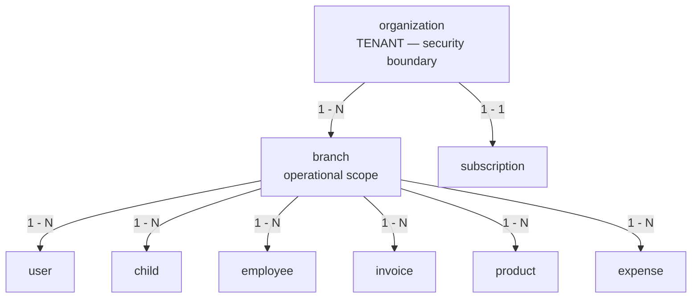
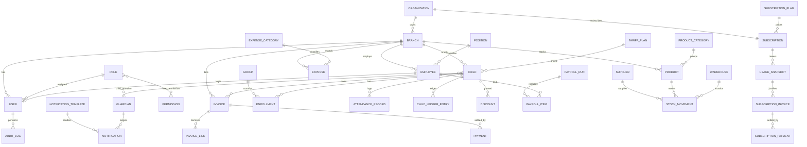
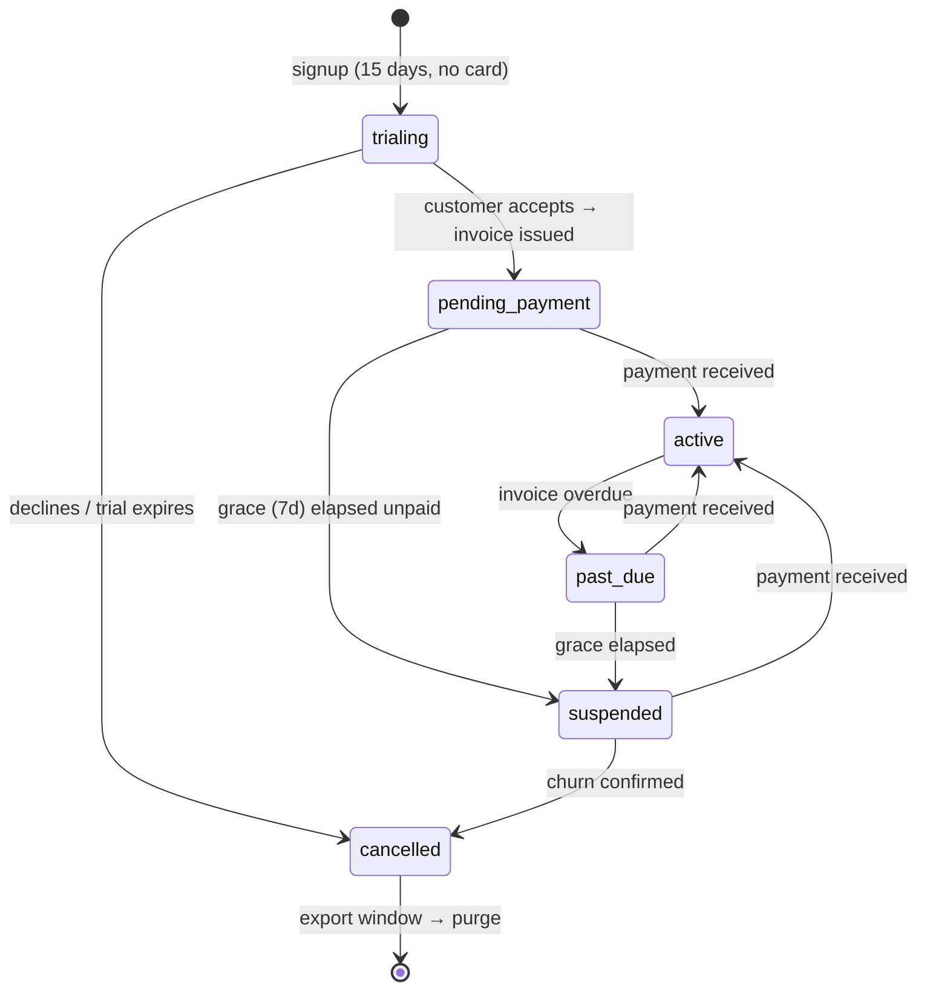

# Kindergarten Management System — Database Architecture (PostgreSQL)

| | |
|---|---|
| **Project** | Kindergarten Management System (KG-CRM) |
| **Database** | PostgreSQL 15+ |
| **Document** | Database Design & Data Architecture v1.0 |
| **Scope** | Entities, relationships, business rules, constraints, indexes, normalization |
| **Companion doc** | [02_Software_Architecture.md](./02_Software_Architecture.md) |
| **Explicitly out of scope** | Django models, migrations, ORM code |

> This is the **logical + physical data design**. It describes every table, column, type, key, constraint, index, and the business rules the schema enforces — at the database level, where they belong. No ORM code. When developers later write models, this document is the contract they implement.

---

## Table of Contents

1. [Database Design Principles](#1-database-design-principles)
2. [Naming Conventions](#2-naming-conventions)
3. [Standard Data Types](#3-standard-data-types)
4. [Standard (Base) Columns](#4-standard-base-columns)
5. [Enum & Reference-Data Strategy](#5-enum--reference-data-strategy)
6. [Multi-Tenancy Model](#6-multi-tenancy-model-adr-9)
7. [Soft Delete Strategy](#7-soft-delete-strategy)
8. [Normalization Analysis](#8-normalization-analysis)
9. [High-Level ERD](#9-high-level-erd)
10. [Schema Domain: Tenancy, Identity & Access](#10-schema-domain-tenancy-identity--access)
11. [Schema Domain: Children (CRM)](#11-schema-domain-children-crm)
12. [Schema Domain: Attendance](#12-schema-domain-attendance)
13. [Schema Domain: Finance](#13-schema-domain-finance)
14. [Schema Domain: HR & Payroll](#14-schema-domain-hr--payroll)
15. [Schema Domain: Inventory (Kitchen & Warehouse)](#15-schema-domain-inventory-kitchen--warehouse)
16. [Schema Domain: Expenses](#16-schema-domain-expenses)
17. [Schema Domain: Notifications](#17-schema-domain-notifications)
18. [Schema Domain: Settings](#18-schema-domain-settings)
19. [Schema Domain: Audit](#19-schema-domain-audit)
20. [Schema Domain: Subscriptions & Metering](#20-schema-domain-subscriptions--metering-adr-11)
21. [Referential Integrity — ON DELETE Matrix](#21-referential-integrity--on-delete-matrix)
22. [Business-Rule Constraints Catalog](#22-business-rule-constraints-catalog)
23. [Indexing Strategy](#23-indexing-strategy)
24. [Triggers & Computed Data](#24-triggers--computed-data)
25. [Views & Materialized Views](#25-views--materialized-views)
26. [Concurrency, Transactions & Integrity](#26-concurrency-transactions--integrity)
27. [Partitioning & Scaling](#27-partitioning--scaling)

---

## 1. Database Design Principles

| # | Principle | Consequence in this schema |
|---|-----------|----------------------------|
| D1 | **Integrity is enforced in the database, not just the app** | Foreign keys, `CHECK`, `UNIQUE`, and `NOT NULL` guard every invariant. The app is one client; the DB is the last line of defense. |
| D2 | **Normalize to 3NF, denormalize only with proof** | The base model is fully normalized. A handful of cached/derived columns exist for performance and are always kept consistent by a transaction or trigger (documented in §24). |
| D3 | **Money and stock are append-only ledgers** | Balances and stock levels are **derived from immutable movement records**, never overwritten in place. This kills the #1 finance bug: silent drift. |
| D4 | **Every business row is organization-scoped, then branch-scoped** | `organization_id` **and** `branch_id` on every operational table. `organization_id` is the tenant/security boundary (never bypassable); `branch_id` is the operational scope (ADR-9, [02 §11](./02_Software_Architecture.md)). |
| D5 | **Soft delete for master data, hard delete for transients** | Financial and referenced records are never physically deleted; they are deactivated for auditability. |
| D6 | **UUID surface keys** | Externally-referenced entities use UUID PKs to prevent enumeration and ease future distribution/sharding. |
| D7 | **Time is always `timestamptz` (UTC)** | No naive timestamps ever. Presentation converts to branch timezone. |
| D8 | **Explicit over implicit** | No hidden magic. Every constraint is named; every rule is documented here. |

---

## 2. Naming Conventions

| Object | Convention | Example |
|--------|-----------|---------|
| Table | `snake_case`, **singular** noun | `child`, `payment`, `stock_movement` |
| Join / bridge table | `<a>_<b>` singular | `child_guardian`, `role_permission` |
| Column | `snake_case` | `first_name`, `amount_due` |
| Primary key | `id` | `id` |
| Foreign key | `<referenced_table>_id` | `child_id`, `branch_id` |
| Boolean | `is_` / `has_` / `can_` prefix | `is_active`, `can_pickup` |
| Timestamp | `_at` suffix | `created_at`, `paid_at` |
| Date | `_date` suffix (or `_on`) | `due_date`, `hire_date` |
| Money amount | `amount` / `amount_*` | `amount_due`, `base_salary` |
| Index | `ix_<table>_<cols>` | `ix_attendance_child_date` |
| Unique constraint | `uq_<table>_<cols>` | `uq_invoice_number` |
| Check constraint | `ck_<table>_<rule>` | `ck_payment_amount_positive` |
| Foreign key constraint | `fk_<table>_<ref>` | `fk_invoice_child` |

**Rules:** no reserved words as identifiers, no abbreviations that aren't domain-standard, no plural table names (Django-friendly and unambiguous).

---

## 3. Standard Data Types

Deliberate, consistent type choices across the whole database.

| Concept | PostgreSQL type | Rationale |
|---------|-----------------|-----------|
| Surface primary key | `UUID` (default `gen_random_uuid()`) | Non-guessable, distribution-friendly (D6). |
| High-volume internal PK (optional) | `BIGINT GENERATED ALWAYS AS IDENTITY` | For append-only giants (attendance, audit) where UUID index bloat matters — used selectively. |
| Money | `NUMERIC(12,2)` | Exact decimal. **Never `float`/`real`** for money. Supports up to 9,999,999,999.99. |
| Quantity (stock) | `NUMERIC(12,3)` | Fractional units (e.g. 2.5 kg). |
| Percentage | `NUMERIC(5,2)` | e.g. discount 12.50 %. |
| Short text (names, codes) | `VARCHAR(n)` with sensible `n` | Bounded to catch bad data early. |
| Long text (notes, body) | `TEXT` | Unbounded content. |
| Email | `CITEXT` | Case-insensitive uniqueness without `LOWER()` gymnastics. |
| Phone | `VARCHAR(20)` | Stored normalized (E.164-ish); validated in app. |
| Timestamp | `TIMESTAMPTZ` | UTC, timezone-aware (D7). |
| Date only | `DATE` | Birthdays, due dates, attendance day. |
| Boolean | `BOOLEAN` | With explicit default. |
| Enum-like status | `VARCHAR` + `CHECK` | See §5 — portable and easy to evolve. |
| Flexible config / snapshots | `JSONB` | Settings values, audit diffs. Indexable via GIN. |
| Full-text search | `TSVECTOR` (generated) + GIN | Child/guardian search (§23). |

---

## 4. Standard (Base) Columns

Every table inherits a base set. To avoid repetition, the per-table definitions below **omit these** and list only domain columns.

| Column | Type | Constraint | Applies to |
|--------|------|-----------|-----------|
| `id` | `UUID` | PK, default `gen_random_uuid()` | all tables |
| `created_at` | `TIMESTAMPTZ` | `NOT NULL DEFAULT now()` | all tables |
| `updated_at` | `TIMESTAMPTZ` | `NOT NULL DEFAULT now()` (trigger-maintained) | all mutable tables |
| `is_active` | `BOOLEAN` | `NOT NULL DEFAULT true` | **master data only** (soft delete) |
| `created_by` | `UUID` | `NULL`, FK → `user(id)` `ON DELETE SET NULL` | user-authored records |
| `organization_id` | `UUID` | `NOT NULL`, FK → `organization(id)` `ON DELETE RESTRICT` | **every operational table** (D4, P10) |
| `branch_id` | `UUID` | `NOT NULL`, FK → `branch(id)` `ON DELETE RESTRICT` | all branch-scoped tables |

> **Append-only tables** (`child_ledger_entry`, `stock_movement`, `audit_log`, `attendance_record`, `usage_snapshot`) intentionally have **no `updated_at`/`is_active`** — they are immutable facts. Corrections are new rows, not edits (D3).

> **`organization_id` has no exceptions among operational tables.** The only tables that omit it are the two vendor-owned reference tables, `permission` and `subscription_plan` (§6.2). A new table without `organization_id` should fail code review by default.

---

## 5. Enum & Reference-Data Strategy

Three tiers, chosen by how the value set behaves:

| Tier | Mechanism | When | Examples |
|------|-----------|------|----------|
| **Fixed, code-owned enums** | `VARCHAR` column + named `CHECK (col IN (...))` | Small, stable, meaningful only to code | `gender`, `invoice.status`, `attendance.status`, `payment.method` |
| **Extensible master data** | Dedicated reference table (FK) | Users add/rename values; need attributes | `expense_category`, `product_category`, `position`, `notification_template` |
| **Global configuration** | `system_setting` (JSONB) | Tunable at runtime, no schema change | tariff defaults, reminder cadence, feature flags |

**Why `CHECK`-constrained `VARCHAR` over native `CREATE TYPE ... AS ENUM`?**
Native PG enums are painful to alter (adding/reordering values, removing values requires rewrites) and map awkwardly to the ORM. `VARCHAR + CHECK` is portable, trivially extensible (edit the constraint), self-documenting, and Django-friendly. We reserve reference **tables** for anything users manage.

---

## 6. Multi-Tenancy Model (ADR-9)

**Model: shared database, shared schema, row-level scoping by `organization_id` (security) + `branch_id` (operations)** (D4).

> **This section supersedes the earlier branch-as-tenancy-root design.** The product is sold per **organization**, and one subscription covers unlimited branches ([01 §4](./01_Project_Vision.md)). Branch cannot be the tenancy root, because a customer's own Org Owner legitimately reads across their branches — while no one may ever read across organizations.

### 6.1 The two scoping levels

| Level | Column | Nature | Who may cross it |
|-------|--------|--------|------------------|
| **Organization** | `organization_id NOT NULL` | **Security boundary** | **Nobody.** Not Org Owner, not platform staff via the normal API. |
| **Branch** | `branch_id` | Business scope | Org Owner (all branches in their org); other roles are branch-bound. |

### 6.2 Rules

- Every operational table carries **both** `organization_id NOT NULL` and `branch_id`.
- `organization_id` is **denormalized onto every table**, not reached through `branch`. One extra UUID per row buys single-hop filtering and simple RLS policies; the value is immutable for the row's lifetime, so no consistency trigger is needed ([02 §12.1](./02_Software_Architecture.md)).
- The base queryset applies the organization filter **before** any permission or branch logic. A cross-organization id returns **404**, never 403 — a 403 would confirm the row exists in another tenant.
- **Uniqueness is scoped to the organization, not globally.** Two different kindergartens may both have a branch coded `MAIN` or a group named "Sunflowers". Every unique index that was `UNIQUE (branch_id, …)` must include or be rooted in `organization_id`; anything that was globally unique (e.g. `branch.code`) becomes `UNIQUE (organization_id, code)`.
- **Platform-global data** (no organization): `permission`, `subscription_plan`. These are vendor-owned reference tables with `organization_id` absent by design — the only tables allowed to omit it.
- **Organization-global data**: `role`, `system_setting`, `notification_template` rows with `branch_id IS NULL` mean "applies to all branches **of this organization**" — they still carry `organization_id`.

### 6.3 Defense in depth — Row-Level Security

App-layer scoping is the primary control, but a single forgotten filter in a new endpoint would leak children's data across customers. Before the first paying customer, add Postgres **RLS** policies on `organization_id` for every operational table, with the tenant id set per connection/transaction.

RLS is a *policy addition*, not a migration, precisely because `organization_id` is present from the first migration. This is the payoff of deciding tenancy before any code exists.

**Implemented in Sprint 11** (`apps/core/migrations/0002_row_level_security.py`). How it works:

| Piece | Detail |
|-------|--------|
| Tenant id per connection | `organization_context()` sets both the `ContextVar` *and* the Postgres GUC `app.organization_id`, and clears the GUC on exit so a pooled connection never inherits the previous tenant. |
| Policy | `USING (organization_id = app_current_org())`, where `app_current_org()` returns `NULL` when the GUC is unset — so **an unset context sees nothing**, matching `TenantScopeMissing`. |
| `FORCE ROW LEVEL SECURITY` | Enabled on every protected table. Without it the table **owner bypasses RLS entirely**, which would make the policies decorative in exactly the deployment most projects run. It also means the whole test suite executes under RLS. |
| Platform plane | `organization`, `subscription`, `usage_snapshot`, `subscription_invoice`, `subscription_payment` add `OR app_is_platform()`. **Operational tables do not** — children, payments and attendance stay invisible to the vendor even in platform mode ([04 §19](./04_Backend_API_Specification.md)). |
| Auth door | `user` and `refresh_token` add `OR app_is_auth_lookup()`. Finding a user by email *is* the query that determines the tenant, so it cannot itself be tenant-scoped. The door is two tables wide and nothing else. |
| `audit_log` | Read is strict; **write also permits `organization_id IS NULL`**. A failed login has no known organization, and refusing to write that row would discard exactly the evidence that matters most. |
| Catalogue | `permission` and `subscription_plan` have no RLS — vendor reference data, identical for all tenants (§6.2). |

> **Cross-tenant work is now explicit.** Anything that legitimately spans tenants — signup (there is no tenant yet), the nightly jobs, the platform console — must ask for `platform_context()` by name. That is the point: a cross-tenant loop should be visible in the code and greppable, not an accident of a missing filter.

> **Deployment requirement.** The runtime database role should **not** own the tables. Migrations run as the owner; the application connects as a restricted role. `FORCE` makes RLS apply either way, but keeping ownership separate means a mistake in the policy set still cannot be escalated by the app's own connection.

> **Why not schema-per-tenant or DB-per-tenant?** Both isolate better but make cross-organization vendor operations (usage metering, platform reporting, migrations across hundreds of tenants) painful and slow, and neither is needed at this scale. Shared-schema + RLS is the standard trade-off; the escape hatch is partition-by-organization or extracting a large tenant, and `organization_id` on every row keeps both open.

---

## 7. Soft Delete Strategy

| Data class | Deletion | Reason |
|-----------|----------|--------|
| **Organization (tenant root)** | **Soft**, then an explicit audited **purge job** after the export window | Churn is `is_active=false`; the customer keeps read-only access + export for 30 days ([01 §4.4](./01_Project_Vision.md)). Physical deletion is a deliberate, logged operation with a known table order — never a cascade (§21). |
| Master/reference (child, employee, product, user, group, tariff, category) | **Soft** — set `is_active = false` | Referenced by history; must never break FKs or reports (D5). |
| Financial/append-only (ledger, payment, invoice, stock movement, payroll, **usage snapshot, subscription invoice/payment**) | **Never deleted** — status/reversal rows | Legal/audit integrity. A cancelled invoice gets `status='cancelled'`, not a `DELETE`. |
| Transient (unsent notification draft, expired export, session token) | **Hard delete** allowed | No historical value. |

**Uniqueness with soft delete:** partial unique indexes ignore inactive rows where re-use should be allowed, e.g. `UNIQUE (branch_id, name) WHERE is_active` for groups.

---

## 8. Normalization Analysis

The schema is designed to **Third Normal Form (3NF)**, with select tables reaching **BCNF**, and a small, explicit set of **controlled denormalizations** for performance.

### 8.1 Normal-form walkthrough

| NF | Requirement | How the design satisfies it |
|----|-------------|-----------------------------|
| **1NF** | Atomic columns, no repeating groups | No comma-lists or arrays-of-entities. A child's multiple guardians → rows in `child_guardian`, not `guardian1/guardian2` columns. A child's group history → `enrollment` rows. |
| **2NF** | No partial dependency on part of a composite key | Bridge tables (`child_guardian`, `role_permission`) carry only attributes fully dependent on the *whole* key (e.g. `is_primary` depends on the child+guardian pair, not on either alone). |
| **3NF** | No transitive dependency (non-key → non-key) | `invoice` stores `child_id`, not the child's name/phone (those live in `child`). `payment` stores `invoice_id`, not the invoice's amount. Category names live once in category tables and are referenced by FK. |
| **BCNF** | Every determinant is a candidate key | Reference tables (`permission.code`, `product` per branch) have their natural keys as enforced unique candidate keys. |

### 8.2 Deliberate denormalizations (and how they stay correct)

Denormalization is allowed **only** when (a) it removes a proven hot aggregation and (b) it's kept consistent inside the same transaction or by a trigger. Each is a *cache of derived truth*, never an independent source.

| Denormalized column | Source of truth | Kept consistent by | Why |
|---------------------|-----------------|--------------------|-----|
| `invoice.amount_paid`, `invoice.status` | sum of `payment` rows for the invoice | payment service (same transaction) + reconciliation job | Avoids summing payments on every invoice list render. |
| `child.balance` *(optional cache)* | `child_ledger_entry` sum | trigger on ledger insert | Debtor list & child header show balance without scanning the ledger. Authoritative balance still computed from ledger for any money-moving decision (D3). |
| `product.current_stock` | `stock_movement` sum | trigger on movement insert (or service in txn) | Stock badges/alerts without re-aggregating movements. |
| `payroll_run.total_net` etc. | `payroll_item` rows | payroll finalize service (txn) | Run summary display. |
| `group.enrolled_count` *(optional)* | active `enrollment` rows | trigger | Capacity checks and dashboards. |

> **The discipline (D3):** the ledger / movement tables are **the truth**; caches can always be rebuilt by re-aggregating. Any money-affecting operation recomputes from the ledger under a lock (§26) rather than trusting the cached column.

---

## 9. High-Level ERD

Domain-level view (details per domain follow). Bridge tables shown where they carry meaning.

---

## 10. Schema Domain: Tenancy, Identity & Access

### 10.1 `organization` (the tenancy root — ADR-9)
One paying customer: a kindergarten business, with one or more branches. **Every operational row in the database points here.**

| Column | Type | Constraints | Notes |
|--------|------|-------------|-------|
| `name` | `VARCHAR(200)` | `NOT NULL` | Trading name |
| `slug` | `VARCHAR(50)` | `NOT NULL`, `UNIQUE` | URL/support identifier — globally unique |
| `legal_name` | `VARCHAR(255)` | `NULL` | Registered entity name (for invoices/acts) |
| `tax_id` | `VARCHAR(20)` | `NULL` | INN/STIR — required before the first subscription invoice |
| `contact_email` | `CITEXT` | `NOT NULL` | Billing contact |
| `contact_phone` | `VARCHAR(20)` | `NULL` | |
| `country` | `CHAR(2)` | `NOT NULL DEFAULT 'UZ'` | ISO 3166-1; drives data-residency handling |
| `locale` | `VARCHAR(10)` | `NOT NULL DEFAULT 'uz'` | Default UI language |
| `onboarded_at` | `TIMESTAMPTZ` | `NULL` | First successful data import — the trial clock reference ([01 §4.4](./01_Project_Vision.md)) |

**Business rules:**
- An organization is **never hard-deleted.** Churn sets `is_active=false`; data is retained for the export window, then purged by an explicit, audited job.
- `slug` is globally unique (it appears in support tooling and URLs); everything else is scoped beneath it.
- Deleting an organization row is blocked by `ON DELETE RESTRICT` from every child table — by design.

### 10.2 `branch`
An operational location **inside an organization**. Not the tenancy root (ADR-9).

| Column | Type | Constraints | Notes |
|--------|------|-------------|-------|
| `organization_id` | `UUID` | `NOT NULL` FK → organization `ON DELETE RESTRICT` | Tenant owner |
| `name` | `VARCHAR(150)` | `NOT NULL` | Display name |
| `code` | `VARCHAR(20)` | `NOT NULL` | Short code (used in invoice numbering) |
| `address` | `TEXT` | `NULL` | |
| `phone` | `VARCHAR(20)` | `NULL` | |
| `currency` | `CHAR(3)` | `NOT NULL DEFAULT 'UZS'` | ISO 4217 |
| `timezone` | `VARCHAR(40)` | `NOT NULL DEFAULT 'Asia/Tashkent'` | For presentation |

**Constraint:** `uq_branch_org_code` — `UNIQUE (organization_id, code)`. Code is unique **within an organization**, not globally — two unrelated kindergartens may both use `MAIN`.

**Business rules:** a branch cannot be hard-deleted while it has children/employees (soft delete only). There is **no limit on branches per organization** — branch count is never billed ([01 §4.5](./01_Project_Vision.md)).

### 10.3 `role`
Business roles (not Django groups). Branch-scoped or global.

| Column | Type | Constraints | Notes |
|--------|------|-------------|-------|
| `name` | `VARCHAR(80)` | `NOT NULL` | e.g. "Cashier" |
| `code` | `VARCHAR(40)` | `NOT NULL` | `org_owner`, `director`, `manager`, `cashier`, `attendance_manager` |
| `description` | `TEXT` | `NULL` | |
| `is_system` | `BOOLEAN` | `NOT NULL DEFAULT false` | System roles can't be deleted/renamed |
| `organization_id` | `UUID` | `NOT NULL` FK → organization | Roles are per-organization |
| `branch_id` | `UUID` | `NULL` FK → branch | `NULL` = applies to all branches of this organization |

**Constraints:** `uq_role_org_code_branch` — `UNIQUE (organization_id, code, branch_id)`. **Rule:** `is_system = true` rows are immutable except permission assignment.

> **`super_admin` is gone** (ADR-10). `org_owner` is its replacement and is scoped to one organization; vendor staff are not rows in this table at all — they live in the platform plane ([02 §11.0](./02_Software_Architecture.md)). System roles are seeded per organization at signup.

### 10.4 `permission`
Atomic capabilities, global.

| Column | Type | Constraints | Notes |
|--------|------|-------------|-------|
| `code` | `VARCHAR(60)` | `NOT NULL`, `UNIQUE` | `"<module>.<action>"`, e.g. `payments.create` |
| `module` | `VARCHAR(40)` | `NOT NULL` | `payments`, `children`, … |
| `action` | `VARCHAR(20)` | `NOT NULL` | `read`, `create`, `update`, `delete`, `export`, `approve` |
| `label` | `VARCHAR(120)` | `NOT NULL` | Human label |

**Constraint:** `uq_permission_module_action` — `UNIQUE (module, action)`.

### 10.5 `role_permission` (bridge)

| Column | Type | Constraints |
|--------|------|-------------|
| `role_id` | `UUID` | `NOT NULL` FK → role `ON DELETE CASCADE` |
| `permission_id` | `UUID` | `NOT NULL` FK → permission `ON DELETE CASCADE` |

**Constraint:** `uq_role_permission` — `UNIQUE (role_id, permission_id)`. (No surrogate id needed; composite PK acceptable, but we keep base `id` for ORM uniformity.)

### 10.6 `user`
Authentication identity.

| Column | Type | Constraints | Notes |
|--------|------|-------------|-------|
| `organization_id` | `UUID` | `NOT NULL` FK → organization `ON DELETE RESTRICT` | Tenant owner — set at creation, **never mutable** |
| `email` | `CITEXT` | `NOT NULL` | Login identifier |
| `password_hash` | `VARCHAR(255)` | `NOT NULL` | Argon2/PBKDF2 |
| `full_name` | `VARCHAR(150)` | `NOT NULL` | |
| `phone` | `VARCHAR(20)` | `NULL` | |
| `role_id` | `UUID` | `NOT NULL` FK → role `ON DELETE RESTRICT` | One primary role (MVP) |
| `branch_id` | `UUID` | `NULL` FK → branch | `NULL` only for Org Owner (cross-branch within their org) |
| `is_staff` | `BOOLEAN` | `NOT NULL DEFAULT true` | Back-office user |
| `last_login_at` | `TIMESTAMPTZ` | `NULL` | |

**Constraint:** `uq_user_org_email` — `UNIQUE (organization_id, email)`.

> **Email is unique per organization, not globally.** The same person may legitimately work for two kindergartens. Login therefore resolves an email to *one or more* organization memberships; if there is more than one, the user picks the organization after authenticating. Making email globally unique would silently prevent a real scenario and, worse, leak the existence of another tenant's account at signup time.

**Business rules:**
- Org Owner may have `branch_id IS NULL`; **all other roles must have a branch** → `ck_user_branch_required` `CHECK (role is org_owner OR branch_id IS NOT NULL)` (enforced via app + trigger since it references role code).
- `ck_user_branch_same_org` — a user's `branch_id` must belong to their `organization_id` (trigger; a plain FK cannot express it). The same rule applies to every table carrying both columns.
- `organization_id` is **immutable after insert** (trigger). Moving a user between tenants is not an update; it is a new account.
- Deactivating a user (`is_active=false`) must invalidate their refresh tokens (app-level).
- **Future-proofing:** to move from single-role to multi-role, add a `user_role` bridge; `role_id` stays as "primary role" during transition.

### 10.7 `refresh_token` (auth session tracking — optional but recommended)

| Column | Type | Constraints | Notes |
|--------|------|-------------|-------|
| `user_id` | `UUID` | `NOT NULL` FK → user `ON DELETE CASCADE` | |
| `token_hash` | `VARCHAR(255)` | `NOT NULL`, `UNIQUE` | Store hash, never raw |
| `expires_at` | `TIMESTAMPTZ` | `NOT NULL` | |
| `revoked_at` | `TIMESTAMPTZ` | `NULL` | Blacklist on logout/rotation |
| `user_agent` | `VARCHAR(255)` | `NULL` | |
| `ip` | `INET` | `NULL` | |

> Fast blacklist checks also live in Redis; this table is the durable record for audit and "active sessions" UI.

---

## 11. Schema Domain: Children (CRM)

### 11.1 `child`

| Column | Type | Constraints | Notes |
|--------|------|-------------|-------|
| `first_name` | `VARCHAR(80)` | `NOT NULL` | |
| `last_name` | `VARCHAR(80)` | `NOT NULL` | |
| `middle_name` | `VARCHAR(80)` | `NULL` | |
| `date_of_birth` | `DATE` | `NOT NULL` | |
| `gender` | `VARCHAR(10)` | `NOT NULL`, `CHECK (gender IN ('male','female'))` | |
| `enrollment_status` | `VARCHAR(20)` | `NOT NULL DEFAULT 'active'`, `CHECK (... IN ('prospect','active','paused','graduated','withdrawn'))` | Lifecycle |
| `enrolled_on` | `DATE` | `NULL` | |
| `tariff_id` | `UUID` | `NULL` FK → tariff_plan `ON DELETE RESTRICT` | Current billing plan |
| `photo_path` | `VARCHAR(255)` | `NULL` | Private storage key |
| `balance` | `NUMERIC(12,2)` | `NOT NULL DEFAULT 0` | **Cached** from ledger (§8.2) |
| `notes` | `TEXT` | `NULL` | |
| `search_vector` | `TSVECTOR` | generated | Full-text search (§23) |

**Business rules:**
- `date_of_birth` must be in the past → `ck_child_dob_past CHECK (date_of_birth < CURRENT_DATE)`.
- A child in `active` status should have a `tariff_id` (enforced at billing time; warned in app).
- Soft delete only; a child with financial history is never hard-deleted.

### 11.2 `guardian`

| Column | Type | Constraints | Notes |
|--------|------|-------------|-------|
| `first_name` | `VARCHAR(80)` | `NOT NULL` | |
| `last_name` | `VARCHAR(80)` | `NOT NULL` | |
| `phone` | `VARCHAR(20)` | `NOT NULL` | Primary contact for SMS |
| `email` | `CITEXT` | `NULL` | Future email channel |
| `search_vector` | `TSVECTOR` | generated | |

**Constraint:** `uq_guardian_branch_phone` — `UNIQUE (branch_id, phone) WHERE is_active` (dedupe guardians per branch). **Future-proofing:** a `guardian` can later be linked 1–1 to a `user` for the Parent Portal (add nullable `user_id`).

### 11.3 `child_guardian` (bridge — carries the relationship semantics)

| Column | Type | Constraints | Notes |
|--------|------|-------------|-------|
| `child_id` | `UUID` | `NOT NULL` FK → child `ON DELETE CASCADE` | |
| `guardian_id` | `UUID` | `NOT NULL` FK → guardian `ON DELETE RESTRICT` | |
| `relation` | `VARCHAR(20)` | `NOT NULL`, `CHECK (... IN ('mother','father','grandparent','sibling','other'))` | |
| `is_primary` | `BOOLEAN` | `NOT NULL DEFAULT false` | Primary contact |
| `can_pickup` | `BOOLEAN` | `NOT NULL DEFAULT true` | Pickup authorization |

**Constraints:**
- `uq_child_guardian` — `UNIQUE (child_id, guardian_id)`.
- **At most one primary guardian per child** → partial unique index `uq_child_primary_guardian UNIQUE (child_id) WHERE is_primary`.
- Business rule: every `active` child must have ≥1 guardian and exactly one `is_primary` (enforced in app; the partial index guarantees "at most one").

### 11.4 `group` (kindergarten class/group)

| Column | Type | Constraints | Notes |
|--------|------|-------------|-------|
| `name` | `VARCHAR(80)` | `NOT NULL` | e.g. "Sunflowers" |
| `age_min` | `SMALLINT` | `NULL` | Min age (months/years) |
| `age_max` | `SMALLINT` | `NULL` | |
| `capacity` | `SMALLINT` | `NOT NULL DEFAULT 0`, `CHECK (capacity >= 0)` | |
| `teacher_employee_id` | `UUID` | `NULL` FK → employee `ON DELETE SET NULL` | Homeroom teacher |
| `enrolled_count` | `SMALLINT` | `NOT NULL DEFAULT 0` | **Cached** active enrollments |

**Constraints:** `uq_group_branch_name UNIQUE (branch_id, name) WHERE is_active`; `ck_group_age CHECK (age_max IS NULL OR age_min IS NULL OR age_max >= age_min)`.

### 11.5 `enrollment` (child ↔ group over time — the history)

| Column | Type | Constraints | Notes |
|--------|------|-------------|-------|
| `child_id` | `UUID` | `NOT NULL` FK → child `ON DELETE CASCADE` | |
| `group_id` | `UUID` | `NOT NULL` FK → group `ON DELETE RESTRICT` | |
| `start_date` | `DATE` | `NOT NULL` | |
| `end_date` | `DATE` | `NULL` | Open = current |
| `status` | `VARCHAR(20)` | `NOT NULL DEFAULT 'active'`, `CHECK (... IN ('active','ended','transferred'))` | |

**Business rules:**
- `ck_enrollment_dates CHECK (end_date IS NULL OR end_date >= start_date)`.
- **A child has at most one open (current) enrollment** → partial unique index `uq_enrollment_current UNIQUE (child_id) WHERE end_date IS NULL AND status='active'`.
- Group capacity check (enrolled_count < capacity) enforced in the enrollment service under a lock.

---

## 12. Schema Domain: Attendance

### 12.1 `attendance_record` (append-only, high volume)

| Column | Type | Constraints | Notes |
|--------|------|-------------|-------|
| `child_id` | `UUID` | `NOT NULL` FK → child `ON DELETE CASCADE` | |
| `group_id` | `UUID` | `NULL` FK → group `ON DELETE SET NULL` | Group at time of record |
| `attendance_date` | `DATE` | `NOT NULL` | The day |
| `status` | `VARCHAR(15)` | `NOT NULL`, `CHECK (... IN ('present','absent','excused','late'))` | |
| `check_in_at` | `TIMESTAMPTZ` | `NULL` | |
| `check_out_at` | `TIMESTAMPTZ` | `NULL` | |
| `reason` | `VARCHAR(255)` | `NULL` | Absence/late reason |
| `recorded_by` | `UUID` | `NULL` FK → user `ON DELETE SET NULL` | |

**Business rules:**
- **One record per child per day** → `uq_attendance_child_date UNIQUE (child_id, attendance_date)`. Corrections update the same row (this is the one operational table where an in-place status update is allowed, because a day's state is a single fact, not a money movement).
- `ck_attendance_checkout CHECK (check_out_at IS NULL OR check_in_at IS NULL OR check_out_at >= check_in_at)`.
- `attendance_date` cannot be in the future → `ck_attendance_not_future CHECK (attendance_date <= CURRENT_DATE)`.

**Scaling note:** prime candidate for **range partitioning by month** as volume grows (§27).

---

## 13. Schema Domain: Finance

> The **`child_ledger_entry`** table is the single source of financial truth. Invoices and payments are *documents* that generate ledger entries. Balances and the entire **Debtors** module are derived from this ledger (D3, ADR-7).

### 13.1 `tariff_plan`

| Column | Type | Constraints | Notes |
|--------|------|-------------|-------|
| `name` | `VARCHAR(80)` | `NOT NULL` | e.g. "Full-day" |
| `amount` | `NUMERIC(12,2)` | `NOT NULL`, `CHECK (amount >= 0)` | Base charge |
| `billing_period` | `VARCHAR(15)` | `NOT NULL DEFAULT 'monthly'`, `CHECK (... IN ('monthly','daily','termly'))` | |

**Constraint:** `uq_tariff_branch_name UNIQUE (branch_id, name) WHERE is_active`.
**Future-proofing:** child↔tariff over time can graduate to a `child_tariff` history table with `effective_from/to`; MVP uses `child.tariff_id`.

### 13.2 `discount`

| Column | Type | Constraints | Notes |
|--------|------|-------------|-------|
| `child_id` | `UUID` | `NOT NULL` FK → child `ON DELETE CASCADE` | Recurring child-level discount |
| `discount_type` | `VARCHAR(12)` | `NOT NULL`, `CHECK (... IN ('percent','fixed'))` | |
| `value` | `NUMERIC(12,2)` | `NOT NULL`, `CHECK (value >= 0)` | % or amount |
| `reason` | `VARCHAR(255)` | `NULL` | Sibling discount, staff child, etc. |
| `valid_from` | `DATE` | `NOT NULL` | |
| `valid_to` | `DATE` | `NULL` | |

**Constraints:** `ck_discount_percent CHECK (discount_type <> 'percent' OR value <= 100)`; `ck_discount_dates CHECK (valid_to IS NULL OR valid_to >= valid_from)`.

### 13.3 `invoice`

| Column | Type | Constraints | Notes |
|--------|------|-------------|-------|
| `number` | `VARCHAR(30)` | `NOT NULL` | Human-readable (branch code + seq) |
| `child_id` | `UUID` | `NOT NULL` FK → child `ON DELETE RESTRICT` | |
| `tariff_id` | `UUID` | `NULL` FK → tariff_plan `ON DELETE SET NULL` | Snapshot of plan used |
| `period_year` | `SMALLINT` | `NOT NULL` | Billing period |
| `period_month` | `SMALLINT` | `NOT NULL`, `CHECK (period_month BETWEEN 1 AND 12)` | |
| `amount_due` | `NUMERIC(12,2)` | `NOT NULL`, `CHECK (amount_due >= 0)` | After discounts |
| `amount_paid` | `NUMERIC(12,2)` | `NOT NULL DEFAULT 0`, `CHECK (amount_paid >= 0)` | **Cached** from payments |
| `status` | `VARCHAR(20)` | `NOT NULL DEFAULT 'issued'`, `CHECK (... IN ('draft','issued','partially_paid','paid','overdue','cancelled'))` | |
| `issued_date` | `DATE` | `NOT NULL` | |
| `due_date` | `DATE` | `NOT NULL` | |

**Business rules:**
- `uq_invoice_number UNIQUE (branch_id, number)`.
- **One invoice per child per period** → `uq_invoice_child_period UNIQUE (child_id, period_year, period_month) WHERE status <> 'cancelled'`. This makes monthly invoice generation **idempotent** (D3 / [02_Software_Architecture.md §18.3](./02_Software_Architecture.md)).
- `ck_invoice_paid_not_over CHECK (amount_paid <= amount_due)`.
- `ck_invoice_due_after_issue CHECK (due_date >= issued_date)`.
- Status transitions are one-directional except cancel: `draft → issued → partially_paid → paid`; `overdue` set by a scheduled job when `due_date < today AND amount_paid < amount_due`.

### 13.4 `invoice_line`
For itemization beyond the base tariff (extra meals, activities, one-off fees).

| Column | Type | Constraints | Notes |
|--------|------|-------------|-------|
| `invoice_id` | `UUID` | `NOT NULL` FK → invoice `ON DELETE CASCADE` | |
| `description` | `VARCHAR(255)` | `NOT NULL` | |
| `quantity` | `NUMERIC(10,2)` | `NOT NULL DEFAULT 1`, `CHECK (quantity > 0)` | |
| `unit_amount` | `NUMERIC(12,2)` | `NOT NULL`, `CHECK (unit_amount >= 0)` | |
| `line_total` | `NUMERIC(12,2)` | `NOT NULL` | `= quantity * unit_amount` (enforced in service) |

**Rule:** `SUM(line_total)` should reconcile to `invoice.amount_due` (validated in service; deviations only via explicit discount lines).

### 13.5 `payment`
A money-received event.

| Column | Type | Constraints | Notes |
|--------|------|-------------|-------|
| `invoice_id` | `UUID` | `NULL` FK → invoice `ON DELETE RESTRICT` | Direct link (MVP); NULL = unapplied credit |
| `child_id` | `UUID` | `NOT NULL` FK → child `ON DELETE RESTRICT` | Denormalized for fast child statements |
| `amount` | `NUMERIC(12,2)` | `NOT NULL`, `CHECK (amount > 0)` | |
| `method` | `VARCHAR(20)` | `NOT NULL`, `CHECK (... IN ('cash','card','bank_transfer','online'))` | `online` reserved for future gateway |
| `reference` | `VARCHAR(100)` | `NULL` | External txn ref |
| `paid_at` | `TIMESTAMPTZ` | `NOT NULL DEFAULT now()` | |
| `received_by` | `UUID` | `NULL` FK → user `ON DELETE SET NULL` | Cashier |
| `receipt_path` | `VARCHAR(255)` | `NULL` | Generated receipt PDF |

**Business rules:**
- A payment is **immutable**; corrections are made via a **reversal payment** (`amount` reversal recorded as a credit-reversing ledger entry) or a `refund` ledger entry — never an UPDATE/DELETE (D3).
- Recording a payment, in one transaction: inserts the payment, inserts a **credit** `child_ledger_entry`, updates `invoice.amount_paid`/`status`, updates `child.balance`.
- **Future-proofing (multi-invoice settlement / overpayment):** introduce `payment_allocation (payment_id, invoice_id, amount)` to split one payment across invoices; MVP uses the direct `invoice_id`.

### 13.6 `child_ledger_entry` (append-only — THE source of truth)

| Column | Type | Constraints | Notes |
|--------|------|-------------|-------|
| `child_id` | `UUID` | `NOT NULL` FK → child `ON DELETE RESTRICT` | |
| `entry_type` | `VARCHAR(15)` | `NOT NULL`, `CHECK (... IN ('charge','payment','discount','adjustment','refund'))` | |
| `direction` | `VARCHAR(6)` | `NOT NULL`, `CHECK (direction IN ('debit','credit'))` | debit ↑owed, credit ↓owed |
| `amount` | `NUMERIC(12,2)` | `NOT NULL`, `CHECK (amount > 0)` | Always positive; sign comes from `direction` |
| `source_type` | `VARCHAR(20)` | `NOT NULL`, `CHECK (... IN ('invoice','payment','discount','manual'))` | What generated it |
| `source_id` | `UUID` | `NULL` | Points to invoice/payment id (soft polymorphic) |
| `occurred_at` | `TIMESTAMPTZ` | `NOT NULL DEFAULT now()` | |
| `description` | `VARCHAR(255)` | `NULL` | |
| `created_by` | `UUID` | `NULL` FK → user `ON DELETE SET NULL` | |

**Business rules (the ledger contract):**
- **Balance of a child** = `Σ debit.amount − Σ credit.amount`. `> 0` ⇒ child owes ⇒ **debtor**.
- Rows are **never updated or deleted**. A mistake is corrected by an `adjustment`/`refund` counter-entry.
- `charge` → debit (from invoice issue); `payment` → credit; `discount` → credit; `refund` → debit.
- Consistency check job: `child.balance` (cache) must equal recomputed ledger balance.

### 13.7 Debtors — **derived, not stored**
There is **no `debtor` table.** A debtor is any child whose ledger balance is positive (optionally: with an overdue invoice). Served by a SQL view (§25) and the Debtors module reads it. This is the whole point of the ledger design: the debtor list can never drift out of sync with reality.

---

## 14. Schema Domain: HR & Payroll

### 14.1 `position`

| Column | Type | Constraints | Notes |
|--------|------|-------------|-------|
| `title` | `VARCHAR(80)` | `NOT NULL` | e.g. "Teacher", "Cook" |
| `department` | `VARCHAR(60)` | `NULL` | |

**Constraint:** `uq_position_branch_title UNIQUE (branch_id, title) WHERE is_active`.

### 14.2 `employee`
Distinct from `user` — not every employee logs in; not every user is paid.

| Column | Type | Constraints | Notes |
|--------|------|-------------|-------|
| `first_name` | `VARCHAR(80)` | `NOT NULL` | |
| `last_name` | `VARCHAR(80)` | `NOT NULL` | |
| `phone` | `VARCHAR(20)` | `NULL` | |
| `position_id` | `UUID` | `NULL` FK → position `ON DELETE SET NULL` | |
| `user_id` | `UUID` | `NULL` FK → user `ON DELETE SET NULL`, `UNIQUE` | Optional login link (future Teacher Portal) |
| `employment_status` | `VARCHAR(15)` | `NOT NULL DEFAULT 'active'`, `CHECK (... IN ('active','on_leave','terminated'))` | |
| `hire_date` | `DATE` | `NOT NULL` | |
| `termination_date` | `DATE` | `NULL` | |
| `base_salary` | `NUMERIC(12,2)` | `NOT NULL DEFAULT 0`, `CHECK (base_salary >= 0)` | Monthly base |

**Constraints:** `uq_employee_user UNIQUE (user_id)` (a user maps to at most one employee); `ck_employee_termination CHECK (termination_date IS NULL OR termination_date >= hire_date)`.

### 14.3 `payroll_run`
A payroll cycle for a period.

| Column | Type | Constraints | Notes |
|--------|------|-------------|-------|
| `period_year` | `SMALLINT` | `NOT NULL` | |
| `period_month` | `SMALLINT` | `NOT NULL`, `CHECK (period_month BETWEEN 1 AND 12)` | |
| `status` | `VARCHAR(15)` | `NOT NULL DEFAULT 'draft'`, `CHECK (... IN ('draft','finalized','paid'))` | |
| `total_gross` | `NUMERIC(14,2)` | `NOT NULL DEFAULT 0` | **Cached** from items |
| `total_deductions` | `NUMERIC(14,2)` | `NOT NULL DEFAULT 0` | Cached |
| `total_net` | `NUMERIC(14,2)` | `NOT NULL DEFAULT 0` | Cached |
| `finalized_at` | `TIMESTAMPTZ` | `NULL` | |
| `finalized_by` | `UUID` | `NULL` FK → user | |

**Business rules:**
- **One run per branch per period** → `uq_payroll_run_branch_period UNIQUE (branch_id, period_year, period_month)`.
- A `finalized` run is immutable (items locked); only status → `paid` afterward.

### 14.4 `payroll_item`
Per-employee line within a run.

| Column | Type | Constraints | Notes |
|--------|------|-------------|-------|
| `payroll_run_id` | `UUID` | `NOT NULL` FK → payroll_run `ON DELETE CASCADE` | |
| `employee_id` | `UUID` | `NOT NULL` FK → employee `ON DELETE RESTRICT` | |
| `base_amount` | `NUMERIC(12,2)` | `NOT NULL`, `CHECK (base_amount >= 0)` | Snapshot of salary |
| `bonus` | `NUMERIC(12,2)` | `NOT NULL DEFAULT 0`, `CHECK (bonus >= 0)` | |
| `deduction` | `NUMERIC(12,2)` | `NOT NULL DEFAULT 0`, `CHECK (deduction >= 0)` | |
| `gross` | `NUMERIC(12,2)` | `NOT NULL` | `= base + bonus` |
| `net` | `NUMERIC(12,2)` | `NOT NULL`, `CHECK (net >= 0)` | `= gross − deduction` |
| `note` | `VARCHAR(255)` | `NULL` | |

**Constraint:** `uq_payroll_item UNIQUE (payroll_run_id, employee_id)` — one line per employee per run.
**Future-proofing:** detailed bonus/deduction breakdown → `payroll_item_component` child table.

---

## 15. Schema Domain: Inventory (Kitchen & Warehouse)

> Same ledger philosophy as finance: **stock levels are derived from immutable `stock_movement` rows** (D3). Foundation for future Meal Planning (recipes consume stock).

### 15.1 `warehouse`
A storage location (a branch may have kitchen store, dry store, etc.).

| Column | Type | Constraints | Notes |
|--------|------|-------------|-------|
| `name` | `VARCHAR(80)` | `NOT NULL` | |

**Constraint:** `uq_warehouse_branch_name UNIQUE (branch_id, name) WHERE is_active`. MVP may seed one default warehouse per branch.

### 15.2 `product_category`

| Column | Type | Constraints | Notes |
|--------|------|-------------|-------|
| `name` | `VARCHAR(80)` | `NOT NULL` | e.g. "Vegetables", "Dairy" |

**Constraint:** `uq_product_category_branch_name UNIQUE (branch_id, name) WHERE is_active`.

### 15.3 `product` (stock item)

| Column | Type | Constraints | Notes |
|--------|------|-------------|-------|
| `name` | `VARCHAR(120)` | `NOT NULL` | |
| `sku` | `VARCHAR(40)` | `NULL` | Optional internal code |
| `category_id` | `UUID` | `NULL` FK → product_category `ON DELETE SET NULL` | |
| `unit` | `VARCHAR(15)` | `NOT NULL`, `CHECK (... IN ('kg','g','l','ml','pcs','pack'))` | Unit of measure |
| `min_stock` | `NUMERIC(12,3)` | `NOT NULL DEFAULT 0`, `CHECK (min_stock >= 0)` | Low-stock alert threshold |
| `current_stock` | `NUMERIC(12,3)` | `NOT NULL DEFAULT 0` | **Cached** from movements (§8.2) |

**Constraints:** `uq_product_branch_name UNIQUE (branch_id, name) WHERE is_active`; `uq_product_sku UNIQUE (branch_id, sku) WHERE sku IS NOT NULL`.
**Rule:** low-stock alert fired when `current_stock < min_stock` (notification job).

### 15.4 `supplier`

| Column | Type | Constraints | Notes |
|--------|------|-------------|-------|
| `name` | `VARCHAR(120)` | `NOT NULL` | |
| `phone` | `VARCHAR(20)` | `NULL` | |
| `contact_person` | `VARCHAR(120)` | `NULL` | |

**Constraint:** `uq_supplier_branch_name UNIQUE (branch_id, name) WHERE is_active`.

### 15.5 `stock_movement` (append-only — source of truth for stock)

| Column | Type | Constraints | Notes |
|--------|------|-------------|-------|
| `product_id` | `UUID` | `NOT NULL` FK → product `ON DELETE RESTRICT` | |
| `warehouse_id` | `UUID` | `NOT NULL` FK → warehouse `ON DELETE RESTRICT` | |
| `supplier_id` | `UUID` | `NULL` FK → supplier `ON DELETE SET NULL` | For inbound |
| `direction` | `VARCHAR(4)` | `NOT NULL`, `CHECK (direction IN ('in','out'))` | |
| `movement_type` | `VARCHAR(15)` | `NOT NULL`, `CHECK (... IN ('purchase','consumption','adjustment','waste','transfer'))` | |
| `quantity` | `NUMERIC(12,3)` | `NOT NULL`, `CHECK (quantity > 0)` | Always positive; sign from `direction` |
| `unit_cost` | `NUMERIC(12,2)` | `NULL`, `CHECK (unit_cost IS NULL OR unit_cost >= 0)` | For inbound valuation |
| `occurred_at` | `TIMESTAMPTZ` | `NOT NULL DEFAULT now()` | |
| `reference` | `VARCHAR(100)` | `NULL` | Delivery note, meal id (future) |
| `note` | `VARCHAR(255)` | `NULL` | |

**Business rules:**
- **Stock level of a product** = `Σ in.quantity − Σ out.quantity` (per warehouse). Cached in `product.current_stock`.
- Never edited/deleted; corrections via `adjustment` movements.
- **No negative stock** guard: an `out` movement that would drive stock below zero is rejected in the service under a row lock (§26) — a DB `CHECK` can't see the running total, so this is enforced transactionally.
- `purchase`/`transfer-in` ⇒ `direction='in'`; `consumption`/`waste` ⇒ `direction='out'`.

**Scaling note:** partition by month like attendance if volume grows (§27).

---

## 16. Schema Domain: Expenses

### 16.1 `expense_category`

| Column | Type | Constraints | Notes |
|--------|------|-------------|-------|
| `name` | `VARCHAR(80)` | `NOT NULL` | e.g. "Utilities", "Repairs" |

**Constraint:** `uq_expense_category_branch_name UNIQUE (branch_id, name) WHERE is_active`.

### 16.2 `expense`

| Column | Type | Constraints | Notes |
|--------|------|-------------|-------|
| `category_id` | `UUID` | `NOT NULL` FK → expense_category `ON DELETE RESTRICT` | |
| `amount` | `NUMERIC(12,2)` | `NOT NULL`, `CHECK (amount > 0)` | |
| `expense_date` | `DATE` | `NOT NULL` | |
| `description` | `VARCHAR(255)` | `NULL` | |
| `status` | `VARCHAR(12)` | `NOT NULL DEFAULT 'pending'`, `CHECK (... IN ('pending','approved','rejected','paid'))` | Approval workflow |
| `approved_by` | `UUID` | `NULL` FK → user `ON DELETE SET NULL` | |
| `receipt_path` | `VARCHAR(255)` | `NULL` | Scanned receipt |

**Business rules:** `ck_expense_not_future CHECK (expense_date <= CURRENT_DATE)`; only `approved` expenses count in P&L reports; `rejected` requires no further action.

---

## 17. Schema Domain: Notifications

Channel-agnostic hub (SMS now; Telegram/Email later). See [02_Software_Architecture.md §17](./02_Software_Architecture.md).

### 17.1 `notification_template`

| Column | Type | Constraints | Notes |
|--------|------|-------------|-------|
| `code` | `VARCHAR(50)` | `NOT NULL` | `payment_received`, `debt_reminder`, … |
| `channel` | `VARCHAR(12)` | `NOT NULL`, `CHECK (... IN ('sms','telegram','email'))` | |
| `subject` | `VARCHAR(150)` | `NULL` | Email/Telegram title |
| `body` | `TEXT` | `NOT NULL` | With `{variables}` |
| `branch_id` | `UUID` | `NULL` FK → branch | `NULL` = global template |

**Constraint:** `uq_template_code_channel_branch UNIQUE (code, channel, branch_id)`.

### 17.2 `notification`
One dispatch record per recipient per message.

| Column | Type | Constraints | Notes |
|--------|------|-------------|-------|
| `template_id` | `UUID` | `NULL` FK → notification_template `ON DELETE SET NULL` | |
| `guardian_id` | `UUID` | `NULL` FK → guardian `ON DELETE SET NULL` | Target (MVP: guardians) |
| `channel` | `VARCHAR(12)` | `NOT NULL`, `CHECK (... IN ('sms','telegram','email'))` | |
| `recipient_address` | `VARCHAR(120)` | `NOT NULL` | Phone/chat-id/email snapshot |
| `rendered_body` | `TEXT` | `NOT NULL` | Final message |
| `status` | `VARCHAR(12)` | `NOT NULL DEFAULT 'queued'`, `CHECK (... IN ('queued','sent','delivered','failed','cancelled'))` | |
| `provider_message_id` | `VARCHAR(120)` | `NULL` | Gateway id |
| `retry_count` | `SMALLINT` | `NOT NULL DEFAULT 0` | |
| `error` | `TEXT` | `NULL` | Last failure reason |
| `scheduled_for` | `TIMESTAMPTZ` | `NULL` | Deferred send |
| `sent_at` | `TIMESTAMPTZ` | `NULL` | |

**Business rules:** status transitions `queued → sent → delivered` or `→ failed` (with retry/backoff in Celery); `cancelled` allowed from `queued` only.

---

## 18. Schema Domain: Settings

### 18.1 `system_setting`

| Column | Type | Constraints | Notes |
|--------|------|-------------|-------|
| `key` | `VARCHAR(80)` | `NOT NULL` | e.g. `finance.reminder_day` |
| `value` | `JSONB` | `NOT NULL` | Any shape (scalar/object/array) |
| `branch_id` | `UUID` | `NULL` FK → branch | `NULL` = global default |
| `description` | `VARCHAR(255)` | `NULL` | |

**Constraint:** `uq_setting_key_branch UNIQUE (key, branch_id)`. Resolution order: branch-specific value overrides the global (`branch_id IS NULL`) default.
**GIN index** on `value` for JSONB queries where needed. Feature flags live here to gate future modules without schema changes.

---

## 19. Schema Domain: Audit

### 19.1 `audit_log` (append-only, immutable)

| Column | Type | Constraints | Notes |
|--------|------|-------------|-------|
| `actor_id` | `UUID` | `NULL` FK → user `ON DELETE SET NULL` | Who (NULL = system job) |
| `action` | `VARCHAR(30)` | `NOT NULL`, `CHECK (... IN ('create','update','delete','login','logout','approve','cancel','export'))` | |
| `entity_type` | `VARCHAR(50)` | `NOT NULL` | e.g. `payment`, `role` |
| `entity_id` | `UUID` | `NULL` | Affected row |
| `changes` | `JSONB` | `NULL` | `{before, after}` diff |
| `branch_id` | `UUID` | `NULL` FK → branch | Context |
| `ip` | `INET` | `NULL` | |
| `user_agent` | `VARCHAR(255)` | `NULL` | |

**Business rules:**
- **Insert-only.** No `UPDATE`/`DELETE` (enforced by DB grants: the app DB role has only `INSERT`/`SELECT` on this table).
- Written from the service layer for all money/admin mutations (payments, invoices, payroll runs, role/permission changes, user activation, settings, stock adjustments).
- **Retention & scale:** monthly partitioning candidate (§27).

---

## 20. Schema Domain: Subscriptions & Metering (ADR-11)

Vendor → customer billing. **Structurally separate from `finance`** (kindergarten → parent). The two domains share vocabulary and nothing else ([01 §4.6](./01_Project_Vision.md)); no service in one may write tables in the other.

The design mirrors D3: **charges derive from immutable usage evidence**, never from a mutable counter.

### 20.1 `subscription_plan` (vendor-owned reference data)
Pricing definitions. **One of only two tables without `organization_id`** — these are the vendor's catalogue, not tenant data (§6.2).

| Column | Type | Constraints | Notes |
|--------|------|-------------|-------|
| `code` | `VARCHAR(40)` | `NOT NULL` | e.g. `standard` |
| `name` | `VARCHAR(100)` | `NOT NULL` | Display name |
| `currency` | `CHAR(3)` | `NOT NULL DEFAULT 'UZS'` | |
| `base_price` | `NUMERIC(12,2)` | `NOT NULL`, `CHECK (base_price >= 0)` | 500 000 |
| `included_children` | `SMALLINT` | `NOT NULL`, `CHECK (included_children > 0)` | 50 — also the **minimum billable count** |
| `overage_step_children` | `SMALLINT` | `NOT NULL`, `CHECK (overage_step_children > 0)` | 10 |
| `overage_step_price` | `NUMERIC(12,2)` | `NOT NULL`, `CHECK (overage_step_price >= 0)` | 80 000 |
| `valid_from` | `DATE` | `NOT NULL` | Price version start |
| `valid_to` | `DATE` | `NULL` | `NULL` = current |

**Constraint:** `uq_plan_code_valid_from` — `UNIQUE (code, valid_from)`.

> **Plans are versioned, never edited.** A price change inserts a new row with a new `valid_from` and closes the old one. Existing subscriptions keep pointing at the plan version they purchased, so a customer's price cannot silently change under them — essential under UZS inflation ([01 §10](./01_Project_Vision.md)). Editing a live plan row in place would retroactively rewrite history on every past invoice.

### 20.2 `subscription`
One organization's commercial agreement. **One active subscription per organization.**

| Column | Type | Constraints | Notes |
|--------|------|-------------|-------|
| `organization_id` | `UUID` | `NOT NULL` FK → organization `ON DELETE RESTRICT` | |
| `plan_id` | `UUID` | `NOT NULL` FK → subscription_plan `ON DELETE RESTRICT` | The purchased **version** |
| `status` | `VARCHAR(20)` | `NOT NULL`, `CHECK (status IN ('trialing','pending_payment','active','past_due','suspended','cancelled'))` | §20.6 |
| `payment_term` | `VARCHAR(20)` | `NOT NULL`, `CHECK (payment_term IN ('monthly','semiannual','annual'))` | |
| `discount_percent` | `NUMERIC(5,2)` | `NOT NULL DEFAULT 0`, `CHECK (discount_percent >= 0 AND discount_percent <= 100)` | 0 / 15 / 25 — **frozen at purchase** |
| `trial_started_at` | `TIMESTAMPTZ` | `NULL` | |
| `trial_ends_at` | `TIMESTAMPTZ` | `NULL` | `trial_started_at + 15 days` |
| `current_period_start` | `DATE` | `NOT NULL` | |
| `current_period_end` | `DATE` | `NOT NULL`, `CHECK (current_period_end > current_period_start)` | |
| `committed_children` | `SMALLINT` | `NULL`, `CHECK (committed_children >= 0)` | Child count the prepayment covers (prepaid terms only) |
| `cancelled_at` | `TIMESTAMPTZ` | `NULL` | |

**Constraints:**
- `uq_subscription_active_org` — `UNIQUE (organization_id) WHERE status <> 'cancelled'` (partial): at most one live subscription per organization.
- `ck_subscription_trial_dates` — `CHECK (trial_ends_at IS NULL OR trial_started_at IS NOT NULL)`.

**Business rules:**
- `discount_percent` is **copied onto the row at purchase**, not read from the term at billing time. If the vendor later changes what "annual" is worth, existing agreements are untouched.
- The discount applies to the **base package**, and overage steps are billed at the **same rate** ([01 §4.3](./01_Project_Vision.md)) — i.e. `discount_amount = (base_amount + overage_amount) × discount_percent`. Applying it to the base alone would make a customer who prepaid a year pay full price for growth, which is contrary to the spirit of the commitment.
- A falling child count never triggers a refund — `included_children` is a floor, not an estimate.

### 20.3 `usage_snapshot` (append-only — THE metering evidence)
The immutable answer to "why is this invoice this amount?" Never updated, never deleted (P11).

| Column | Type | Constraints | Notes |
|--------|------|-------------|-------|
| `organization_id` | `UUID` | `NOT NULL` FK → organization `ON DELETE RESTRICT` | |
| `subscription_id` | `UUID` | `NOT NULL` FK → subscription `ON DELETE RESTRICT` | |
| `period_year` | `SMALLINT` | `NOT NULL` | |
| `period_month` | `SMALLINT` | `NOT NULL`, `CHECK (period_month BETWEEN 1 AND 12)` | |
| `peak_children` | `INTEGER` | `NOT NULL`, `CHECK (peak_children >= 0)` | **Highest** active-enrolled count observed in the period |
| `peak_observed_at` | `TIMESTAMPTZ` | `NOT NULL` | When the peak occurred |
| `billable_children` | `INTEGER` | `NOT NULL` | `GREATEST(peak_children, plan.included_children)` |
| `measurement_method` | `VARCHAR(30)` | `NOT NULL`, `CHECK (measurement_method IN ('daily_peak','manual_adjustment'))` | |
| `note` | `TEXT` | `NULL` | Required for `manual_adjustment` |

| `closed_at` | `TIMESTAMPTZ` | `NULL` | Set at period close; the row is frozen from then on |

**Constraints:**
- `uq_usage_snapshot_period` — `UNIQUE (subscription_id, period_year, period_month) WHERE measurement_method = 'daily_peak'` (**partial**).
- `ck_usage_adjustment_note` — a `manual_adjustment` row must carry a note.

> **Why the unique index is partial.** As first written, this constraint contradicted the correction rule directly below it: one row per period makes a second `manual_adjustment` row for that same period impossible to insert. Scoping the index to `daily_peak` resolves it — exactly one *measurement* row per period, with corrections stacked alongside as additional rows. Found while implementing Sprint 10.
>
> **Why `closed_at`.** "Append-only" and "the highest count observed during the period" also need reconciling: while the period is open the daily job must be able to raise `peak_children`, which *is* the measurement, not a rewrite of history. `closed_at` marks the moment it becomes history; after that the row never changes and any correction is a new row.

> **Why peak, not month-end count?** A month-end reading is trivially gamed: mark children inactive on the 30th, reactivate on the 1st. The peak is measured by a daily job that records the high-water mark, so the number reflects the service actually consumed. Corrections are **new `manual_adjustment` rows with a mandatory note**, never edits — same discipline as `child_ledger_entry` (D3).

### 20.4 `subscription_invoice`
What the vendor bills the organization. Immutable once issued.

| Column | Type | Constraints | Notes |
|--------|------|-------------|-------|
| `organization_id` | `UUID` | `NOT NULL` FK → organization `ON DELETE RESTRICT` | |
| `subscription_id` | `UUID` | `NOT NULL` FK → subscription `ON DELETE RESTRICT` | |
| `usage_snapshot_id` | `UUID` | `NULL` FK → usage_snapshot `ON DELETE RESTRICT` | `NULL` for pure prepayment lines |
| `number` | `VARCHAR(30)` | `NOT NULL`, `UNIQUE` | Vendor-global sequence |
| `issued_at` | `DATE` | `NOT NULL` | |
| `due_at` | `DATE` | `NOT NULL`, `CHECK (due_at >= issued_at)` | |
| `period_start` | `DATE` | `NOT NULL` | |
| `period_end` | `DATE` | `NOT NULL`, `CHECK (period_end >= period_start)` | |
| `billable_children` | `INTEGER` | `NOT NULL` | Copied from the snapshot — frozen |
| `base_amount` | `NUMERIC(12,2)` | `NOT NULL` | |
| `overage_amount` | `NUMERIC(12,2)` | `NOT NULL DEFAULT 0` | |
| `discount_amount` | `NUMERIC(12,2)` | `NOT NULL DEFAULT 0` | |
| `total_amount` | `NUMERIC(12,2)` | `NOT NULL`, `CHECK (total_amount >= 0)` | |
| `currency` | `CHAR(3)` | `NOT NULL DEFAULT 'UZS'` | |
| `status` | `VARCHAR(20)` | `NOT NULL`, `CHECK (status IN ('issued','paid','overdue','cancelled'))` | |

**Constraint:** `ck_subscription_invoice_total` — `CHECK (total_amount = base_amount + overage_amount - discount_amount)`.

> Amounts are **denormalized onto the invoice on purpose.** An invoice is a legal document: it must render identically in three years even if the plan version, the snapshot interpretation, or the discount policy has changed. Recomputing an old invoice from current data is a bug, not a feature.

### 20.5 `subscription_payment`
Settlement against a subscription invoice. Append-only.

| Column | Type | Constraints | Notes |
|--------|------|-------------|-------|
| `organization_id` | `UUID` | `NOT NULL` FK → organization `ON DELETE RESTRICT` | |
| `subscription_invoice_id` | `UUID` | `NOT NULL` FK → subscription_invoice `ON DELETE RESTRICT` | |
| `amount` | `NUMERIC(12,2)` | `NOT NULL`, `CHECK (amount > 0)` | |
| `method` | `VARCHAR(20)` | `NOT NULL`, `CHECK (method IN ('bank_transfer','card','cash'))` | `bank_transfer` is the MVP default |
| `reference` | `VARCHAR(80)` | `NULL` | Bank reference / payment order no. |
| `received_at` | `TIMESTAMPTZ` | `NOT NULL` | |
| `recorded_by` | `UUID` | `NULL` FK → user `ON DELETE SET NULL` | Platform actor |

### 20.6 Subscription lifecycle

| Status | Access | Notes |
|--------|--------|-------|
| `trialing` | Full | 15 days from `trial_started_at`. |
| `pending_payment` | **Full** | Invoice issued, bank transfer in flight (7-day grace). Access is never cut off mid-transfer — customers are legal entities and transfers take days ([01 §4.4](./01_Project_Vision.md)). |
| `active` | Full | |
| `past_due` | Full | Invoice overdue; reminders sent. |
| `suspended` | **Read-only** — writes return `402` | Data is **never deleted or hidden** for non-payment. They keep their financial history and can return. |
| `cancelled` | Read-only + export, 30 days | Then purged by an audited job. |

> **The first paid invoice covers the trial period.** On conversion, `period_start` is set to `trial_started_at`, not to the acceptance date ([01 §4.4](./01_Project_Vision.md)). This must be disclosed in the offer at signup — the schema supports the policy, but only honest presentation makes it fair.

---

## 21. Referential Integrity — ON DELETE Matrix

`ON DELETE` behavior is chosen per relationship by **what should happen to children when a parent is removed**. Because most master data is soft-deleted, `RESTRICT`/`SET NULL` dominate; `CASCADE` is reserved for true ownership.

| Child table → Parent | ON DELETE | Why |
|----------------------|-----------|-----|
| `role_permission → role` / `permission` | **CASCADE** | Pure join rows; meaningless without both sides. |
| `child_guardian → child` | **CASCADE** | Owned by the child. |
| `child_guardian → guardian` | **RESTRICT** | Don't lose a guardian still linked; soft-delete guardian instead. |
| `enrollment → child` | **CASCADE** | Owned by the child. |
| `enrollment → group` | **RESTRICT** | Preserve enrollment history; groups are soft-deleted. |
| `attendance_record → child` | **CASCADE** | History tied to child (child is soft-deleted in practice, so this rarely fires). |
| `invoice → child` | **RESTRICT** | **Never** delete a child with financial documents. |
| `invoice_line → invoice` | **CASCADE** | Owned by the invoice. |
| `payment → invoice` | **RESTRICT** | Payments are permanent financial records. |
| `child_ledger_entry → child` | **RESTRICT** | Ledger is immutable truth. |
| `payroll_item → payroll_run` | **CASCADE** | Owned by the run (only while draft). |
| `payroll_item → employee` | **RESTRICT** | Preserve payroll history; employees soft-deleted. |
| `stock_movement → product` / `warehouse` | **RESTRICT** | Immutable stock history. |
| `expense → expense_category` | **RESTRICT** | Keep expense classification intact. |
| `*.created_by / approved_by / *_by → user` | **SET NULL** | Keep the record; forget the actor reference. |
| `* → branch` | **RESTRICT** | A branch with data cannot be deleted. |
| **`* → organization`** | **RESTRICT** | **Never `CASCADE`.** A single accidental `DELETE FROM organization` must not be able to erase a customer's entire history. Offboarding is an explicit, audited purge job that deletes in a known order — not a cascade. |
| `usage_snapshot → subscription` | **RESTRICT** | Metering evidence outlives any plan change. |
| `subscription_invoice → usage_snapshot` | **RESTRICT** | An invoice must always be able to show what it was based on. |
| `subscription_payment → subscription_invoice` | **RESTRICT** | Permanent financial record. |

> **Guiding rule:** financial, ledger, and history tables use **RESTRICT** (or are simply never deleted); ownership/join tables use **CASCADE**; actor references use **SET NULL**. This guarantees the money trail is unbreakable.

> **The tenant root is deliberately the most restricted node in the graph.** Every path from `organization` downward is `RESTRICT`, so there is no single statement that can destroy a tenant. This is the counterpart to P10: isolation protects tenants from each other, and `RESTRICT` protects them from us.

---

## 22. Business-Rule Constraints Catalog

The database enforces these invariants directly (named `CHECK`/`UNIQUE`/partial indexes) — not just the app. Consolidated for reviewers:

| Rule | Enforced by |
|------|-------------|
| Money amounts are non-negative; payment/movement amounts strictly positive | `CHECK (... >= 0)` / `(... > 0)` |
| An invoice can't be overpaid | `ck_invoice_paid_not_over CHECK (amount_paid <= amount_due)` |
| One invoice per child per billing period | `uq_invoice_child_period` (partial, excludes cancelled) |
| One attendance record per child per day | `uq_attendance_child_date` |
| One current enrollment per child | `uq_enrollment_current` (partial) |
| At most one primary guardian per child | `uq_child_primary_guardian` (partial) |
| One payroll run per branch per period | `uq_payroll_run_branch_period` |
| One payroll line per employee per run | `uq_payroll_item` |
| Discount percent ≤ 100 | `ck_discount_percent` |
| Date sanity (due ≥ issue, end ≥ start, dob in past, dates not future) | per-table `CHECK`s |
| Percentages within 0–100; months within 1–12 | `CHECK` ranges |
| No negative stock; sufficient balance before payout | **transactional** (row lock in service, §26) |
| Audit log is insert-only | **DB privilege grants** (no UPDATE/DELETE) |
| **Tenant scoping** | `NOT NULL organization_id` on every operational table + base-queryset filter + **Postgres RLS** before first paying customer (§6.3) |
| Branch scoping | `NOT NULL branch_id` + role-dependent app-level filter |
| **A row's branch belongs to its organization** | `ck_*_branch_same_org` trigger per table — a plain FK cannot express a two-column consistency rule |
| **`organization_id` never changes after insert** | immutability trigger — moving data between tenants is a migration, not an `UPDATE` |
| At most one live subscription per organization | `uq_subscription_active_org` (partial, excludes cancelled) |
| One usage snapshot per subscription per month | `uq_usage_snapshot_period` |
| Subscription invoice totals add up | `ck_subscription_invoice_total CHECK (total = base + overage − discount)` |
| Usage snapshots are insert-only | **DB privilege grants** (no UPDATE/DELETE) — corrections are new `manual_adjustment` rows |

---

## 23. Indexing Strategy

Indexes are chosen from **actual query paths** (list screens, lookups, reports), not sprinkled blindly — every index costs write time and storage.

### 23.1 Automatic
- Every PK (`id`) → implicit unique B-tree.
- Every `UNIQUE` constraint → unique index (used for lookups too).

### 23.2 Foreign-key indexes (Postgres does **not** auto-create these)
Index **every FK column** that is filtered or joined — critical for scoped list queries and `ON DELETE RESTRICT` checks:
`child.branch_id`, `child.tariff_id`, `invoice.child_id`, `payment.invoice_id`, `payment.child_id`, `attendance_record.child_id`, `enrollment.child_id/group_id`, `stock_movement.product_id/warehouse_id`, `payroll_item.employee_id`, `expense.category_id`, `child_guardian.guardian_id`, etc.

**`organization_id` is the highest-selectivity column in the database** and appears in *every* query (P10). It must be the **leading column** of the scoped composite indexes below, not a standalone index — a lone `ix_x_organization_id` is nearly useless once one tenant grows large, while `(organization_id, …)` serves both the tenant filter and the sort/range in one scan.

### 23.3 Composite indexes for hot paths

| Index | Table (cols) | Serves |
|-------|--------------|--------|
| `ix_attendance_child_date` | `attendance_record (child_id, attendance_date DESC)` | Child attendance history |
| `ix_attendance_org_branch_date` | `attendance_record (organization_id, branch_id, attendance_date)` | Daily register per branch |
| `ix_invoice_child_status` | `invoice (child_id, status)` | Child's outstanding invoices |
| `ix_invoice_org_branch_period` | `invoice (organization_id, branch_id, period_year, period_month)` | Monthly billing runs |
| `ix_payment_org_branch_paidat` | `payment (organization_id, branch_id, paid_at DESC)` | Cashier daily totals, reports |
| `ix_child_org_active` | `child (organization_id, is_active)` | **Usage metering** — the daily peak-child count job (§20.3) |
| `ix_usage_snapshot_sub_period` | `usage_snapshot (subscription_id, period_year, period_month)` | Invoice reconstruction |
| `ix_subscription_status` | `subscription (status, current_period_end)` | Platform console: expiring trials, overdue subscriptions |
| `ix_ledger_child` | `child_ledger_entry (child_id, occurred_at)` | Balance computation, statements |
| `ix_stock_product_time` | `stock_movement (product_id, occurred_at)` | Stock level recompute |
| `ix_expense_branch_date` | `expense (branch_id, expense_date)` | Expense reports |
| `ix_audit_entity` | `audit_log (entity_type, entity_id)` | "History of this record" |
| `ix_audit_actor_time` | `audit_log (actor_id, created_at)` | "What did user X do" |

### 23.4 Partial indexes (index only the rows that matter)
- `ix_invoice_overdue ON invoice (branch_id, due_date) WHERE status IN ('issued','partially_paid')` — the Debtors query only cares about unpaid.
- `ix_product_low_stock ON product (branch_id) WHERE current_stock < min_stock` — low-stock dashboard.
- `ix_notification_pending ON notification (scheduled_for) WHERE status = 'queued'` — the dispatcher's work list.
- Plus the uniqueness partials in §7/§11/§13.

### 23.5 GIN indexes
- **Full-text search:** `search_vector` on `child` and `guardian` (generated `TSVECTOR` from names/phone) → `GIN` index for fast `?search=`.
- **JSONB:** `GIN` on `system_setting.value` and `audit_log.changes` where queried.

### 23.6 Anti-patterns avoided
- No indexes on low-selectivity boolean columns alone (`is_active`) — folded into partial indexes instead.
- No duplicate/overlapping indexes (a composite `(a,b)` already serves `(a)`).

---

## 24. Triggers & Computed Data

Kept minimal and explicit; used only where the app cannot cheaply guarantee consistency.

| Trigger / mechanism | On | Does |
|---------------------|----|----|
| `set_updated_at` | BEFORE UPDATE on all mutable tables | Sets `updated_at = now()`. |
| `child.balance` sync | AFTER INSERT on `child_ledger_entry` | Recomputes/increments cached child balance (or done in service txn). |
| `product.current_stock` sync | AFTER INSERT on `stock_movement` | Adjusts cached stock (or done in service txn). |
| `invoice.amount_paid/status` | Managed in **payment service transaction** | Recompute on payment insert (preferred over trigger for clarity/testability). |
| `search_vector` | GENERATED column or BEFORE INSERT/UPDATE | Maintains full-text vector for child/guardian. |
| Audit insert | **Service layer** (not trigger) | Keeps business context (before/after, actor, IP) that a trigger lacks. |
| **`organization_id` immutability** | BEFORE UPDATE on every operational table | Raises if `organization_id` changes. A tenant reassignment must never be an accidental `UPDATE`. |
| **`branch` belongs to `organization`** | BEFORE INSERT/UPDATE on tables carrying both | Raises if `branch.organization_id <> NEW.organization_id`. Closes the gap a two-column FK cannot. |
| **Daily peak child count** | Scheduled **Celery job** (not a trigger) | Upserts the running high-water mark into the period's `usage_snapshot` (§20.3). A job, not a trigger, because it must run even on days with no enrollment activity. |

> **Policy:** prefer **explicit service-layer transactions** for business-meaningful derivations (payments, payroll, stock) because they're testable and carry context; reserve **triggers** for mechanical, context-free upkeep (`updated_at`, cache sums). Whichever is used, the derived column is never the source of truth (D3).

> **The two tenancy triggers are the exception to that preference**: they are security invariants, not business derivations. They belong in the database precisely because they must hold even when a bug, a shell session, or a data-fix script bypasses the service layer (D1).

---

## 25. Views & Materialized Views

Read models that keep the app query-simple and guarantee derived data is consistent by construction.

| View | Type | Definition (conceptual) | Consumers |
|------|------|-------------------------|-----------|
| `v_child_balance` | View | Per child: `Σ debit − Σ credit` from `child_ledger_entry` | Debtors, child statement |
| `v_debtor` | View | Children where `v_child_balance > 0` (optionally with overdue invoice), + guardian contact | **Debtors module**, reminder job |
| `v_daily_cash` | View | Payments grouped by day/branch/method | Cashier reconciliation, Dashboard |
| `v_product_stock` | View | Per product/warehouse: `Σ in − Σ out` from `stock_movement` | Inventory screens, low-stock alerts |
| `mv_dashboard_kpi` | **Materialized** | Branch KPIs: active children, month revenue, outstanding debt, today's attendance % | Dashboard (refreshed hourly by Celery + cached in Redis) |
| `mv_monthly_pl` | **Materialized** | Revenue (payments) − expenses − payroll per month/branch | Reports (refreshed nightly) |
| `v_org_billable_children` | View | Per organization: count of active enrolled children **across all branches** | Metering job (§20.3), customer's Billing screen, platform console |
| `v_subscription_projection` | View | Current billable count → projected base + overage + discount for the open period | **Customer-facing "projected bill"** ([01 §6.1](./01_Project_Vision.md) module 14) |

> **`v_subscription_projection` is a projection, never a charge.** It shows the customer where they stand mid-period; the amount actually billed always comes from the closed `usage_snapshot` (§20.3). Keeping the two separate is what makes "no surprise invoices" true rather than aspirational.

**Rules:** materialized views are **refreshed by scheduled Celery jobs** ([02_Software_Architecture.md §18](./02_Software_Architecture.md)) using `REFRESH MATERIALIZED VIEW CONCURRENTLY` (requires a unique index on the MV). Plain views are always live/consistent.

> **Implementation status (Sprint 9): the two materialized views are not built yet, and the aggregates they describe are live ORM queries in `apps/reports/selectors.py`.**
>
> The reason is tenancy, not effort. An MV is raw SQL, so `organization_id` would be written by hand — outside the fail-closed manager, invisible to the generated cross-tenant sweep, and one forgotten `WHERE` away from serving another organization's revenue. A live aggregate over a few hundred children is instant *and* always current, where an MV is correct only as of its last refresh.
>
> **When to add them:** when the dashboard query passes ~200 ms, or when organization count makes repeated aggregation the dominant cost. Both views must then be filtered by `organization_id` **and** read through the same selector layer, so the boundary stays in one file. The selectors are already the only caller — nothing else in the codebase touches these aggregates.

---

## 26. Concurrency, Transactions & Integrity

Money and stock demand correctness under concurrent access.

| Scenario | Risk | Mitigation |
|----------|------|-----------|
| Two cashiers pay the same invoice at once | Overpayment / double credit | Payment recorded inside a transaction that `SELECT ... FOR UPDATE` locks the `invoice` row; re-check `amount_due − amount_paid` before inserting. |
| Concurrent stock-out drives stock negative | Oversell / negative inventory | Consumption service locks the `product` row (`FOR UPDATE`), recomputes stock from movements, rejects if insufficient, then inserts the `out` movement — all in one txn. |
| Duplicate monthly invoice generation | Two invoices for same period | `uq_invoice_child_period` makes the second insert fail; the idempotent job catches the conflict and skips. |
| Payroll finalized twice | Double payout | Run status transition guarded by `SELECT ... FOR UPDATE` on `payroll_run` + status check. |
| Balance cache vs ledger drift | Wrong debtor list | Nightly reconciliation job recomputes `child.balance` from ledger and flags mismatches. |

**Transaction rules:**
- Every multi-row financial operation (payment, invoice issue, payroll finalize, stock movement) runs in **one DB transaction**; partial writes are impossible.
- Isolation level **READ COMMITTED** (Postgres default) is sufficient given explicit row locks; escalate to **REPEATABLE READ** only for report snapshots needing a consistent point-in-time.
- The application uses the DB as the arbiter of truth; caches (Redis, denormalized columns) are advisory and rebuildable.

---

## 27. Partitioning & Scaling

The schema is small-data today but designed so growth is a configuration step, not a redesign.

| Table | Growth driver | Plan |
|-------|---------------|------|
| `attendance_record` | children × days | **Range partition by month** (`attendance_date`) when it reaches tens of millions of rows; old partitions detached/archived. |
| `stock_movement` | items × transactions | Range partition by month (`occurred_at`) similarly. |
| `audit_log` | every mutation | Range partition by month; drop/archive partitions per retention policy. |
| `child_ledger_entry` | children × charges/payments | Monitor; partition by year if needed. |
| Reporting reads | dashboards/exports | Route to a **read replica**; materialized views absorb heavy aggregation. |
| Multi-branch scale | branches | Row-scoping today → optional **partition by `branch_id`** or **Row-Level Security (RLS)** later, with no data migration. |

**Other scaling levers:**
- **PgBouncer** connection pooling in front of Postgres for many Gunicorn/Celery workers.
- **Covering indexes** (`INCLUDE`) for the hottest read-only report queries.
- **`BIGINT` identity PKs** on the partitioned append-only giants if UUID index size becomes a bottleneck (surface UUID retained where external references need it).

---

## Summary — Why This Database Is Correct *and* Future-Proof

1. **3NF core, with denormalization only as documented, always-reconstructable caches** — clean data, fast reads, no drift.
2. **Ledger/movement tables are immutable truth; balances and stock are derived** — the finance and inventory correctness guarantee.
3. **Debtors, dashboards, and P&L are views over the ledger** — never a stored table that can lie.
4. **Integrity lives in the database** — FKs, `CHECK`s, unique/partial indexes, and insert-only audit make bad states unrepresentable.
5. **`organization_id` + `branch_id` everywhere, UUID keys, append-only partition candidates** — multi-tenancy, RLS, replicas, and partitioning arrive without a rewrite, matching the module roadmap in [02_Software_Architecture.md §22](./02_Software_Architecture.md).
6. **Tenant isolation is structural, not procedural** — the tenant column exists on every operational table from the first migration (§6), so the security boundary is enforced by the base queryset today and by Postgres RLS tomorrow. Retrofitting this after customers exist is the single most expensive migration in SaaS; we avoided it by deciding before writing code.
7. **Subscription charges derive from immutable usage snapshots** (§20.3) — every invoice can be reconstructed and defended months later, the same discipline that makes the tuition ledger trustworthy.

*End of Database Architecture v1.1 — multi-tenancy (ADR-9) and the subscription domain (ADR-11) added. No models, no ORM — this is the contract the models will implement.*
