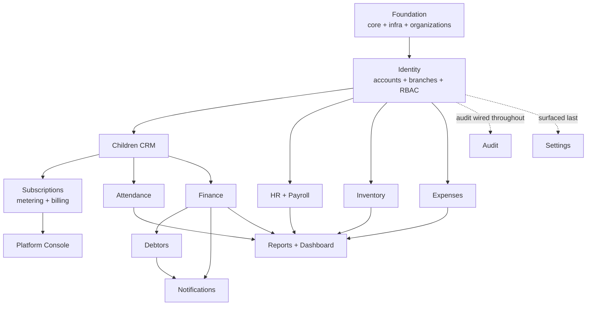

# 06 — Development Roadmap

| | |
|---|---|
| **Project** | Kindergarten Management System (KG-CRM) |
| **Document** | Delivery Plan, Sprints & Build Order v1.0 |
| **Related** | [01_Project_Vision](./01_Project_Vision.md) · [02_Software_Architecture](./02_Software_Architecture.md) · [03_Database_Design](./03_Database_Design.md) · [04_Backend_API_Specification](./04_Backend_API_Specification.md) · [05_Frontend_Architecture](./05_Frontend_Architecture.md) |

> This document turns the design into an **execution plan**: the order to build modules (driven by dependencies, not the UI menu order), sprint-by-sprint goals, Definition of Done, milestones, testing, and risks. It is the answer to "what do we do first, and next?"

---

## Table of Contents
1. [Delivery Approach](#1-delivery-approach)
2. [Team & Roles](#2-team--roles)
3. [Build Order Logic](#3-build-order-logic)
4. [Dependency Graph](#4-dependency-graph)
5. [Sprint Plan](#5-sprint-plan)
6. [Milestones](#6-milestones)
7. [Definition of Done](#7-definition-of-done)
8. [Testing Strategy](#8-testing-strategy)
9. [Branching & CI/CD Workflow](#9-branching--cicd-workflow)
10. [Risk Register](#10-risk-register)
11. [Post-MVP Phases](#11-post-mvp-phases)

---

## 1. Delivery Approach

- **Methodology:** iterative, 2-week sprints, vertical slices (each module shipped end-to-end: DB → API → UI → tests).
- **Vertical over horizontal:** we do **not** build all models, then all APIs, then all UIs. Each sprint delivers a **working, testable module** so value and feedback come early.
- **Dependency-driven order:** foundational modules (auth, RBAC, branch, children) come first because everything else depends on them.
- **Docs-first discipline:** every sprint's work must conform to docs [01–05]; a change to a decision updates the owning doc in the same PR (see [`CLAUDE.md`](../CLAUDE.md)).

**Timeline:** the sprint list is a **sequence, not a schedule.** Sprint numbers express dependency order; calendar duration depends entirely on available hours. Do not treat "Sprint 5" as "week 10".

---

## 2. Team & Roles

**This is a bootstrapped, founder-built product.** One person is the architect, backend developer, frontend developer, DevOps, QA, product owner, and — once customers exist — the support desk and the Platform Admin. The roles below are **hats worn by the same person**, listed so none is silently dropped.

| Hat | Responsibility | Non-negotiable even solo? |
|-----|----------------|---------------------------|
| Architect | Guards the architecture & docs; the ADRs in [02 §2](./02_Software_Architecture.md) are the memory that replaces a review conversation. | **Yes** |
| Backend | Django apps: models, services, selectors, serializers, views, tasks, tests. | Yes |
| Frontend | React features per [05](./05_Frontend_Architecture.md). | Yes |
| DevOps | Docker, CI/CD, Nginx, server, **backups + tested restore**. | **Backups: yes.** Elaborate CD: no. |
| QA | Money tests, tenant-isolation sweep, E2E of key flows. | **Yes** — see below |
| Product | Prioritizes against [01_Project_Vision](./01_Project_Vision.md); talks to real kindergartens. | Yes |
| Support / Platform Admin | Onboarding, invoices, suspensions, answering "why is my bill this?" | From the first customer |

### What solo changes — and what it does not

**Automated tests become *more* important, not less.** With no second reviewer, CI is the only thing that catches a regression before a customer does. The two suites that must never be skipped are the money tests and the tenant-isolation sweep ([§8](#8-testing-strategy)) — both cover failures a solo founder cannot afford: a wrong invoice destroys trust, a cross-tenant leak destroys the business.

**Structural decisions still get full rigor.** Tenancy, ledgers, and audit are load-bearing: retrofitting them costs months later and cannot be done safely once real customers hold data. Being solo is an argument for getting these right *once*, not for skipping them.

**Polish and automation can wait for revenue.** Elaborate CD pipelines, dashboards for the vendor console, and automated card debit are all deferrable. Manual is acceptable where the volume is small and the cost of being wrong is low.

> **The first customer does not require the whole roadmap.** With a handful of organizations, subscription invoices can be issued by hand from `/billing/usage` numbers and settled by bank transfer — Sprint 10's automation pays off at ~10 customers, not at one. What *cannot* be deferred is Sprint 0's tenancy foundation, because it is the one thing that becomes unaffordable the moment a second customer's data exists. Sequence risk, not features.

---

## 3. Build Order Logic

Modules are sequenced by **what depends on what** ([02 §9](./02_Software_Architecture.md) relationships):

1. **Foundation** (`core`, `config`, Docker, CI) — nothing works without it. **`organizations` ships here**, not later: `organization_id` must exist in the very first migration (ADR-9).
2. **Identity** (`accounts` + `branches` + RBAC) — every other endpoint needs auth & scoping.
3. **Children (CRM)** — the central entity referenced by attendance & finance.
4. **Attendance** — depends on children/groups; simple, high-value, good momentum.
5. **Finance** (tariffs → invoices → payments → ledger) — the ERP heart; depends on children.
6. **Debtors** — a derived view; trivial *after* finance exists.
7. **HR & Payroll** — independent of children; can parallel finance if capacity allows.
8. **Inventory** — independent; ledger pattern reused from finance.
9. **Expenses** — small, independent.
10. **Notifications** — cross-cutting; wired once finance/debtors emit events.
11. **Reports & Dashboard** — aggregates everything, so it comes late.
12. **Settings & Audit** — cross-cutting; audit wired incrementally from Sprint 2, settings surfaced last.
13. **Subscriptions & Platform Console** — metering needs `children` + `enrollment` to count, so it lands after the CRM. It is the **last thing built and the first thing needed to earn money**, which is exactly why it gets its own sprint instead of being squeezed into hardening.

> **Why `organizations` cannot slip to a later sprint.** Adding the tenant column to 20 tables with no data is a one-line change per model. Adding it once real customers exist means backfilling every table, rewriting every query, and auditing every endpoint for leaks — while live. This is the single most expensive migration in SaaS, and Sprint 0 is the only free moment to avoid it.

---

## 4. Dependency Graph

---

## 5. Sprint Plan

Each sprint delivers a vertical slice meeting the [Definition of Done](#7-definition-of-done).

### Sprint 0 — Foundation, Tenancy & Scaffolding
**Goal:** a running skeleton both stacks build on, **with the tenant boundary already in place**.
- Repo, `docs/` (done), `CLAUDE.md` (done), branch protection.
- Backend: Django project per [02 §5](./02_Software_Architecture.md) layout; split settings; Docker Compose (web, db, redis, worker, beat); `.env`.
- **`organizations` app: the `organization` model** ([03 §10.1](./03_Database_Design.md)) — first migration, before any business table exists.
- **`core` app:** base model carrying **`organization_id`**, the **tenant-scoping queryset mixin**, envelope, exception handler (incl. `402 SUBSCRIPTION_INACTIVE`), pagination, and the `organization_id` immutability trigger.
- **`accounts` app — the `User` model only** (no roles, permissions, or auth endpoints; those are Sprint 1). Pulled forward for two structural reasons: `AUTH_USER_MODEL` cannot be swapped after the first migration without a painful rebuild, and `core`'s `created_by` column already references it. Same logic as `organization_id` — the cheap moment is now.

> **Two deviations from the original plan, recorded here so the docs stay true to the code:**
>
> 1. **`branch_id` is not in the Sprint 0 base model.** The `branch` table does not exist until Sprint 1, so the FK cannot be written yet. `core` ships `TenantScopedModel` (organization only); the branch-scoped mixin lands with the `branches` app.
> 2. **`auth.E003` is silenced.** Django requires `USERNAME_FIELD` to be globally unique, but [03 §10.6](./03_Database_Design.md) deliberately makes email unique *per organization*. Sprint 1 must ship the custom authentication backend that resolves an email to one or more organizations ([04 §5](./04_Backend_API_Specification.md)); until it does, there is no login path at all.
- Frontend: Vite + TS + Tailwind + Shadcn; `app/`, `lib/api` client, providers, router shell; login page stub.
- DevOps: CI (lint, type-check, test), Dockerfiles, Nginx config.
- **Deliverable:** `docker compose up` runs API + SPA; health check green; empty `/api/v1` responds with the envelope; **a test proves that a queryset built on the base model cannot return another organization's rows.**

> **The Sprint 0 exit criterion that matters most is that last test.** Everything else in this sprint is recoverable later; the tenant boundary is not (§3).

### Sprint 1 — Identity: Auth, Users, Roles, Branches
**Goal:** secure login and the RBAC backbone, tenant-scoped end to end.
- DB: `branch`, `role`, `permission`, `role_permission`, `refresh_token` ([03 §10](./03_Database_Design.md)) — all carrying `organization_id`. (`user` already exists from Sprint 0; Sprint 1 adds its `role`/`branch` columns.)
- **Custom authentication backend** — required, not optional: email is unique per organization, so the default `ModelBackend` cannot resolve a login on its own (see the Sprint 0 note above).
- API: `/auth/*` incl. **`/auth/signup`** and **`/auth/select-organization`**, `/users`, `/roles`, `/permissions`, `/branches` ([04 §5–6, §16](./04_Backend_API_Specification.md)).
- RBAC: permission classes, **organization scoping applied before branch scoping**, branch-scoping mixin, seed the 5 roles + permission matrix per organization ([02 §11](./02_Software_Architecture.md)).
- **Cross-tenant test suite:** for every endpoint, a test asserting that org A's token cannot read, update, or delete org B's resource, and that the response is `404` (not `403`).
- Frontend: real login, org selection when an email has several, `AuthProvider`, `ProtectedRoute`/`RoleRoute`, `useCan`, AppLayout + Sidebar (permission-filtered), branch switcher, Users & Roles pages.
- Audit: begin logging auth + user/role changes.
- **Deliverable:** an organization can self-sign-up, its users log in, see only permitted nav, manage branches, and are provably unable to reach another organization's data.

> **Status: delivered.** The cross-tenant sweep caught a real leak during this sprint — `User`'s default manager was unscoped (login must search across organizations), so `/users` exposed other tenants' staff. The default manager is now scoped and the auth path uses an explicit `User.auth_objects` escape hatch. This is exactly the failure the generated sweep exists to catch, and it would not have been found by hand-written per-endpoint tests.
>
> The Roles management UI and Topbar branch switcher shipped in the same sprint. `SettingsPage` still renders its pre-v1.1 mock content and is rewritten when `settings_app` lands (Sprint 8).

### Sprint 2 — Children (CRM)
**Goal:** manage children, guardians, groups, enrollment.
- DB: `child`, `guardian`, `child_guardian`, `group`, `enrollment` ([03 §11](./03_Database_Design.md)).
- API: `/children`, `/guardians`, `/groups`, `/enrollments`, photo upload ([04 §7](./04_Backend_API_Specification.md)).
- **Bulk import: Excel/CSV upload with column mapping, dry-run preview, per-row error report, and idempotent re-run.**
- Frontend: `children` feature — list (search/filter), create/edit, detail with guardians & group, enrollment, import wizard.
- **Deliverable:** full child lifecycle works end-to-end, and 150 children can be loaded from a spreadsheet in one sitting.

> **Bulk import is a Sprint 2 requirement, not a later nicety** ([01 §3.1](./01_Project_Vision.md) goal 13). A kindergarten feels no value until its roster is in the system; if that takes ten days of typing, the 15-day trial ends in churn no matter how good the product is. Import is the trial's success condition.

### Sprint 3 — Attendance
**Goal:** daily attendance per group.
- DB: `attendance_record` (unique child+date) ([03 §12](./03_Database_Design.md)).
- API: `/attendance`, `/attendance/bulk`, `/attendance/daily`, `/attendance/summary` ([04 §8](./04_Backend_API_Specification.md)).
- Frontend: `attendance` feature — daily register (mark whole group), monthly summary; optimistic toggles.
- **Deliverable:** attendance recorded and viewable; Attendance Manager role validated.

### Sprint 4 — Finance I: Tariffs, Invoices, Ledger
**Goal:** billing foundation on the ledger.
- DB: `tariff_plan`, `discount`, `invoice`, `invoice_line`, `child_ledger_entry` ([03 §13](./03_Database_Design.md)).
- API: `/tariffs`, `/invoices` (incl. `/invoices/generate`), `/discounts`.
- Async: monthly invoice generation (idempotent Celery task).
- Frontend: tariffs admin, invoices list/detail, generate-invoices action.
- **Deliverable:** monthly invoices generate correctly and post charges to the ledger.

### Sprint 5 — Finance II: Payments, Receipts, Debtors
**Goal:** take money and track debt.
- API: `/payments`, `/invoices/{id}/payments`, `/payments/{id}/reverse`, receipts; `/debtors`, `/debtors/{id}/remind` ([04 §9–10](./04_Backend_API_Specification.md)).
- Transactions: locked payment posting (credit ledger entry, update invoice/status/balance) ([03 §26](./03_Database_Design.md)).
- Async: receipt PDF generation.
- Frontend: `payments` feature (record payment, daily summary), `debtors` feature (list, statement, remind).
- **Deliverable:** payment moves a child off the debtor list in real time; reconciles to the cent.

### Sprint 6 — HR & Payroll
**Goal:** staff and monthly payroll.
- DB: `position`, `employee`, `payroll_run`, `payroll_item` ([03 §14](./03_Database_Design.md)).
- API: `/employees`, `/positions`, `/payroll/runs/*` (create, edit items, finalize, mark-paid, payslip).
- Frontend: employees admin, payroll run workflow, payslip.
- **Deliverable:** run monthly payroll, finalize (immutable), produce payslips.

### Sprint 7 — Inventory & Expenses
**Goal:** kitchen/warehouse stock and operational spend.
- DB: `warehouse`, `product_category`, `product`, `supplier`, `stock_movement`; `expense_category`, `expense` ([03 §15–16](./03_Database_Design.md)).
- API: `/products`, `/stock-movements` (locked stock-out), `/suppliers`, low-stock; `/expenses` (approval), `/expense-categories`.
- Frontend: `inventory` feature (products, movements, suppliers, low-stock), `expenses` feature (record, approve).
- **Deliverable:** stock in/out with no-negative-stock guard; expense approval workflow.

### Sprint 8 — Notifications & Settings
**Goal:** communication + configuration.
- DB: `notification_template`, `notification`, `system_setting` ([03 §17–18](./03_Database_Design.md)).
- API: `/notifications/*`, `/notification-templates`, `/settings`, `/branches`.
- Async: SMS dispatch adapter + delivery log/retries; scheduled debt reminders (Beat).
- Wire events: payment received → SMS receipt; overdue → reminder.
- Frontend: `notifications` feature (log, templates, send), `settings` feature.
- **Deliverable:** SMS sent on payment and for debt reminders, with delivery status.

### Sprint 9 — Reports, Dashboard & Hardening
**Goal:** visibility + release readiness.
- DB: materialized views `mv_dashboard_kpi`, `mv_monthly_pl`; views `v_debtor`, `v_daily_cash` ([03 §25](./03_Database_Design.md)).
- API: `/dashboard`, `/reports/*` (+ async exports), `/audit-logs`.
- Async: MV refresh jobs (Beat), export generation.
- Frontend: `dashboard` (Recharts KPIs), `reports` (with export), audit log viewer.
- Hardening: rate limiting, security headers, load/index review, backup/restore test, E2E of the success criteria ([01 §9](./01_Project_Vision.md)).
- **Deliverable:** MVP release candidate — all [01](./01_Project_Vision.md) success criteria pass.

### Sprint 10 — Subscriptions, Metering & Billing
**Goal:** the product becomes sellable — trials convert and invoices are defensible.
- DB: `subscription_plan`, `subscription`, `usage_snapshot`, `subscription_invoice`, `subscription_payment` ([03 §20](./03_Database_Design.md)); views `v_org_billable_children`, `v_subscription_projection`.
- Seed the launch plan version: base 500 000 UZS / 50 children / +80 000 per 10 ([01 §4.2](./01_Project_Vision.md)).
- Async: **daily peak-child-count job** (the high-water mark), period-close job that freezes the snapshot, invoice generation, dunning reminders, trial-expiry transitions.
- API: `/billing/*` ([04 §18](./04_Backend_API_Specification.md)); the `402` write gate for `suspended`.
- Frontend: `billing` feature — current plan, live child count, **projected bill**, invoice list + PDF download, trial banner with days remaining, payment-term selection, read-only mode banner.
- Money tests: base+overage+discount arithmetic across every tier boundary (49/50/51/60/61 children), the three payment terms, trial→`pending_payment`→`active` transitions, grace-period expiry, peak-vs-month-end gaming scenarios, and **invoice reconstruction from an old snapshot after a plan version change**.
- **Deliverable:** an organization signs up, trials for 15 days, converts, receives a correct invoice dated from the trial start, and is suspended read-only (never deleted) if it does not pay.

### Sprint 11 — Platform Console & Launch Readiness
**Goal:** the vendor can operate the business safely.
- DB: platform staff identity + platform audit ([02 §11.0](./02_Software_Architecture.md)); support-grant records.
- API: `/platform/*` ([04 §19](./04_Backend_API_Specification.md)) — **metadata only**; `/audit-logs/platform-access` for customer visibility.
- **Postgres RLS policies on `organization_id`** for every operational table ([03 §6.3](./03_Database_Design.md)) — the second isolation layer, added before the first paying customer.
- Ops: separate platform auth path with mandatory 2FA; data export job; audited offboarding/purge job with the correct table order.
- **Legal gate:** data-residency/hosting jurisdiction confirmed ([01 §10](./01_Project_Vision.md)) — this blocks launch, not the code.
- Cross-tenant security review: attempt tenant escape via every endpoint, id enumeration, and the login oracle.
- **Deliverable:** first paying customer can be onboarded; vendor access to any tenant is impossible without an audited, customer-visible grant.

---

## 6. Milestones

| Milestone | After | Meaning |
|-----------|-------|---------|
| **M0 — Skeleton + tenancy** | Sprint 0 | Both stacks build & deploy; the tenant boundary exists and is tested. |
| **M1 — Secure shell** | Sprint 1 | Self-signup, auth + RBAC + user management live; cross-tenant access provably blocked. |
| **M2 — CRM ready** | Sprint 3 | Children + attendance usable daily; roster importable from a spreadsheet. |
| **M3 — Money works** | Sprint 5 | Tuition billing, payments, debtors reconcile — the core business value. |
| **M4 — Operations complete** | Sprint 8 | Payroll, inventory, expenses, notifications live. |
| **M5 — Feature complete** | Sprint 9 | Dashboard/reports + hardening; success criteria met. |
| **M6 — Sellable** | Sprint 10 | Trials convert, per-child invoices are correct and reconstructable. |
| **M7 — Launch ready** | Sprint 11 | Platform console, RLS, data-residency cleared; first paying customer can onboard. |

> **M5 is feature complete, not revenue ready.** The product could be demoed at M5 but not sold: nothing meters usage or issues an invoice. M6/M7 are what turn a working system into a business, which is why they are sprints rather than a checklist item inside hardening.

---

## 7. Definition of Done

A module/feature is **Done** only when **all** hold:

- [ ] Conforms to docs [02](./02_Software_Architecture.md)–[05](./05_Frontend_Architecture.md) (structure, contracts, conventions).
- [ ] DB objects match [03](./03_Database_Design.md): constraints, indexes, ON DELETE, soft-delete/append-only rules.
- [ ] Business logic in `services.py`; reads in `selectors.py`; views thin.
- [ ] Endpoints match [04](./04_Backend_API_Specification.md): envelope, error format, pagination/filter/sort, **RBAC enforced**, organization-scoped **and** branch-scoped.
- [ ] **Every new table carries `organization_id NOT NULL`** and every new endpoint has a cross-tenant test proving org A cannot reach org B's rows (returns `404`, not `403`).
- [ ] Money/stock operations are transactional and audited.
- [ ] Backend tests: service unit tests + API tests (happy path + permission denial + validation + **cross-tenant denial**).
- [ ] Frontend: typed via Zod, loading/error/empty states, permission-gated UI.
- [ ] No N+1 queries on list endpoints (verified).
- [ ] Docs updated if any decision changed; PR reviewed and green in CI.

---

## 8. Testing Strategy

| Layer | Tool | What |
|-------|------|------|
| Backend unit | pytest | Services & selectors (business rules, ledger math, stock guards). |
| Backend API | pytest + DRF client | Per endpoint: success, `403` (RBAC), `400` (validation), `422` (business rule), `402` (suspended), branch isolation. |
| **Tenant isolation** | pytest, **generated per endpoint** | Org A's token against org B's resource → `404` on read/update/delete; ids not enumerable; login does not reveal other tenants. Run as a **parametrized sweep over the router**, so a new endpoint is covered the day it is added rather than when someone remembers. |
| DB integrity | pytest | Constraints fire (duplicate invoice period, overpayment, negative stock, unique attendance, `organization_id` immutability, branch-belongs-to-org). |
| Frontend unit | Vitest + Testing Library | Components, hooks, form validation. |
| Contract | Schema/OpenAPI check | Frontend types stay in sync with [04](./04_Backend_API_Specification.md). |
| E2E (key flows) | Playwright (from Sprint 5) | Enroll → invoice → pay → off debtor list; attendance; payroll run; **signup → import → trial → convert → invoice**. |
| Performance | Query profiling | Index coverage, N+1 detection on list endpoints; scoped-query plans use the `(organization_id, …)` composite indexes. |

**Critical test focus (tuition money):** billing idempotency, no double-charge, payment reconciliation to the ledger, debtor correctness, no negative stock.

**Critical test focus (subscription money):** tier-boundary arithmetic (49/50/51/60/61 children), the three payment terms, discount frozen at purchase, peak-vs-month-end metering, trial dating from `trial_started_at`, grace-period expiry, and **reconstructing an old invoice after a plan version change**.

> **The isolation sweep is deliberately generated rather than hand-written.** Hand-written per-endpoint tenant tests are exactly the kind that get skipped under deadline pressure — and the one that gets skipped is the one that leaks.

---

## 9. Branching & CI/CD Workflow

- **Branches:** `feature/…`, `fix/…`, `chore/…`; protected `main`; PR + review required.
- **Commits:** Conventional Commits (`feat:`, `fix:`, `refactor:`, `docs:`).
- **CI (on PR):** lint (ruff/eslint), type-check (mypy/tsc), tests (pytest/vitest), build images.
- **CD (on merge to main):** build & push images → deploy to Linux server; **migrations run as an explicit step**, never on boot ([02 §23](./02_Software_Architecture.md)).
- **Backups:** automated Postgres backup + tested restore before each release.

---

## 10. Risk Register

| Risk | Impact | Mitigation |
|------|--------|-----------|
| Financial calculation errors | High (trust) | Ledger as source of truth; heavy money tests; audit log; reconciliation job. |
| Scope creep from future modules | Medium | [01](./01_Project_Vision.md) non-goals are firm; future work is additive per [02 §22](./02_Software_Architecture.md). |
| SMS provider unreliability | Medium | Async dispatch + retries + delivery log; provider behind an adapter (swap without code changes). |
| RBAC gaps | High (security) | Deny-by-default; every endpoint tested for `403`; backend is the authority. |
| **Cross-tenant data leak** | **Critical** (children's data, business-ending) | `organization_id` from the first migration; scoping in the shared base queryset before any view logic; generated isolation sweep over every endpoint; Postgres RLS as a second layer before the first paying customer; `404` not `403` on boundary violations. |
| **Metering disputes** | High (revenue + trust) | Immutable `usage_snapshot` per period; peak measurement; corrections as append-only adjustments with mandatory notes; customer-visible live count and projected bill so the invoice is never a surprise. |
| **Trial framing perceived as a bait-and-switch** | High (reputation, small market) | The retroactive first-month dating is disclosed **in the offer at signup**, never at conversion; no card taken; nothing charged if the customer declines ([01 §4.4](./01_Project_Vision.md)). |
| **Data-residency non-compliance** | **Critical** (legal, blocks operation) | Hosting jurisdiction confirmed with counsel before the first paying customer; treated as a launch gate in Sprint 11, not a deployment detail. |
| **Seasonal revenue dip** (summer enrollment falls) | Medium (cash flow) | Annual/semi-annual prepayment discounts smooth intake; base package is a floor that holds even when counts drop. |
| **Small customers cost more to support than they pay** | Medium (margin) | 50-child minimum billing floor ([01 §4.2](./01_Project_Vision.md)); self-service signup + bulk import keep onboarding cost near zero. |
| Context loss / conflicting decisions | Medium | The docs system + `CLAUDE.md`; docs updated in the same PR as code. |
| Performance under data growth | Medium | Indexes from [03 §23](./03_Database_Design.md); partition candidates identified; reports on MVs. |
| Single-server availability | Low (MVP) | Stateless API enables scale-out later; backups + monitoring now. **Note:** as a SaaS, one server's downtime is now *every customer's* downtime — HA moves up the priority list once revenue justifies it. |

---

## 11. Post-MVP Phases

Sequenced by value and readiness; each is **additive** (new app/feature + roles), not a refactor ([02 §22](./02_Software_Architecture.md)).

| Phase | Modules | Enabled by (already designed) |
|-------|---------|-------------------------------|
| **P1** | Automated card debit for subscriptions (Payme/Click/Uzum) | `subscriptions` invoices + adapter pattern; bank transfer stays available for legal entities. |
| **P2** | Online Payments for tuition | Ledger + payment-gateway adapter + webhook. |
| **P3** | Parent Portal | Data-driven RBAC (Parent role) + guardian↔user link + existing selectors. |
| **P4** | Teacher Portal | Employee↔user link + Teacher role. |
| **P5** | Meal Planning + Medical Records | Inventory (stock consumption) + child-linked apps. |
| **P6** | Homework / LMS + Gallery | New apps on storage abstraction + portals. |
| **P7** | AI Assistant + Advanced Analytics | Read selectors + Celery + read replica / warehouse. |
| **P8** | Mobile App | Same `/api/v1`, stateless JWT. |

---

## Summary

Build **foundation+tenancy → identity → children → attendance → finance → debtors → payroll → inventory → expenses → notifications → reports/dashboard → subscriptions → platform console**, each as a vertical slice meeting the Definition of Done, all conforming to docs [01](./01_Project_Vision.md)–[05](./05_Frontend_Architecture.md).

Two bars are higher than the rest: **money correctness** and **tenant isolation**. Money can be reconciled after the fact; a cross-tenant leak of children's records cannot be undone. That is why `organization_id` lands in Sprint 0's first migration rather than in the sprint that finally needs it.

After M7, the roadmap's future modules arrive as new folders, not rewrites.

*End of Development Roadmap v1.1 — Sprint 0 tenancy, Sprint 10–11 (subscriptions, platform), SaaS risks added.*
