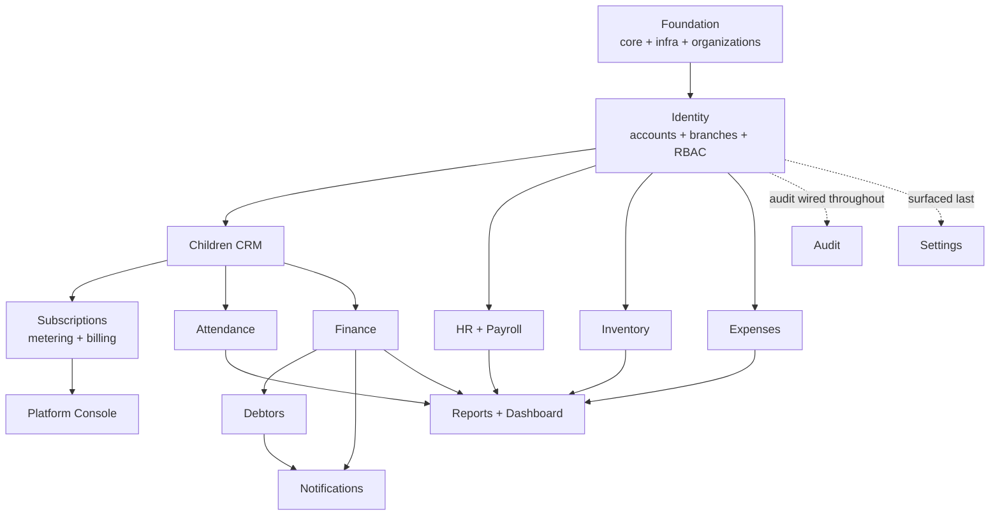

# 06 — Development Roadmap

| | |
|---|---|
| **Project** | Kindergarten Management System (KG-CRM) |
| **Document** | Delivery Plan, Sprints & Build Order v1.0 |
| **Related** | [01_Project_Vision](./01_Project_Vision.md) · [02_Software_Architecture](./02_Software_Architecture.md) · [03_Database_Design](./03_Database_Design.md) · [04_Backend_API_Specification](./04_Backend_API_Specification.md) · [05_Frontend_Architecture](./05_Frontend_Architecture.md) |

> This document turns the design into an **execution plan**: the order to build modules (driven by dependencies, not the UI menu order), sprint-by-sprint goals, Definition of Done, milestones, testing, and risks. It is the answer to "what do we do first, and next?"

---

## Table of Contents
1. [Delivery Approach](#1-delivery-approach)
2. [Team & Roles](#2-team--roles)
3. [Build Order Logic](#3-build-order-logic)
4. [Dependency Graph](#4-dependency-graph)
5. [Sprint Plan](#5-sprint-plan)
6. [Milestones](#6-milestones)
7. [Definition of Done](#7-definition-of-done)
8. [Testing Strategy](#8-testing-strategy)
9. [Branching & CI/CD Workflow](#9-branching--cicd-workflow)
10. [Risk Register](#10-risk-register)
11. [Post-MVP Phases](#11-post-mvp-phases)

---

## 1. Delivery Approach

- **Methodology:** iterative, 2-week sprints, vertical slices (each module shipped end-to-end: DB → API → UI → tests).
- **Vertical over horizontal:** we do **not** build all models, then all APIs, then all UIs. Each sprint delivers a **working, testable module** so value and feedback come early.
- **Dependency-driven order:** foundational modules (auth, RBAC, branch, children) come first because everything else depends on them.
- **Docs-first discipline:** every sprint's work must conform to docs [01–05]; a change to a decision updates the owning doc in the same PR (see [`CLAUDE.md`](../CLAUDE.md)).

**Timeline:** the sprint list is a **sequence, not a schedule.** Sprint numbers express dependency order; calendar duration depends entirely on available hours. Do not treat "Sprint 5" as "week 10".

---

## 2. Team & Roles

**This is a bootstrapped, founder-built product.** One person is the architect, backend developer, frontend developer, DevOps, QA, product owner, and — once customers exist — the support desk and the Platform Admin. The roles below are **hats worn by the same person**, listed so none is silently dropped.

| Hat | Responsibility | Non-negotiable even solo? |
|-----|----------------|---------------------------|
| Architect | Guards the architecture & docs; the ADRs in [02 §2](./02_Software_Architecture.md) are the memory that replaces a review conversation. | **Yes** |
| Backend | Django apps: models, services, selectors, serializers, views, tasks, tests. | Yes |
| Frontend | React features per [05](./05_Frontend_Architecture.md). | Yes |
| DevOps | Docker, CI/CD, Nginx, server, **backups + tested restore**. | **Backups: yes.** Elaborate CD: no. |
| QA | Money tests, tenant-isolation sweep, E2E of key flows. | **Yes** — see below |
| Product | Prioritizes against [01_Project_Vision](./01_Project_Vision.md); talks to real kindergartens. | Yes |
| Support / Platform Admin | Onboarding, invoices, suspensions, answering "why is my bill this?" | From the first customer |

### What solo changes — and what it does not

**Automated tests become *more* important, not less.** With no second reviewer, CI is the only thing that catches a regression before a customer does. The two suites that must never be skipped are the money tests and the tenant-isolation sweep ([§8](#8-testing-strategy)) — both cover failures a solo founder cannot afford: a wrong invoice destroys trust, a cross-tenant leak destroys the business.

**Structural decisions still get full rigor.** Tenancy, ledgers, and audit are load-bearing: retrofitting them costs months later and cannot be done safely once real customers hold data. Being solo is an argument for getting these right *once*, not for skipping them.

**Polish and automation can wait for revenue.** Elaborate CD pipelines, dashboards for the vendor console, and automated card debit are all deferrable. Manual is acceptable where the volume is small and the cost of being wrong is low.

> **The first customer does not require the whole roadmap.** With a handful of organizations, subscription invoices can be issued by hand from `/billing/usage` numbers and settled by bank transfer — Sprint 10's automation pays off at ~10 customers, not at one. What *cannot* be deferred is Sprint 0's tenancy foundation, because it is the one thing that becomes unaffordable the moment a second customer's data exists. Sequence risk, not features.

---

## 3. Build Order Logic

Modules are sequenced by **what depends on what** ([02 §9](./02_Software_Architecture.md) relationships):

1. **Foundation** (`core`, `config`, Docker, CI) — nothing works without it. **`organizations` ships here**, not later: `organization_id` must exist in the very first migration (ADR-9).
2. **Identity** (`accounts` + `branches` + RBAC) — every other endpoint needs auth & scoping.
3. **Children (CRM)** — the central entity referenced by attendance & finance.
4. **Attendance** — depends on children/groups; simple, high-value, good momentum.
5. **Finance** (tariffs → invoices → payments → ledger) — the ERP heart; depends on children.
6. **Debtors** — a derived view; trivial *after* finance exists.
7. **HR & Payroll** — independent of children; can parallel finance if capacity allows.
8. **Inventory** — independent; ledger pattern reused from finance.
9. **Expenses** — small, independent.
10. **Notifications** — cross-cutting; wired once finance/debtors emit events.
11. **Reports & Dashboard** — aggregates everything, so it comes late.
12. **Settings & Audit** — cross-cutting; audit wired incrementally from Sprint 2, settings surfaced last.
13. **Subscriptions & Platform Console** — metering needs `children` + `enrollment` to count, so it lands after the CRM. It is the **last thing built and the first thing needed to earn money**, which is exactly why it gets its own sprint instead of being squeezed into hardening.

> **Why `organizations` cannot slip to a later sprint.** Adding the tenant column to 20 tables with no data is a one-line change per model. Adding it once real customers exist means backfilling every table, rewriting every query, and auditing every endpoint for leaks — while live. This is the single most expensive migration in SaaS, and Sprint 0 is the only free moment to avoid it.

---

## 4. Dependency Graph

---

## 5. Sprint Plan

Each sprint delivers a vertical slice meeting the [Definition of Done](#7-definition-of-done).

### Sprint 0 — Foundation, Tenancy & Scaffolding
**Goal:** a running skeleton both stacks build on, **with the tenant boundary already in place**.
- Repo, `docs/` (done), `CLAUDE.md` (done), branch protection.
- Backend: Django project per [02 §5](./02_Software_Architecture.md) layout; split settings; Docker Compose (web, db, redis, worker, beat); `.env`.
- **`organizations` app: the `organization` model** ([03 §10.1](./03_Database_Design.md)) — first migration, before any business table exists.
- **`core` app:** base model carrying **`organization_id`**, the **tenant-scoping queryset mixin**, envelope, exception handler (incl. `402 SUBSCRIPTION_INACTIVE`), pagination, and the `organization_id` immutability trigger.
- **`accounts` app — the `User` model only** (no roles, permissions, or auth endpoints; those are Sprint 1). Pulled forward for two structural reasons: `AUTH_USER_MODEL` cannot be swapped after the first migration without a painful rebuild, and `core`'s `created_by` column already references it. Same logic as `organization_id` — the cheap moment is now.

> **Two deviations from the original plan, recorded here so the docs stay true to the code:**
>
> 1. **`branch_id` is not in the Sprint 0 base model.** The `branch` table does not exist until Sprint 1, so the FK cannot be written yet. `core` ships `TenantScopedModel` (organization only); the branch-scoped mixin lands with the `branches` app.
> 2. **`auth.E003` is silenced.** Django requires `USERNAME_FIELD` to be globally unique, but [03 §10.6](./03_Database_Design.md) deliberately makes email unique *per organization*. Sprint 1 must ship the custom authentication backend that resolves an email to one or more organizations ([04 §5](./04_Backend_API_Specification.md)); until it does, there is no login path at all.
- Frontend: Vite + TS + Tailwind + Shadcn; `app/`, `lib/api` client, providers, router shell; login page stub.
- DevOps: CI (lint, type-check, test), Dockerfiles, Nginx config.
- **Deliverable:** `docker compose up` runs API + SPA; health check green; empty `/api/v1` responds with the envelope; **a test proves that a queryset built on the base model cannot return another organization's rows.**

> **The Sprint 0 exit criterion that matters most is that last test.** Everything else in this sprint is recoverable later; the tenant boundary is not (§3).

### Sprint 1 — Identity: Auth, Users, Roles, Branches
**Goal:** secure login and the RBAC backbone, tenant-scoped end to end.
- DB: `branch`, `role`, `permission`, `role_permission`, `refresh_token` ([03 §10](./03_Database_Design.md)) — all carrying `organization_id`. (`user` already exists from Sprint 0; Sprint 1 adds its `role`/`branch` columns.)
- **Custom authentication backend** — required, not optional: email is unique per organization, so the default `ModelBackend` cannot resolve a login on its own (see the Sprint 0 note above).
- API: `/auth/*` incl. **`/auth/signup`** and **`/auth/select-organization`**, `/users`, `/roles`, `/permissions`, `/branches` ([04 §5–6, §16](./04_Backend_API_Specification.md)).
- RBAC: permission classes, **organization scoping applied before branch scoping**, branch-scoping mixin, seed the 5 roles + permission matrix per organization ([02 §11](./02_Software_Architecture.md)).
- **Cross-tenant test suite:** for every endpoint, a test asserting that org A's token cannot read, update, or delete org B's resource, and that the response is `404` (not `403`).
- Frontend: real login, org selection when an email has several, `AuthProvider`, `ProtectedRoute`/`RoleRoute`, `useCan`, AppLayout + Sidebar (permission-filtered), branch switcher, Users & Roles pages.
- Audit: begin logging auth + user/role changes.
- **Deliverable:** an organization can self-sign-up, its users log in, see only permitted nav, manage branches, and are provably unable to reach another organization's data.

> **Status: delivered.** The cross-tenant sweep caught a real leak during this sprint — `User`'s default manager was unscoped (login must search across organizations), so `/users` exposed other tenants' staff. The default manager is now scoped and the auth path uses an explicit `User.auth_objects` escape hatch. This is exactly the failure the generated sweep exists to catch, and it would not have been found by hand-written per-endpoint tests.
>
> The Roles management UI and Topbar branch switcher shipped in the same sprint. `SettingsPage` still rendered its pre-v1.1 mock content at this point; it was rewritten against the real API in Sprint 8.

### Sprint 2 — Children (CRM)
**Goal:** manage children, guardians, groups, enrollment.
- DB: `child`, `guardian`, `child_guardian`, `group`, `enrollment` ([03 §11](./03_Database_Design.md)).
- API: `/children`, `/guardians`, `/groups`, `/enrollments`, photo upload ([04 §7](./04_Backend_API_Specification.md)).
- **Bulk import: Excel/CSV upload with column mapping, dry-run preview, per-row error report, and idempotent re-run.**
- Frontend: `children` feature — list (search/filter), create/edit, detail with guardians & group, enrollment, import wizard.
- **Deliverable:** full child lifecycle works end-to-end, and 150 children can be loaded from a spreadsheet in one sitting.

> **Status: delivered.** The generated cross-tenant sweep picked up `/children`, `/guardians` and `/groups` the moment they were registered and failed until test data was supplied for them — the intended behaviour. It now covers 7 endpoints.
>
> **Import is CSV-only.** Reading `.xlsx` needs `openpyxl`; the wizard instead tells the user to "Save as CSV" in Excel and ships a template with a UTF-8 BOM so Uzbek and Cyrillic characters survive the round trip. Adding the dependency is a small, deliberate deferral — revisit if real customers push back.
>
> The child detail page and group CRUD screens shipped alongside Sprint 3. Photo upload remains unbuilt — it needs the storage abstraction, which lands with `gallery` post-MVP.

> **Bulk import is a Sprint 2 requirement, not a later nicety** ([01 §3.1](./01_Project_Vision.md) goal 13). A kindergarten feels no value until its roster is in the system; if that takes ten days of typing, the 15-day trial ends in churn no matter how good the product is. Import is the trial's success condition.

### Sprint 3 — Attendance
**Goal:** daily attendance per group.
- DB: `attendance_record` (unique child+date) ([03 §12](./03_Database_Design.md)).
- API: `/attendance`, `/attendance/bulk`, `/attendance/daily`, `/attendance/summary` ([04 §8](./04_Backend_API_Specification.md)).
- Frontend: `attendance` feature — daily register (mark whole group), monthly summary; optimistic toggles.
- **Deliverable:** attendance recorded and viewable; Attendance Manager role validated.

> **Status: delivered.** The daily register deliberately returns **unmarked children too** (`status: null`) — a register that only lists marked children leaves "who did I miss?" unanswerable, which is the one question the screen exists to answer.
>
> `attendance_record` is the **only** operational table where an in-place `UPDATE` is allowed ([03 §12.1](./03_Database_Design.md)): a day's state is a single fact, not a money movement. A teacher marking "absent" at 08:00 and correcting it at 10:00 is normal workflow, and forcing a counter-entry there would misapply ledger logic.
>
> The generated sweep picked up `/attendance` on registration and now covers 8 endpoints.

### Sprint 4 — Finance I: Tariffs, Invoices, Ledger
**Goal:** billing foundation on the ledger.
- DB: `tariff_plan`, `discount`, `invoice`, `invoice_line`, `child_ledger_entry` ([03 §13](./03_Database_Design.md)).
- API: `/tariffs`, `/invoices` (incl. `/invoices/generate`), `/discounts`.
- Async: monthly invoice generation (idempotent Celery task).
- Frontend: tariffs admin, invoices list/detail, generate-invoices action.
- **Deliverable:** monthly invoices generate correctly and post charges to the ledger.

> **Status: delivered.** Idempotency is guaranteed **in the database** by the partial unique index `uq_invoice_child_period`, not by an application check — under concurrency an app-level "does it exist?" test races and double-charges. `issue_invoice()` catches the resulting `IntegrityError` and returns the existing invoice: that is idempotency working, not an error.
>
> **Zero-amount invoices post no ledger entry.** A fully-discounted child owes nothing, and a zero movement is not a movement. Allowing it would have required weakening the `amount > 0` invariant — a rule that catches real bugs. The invoice still exists as the document proving the child owes nothing for that period.
>
> **Invoices are read-only over the API** (`PATCH`/`DELETE` → `405`). An invoice is the document that produced a ledger entry; editing it would split the document from the ledger. Corrections go through `POST /invoices/{id}/cancel`, which posts an equal counter-entry and leaves the original debit visible (D3).
>
> **Carried to Sprint 5:** payments, receipts and the derived debtors view. `Invoice.amount_paid` stays at zero until then.

### Sprint 5 — Finance II: Payments, Receipts, Debtors
**Goal:** take money and track debt.
- API: `/payments`, `/invoices/{id}/payments`, `/payments/{id}/reverse`, receipts; `/debtors`, `/debtors/{id}/remind` ([04 §9–10](./04_Backend_API_Specification.md)).
- Transactions: locked payment posting (credit ledger entry, update invoice/status/balance) ([03 §26](./03_Database_Design.md)).
- Async: receipt PDF generation.
- Frontend: `payments` feature (record payment, daily summary), `debtors` feature (list, statement, remind).
- **Deliverable:** payment moves a child off the debtor list in real time; reconciles to the cent.

> **Status: delivered (SMS reminders deferred).** Debtors is a **derived list with no table behind it** (ADR-7) — a test asserts no `debtor` table exists in the app registry, because the moment one does the list can drift from the ledger and nobody can say which is right.
>
> The list is computed from ledger entries as a query annotation, **not** from `child.balance`. A test corrupts the cache and asserts the list stays correct: a wrong debtor list surfaces in the worst possible place — asking a parent for money they already paid.
>
> **Payments are immutable.** `PATCH`/`DELETE` return `405`; corrections go through `POST /payments/{id}/reverse`, which keeps the original row and posts an equal debit. The cash journal then reads "received, then reversed" rather than "nothing happened".
>
> **`invoice.amount_paid` is recomputed, never incremented.** Incremental updates drift silently on a single missed event and nobody can say when the drift began. A test corrupts it and asserts the next payment repairs it.
>
> **Deferred:** SMS reminders (`/debtors/{id}/remind`) need the `notifications` app — Sprint 8. Receipt PDFs need the storage abstraction. Both are listed in the API spec and unimplemented.

### Sprint 6 — HR & Payroll
**Goal:** staff and monthly payroll.
- DB: `position`, `employee`, `payroll_run`, `payroll_item` ([03 §14](./03_Database_Design.md)).
- API: `/employees`, `/positions`, `/payroll/runs/*` (create, edit items, finalize, mark-paid, payslip).
- Frontend: employees admin, payroll run workflow, payslip.
- **Deliverable:** run monthly payroll, finalize (immutable), produce payslips.

> **Status: delivered (payslip PDF deferred).** `payroll_item.base_amount` is a **snapshot** of the employee's salary, not a reference to it. A raise next month must not rewrite last month's run — otherwise "what was I paid in July?" gets a different answer depending on when it is asked. A test raises the salary after the run and asserts the item is unchanged.
>
> The state machine is one-directional: `draft → finalized → paid`. A finalized run is immutable; a mistake is corrected in the *next* month with a bonus or deduction — the same reasoning as the ledger's counter-entry (D3).
>
> **Net pay cannot go negative** (DB `CHECK` plus a service rule): a deduction exceeding gross would leave the employee owing the kindergarten, a state payroll cannot express.
>
> An employee with payroll history is **terminated, never deleted** — `ON DELETE RESTRICT` from `payroll_item` enforces it at the database level too.
>
> **Deferred:** payslip PDF needs the storage abstraction (Sprint 9). The endpoint returns the payslip as JSON today.

### Sprint 7 — Inventory & Expenses
**Goal:** kitchen/warehouse stock and operational spend.
- DB: `warehouse`, `product_category`, `product`, `supplier`, `stock_movement`; `expense_category`, `expense` ([03 §15–16](./03_Database_Design.md)).
- API: `/products`, `/stock-movements` (locked stock-out), `/suppliers`, low-stock; `/expenses` (approval), `/expense-categories`.
- Frontend: `inventory` feature (products, movements, suppliers, low-stock), `expenses` feature (record, approve).
- **Deliverable:** stock in/out with no-negative-stock guard; expense approval workflow.

> **Status: delivered.** Stock follows the same ledger discipline as money: levels are derived from immutable `stock_movement` rows, `product.current_stock` is a cache, and corrections are `adjustment` movements rather than edits.
>
> **No negative stock is enforced transactionally, not by a `CHECK`** — a constraint cannot see the running total across rows. The service locks the product row (`SELECT … FOR UPDATE`), recomputes available stock from movements, and rejects the movement if it would go below zero ([03 §26](./03_Database_Design.md)).
>
> **Direction is inferred from `movement_type`**, not accepted from the client: a purchase is always inbound, waste always outbound. Only `adjustment` is two-way and it *requires* an explicit direction — guessing there would silently resolve "I corrected it, but which way?".
>
> **A test caught a real RBAC gap:** `approve` was in the action catalogue but in no role's permission set, so the expense approval flow was unreachable for everyone including the Org Owner. `_F` ("full access") now includes `approve`.
>
> **Rejected expenses are kept, never deleted** — the record of what was asked and why it was refused is the point of an approval workflow.
>
> Stock valuation uses the **last purchase price**, stated explicitly in the response (`basis`). Average or FIFO is an accounting decision that should be made with the customer, not assumed.

### Sprint 8 — Notifications & Settings
**Goal:** communication + configuration.
- DB: `notification_template`, `notification`, `system_setting` ([03 §17–18](./03_Database_Design.md)).
- API: `/notifications/*`, `/notification-templates`, `/settings`, `/branches`.
- Async: SMS dispatch adapter + delivery log/retries; scheduled debt reminders (Beat).
- Wire events: payment received → SMS receipt; overdue → reminder.
- Frontend: `notifications` feature (log, templates, send), `settings` feature.
- **Deliverable:** SMS sent on payment and for debt reminders, with delivery status.

> **Status: delivered.** Payments and debt reminders both send, and every attempt is on the record.
>
> **The gateway is behind an adapter, and MVP ships with the console one.** `providers.py` defines the `send()` contract and a registry; `ConsoleProvider` logs the message. This is deliberate: a real SMS gateway needs a contract and prepayment, and can wait for the first paying customer — while everything *around* it (queueing, retries, the delivery log) is already built and tested. Switching providers later adds one class and changes one `.env` value.
>
> **Dispatch is a separate step from queueing.** Waiting on a gateway inside the payment request would make taking money as slow and as failure-prone as the SMS network (P8).
>
> **A failed send must not roll back a payment.** `record_payment()` calls the notification at the end of the transaction with its exception swallowed and logged — the money has already been handed over; a gateway outage cannot undo that.
>
> **Reminders read the derived debtor list** (ADR-7), so a reminder never reaches a parent who has already paid — verified by a test that pays the invoice and asserts the next run queues nothing.
>
> **Templates render with `string.Template.safe_substitute`, not `.format()`.** Customers edit this text; a stray `{` or an unknown placeholder must not break the send. Address and body are **snapshotted** onto the notification row, so changing a guardian's phone later never rewrites what was actually sent.
>
> **Settings resolve branch → organization → code default**, and the API always returns the full set including untouched defaults — a setting that exists only when someone has changed it is a setting nobody can find.
>
> **A timezone bug surfaced here and was fixed at the source:** `ck_attendance_not_future` compared the date against `Now()` (UTC in Postgres) while the service used `timezone.localdate()` (Asia/Tashkent). Between local midnight and 05:00 the constraint rejected a perfectly valid same-day record — every kindergarten, every day. The `CHECK` now carries a one-day tolerance as a coarse sanity guard and the exact rule lives in the service and serializer, where it can see the branch's own timezone.
>
> The mock `SettingsPage` is gone, and with it the last pre-v1.1 `Super Admin` copy in the frontend.

### Sprint 9 — Reports, Dashboard & Hardening
**Goal:** visibility + release readiness.
- DB: materialized views `mv_dashboard_kpi`, `mv_monthly_pl`; views `v_debtor`, `v_daily_cash` ([03 §25](./03_Database_Design.md)).
- API: `/dashboard`, `/reports/*` (+ async exports), `/audit-logs`.
- Async: MV refresh jobs (Beat), export generation.
- Frontend: `dashboard` (Recharts KPIs), `reports` (with export), audit log viewer.
- Hardening: rate limiting, security headers, load/index review, backup/restore test, E2E of the success criteria ([01 §9](./01_Project_Vision.md)).
- **Deliverable:** MVP release candidate — all [01](./01_Project_Vision.md) success criteria pass.

> **Status: delivered, with two deliberate deviations recorded below.**
>
> **The materialized views were not built; aggregates are live ORM queries.** An MV would need `organization_id` written by hand in raw SQL — moving the tenant boundary outside the ORM, where the fail-closed manager cannot help and the sweep cannot see. At this data size (hundreds of children per organization) a live aggregate is instant, and it is always right rather than right-as-of-the-last-refresh. The MV stays on the table as a later optimization behind the same selector layer: when the dashboard query exceeds ~200 ms or the organization count makes it worthwhile, `apps/reports/selectors.py` is the only file that changes. [03 §25](./03_Database_Design.md) is updated to say so.
>
> **Exports are CSV, not Excel or PDF.** CSV opens in Excel, Google Sheets, and 1C, and needs no new dependency. It is written through `FileField` — i.e. Django's **storage abstraction** — so the deferred PDF receipt and payslip now have the place they were waiting for; moving to S3 later changes one setting, not this code.
>
> **The export file is served by an authenticated endpoint, never a `/media/` URL.** A static media path knows nothing about authentication or tenancy: anyone who guessed the URL would download another kindergarten's full financial history. `GET /reports/exports/{id}/download` goes through the tenant-scoped manager, so a foreign job is simply `404`.
>
> **Reports state their `basis` explicitly.** "Revenue" means two different things — invoices issued and money received — and they are not equal. Everything here is **cash basis**, said out loud in the response and on screen, following the precedent set by stock valuation in Sprint 7.
>
> **The sweep now fails on endpoints it cannot cover.** A viewset with no `model` was silently skipped, so a plain `ViewSet` got zero isolation coverage. Skipped basenames must now be listed with a reason and a pointer to a hand-written test. Adding that check immediately exposed **`/debtors` — untested since Sprint 4** — and writing its test found a real inconsistency: `/debtors/{id}` returned `422` for another tenant's child while every other endpoint returns `404`. One endpoint behaving differently is exactly what tells someone probing the API where to look. Fixed, and the old test that encoded the wrong behaviour was corrected.
>
> **`active_children` counts the roster, not group memberships.** The first implementation required an active enrollment, so a director who imported 60 children from CSV saw `0` on the dashboard — group assignment happens later, but the children are already the kindergarten's. Whether *billing* counts the same way is a separate question, decided in Sprint 10 alongside the pricing rules; the two definitions are commented so they cannot silently diverge.
>
> **Celery ran against a real broker for the first time** — the gap open since Sprint 0. All four tasks executed and returned: export generation, overdue marking, debt reminders (16 organizations, each in its own tenant context), and the nightly ledger-vs-cache reconciliation, which checked 20 children and found **zero drift**. `CELERY_BEAT_SCHEDULE` now ships a default schedule so a fresh install is not one forgotten admin click away from never issuing an invoice.
>
> The export endpoint has its own throttle scope — it reads a whole period and writes a file, and an unthrottled retry loop would starve *other tenants'* workers. Test settings now derive their throttle keys from the base settings, because the previous hand-maintained list turned "add a new scope" into a `500` whose cause was in a settings file.
>
> Still open: the backup/restore drill, and the browser-level E2E pass (only type-checks, builds, and module-transform checks have been run — there is no browser in this environment).

### Sprint 10 — Subscriptions, Metering & Billing
**Goal:** the product becomes sellable — trials convert and invoices are defensible.
- DB: `subscription_plan`, `subscription`, `usage_snapshot`, `subscription_invoice`, `subscription_payment` ([03 §20](./03_Database_Design.md)); views `v_org_billable_children`, `v_subscription_projection`.
- Seed the launch plan version: base 500 000 UZS / 50 children / +80 000 per 10 ([01 §4.2](./01_Project_Vision.md)).
- Async: **daily peak-child-count job** (the high-water mark), period-close job that freezes the snapshot, invoice generation, dunning reminders, trial-expiry transitions.
- API: `/billing/*` ([04 §18](./04_Backend_API_Specification.md)); the `402` write gate for `suspended`.
- Frontend: `billing` feature — current plan, live child count, **projected bill**, invoice list + PDF download, trial banner with days remaining, payment-term selection, read-only mode banner.
- Money tests: base+overage+discount arithmetic across every tier boundary (49/50/51/60/61 children), the three payment terms, trial→`pending_payment`→`active` transitions, grace-period expiry, peak-vs-month-end gaming scenarios, and **invoice reconstruction from an old snapshot after a plan version change**.
- **Deliverable:** an organization signs up, trials for 15 days, converts, receives a correct invoice dated from the trial start, and is suspended read-only (never deleted) if it does not pay.

> **Status: delivered.** The full path works end to end: signup → 15-day trial → conversion → invoice → payment → active, and non-payment → `past_due` → `suspended` with the data intact.
>
> **The pricing engine is a pure module with 30 tests of its own.** `pricing.py` touches no database, no request, and no clock, because an error here sends a customer the wrong bill — and a wrong bill costs more than one mistake, it costs trust. Every tier boundary is tested individually (49/50/51/59/60/61/69/70/71), along with all four worked examples from [01 §4.2](./01_Project_Vision.md), plus a sweep asserting the price **never falls as children are added** — the property a rounding or discount bug breaks first and the eye catches last.
>
> **Two ambiguities in [03 §20](./03_Database_Design.md) surfaced during implementation and are now fixed there:**
> - `uq_usage_snapshot_period` contradicted the correction rule immediately below it — one row per period makes a second `manual_adjustment` row for that period impossible. The index is now **partial** on `daily_peak`.
> - "Append-only" and "highest count observed during the period" needed reconciling. `closed_at` marks the boundary: while the period is open the daily job raises `peak_children` (that *is* the measurement); once closed the row is history and every correction is a new row.
>
> Also clarified: the discount applies to base **and** overage at the same rate. Applying it to the base alone would make a customer who prepaid a year pay full price for growth.
>
> **The `402` write gate found its own bug on the first run.** It was registered in `DEFAULT_PERMISSION_CLASSES` — which DRF discards entirely the moment a view declares `permission_classes`, and every viewset in this project declares them. The setting read like global protection while protecting nothing. It is now attached per viewset, and `test_write_gate_is_everywhere` walks the router asserting no endpoint is missing it — same philosophy as the cross-tenant sweep: never rely on remembering.
>
> **What `suspended` does and does not do:** writes return `402` (not `403` — the role is fine, the invoice is not), reads keep working, and **`/billing/*` and export stay open**. A gate that stopped a customer from seeing or paying their invoice would work against itself, and holding someone's own operational data hostage to a billing dispute is not a collections tactic, it is a reason to never come back.
>
> `pending_payment` and `past_due` both keep **full** access. Customers are legal entities and a bank transfer takes days; cutting off someone whose money is already in flight is the one failure that turns a paying customer into a former one.
>
> `included_children` is enforced as a **floor**, verified at 0, 1, 12 and 49 children: the service does not get cheaper with fewer children, so this is a revenue floor, not a discount.
>
> A database `CHECK` caught a bad test during this sprint — backdating `due_at` without `issued_at` violates `ck_sub_invoice_due`, and it was right to: an invoice overdue before it was issued is nonsense. Invoice arithmetic is likewise enforced in the database, so a total that disagrees with its parts cannot be written at all.
>
> Still deferred: the invoice PDF (`GET /billing/invoices/{id}/document`) and `POST /billing/export` — both wait on the same storage abstraction now in place from Sprint 9, and neither blocks taking money by bank transfer against the on-screen invoice.

### Sprint 11 — Platform Console & Launch Readiness
**Goal:** the vendor can operate the business safely.
- DB: platform staff identity + platform audit ([02 §11.0](./02_Software_Architecture.md)); support-grant records.
- API: `/platform/*` ([04 §19](./04_Backend_API_Specification.md)) — **metadata only**; `/audit-logs/platform-access` for customer visibility.
- **Postgres RLS policies on `organization_id`** for every operational table ([03 §6.3](./03_Database_Design.md)) — the second isolation layer, added before the first paying customer.
- Ops: separate platform auth path with mandatory 2FA (later made a deployment switch, default off — ADR-15); data export job; audited offboarding/purge job with the correct table order.
- **Legal gate:** data-residency/hosting jurisdiction confirmed ([01 §10](./01_Project_Vision.md)) — this blocks launch, not the code.
- Cross-tenant security review: attempt tenant escape via every endpoint, id enumeration, and the login oracle.
- **Deliverable:** first paying customer can be onboarded; vendor access to any tenant is impossible without an audited, customer-visible grant.

> **Status: delivered, except the legal gate — which is not code.**
>
> **RLS turned out to be the most valuable work in the project, because it exposed things no test had.** Turning on `FORCE ROW LEVEL SECURITY` made the entire suite run under the policies, and 63 tests failed. Nearly all were tests quietly reading across tenants without a context — but three were **real production bugs**:
> - `_next_invoice_number()` searched for the last invoice number inside a tenant context. `all_objects` escapes the app filter but not the database policy, so the second customer to convert would have been handed a number that already existed and hit the unique constraint. The vendor sequence is a platform-plane concern and now says so.
> - `generate_export()` looked up its own job row with no tenant context. Under RLS it found nothing and returned "missing" — the user clicks Export, gets no error, and no file. The worker now takes `organization_id` as an argument, which is more honest anyway: a worker should know whose work it is doing.
> - Lazy querysets evaluated *outside* the context they were built in. Previously they worked by accident.
>
> **`FORCE` was the decision that made RLS real.** Postgres exempts a table's owner from its own policies unless forced, so the common deployment — app connects as the owner — would have had decorative policies and a false sense of safety. Forcing it also means the policies are exercised by 547 tests rather than the dozen that name them.
>
> **Fail-closed, like the rest of the tenancy layer.** `app_current_org()` returns `NULL` when the setting is unset, so a query with no context returns **no rows**, never all of them.
>
> **The vendor plane is enforced twice, independently.** The console has no endpoint that returns a child, guardian, payment, or attendance row — and the database refuses those tables in platform mode regardless. A compromised vendor account knows *who* the customers are; it cannot read a single child's record. `test_there_is_no_endpoint_that_lists_children` exists so that adding one later requires deleting a test first — deliberate, not incidental.
>
> **Signup is a platform-plane write.** RLS surfaced this immediately: creating an organization happens when no tenant exists yet. Rather than widen a policy, the call now asks for `platform_context()` by name — cross-tenant work should be greppable.
>
> **2FA is implemented, not imported.** TOTP (RFC 6238) is thirty lines against the standard library; one fewer dependency on the authentication path is worth writing them. Login failures return one identical message whichever factor was wrong.
>
> **The purge job deletes in a hand-written table order** rather than relying on `CASCADE`, and counts every row it removes. Three guards must pass: the organization must be cancelled, the 30-day export window must have elapsed, and the caller must type the slug exactly. The deletion itself leaves an audit row in the platform plane — the customer's own audit rows are deleted with everything else, because those are personal data too.
>
> **The security review is scenario-based, not pattern-based**: id enumeration (existing and missing ids return byte-identical responses), the login oracle (unknown email and wrong password are indistinguishable; signup never reveals that an email exists elsewhere), tenant escape (`organization_id` in the body is ignored, a forged token org is rejected, filters/search/ordering cannot cross), and privilege escalation (a cashier cannot promote themselves; a user cannot be moved between organizations — the DB trigger refuses).
>
> **The vendor console UI shipped after the sprint**, when the owner asked for it. It is a separate route tree (`/platform/*`) with its own provider, its own token in `sessionStorage` (not `localStorage` — a vendor session ends with the tab), its own dark shell so the two planes can never be confused at a glance, and no refresh token: when it expires you sign in again (with a 2FA code if `PLATFORM_2FA_REQUIRED` is on — ADR-15). `create_platform_user` is a management command rather than an endpoint — an account-creation endpoint for the vendor plane would be the single most valuable target on the surface, and anyone who can run a command on the server already has that level of access.
>
> Building it also exposed a **live-database bug that no test could reach** — see the `check_rls` note in [03 §6.3](./03_Database_Design.md). The migration had been edited after it was applied, so the development database carried the RLS policies without `FORCE`; the app connects as the table owner, and Postgres exempts the owner unless forced. Every screen and all 547 tests looked correct while the second isolation layer did nothing. It surfaced only because a console query returned another organization's rows. `check_rls` now asks a live database directly and gates the deploy.
>
> **Still open, and it blocks launch rather than the code:** the data-residency / hosting-jurisdiction decision ([01 §10](./01_Project_Vision.md)), plus the backup/restore drill and a browser-level E2E pass.

---

### Sprint 12 — Radix Intelligence V1: vertical slice (ADR-14)
**Goal:** the owner opens the dashboard and sees *what needs attention today*, with the evidence — computed from data the CRM already has, with no external model.
- DB: `insight` table ([03 §20a](./03_Database_Design.md)) with the one-open-row-per-condition partial unique index, RLS policy in the app's own migration, `check_rls` → 39.
- Engine: pure rules (`payment_delay` live; `attendance_drop` written and unit-tested, not yet wired), ledger-based debt with FIFO settlement of unlinked payments, nightly `intelligence.generate_insights` at 03:30, reconcile with refresh / auto-resolve / 7-day dismiss suppression / episode end.
- API: `/insights`, `/insights/briefing`, `seen` / `resolve` / `dismiss` ([04 §14.3](./04_Backend_API_Specification.md)); `?ids=` on `/children` for live labels.
- Frontend: `features/intelligence/` — card, "Why?" panel, live attendance-completeness check on the dashboard; `DebtorsPage?overdue_days` deep link.
- Acceptance against the Bahor dataset ([07 §13.1](./07_Radix_Intelligence.md)); 440 px and 1440 px screenshots.
- **Deliverable:** one honest signal end-to-end, from nightly job to a "Why?" a director can verify against the Debtors page.

> **Status: delivered 2026-09-18.** 738 backend tests, 75 frontend tests.
>
> **The rule the design doc specified was wrong, and the integration test found it before the first customer did.** [07 §4](./07_Radix_Intelligence.md) originally read overdue debt from `invoice.status` / `amount_paid`. The very first end-to-end test — real invoices through `finance.issue_invoice`, a payment through `finance.record_payment` — flagged the child who had *paid*: `record_payment` accepts payments without an invoice link (advance, "for everything"), the ledger goes to zero and the invoice stays `issued`. Invariant 4 already said it: Debtors is a derived view over the ledger. The selector now asks the ledger *whether* a child owes (the same `debtor_queryset` the Debtors page uses, so the insight's list is a subset of that page by construction) and the invoices *how late*, settling unlinked credit FIFO against the oldest invoice. The doc was corrected in the same change. A pure-function rule test could never have caught this; the seed data allocates every payment to its invoice, so a demo could not either.
>
> **The database guarantee is tested as a database guarantee.** `test_same_branch_same_type_cannot_have_two_open_rows` writes the second row with the ORM directly, bypassing the service, and expects `IntegrityError` from Postgres. A second test races two threads through the real service on a transactional connection and asserts one open row. The concurrency test also had to re-seed the subscription plan — `TransactionTestCase` flushes the tables, and the finance concurrency test that runs before it takes the migration-seeded plan with it; the pattern was already documented in `finance/tests/test_concurrency.py`.
>
> **Four small things the real browser found that unit tests did not**: `?status=all` was rejected by django-filter (the field is now handled by the viewset alone); a closed row returned `404` on `resolve` instead of `422` because the default open filter applied to detail routes too; `-severity` ordering put `warning` first because it is alphabetical (now a `CASE` rank); and the Debtors deep-link cutoff was computed with `toISOString()`, which in Tashkent shifts the date by one day.
>
> **The nightly path was proven live, not assumed.** On the SaaS stack the row created by hand at 17:29 UTC was refreshed by Celery beat at 22:30 UTC (03:30 Tashkent) — `created: 0, refreshed: 1`. On `/private` the Bahor row went `new → seen → resolved` (audit: `demo@bahor.uz`, 22:28 local) and the next manual run created a fresh row, because `resolved` deliberately carries no suppression ([07 §9](./07_Radix_Intelligence.md)). History is rows.
>
> **Not in this slice, on purpose:** `attendance_drop` wiring (needs the rolling-window selector and the `AttendancePage?group=&range=` deep link), notifications, per-organization thresholds, RU in the app shell (the content layer is key-for-key ready).

---

## 6. Milestones

| Milestone | After | Meaning |
|-----------|-------|---------|
| **M0 — Skeleton + tenancy** | Sprint 0 | Both stacks build & deploy; the tenant boundary exists and is tested. |
| **M1 — Secure shell** | Sprint 1 | Self-signup, auth + RBAC + user management live; cross-tenant access provably blocked. |
| **M2 — CRM ready** | Sprint 3 | Children + attendance usable daily; roster importable from a spreadsheet. |
| **M3 — Money works** | Sprint 5 | Tuition billing, payments, debtors reconcile — the core business value. |
| **M4 — Operations complete** | Sprint 8 | Payroll, inventory, expenses, notifications live. |
| **M5 — Feature complete** | Sprint 9 | Dashboard/reports + hardening; success criteria met. |
| **M6 — Sellable** | Sprint 10 | Trials convert, per-child invoices are correct and reconstructable. |
| **M7 — Launch ready** | Sprint 11 | Platform console, RLS, data-residency cleared; first paying customer can onboard. |

> **M5 is feature complete, not revenue ready.** The product could be demoed at M5 but not sold: nothing meters usage or issues an invoice. M6/M7 are what turn a working system into a business, which is why they are sprints rather than a checklist item inside hardening.

---

## 7. Definition of Done

A module/feature is **Done** only when **all** hold:

- [ ] Conforms to docs [02](./02_Software_Architecture.md)–[05](./05_Frontend_Architecture.md) (structure, contracts, conventions).
- [ ] DB objects match [03](./03_Database_Design.md): constraints, indexes, ON DELETE, soft-delete/append-only rules.
- [ ] Business logic in `services.py`; reads in `selectors.py`; views thin.
- [ ] Endpoints match [04](./04_Backend_API_Specification.md): envelope, error format, pagination/filter/sort, **RBAC enforced**, organization-scoped **and** branch-scoped.
- [ ] **Every new table carries `organization_id NOT NULL`** and every new endpoint has a cross-tenant test proving org A cannot reach org B's rows (returns `404`, not `403`).
- [ ] Money/stock operations are transactional and audited.
- [ ] Backend tests: service unit tests + API tests (happy path + permission denial + validation + **cross-tenant denial**).
- [ ] Frontend: typed via Zod, loading/error/empty states, permission-gated UI.
- [ ] No N+1 queries on list endpoints (verified).
- [ ] Docs updated if any decision changed; PR reviewed and green in CI.

---

## 8. Testing Strategy

| Layer | Tool | What |
|-------|------|------|
| Backend unit | pytest | Services & selectors (business rules, ledger math, stock guards). |
| Backend API | pytest + DRF client | Per endpoint: success, `403` (RBAC), `400` (validation), `422` (business rule), `402` (suspended), branch isolation. |
| **Tenant isolation** | pytest, **generated per endpoint** | Org A's token against org B's resource → `404` on read/update/delete; ids not enumerable; login does not reveal other tenants. Run as a **parametrized sweep over the router**, so a new endpoint is covered the day it is added rather than when someone remembers. |
| DB integrity | pytest | Constraints fire (duplicate invoice period, overpayment, negative stock, unique attendance, `organization_id` immutability, branch-belongs-to-org). |
| Frontend unit | Vitest + Testing Library | Components, hooks, form validation. |
| Contract | Schema/OpenAPI check | Frontend types stay in sync with [04](./04_Backend_API_Specification.md). |
| E2E (key flows) | Playwright (from Sprint 5) | Enroll → invoice → pay → off debtor list; attendance; payroll run; **signup → import → trial → convert → invoice**. |
| Performance | Query profiling | Index coverage, N+1 detection on list endpoints; scoped-query plans use the `(organization_id, …)` composite indexes. |

**Critical test focus (tuition money):** billing idempotency, no double-charge, payment reconciliation to the ledger, debtor correctness, no negative stock.

**Critical test focus (subscription money):** tier-boundary arithmetic (49/50/51/60/61 children), the three payment terms, discount frozen at purchase, peak-vs-month-end metering, trial dating from `trial_started_at`, grace-period expiry, and **reconstructing an old invoice after a plan version change**.

> **The isolation sweep is deliberately generated rather than hand-written.** Hand-written per-endpoint tenant tests are exactly the kind that get skipped under deadline pressure — and the one that gets skipped is the one that leaks.

---

## 9. Branching & CI/CD Workflow

- **Branches:** `feature/…`, `fix/…`, `chore/…`; protected `main`; PR + review required.
- **Commits:** Conventional Commits (`feat:`, `fix:`, `refactor:`, `docs:`).
- **CI (on PR):** lint (ruff/eslint), type-check (mypy/tsc), tests (pytest/vitest), build images.
- **CD (on merge to main):** build & push images → deploy to Linux server; **migrations run as an explicit step**, never on boot ([02 §23](./02_Software_Architecture.md)).
- **Backups:** automated Postgres backup + tested restore before each release.

---

## 10. Risk Register

| Risk | Impact | Mitigation |
|------|--------|-----------|
| Financial calculation errors | High (trust) | Ledger as source of truth; heavy money tests; audit log; reconciliation job. |
| Scope creep from future modules | Medium | [01](./01_Project_Vision.md) non-goals are firm; future work is additive per [02 §22](./02_Software_Architecture.md). |
| SMS provider unreliability | Medium | Async dispatch + retries + delivery log; provider behind an adapter (swap without code changes). |
| RBAC gaps | High (security) | Deny-by-default; every endpoint tested for `403`; backend is the authority. |
| **Cross-tenant data leak** | **Critical** (children's data, business-ending) | `organization_id` from the first migration; scoping in the shared base queryset before any view logic; generated isolation sweep over every endpoint; Postgres RLS as a second layer before the first paying customer; `404` not `403` on boundary violations. |
| **Metering disputes** | High (revenue + trust) | Immutable `usage_snapshot` per period; peak measurement; corrections as append-only adjustments with mandatory notes; customer-visible live count and projected bill so the invoice is never a surprise. |
| **Trial framing perceived as a bait-and-switch** | High (reputation, small market) | The retroactive first-month dating is disclosed **in the offer at signup**, never at conversion; no card taken; nothing charged if the customer declines ([01 §4.4](./01_Project_Vision.md)). |
| **Data-residency non-compliance** | **Critical** (legal, blocks operation) | Hosting jurisdiction confirmed with counsel before the first paying customer; treated as a launch gate in Sprint 11, not a deployment detail. |
| **Seasonal revenue dip** (summer enrollment falls) | Medium (cash flow) | Annual/semi-annual prepayment discounts smooth intake; base package is a floor that holds even when counts drop. |
| **Small customers cost more to support than they pay** | Medium (margin) | 50-child minimum billing floor ([01 §4.2](./01_Project_Vision.md)); self-service signup + bulk import keep onboarding cost near zero. |
| Context loss / conflicting decisions | Medium | The docs system + `CLAUDE.md`; docs updated in the same PR as code. |
| Performance under data growth | Medium | Indexes from [03 §23](./03_Database_Design.md); partition candidates identified; reports on MVs. |
| Single-server availability | Low (MVP) | Stateless API enables scale-out later; backups + monitoring now. **Note:** as a SaaS, one server's downtime is now *every customer's* downtime — HA moves up the priority list once revenue justifies it. |

---

## 11. Post-MVP Phases

Sequenced by value and readiness; each is **additive** (new app/feature + roles), not a refactor ([02 §22](./02_Software_Architecture.md)).

| Phase | Modules | Enabled by (already designed) |
|-------|---------|-------------------------------|
| **P1** | Automated card debit for subscriptions (Payme/Click/Uzum) | `subscriptions` invoices + adapter pattern; bank transfer stays available for legal entities. |
| **P2** | Online Payments for tuition | Ledger + payment-gateway adapter + webhook. |
| **P3** | Parent Portal | Data-driven RBAC (Parent role) + guardian↔user link + existing selectors. |
| **P4** | Teacher Portal | Employee↔user link + Teacher role. |
| **P5** | Meal Planning + Medical Records | Inventory (stock consumption) + child-linked apps. |
| **P6** | Homework / LMS + Gallery | New apps on storage abstraction + portals. |
| **P7** | AI Assistant + Advanced Analytics | Read selectors + Celery + read replica / warehouse. |
| **P8** | Mobile App | Same `/api/v1`, stateless JWT. |

---

## Summary

Build **foundation+tenancy → identity → children → attendance → finance → debtors → payroll → inventory → expenses → notifications → reports/dashboard → subscriptions → platform console**, each as a vertical slice meeting the Definition of Done, all conforming to docs [01](./01_Project_Vision.md)–[05](./05_Frontend_Architecture.md).

Two bars are higher than the rest: **money correctness** and **tenant isolation**. Money can be reconciled after the fact; a cross-tenant leak of children's records cannot be undone. That is why `organization_id` lands in Sprint 0's first migration rather than in the sprint that finally needs it.

After M7, the roadmap's future modules arrive as new folders, not rewrites.

*End of Development Roadmap v1.1 — Sprint 0 tenancy, Sprint 10–11 (subscriptions, platform), SaaS risks added.*
