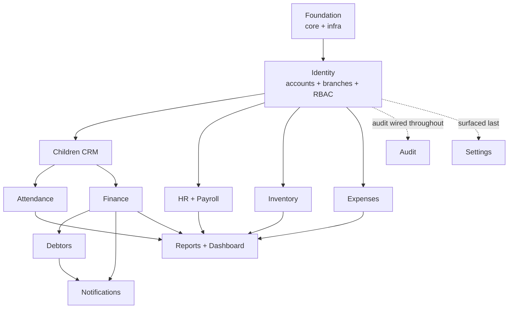

# 06 — Development Roadmap

| | |
|---|---|
| **Project** | Kindergarten Management System (KG-CRM) |
| **Document** | Delivery Plan, Sprints & Build Order v1.0 |
| **Related** | [01_Project_Vision](./01_Project_Vision.md) · [02_Software_Architecture](./02_Software_Architecture.md) · [03_Database_Design](./03_Database_Design.md) · [04_Backend_API_Specification](./04_Backend_API_Specification.md) · [05_Frontend_Architecture](./05_Frontend_Architecture.md) |

> This document turns the design into an **execution plan**: the order to build modules (driven by dependencies, not the UI menu order), sprint-by-sprint goals, Definition of Done, milestones, testing, and risks. It is the answer to "what do we do first, and next?"

---

## Table of Contents
1. [Delivery Approach](#1-delivery-approach)
2. [Team & Roles](#2-team--roles)
3. [Build Order Logic](#3-build-order-logic)
4. [Dependency Graph](#4-dependency-graph)
5. [Sprint Plan](#5-sprint-plan)
6. [Milestones](#6-milestones)
7. [Definition of Done](#7-definition-of-done)
8. [Testing Strategy](#8-testing-strategy)
9. [Branching & CI/CD Workflow](#9-branching--cicd-workflow)
10. [Risk Register](#10-risk-register)
11. [Post-MVP Phases](#11-post-mvp-phases)

---

## 1. Delivery Approach

- **Methodology:** iterative, 2-week sprints, vertical slices (each module shipped end-to-end: DB → API → UI → tests).
- **Vertical over horizontal:** we do **not** build all models, then all APIs, then all UIs. Each sprint delivers a **working, testable module** so value and feedback come early.
- **Dependency-driven order:** foundational modules (auth, RBAC, branch, children) come first because everything else depends on them.
- **Docs-first discipline:** every sprint's work must conform to docs [01–05]; a change to a decision updates the owning doc in the same PR (see [`CLAUDE.md`](../CLAUDE.md)).

**Estimated MVP timeline:** ~9 sprints (~18 weeks) with a small team. Adjust to team size; the *order* is the durable part.

---

## 2. Team & Roles

| Role | Responsibility |
|------|----------------|
| Tech Lead / Architect | Guards the architecture & docs; reviews cross-cutting decisions. |
| Backend Developer(s) | Django apps: models, services, selectors, serializers, views, tasks, tests. |
| Frontend Developer(s) | React features per [05](./05_Frontend_Architecture.md). |
| DevOps (part-time) | Docker, CI/CD, Nginx, server, backups. |
| QA | Test plans, API contract tests, E2E of key flows. |
| Product Owner | Prioritizes backlog against [01_Project_Vision](./01_Project_Vision.md). |

> With a single full-stack developer, run the same sprint order sequentially (backend slice then frontend slice per module).

---

## 3. Build Order Logic

Modules are sequenced by **what depends on what** ([02 §9](./02_Software_Architecture.md) relationships):

1. **Foundation** (`core`, `config`, Docker, CI) — nothing works without it.
2. **Identity** (`accounts` + `branches` + RBAC) — every other endpoint needs auth & scoping.
3. **Children (CRM)** — the central entity referenced by attendance & finance.
4. **Attendance** — depends on children/groups; simple, high-value, good momentum.
5. **Finance** (tariffs → invoices → payments → ledger) — the ERP heart; depends on children.
6. **Debtors** — a derived view; trivial *after* finance exists.
7. **HR & Payroll** — independent of children; can parallel finance if capacity allows.
8. **Inventory** — independent; ledger pattern reused from finance.
9. **Expenses** — small, independent.
10. **Notifications** — cross-cutting; wired once finance/debtors emit events.
11. **Reports & Dashboard** — aggregates everything, so it comes late.
12. **Settings & Audit** — cross-cutting; audit wired incrementally from Sprint 2, settings surfaced last.

---

## 4. Dependency Graph

---

## 5. Sprint Plan

Each sprint delivers a vertical slice meeting the [Definition of Done](#7-definition-of-done).

### Sprint 0 — Foundation & Scaffolding
**Goal:** a running skeleton both stacks build on.
- Repo, `docs/` (done), `CLAUDE.md` (done), branch protection.
- Backend: Django project per [02 §5](./02_Software_Architecture.md) layout; `core` app (base model, envelope, exception handler, pagination); split settings; Docker Compose (web, db, redis, worker, beat); `.env`.
- Frontend: Vite + TS + Tailwind + Shadcn; `app/`, `lib/api` client, providers, router shell; login page stub.
- DevOps: CI (lint, type-check, test), Dockerfiles, Nginx config.
- **Deliverable:** `docker compose up` runs API + SPA; health check green; empty `/api/v1` responds with the envelope.

### Sprint 1 — Identity: Auth, Users, Roles, Branch
**Goal:** secure login and the RBAC backbone.
- DB: `branch`, `user`, `role`, `permission`, `role_permission`, `refresh_token` ([03 §10](./03_Database_Design.md)).
- API: `/auth/*`, `/users`, `/roles`, `/permissions` ([04 §5–6](./04_Backend_API_Specification.md)).
- RBAC: permission classes, branch-scoping mixin, seed the 5 roles + permission matrix ([02 §11](./02_Software_Architecture.md)).
- Frontend: real login, `AuthProvider`, `ProtectedRoute`/`RoleRoute`, `useCan`, AppLayout + Sidebar (permission-filtered), Users & Roles pages.
- Audit: begin logging auth + user/role changes.
- **Deliverable:** users log in, see only permitted nav, and can be managed by Super Admin.

### Sprint 2 — Children (CRM)
**Goal:** manage children, guardians, groups, enrollment.
- DB: `child`, `guardian`, `child_guardian`, `group`, `enrollment` ([03 §11](./03_Database_Design.md)).
- API: `/children`, `/guardians`, `/groups`, `/enrollments`, photo upload ([04 §7](./04_Backend_API_Specification.md)).
- Frontend: `children` feature — list (search/filter), create/edit, detail with guardians & group, enrollment.
- **Deliverable:** full child lifecycle works end-to-end.

### Sprint 3 — Attendance
**Goal:** daily attendance per group.
- DB: `attendance_record` (unique child+date) ([03 §12](./03_Database_Design.md)).
- API: `/attendance`, `/attendance/bulk`, `/attendance/daily`, `/attendance/summary` ([04 §8](./04_Backend_API_Specification.md)).
- Frontend: `attendance` feature — daily register (mark whole group), monthly summary; optimistic toggles.
- **Deliverable:** attendance recorded and viewable; Attendance Manager role validated.

### Sprint 4 — Finance I: Tariffs, Invoices, Ledger
**Goal:** billing foundation on the ledger.
- DB: `tariff_plan`, `discount`, `invoice`, `invoice_line`, `child_ledger_entry` ([03 §13](./03_Database_Design.md)).
- API: `/tariffs`, `/invoices` (incl. `/invoices/generate`), `/discounts`.
- Async: monthly invoice generation (idempotent Celery task).
- Frontend: tariffs admin, invoices list/detail, generate-invoices action.
- **Deliverable:** monthly invoices generate correctly and post charges to the ledger.

### Sprint 5 — Finance II: Payments, Receipts, Debtors
**Goal:** take money and track debt.
- API: `/payments`, `/invoices/{id}/payments`, `/payments/{id}/reverse`, receipts; `/debtors`, `/debtors/{id}/remind` ([04 §9–10](./04_Backend_API_Specification.md)).
- Transactions: locked payment posting (credit ledger entry, update invoice/status/balance) ([03 §25](./03_Database_Design.md)).
- Async: receipt PDF generation.
- Frontend: `payments` feature (record payment, daily summary), `debtors` feature (list, statement, remind).
- **Deliverable:** payment moves a child off the debtor list in real time; reconciles to the cent.

### Sprint 6 — HR & Payroll
**Goal:** staff and monthly payroll.
- DB: `position`, `employee`, `payroll_run`, `payroll_item` ([03 §14](./03_Database_Design.md)).
- API: `/employees`, `/positions`, `/payroll/runs/*` (create, edit items, finalize, mark-paid, payslip).
- Frontend: employees admin, payroll run workflow, payslip.
- **Deliverable:** run monthly payroll, finalize (immutable), produce payslips.

### Sprint 7 — Inventory & Expenses
**Goal:** kitchen/warehouse stock and operational spend.
- DB: `warehouse`, `product_category`, `product`, `supplier`, `stock_movement`; `expense_category`, `expense` ([03 §15–16](./03_Database_Design.md)).
- API: `/products`, `/stock-movements` (locked stock-out), `/suppliers`, low-stock; `/expenses` (approval), `/expense-categories`.
- Frontend: `inventory` feature (products, movements, suppliers, low-stock), `expenses` feature (record, approve).
- **Deliverable:** stock in/out with no-negative-stock guard; expense approval workflow.

### Sprint 8 — Notifications & Settings
**Goal:** communication + configuration.
- DB: `notification_template`, `notification`, `system_setting` ([03 §17–18](./03_Database_Design.md)).
- API: `/notifications/*`, `/notification-templates`, `/settings`, `/branches`.
- Async: SMS dispatch adapter + delivery log/retries; scheduled debt reminders (Beat).
- Wire events: payment received → SMS receipt; overdue → reminder.
- Frontend: `notifications` feature (log, templates, send), `settings` feature.
- **Deliverable:** SMS sent on payment and for debt reminders, with delivery status.

### Sprint 9 — Reports, Dashboard & Hardening
**Goal:** visibility + release readiness.
- DB: materialized views `mv_dashboard_kpi`, `mv_monthly_pl`; views `v_debtor`, `v_daily_cash` ([03 §24](./03_Database_Design.md)).
- API: `/dashboard`, `/reports/*` (+ async exports), `/audit-logs`.
- Async: MV refresh jobs (Beat), export generation.
- Frontend: `dashboard` (Recharts KPIs), `reports` (with export), audit log viewer.
- Hardening: rate limiting, security headers, load/index review, backup/restore test, E2E of the 10 success criteria ([01 §8](./01_Project_Vision.md)).
- **Deliverable:** MVP release candidate — all [01](./01_Project_Vision.md) success criteria pass.

---

## 6. Milestones

| Milestone | After | Meaning |
|-----------|-------|---------|
| **M0 — Skeleton** | Sprint 0 | Both stacks build & deploy. |
| **M1 — Secure shell** | Sprint 1 | Auth + RBAC + user management live. |
| **M2 — CRM ready** | Sprint 3 | Children + attendance usable daily. |
| **M3 — Money works** | Sprint 5 | Billing, payments, debtors reconcile — the core business value. |
| **M4 — Operations complete** | Sprint 8 | Payroll, inventory, expenses, notifications live. |
| **M5 — MVP release** | Sprint 9 | Dashboard/reports + hardening; success criteria met. |

---

## 7. Definition of Done

A module/feature is **Done** only when **all** hold:

- [ ] Conforms to docs [02](./02_Software_Architecture.md)–[05](./05_Frontend_Architecture.md) (structure, contracts, conventions).
- [ ] DB objects match [03](./03_Database_Design.md): constraints, indexes, ON DELETE, soft-delete/append-only rules.
- [ ] Business logic in `services.py`; reads in `selectors.py`; views thin.
- [ ] Endpoints match [04](./04_Backend_API_Specification.md): envelope, error format, pagination/filter/sort, **RBAC enforced**, branch-scoped.
- [ ] Money/stock operations are transactional and audited.
- [ ] Backend tests: service unit tests + API tests (happy path + permission denial + validation).
- [ ] Frontend: typed via Zod, loading/error/empty states, permission-gated UI.
- [ ] No N+1 queries on list endpoints (verified).
- [ ] Docs updated if any decision changed; PR reviewed and green in CI.

---

## 8. Testing Strategy

| Layer | Tool | What |
|-------|------|------|
| Backend unit | pytest | Services & selectors (business rules, ledger math, stock guards). |
| Backend API | pytest + DRF client | Per endpoint: success, `403` (RBAC), `400` (validation), `422` (business rule), branch isolation. |
| DB integrity | pytest | Constraints fire (duplicate invoice period, overpayment, negative stock, unique attendance). |
| Frontend unit | Vitest + Testing Library | Components, hooks, form validation. |
| Contract | Schema/OpenAPI check | Frontend types stay in sync with [04](./04_Backend_API_Specification.md). |
| E2E (key flows) | Playwright (from Sprint 5) | Enroll → invoice → pay → off debtor list; attendance; payroll run. |
| Performance | Query profiling | Index coverage, N+1 detection on list endpoints. |

**Critical test focus (money):** billing idempotency, no double-charge, payment reconciliation to the ledger, debtor correctness, no negative stock.

---

## 9. Branching & CI/CD Workflow

- **Branches:** `feature/…`, `fix/…`, `chore/…`; protected `main`; PR + review required.
- **Commits:** Conventional Commits (`feat:`, `fix:`, `refactor:`, `docs:`).
- **CI (on PR):** lint (ruff/eslint), type-check (mypy/tsc), tests (pytest/vitest), build images.
- **CD (on merge to main):** build & push images → deploy to Linux server; **migrations run as an explicit step**, never on boot ([02 §23](./02_Software_Architecture.md)).
- **Backups:** automated Postgres backup + tested restore before each release.

---

## 10. Risk Register

| Risk | Impact | Mitigation |
|------|--------|-----------|
| Financial calculation errors | High (trust) | Ledger as source of truth; heavy money tests; audit log; reconciliation job. |
| Scope creep from future modules | Medium | [01](./01_Project_Vision.md) non-goals are firm; future work is additive per [02 §22](./02_Software_Architecture.md). |
| SMS provider unreliability | Medium | Async dispatch + retries + delivery log; provider behind an adapter (swap without code changes). |
| RBAC gaps | High (security) | Deny-by-default; every endpoint tested for `403`; backend is the authority. |
| Context loss / conflicting decisions | Medium | The docs system + `CLAUDE.md`; docs updated in the same PR as code. |
| Performance under data growth | Medium | Indexes from [03 §22](./03_Database_Design.md); partition candidates identified; reports on MVs. |
| Single-server availability | Low (MVP) | Stateless API enables scale-out later; backups + monitoring now. |

---

## 11. Post-MVP Phases

Sequenced by value and readiness; each is **additive** (new app/feature + roles), not a refactor ([02 §22](./02_Software_Architecture.md)).

| Phase | Modules | Enabled by (already designed) |
|-------|---------|-------------------------------|
| **P1** | Multiple Branches (enable) | `branch_id` everywhere. |
| **P2** | Online Payments | Ledger + payment-gateway adapter + webhook. |
| **P3** | Parent Portal | Data-driven RBAC (Parent role) + guardian↔user link + existing selectors. |
| **P4** | Teacher Portal | Employee↔user link + Teacher role. |
| **P5** | Meal Planning + Medical Records | Inventory (stock consumption) + child-linked apps. |
| **P6** | Homework / LMS + Gallery | New apps on storage abstraction + portals. |
| **P7** | AI Assistant + Advanced Analytics | Read selectors + Celery + read replica / warehouse. |
| **P8** | Mobile App | Same `/api/v1`, stateless JWT. |

---

## Summary

Build **foundation → identity → children → attendance → finance → debtors → payroll → inventory → expenses → notifications → reports/dashboard**, each as a vertical slice meeting the Definition of Done, all conforming to docs [01](./01_Project_Vision.md)–[05](./05_Frontend_Architecture.md). Money correctness is the highest bar. After M5, the roadmap's future modules arrive as new folders, not rewrites.

*End of Development Roadmap v1.0.*
